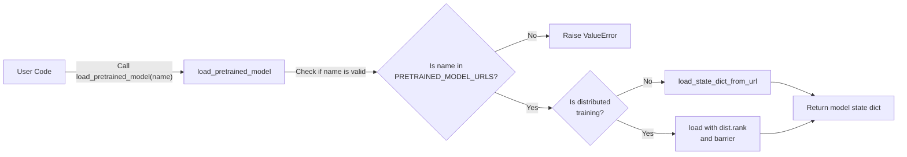
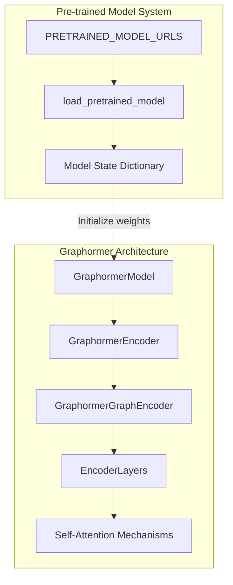
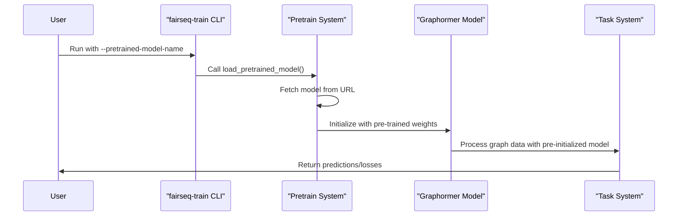
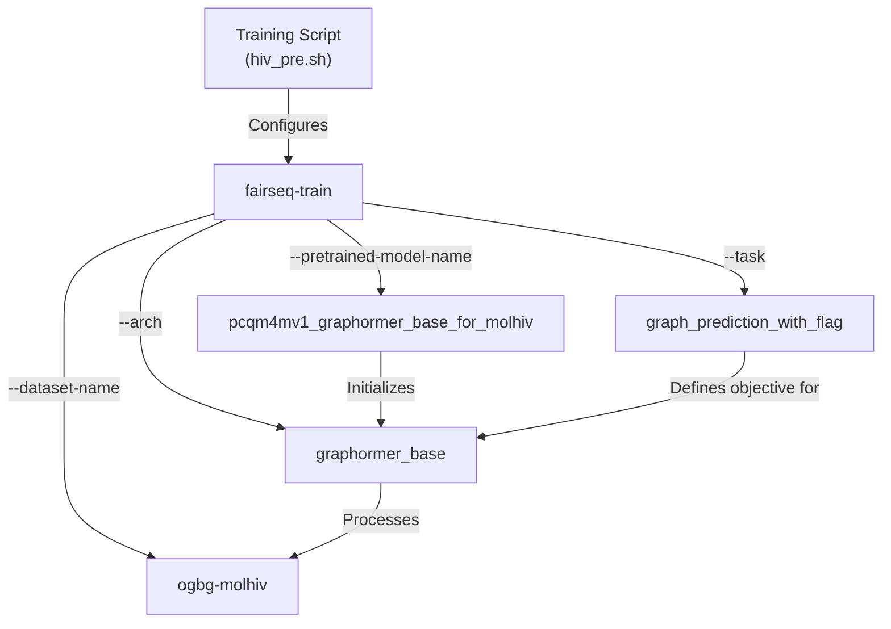

<!-- source: DeepWiki mcp.deepwiki.com · repo microsoft/Graphormer · page 6.1 Using Pre-trained Models · fetched 2026-10-26 -->

# Using Pre-trained Models

<details>
<summary>Relevant source files</summary>

The following files were used as context for generating this wiki page:

- [examples/property_prediction/hiv_pre.sh](examples/property_prediction/hiv_pre.sh)
- [graphormer/pretrain/__init__.py](graphormer/pretrain/__init__.py)

</details>


This document details how to leverage pre-trained Graphormer models for various graph learning tasks. Pre-trained models allow you to benefit from models already trained on large datasets, which can significantly reduce training time and improve performance on downstream tasks through transfer learning.

For information on training your own models from scratch, see [Training and Evaluation](#7).

## Available Pre-trained Models

Graphormer provides several pre-trained models specialized for different tasks. These models are hosted in the Microsoft Azure Blob Storage and can be loaded directly via the provided API.

| Model Name | Description | Dataset | Use Case |
|------------|-------------|---------|----------|
| `pcqm4mv1_graphormer_base` | Base model trained on PCQM4Mv1 | PCQM4Mv1 | General molecular property prediction |
| `pcqm4mv2_graphormer_base` | Updated base model trained on PCQM4Mv2 | PCQM4Mv2 | General molecular property prediction |
| `oc20is2re_graphormer3d_base` | 3D model for catalyst modeling | OC20 | Initial Structure to Relaxed Energy prediction |
| `pcqm4mv1_graphormer_base_for_molhiv` | Specialized base model for HIV prediction | PCQM4Mv1 | HIV property prediction |

Sources: [graphormer/pretrain/__init__.py:4-9]()

## Loading Pre-trained Models

Graphormer provides a simple API to load pre-trained models through the `load_pretrained_model` function.



The loading process works as follows:

1. Call the `load_pretrained_model` function with the name of the desired pre-trained model
2. The function checks if the model name is valid
3. Based on whether distributed training is being used, it loads the model state dictionary
4. Returns the model state dictionary that can be loaded into a Graphormer model

Example code to load a pre-trained model:

```python
from graphormer.pretrain import load_pretrained_model

# Load the PCQM4Mv2 pre-trained model
model_state_dict = load_pretrained_model("pcqm4mv2_graphormer_base")
```

Sources: [graphormer/pretrain/__init__.py:11-19]()

## Pre-trained Model Integration

The following diagram illustrates how pre-trained models integrate into the Graphormer architecture:



When using a pre-trained model, the weights from the pre-trained model state dictionary are loaded into the Graphormer model architecture before training or inference, initializing the model with learned representations.

Sources: [graphormer/pretrain/__init__.py:11-19]()

## Using Pre-trained Models for Downstream Tasks

Pre-trained models can be used for various downstream tasks by specifying the pre-trained model name in the training configuration. The workflow for using pre-trained models is as follows:



When using a pre-trained model for a downstream task:

1. The model architecture should match or be compatible with the pre-trained model's architecture
2. The task-specific head may be randomly initialized while the backbone uses pre-trained weights
3. You can fine-tune all parameters or freeze certain layers depending on your needs

Sources: [graphormer/pretrain/__init__.py:11-19](), [examples/property_prediction/hiv_pre.sh:35]()

## Example: HIV Property Prediction with Pre-trained Model

The Graphormer repository includes an example script for HIV property prediction using a pre-trained model. Here's how it's configured:



Key configuration parameters for using the pre-trained model:

| Parameter | Value in Example | Purpose |
|-----------|------------------|---------|
| `--pretrained-model-name` | `pcqm4mv1_graphormer_base_for_molhiv` | Specifies which pre-trained model to use |
| `--arch` | `graphormer_base` | Defines the architecture (must be compatible with pre-trained model) |
| `--encoder-layers` | `12` | Number of transformer encoder layers |
| `--encoder-embed-dim` | `768` | Dimension of embeddings |
| `--encoder-attention-heads` | `32` | Number of attention heads |

The full training command can be found in the HIV prediction example script.

Sources: [examples/property_prediction/hiv_pre.sh:1-40]()

## Best Practices for Using Pre-trained Models

When using pre-trained models with Graphormer, consider the following best practices:

1. **Model compatibility**: Ensure that your architecture configuration matches the pre-trained model architecture
2. **Learning rate**: Use a smaller learning rate when fine-tuning pre-trained models (example uses 2e-4)
3. **Warmup updates**: Gradually increase the learning rate during early training (example uses 16% of total updates)
4. **Task adaptation**: For classification tasks like HIV prediction, use appropriate loss functions (e.g., `binary_logloss_with_flag`)
5. **Epochs**: Pre-trained models typically require fewer training epochs (example uses 4 epochs)

These practices help ensure effective knowledge transfer from the pre-trained model to your specific task.

Sources: [examples/property_prediction/hiv_pre.sh:6-26]()

## Troubleshooting

If you encounter issues with pre-trained models, consider the following:

1. **Model availability**: Some models may be temporarily unavailable (as noted in the comments for `oc20is2re_graphormer3d_base`)
2. **Distributed training**: When using distributed training, the pre-trained model loading process uses rank-specific file names
3. **Memory requirements**: Pre-trained models may have large memory footprints, so ensure your hardware has sufficient resources
4. **Version compatibility**: Ensure your Graphormer version is compatible with the pre-trained model you're trying to use

Sources: [graphormer/pretrain/__init__.py:7](), [graphormer/pretrain/__init__.py:14-19]()

---

