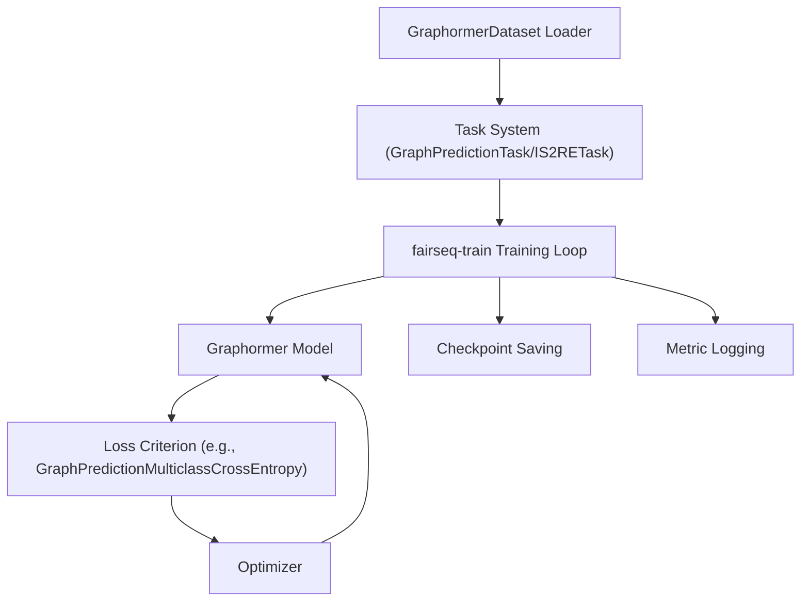
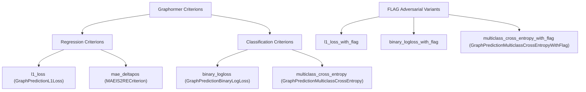
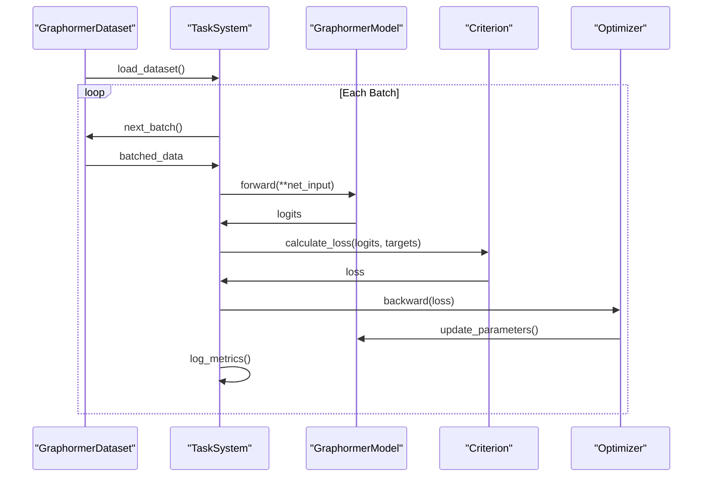
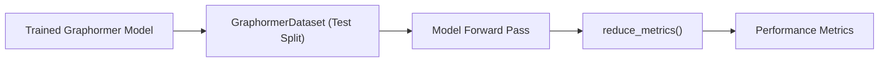
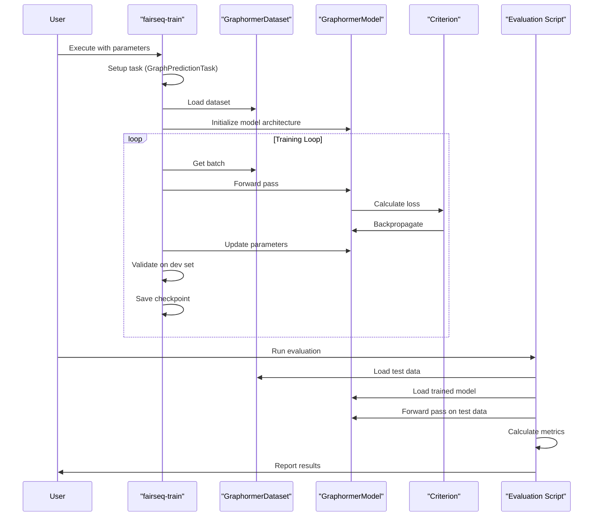

<!-- source: DeepWiki mcp.deepwiki.com · repo microsoft/Graphormer · page 7 Training and Evaluation · fetched 2026-10-26 -->

# Training and Evaluation

<details>
<summary>Relevant source files</summary>

The following files were used as context for generating this wiki page:

- [docs/Parameters.rst](docs/Parameters.rst)
- [graphormer/criterions/multiclass_cross_entropy.py](graphormer/criterions/multiclass_cross_entropy.py)

</details>


This document details the procedures and tools for training and evaluating Graphormer models. It focuses on the command-line interfaces, configuration parameters, and execution workflows. For specific configuration options, see [Training Configuration](#7.1) and [Evaluation Process](#7.2).

## Training Framework Overview

Graphormer extends the Fairseq training framework, utilizing `fairseq-train` with graph-specific parameters. The training system integrates various components for model training and evaluation:



Sources: docs/Parameters.rst

## Command-line Interface

As documented in the parameters reference, Graphormer reuses the `fairseq-train` command-line tools from the Fairseq library:

> Graphormer reuses the `fairseq-train` command-line tools of fairseq for training, and here we mainly document the additional parameters in Graphormer and parameters of `fairseq-train` used by Graphormer.

The basic command structure is:

```bash
fairseq-train [options]
```

Sources: docs/Parameters.rst:6-7

## Training Parameters Configuration

The following table outlines essential parameters for training Graphormer models:

| Category | Parameter | Options/Type | Description |
|----------|-----------|--------------|-------------|
| Task | `--task` | graph_prediction, is2re | Task type for training |
| Model | `--arch` | graphormer_base, graphormer_slim, graphormer_large | Graphormer architecture |
| Loss | `--criterion` | l1_loss, binary_logloss, multiclass_cross_entropy | Loss function |
| Optimization | `--optimizer` | adam, adamw | Optimizer type |
| Optimization | `--lr` | float | Learning rate |
| Optimization | `--lr-scheduler` | polynomial_decay, cosine | Learning rate scheduler |
| Training | `--batch-size` | int | Batch size |
| Training | `--max-epoch` | int | Maximum training epochs |
| Training | `--save-dir` | string | Directory to save checkpoints |
| Training | `--fp16` | bool | Enable mixed precision training |
| Pretrained | `--pretrained-model-name` | pcqm4mv1_graphormer_base, pcqm4mv2_graphormer_base | Pretrained model name |

Sources: docs/Parameters.rst:56-147

## Loss Functions (Criterions)

Graphormer implements various loss functions for different task types. The criterion selection is made via the `--criterion` parameter:



The implementation of multiclass cross-entropy loss can be found in [graphormer/criterions/multiclass_cross_entropy.py](). This file includes:

- Standard implementation in the `GraphPredictionMulticlassCrossEntropy` class
- FLAG-augmented version in the `GraphPredictionMulticlassCrossEntropyWithFlag` class

Sources: graphormer/criterions/multiclass_cross_entropy.py, docs/Parameters.rst:66-82

## Training Data Flow

The training data flow in Graphormer follows this sequence:



In the multiclass cross-entropy criterion, for example, the forward method processes each batch by:
1. Computing logits from the model
2. Getting targets from the sample
3. Calculating correct predictions
4. Computing the loss
5. Returning the loss and logging outputs

Sources: graphormer/criterions/multiclass_cross_entropy.py:18-47

## Evaluation Process

Model evaluation calculates task-specific metrics on validation/test data:



### Evaluation Metrics

The metrics depend on the task type:

| Task Type | Primary Metric | Implementation |
|-----------|----------------|----------------|
| Regression | Mean Absolute Error (MAE) | `l1_loss` criterion |
| Binary Classification | Accuracy | `binary_logloss` criterion |
| Multiclass Classification | Accuracy | `multiclass_cross_entropy` criterion |

For multiclass classification, accuracy is calculated by comparing predicted classes with targets:

```python
ncorrect = (torch.argmax(logits, dim=-1).reshape(-1) == targets.reshape(-1)).sum()
```

Metrics are aggregated using the `reduce_metrics` static method of each criterion class. For the multiclass cross-entropy criterion, this is implemented in [graphormer/criterions/multiclass_cross_entropy.py:49-60]():

```python
@staticmethod
def reduce_metrics(logging_outputs) -> None:
    """Aggregate logging outputs from data parallel training."""
    loss_sum = sum(log.get("loss", 0) for log in logging_outputs)
    sample_size = sum(log.get("sample_size", 0) for log in logging_outputs)

    metrics.log_scalar("loss", loss_sum / sample_size, sample_size, round=3)
    if len(logging_outputs) > 0 and "ncorrect" in logging_outputs[0]:
        ncorrect = sum(log.get("ncorrect", 0) for log in logging_outputs)
        metrics.log_scalar(
            "accuracy", 100.0 * ncorrect / sample_size, sample_size, round=1
        )
```

Sources: graphormer/criterions/multiclass_cross_entropy.py:34-60

## Example Training Workflow

A complete training and evaluation workflow:



### Example Command

```bash
fairseq-train --task graph_prediction \
    --criterion l1_loss \
    --arch graphormer_base \
    --optimizer adam \
    --lr 0.0001 \
    --lr-scheduler polynomial_decay \
    --batch-size 32 \
    --max-epoch 100 \
    --save-dir checkpoints/ \
    --dataset-name pcqm4m \
    --dataset-source ogb
```

Sources: docs/Parameters.rst

## Advanced Training Features

### Pretrained Model Usage

Graphormer provides pretrained models that can be used for transfer learning:

```bash
fairseq-train --pretrained-model-name pcqm4mv2_graphormer_base \
    --load-pretrained-model-output-layer
```

Available pretrained models:
- `pcqm4mv1_graphormer_base`: Trained on PCQM4M v1 dataset
- `pcqm4mv2_graphormer_base`: Trained on PCQM4M v2 dataset

Sources: docs/Parameters.rst:104-114

### FLAG Adversarial Training

FLAG (Free Large-scale Adversarial Augmentation) is supported via specialized criterions with the "_with_flag" suffix:

```bash
fairseq-train --criterion multiclass_cross_entropy_with_flag
```

The implementation of FLAG for multiclass classification is in [graphormer/criterions/multiclass_cross_entropy.py:72-108](). The key difference in the FLAG implementation is the use of the `perturb` parameter during the forward pass:

```python
perturb = sample.get("perturb", None)
logits = model(**sample["net_input"], perturb=perturb)
```

Sources: docs/Parameters.rst:78-82, docs/Parameters.rst:209, graphormer/criterions/multiclass_cross_entropy.py:72-108

### Performance Optimization

To improve training speed, mixed precision training is available:

```bash
fairseq-train --fp16
```

Data loading can be optimized with buffer size parameter:

```bash
fairseq-train --data-buffer-size 10
```

Sources: docs/Parameters.rst:128-134

## Conclusion

This page covered the technical aspects of training and evaluating Graphormer models, including command-line parameters, loss functions, and the training/evaluation workflow. The implementation leverages Fairseq's infrastructure while adding graph-specific components to handle graph-structured data effectively.

---

