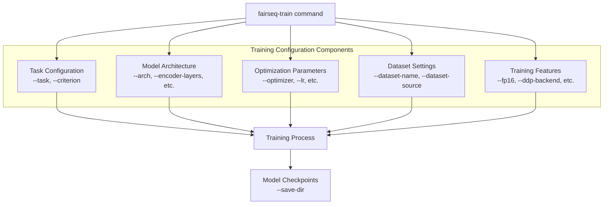
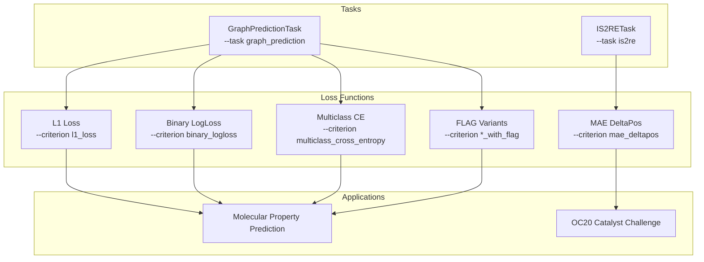
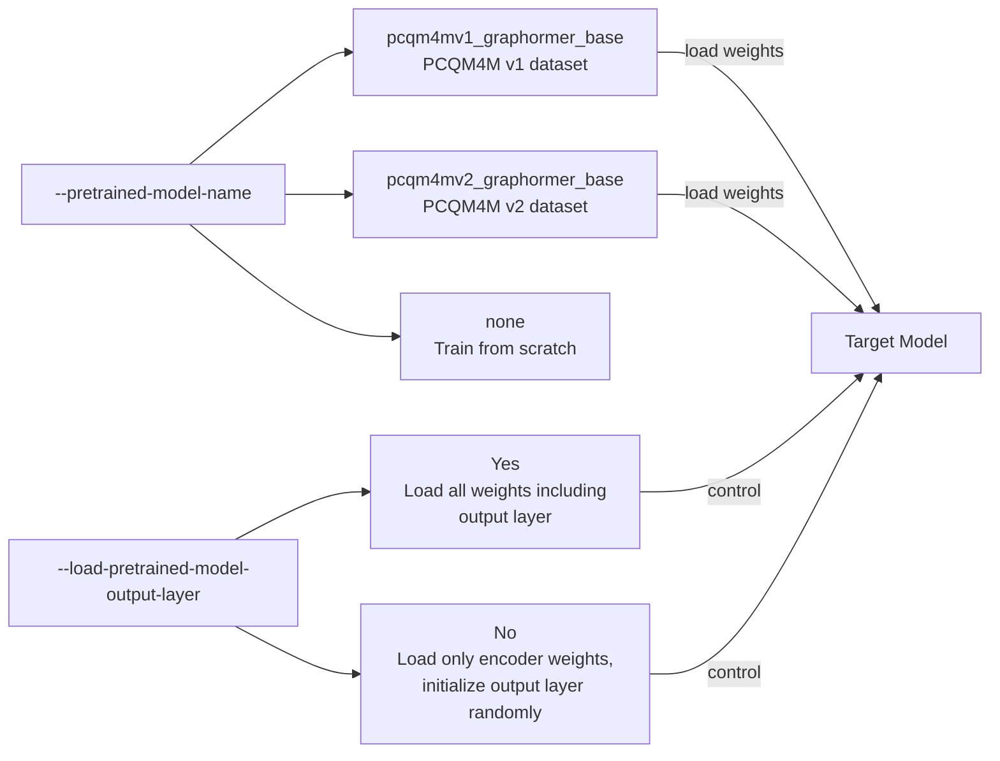

<!-- source: DeepWiki mcp.deepwiki.com · repo microsoft/Graphormer · page 7.1 Training Configuration · fetched 2026-10-26 -->

# Training Configuration

<details>
<summary>Relevant source files</summary>

The following files were used as context for generating this wiki page:

- [docs/Parameters.rst](docs/Parameters.rst)
- [examples/oc20/oc20.sh](examples/oc20/oc20.sh)
- [examples/property_prediction/pcqv1.sh](examples/property_prediction/pcqv1.sh)
- [examples/property_prediction/pcqv2.sh](examples/property_prediction/pcqv2.sh)
- [graphormer/criterions/multiclass_cross_entropy.py](graphormer/criterions/multiclass_cross_entropy.py)

</details>


This page describes the configuration options and parameters for training Graphormer models. It covers all aspects of model training, from basic settings like task selection and loss functions to advanced options like mixed precision training and optimization parameters. For information about evaluating trained models, see [Evaluation Process](#7.2).

## Training Framework Overview

Graphormer leverages the `fairseq-train` command-line tool from the Fairseq framework for model training. The training configuration is controlled through command-line arguments that specify the task, dataset, model architecture, optimization parameters, and other training settings.



Sources: [docs/Parameters.rst:5-7](). [examples/property_prediction/pcqv2.sh:7-24]()

## Task and Criterion Configuration

The first step in configuring Graphormer training is to specify the task and criterion (loss function) appropriate for your application.

### Task Selection

The `--task` parameter defines the type of graph prediction task:

- `graph_prediction`: Standard graph-level prediction task where the goal is to predict a property for the entire graph
- `is2re`: Initial Structure to Relaxed Energy task for catalyst modeling in the Open Catalyst Challenge

### Loss Functions

The `--criterion` parameter specifies the loss function:

| Criterion | Description | Application |
|-----------|-------------|-------------|
| `l1_loss` | Mean Absolute Error (MAE) | Regression tasks |
| `binary_logloss` | Binary Cross Entropy | Binary classification |
| `multiclass_cross_entropy` | Multi-class Cross Entropy | Multi-class classification |
| `mae_deltapos` | Custom loss for IS2RE | OC20 catalyst challenge |
| `*_with_flag` variants | Loss functions with FLAG augmentation | Improved training with perturbations |



Sources: [docs/Parameters.rst:56-82](). [graphormer/criterions/multiclass_cross_entropy.py:12-108]()

## Model Architecture Configuration

Graphormer provides several architecture options, from pre-defined architectures to fine-grained control over specific components.

### Pre-defined Architectures

Use the `--arch` parameter to select a pre-defined architecture:

- `graphormer_base`: Standard architecture with balanced performance and size
- `graphormer_slim`: Smaller model requiring fewer computational resources
- `graphormer_large`: Larger model with potentially higher performance

### Architecture Components

Fine-grained control is available through these parameters:

| Parameter | Description | Default |
|-----------|-------------|---------|
| `--encoder-layers` | Number of Graphormer encoder layers | Depends on architecture |
| `--encoder-embed-dim` | Encoder embedding dimension | Depends on architecture |
| `--encoder-ffn-embed-dim` | Encoder FFN embedding dimension | Depends on architecture |
| `--encoder-attention-heads` | Number of attention heads | Depends on architecture |
| `--activation-fn` | Activation function (`gelu` or `relu`) | `gelu` |
| `--encoder-normalize-before` | Apply layer normalization before encoder blocks | Not set by default |

Sources: [docs/Parameters.rst:9-54](). [examples/property_prediction/pcqv1.sh:12-25]()

## Pre-trained Models

Graphormer supports transfer learning through pre-trained models:



Sources: [docs/Parameters.rst:104-114]()

## Optimization Parameters

Proper optimization settings are crucial for effective model training.

### Optimizer and Learning Rate

- `--optimizer`: Select optimizer (e.g., `adam`)
- `--lr`: Set base learning rate
- `--lr-scheduler`: Choose learning rate scheduler (e.g., `polynomial_decay`)
- `--warmup-updates`: Number of warmup steps
- `--total-num-update`: Total number of updates for schedulers
- `--clip-norm`: Gradient clipping norm
- `--weight-decay`: Weight decay coefficient

### Training Process Control

- `--batch-size`: Number of examples in a batch
- `--max-epoch`: Force stop training at specified epoch
- `--update-freq`: Accumulate gradients across multiple batches
- `--seed`: Random seed for reproducibility

```mermaid
graph TD
    subgraph "Optimization Configuration"
        OPT["--optimizer"] --> ADAM["adam"]
        LR["--lr"] --> RATE["Learning Rate Value"]
        SHED["--lr-scheduler"] --> POLY["polynomial_decay"]
        SHED --> IWSQ["inverse_sqrt"]
        
        WARM["--warmup-updates"] --> STEPS["Warmup Steps"]
        TOTAL["--total-num-update"] --> UPDATES["Total Updates"]
        
        CLIP["--clip-norm"] --> NORM["Gradient Norm"]
        DECAY["--weight-decay"] --> WD["Weight Decay Value"]
    end
    
    subgraph "Training Process"
        BATCH["--batch-size"] --> BS["Batch Size"]
        MAXE["--max-epoch"] --> EPOCHS["Maximum Epochs"]
        SEED["--seed"] --> RNG["Random Seed"]
        UPDATEF["--update-freq"] --> ACCUM["Gradient Accumulation"]
    end
    
    OPT & LR & SHED & WARM & TOTAL & CLIP & DECAY --> TrainProcess["Training Process"]
    BATCH & MAXE & SEED & UPDATEF --> TrainProcess
```



Sources: [docs/Parameters.rst:117-146](). [examples/oc20/oc20.sh:5-50]()

## Advanced Training Features

### Mixed Precision Training

- `--fp16`: Enable mixed precision training for faster computation and reduced memory usage

### Distributed Training

- `--ddp-backend`: Backend for distributed training (`legacy_ddp`, `c10d`, etc.)
- `--num-workers`: Number of data loading workers

### Checkpointing and Logging

- `--save-dir`: Path to save checkpoints
- `--save-interval-updates`: Save checkpoint every N updates
- `--keep-interval-updates`: Keep the last N checkpoints
- `--tensorboard-logdir`: Path for TensorBoard logs

Sources: [docs/Parameters.rst:128-146](). [examples/oc20/oc20.sh:36-50]()

## Dataset Configuration

Dataset-specific parameters control how graph data is processed during training:

- `--dataset-name`: Name of the dataset (e.g., `pcqm4m`, `pcqm4mv2`)
- `--dataset-source`: Source of the dataset (`ogb`, `pyg`, `dgl`)
- `--num-classes`: Number of prediction targets
- `--data-buffer-size`: Number of batches to preload

Additional dataset structural parameters:
- `--num-atoms`: Maximum number of atom types
- `--num-edges`: Maximum number of edge types
- `--num-in-degree`, `--num-out-degree`: Number of in/out degree types
- `--multi-hop-max-dist`: Maximum distance for multi-hop edges
- `--spatial-pos-max`: Maximum spatial position

Sources: [docs/Parameters.rst:149-206]()

## Example Training Commands

### Molecular Property Prediction (PCQM4Mv2)

```
fairseq-train \
--user-dir ../../graphormer \
--num-workers 16 \
--ddp-backend=legacy_ddp \
--dataset-name pcqm4mv2 \
--dataset-source ogb \
--task graph_prediction \
--criterion l1_loss \
--arch graphormer_base \
--num-classes 1 \
--attention-dropout 0.1 --act-dropout 0.1 --dropout 0.0 \
--optimizer adam --adam-betas '(0.9, 0.999)' --adam-eps 1e-8 --clip-norm 5.0 --weight-decay 0.0 \
--lr-scheduler polynomial_decay --power 1 --warmup-updates 60000 --total-num-update 1000000 \
--lr 2e-4 --end-learning-rate 1e-9 \
--batch-size 256 \
--fp16 \
--data-buffer-size 20 \
--save-dir ./ckpts
```

Sources: [examples/property_prediction/pcqv2.sh:7-24]()

### Catalyst Modeling (OC20)

```
fairseq-train --user-dir ../../graphormer  \
       /home/$USER/ocp/data/is2re/all --valid-subset val_id,val_ood_ads,val_ood_cat,val_ood_both --best-checkpoint-metric loss \
       --num-workers 0 --ddp-backend=c10d \
       --task is2re --criterion mae_deltapos --arch graphormer3d_base  \
       --optimizer adam --adam-betas '(0.9, 0.98)' --adam-eps 1e-6 --clip-norm $clip_norm \
       --lr-scheduler polynomial_decay --lr $lr --warmup-updates $warmup_steps --total-num-update $total_steps --batch-size $batch_size \
       --dropout 0.0 --attention-dropout 0.1 --weight-decay 0.001 --update-freq $update_freq --seed $seed \
       --fp16 --fp16-init-scale 4 --fp16-scale-window 256 --tensorboard-logdir $tsb_dir \
       --embed-dim $hidden_size --ffn-embed-dim $hidden_size --attention-heads $num_head \
       --max-update $total_steps --log-interval 100 --log-format simple \
       --save-interval-updates 5000 --validate-interval-updates 2500 --keep-interval-updates 30 --no-epoch-checkpoints  \
       --save-dir $save_dir --layers $layers --blocks $blocks --required-batch-size-multiple 1  --node-loss-weight $node_loss_weight
```

Sources: [examples/oc20/oc20.sh:39-50]()

## Configuration Best Practices

- **Architecture Selection**: Start with `graphormer_base` for most applications, then scale up or down based on dataset size and computational resources
- **Learning Rate**: Typical values range from 1e-4 to 5e-4, with warmup steps of 5-10% of total updates
- **Batch Size**: Adjust based on available GPU memory; larger batch sizes generally improve training stability
- **Mixed Precision**: Enable `--fp16` for faster training and reduced memory usage on modern GPUs
- **Regularization**: Adjust dropout rates (`--attention-dropout`, `--act-dropout`, `--dropout`) based on overfitting/underfitting

This comprehensive configuration system allows for fine-tuned control over the training process, enabling optimal performance across various graph learning tasks.

---

