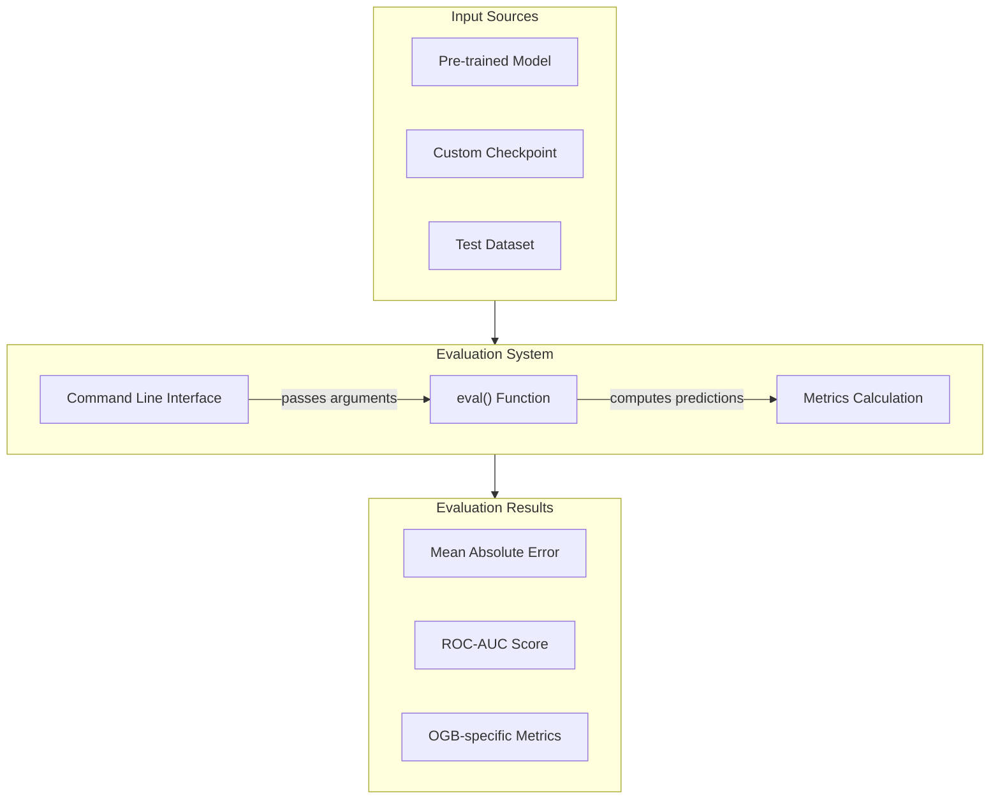
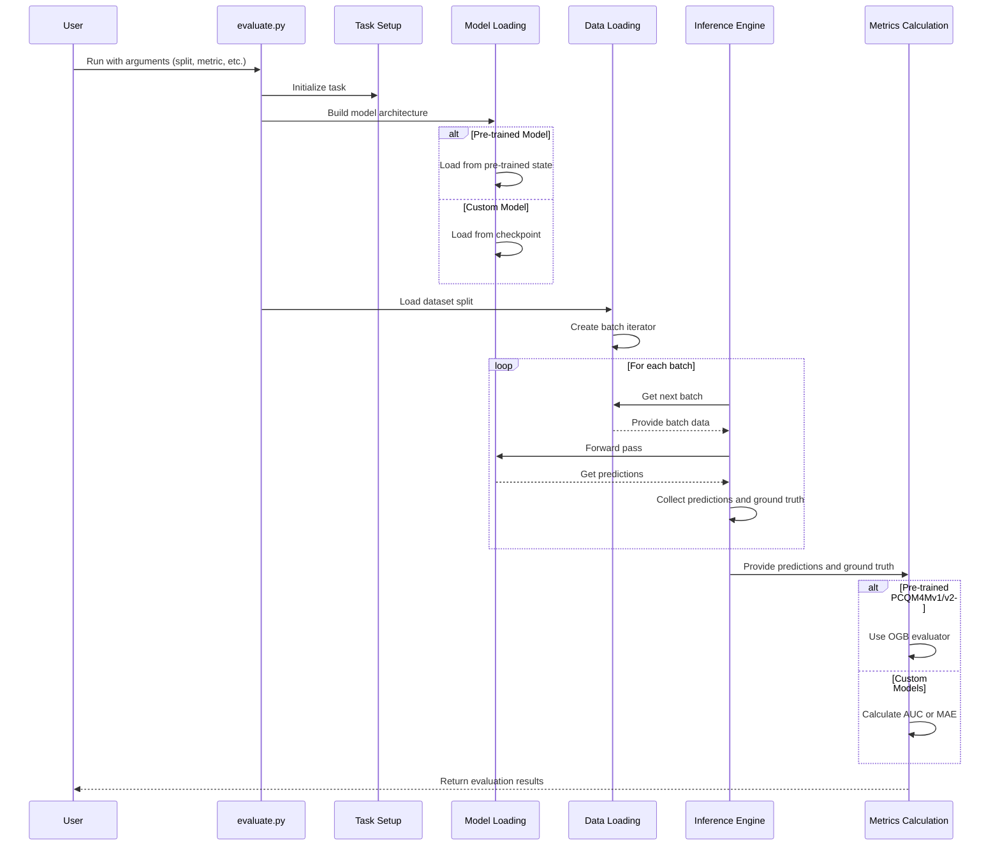
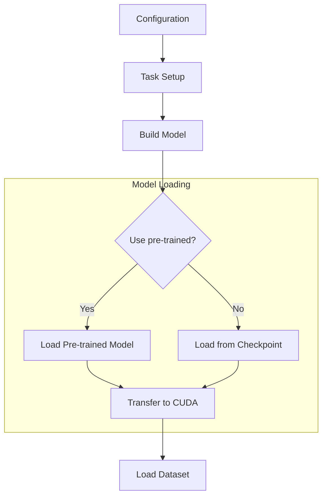
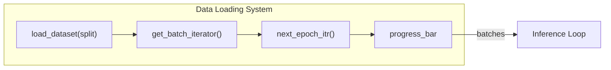
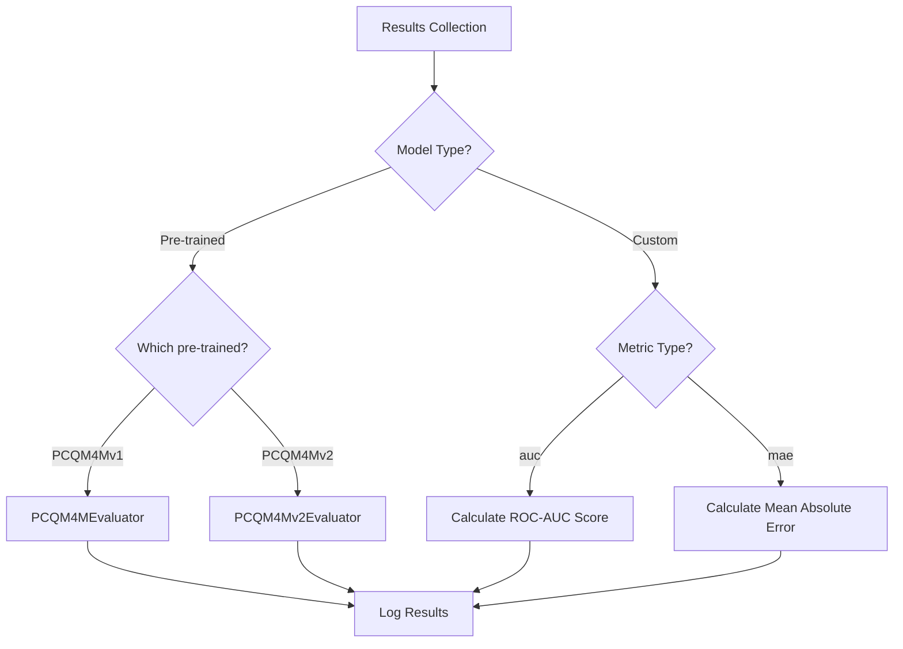
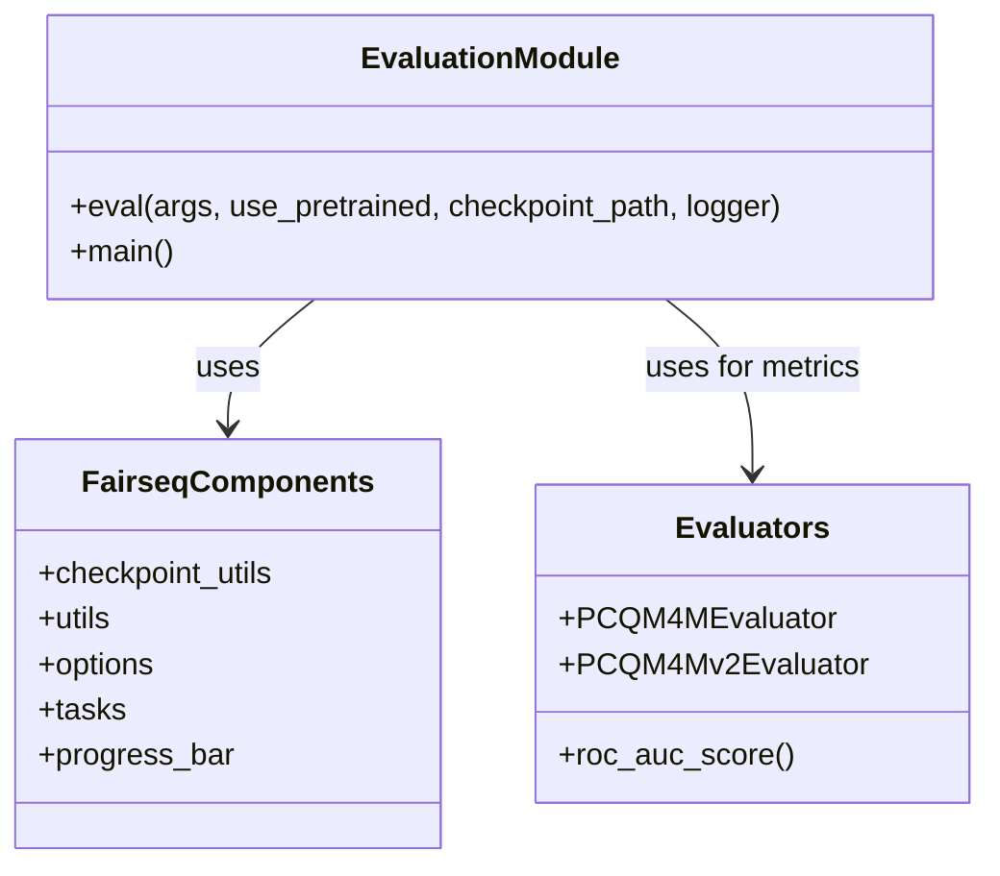
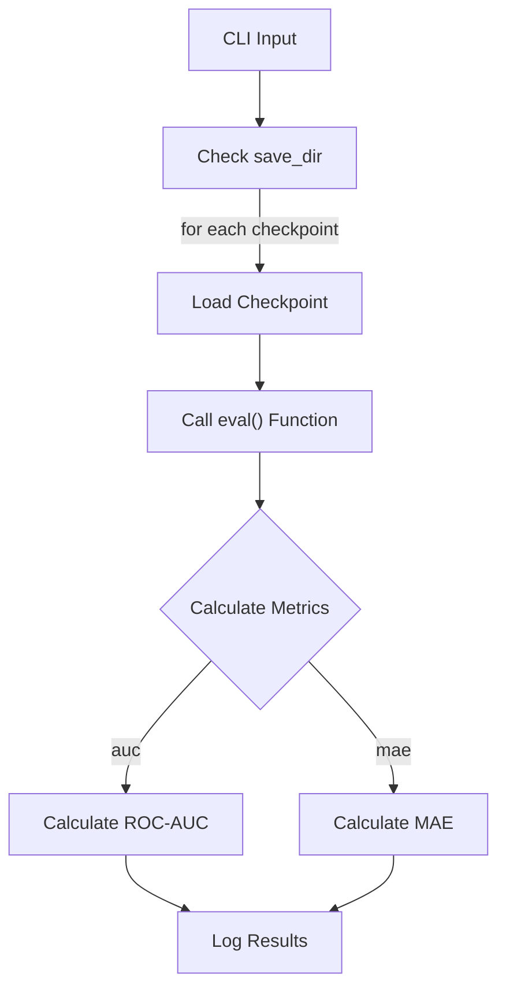

<!-- source: DeepWiki mcp.deepwiki.com · repo microsoft/Graphormer · page 7.2 Evaluation Process · fetched 2026-10-26 -->

# Evaluation Process

Relevant source files

The following files were used as context for generating this wiki page:

- [graphormer/evaluate/evaluate.py](graphormer/evaluate/evaluate.py)

## Purpose

This document describes the evaluation process for Graphormer models, detailing how to assess model performance on graph prediction tasks. It covers both pre-trained and custom-trained model evaluation, available metrics, and the evaluation workflow. For information about training configuration, see [Training Configuration](#7.1).

## Evaluation System Overview

The Graphormer evaluation system provides a standardized way to measure model performance across different graph-related tasks. It supports evaluation of both pre-trained models (provided with the repository) and custom-trained models (from user checkpoints).

Sources: [graphormer/evaluate/evaluate.py:20-105]()

## Evaluation Workflow

The evaluation process follows a structured workflow from model loading to metrics calculation:

Sources: [graphormer/evaluate/evaluate.py:20-105]()

## Model Preparation and Loading

The evaluation process begins with setting up the task and model. The system supports two methods for model loading:

1. **Pre-trained models**: Loads model weights from pre-defined pre-trained models
2. **Custom-trained models**: Loads model weights from checkpoint files

Sources: [graphormer/evaluate/evaluate.py:20-39]()

## Data Processing Pipeline

The evaluation system uses the Fairseq batch iterator for efficient data loading and processing:

Sources: [graphormer/evaluate/evaluate.py:40-67]()

## Inference and Metrics Calculation

During inference, the model processes batches of graph data to generate predictions, which are compared against ground truth labels to calculate performance metrics.

### Inference Process

| Step | Description | Code Reference |
|------|-------------|----------------|
| 1. Model Preparation | Set model to evaluation mode | `model.eval()` |
| 2. Batch Processing | Process each batch with GPU acceleration | `utils.move_to_cuda(sample)` |
| 3. Forward Pass | Run model inference on graph input | `y = model(**sample["net_input"])` |
| 4. Prediction Collection | Collect model predictions and ground truth | `y_pred.extend(y.detach().cpu())` |
| 5. Metrics Calculation | Calculate performance metrics | Depends on metric type |

Sources: [graphormer/evaluate/evaluate.py:69-84]()

### Supported Metrics

The evaluation system supports different metrics depending on the task and model type:

1. **For pre-trained models**:
   - PCQM4Mv1/v2: Uses OGB evaluators with Mean Absolute Error (MAE)

2. **For custom models**:
   - Area Under the ROC Curve (AUC): For classification tasks
   - Mean Absolute Error (MAE): For regression tasks

Sources: [graphormer/evaluate/evaluate.py:85-105]()

## Command-line Interface

The evaluation script provides a command-line interface with several important arguments:

| Argument | Description | Example |
|----------|-------------|---------|
| `--split` | Dataset split to evaluate on (e.g., 'test', 'valid') | `--split valid` |
| `--metric` | Evaluation metric to use (e.g., 'auc', 'mae') | `--metric mae` |
| `--pretrained_model_name` | Name of pre-trained model to evaluate | `--pretrained_model_name pcqm4mv2_graphormer_base` |
| `--save_dir` | Directory containing checkpoints to evaluate | `--save_dir checkpoints/` |

Sources: [graphormer/evaluate/evaluate.py:107-130]()

## Evaluation Code Structure

The evaluation functionality is implemented in the `eval()` function, which handles the entire process from model loading to metrics calculation:

Sources: [graphormer/evaluate/evaluate.py:3-16](), [graphormer/evaluate/evaluate.py:20-105]()

## Evaluating Pre-trained Models

To evaluate pre-trained models, the system uses specialized evaluators from the OGB library. These pre-trained models are accessed using their identifier (e.g., "pcqm4mv1_graphormer_base").

Example evaluation workflow for pre-trained models:

1. Set the pre-trained model name in the arguments
2. The evaluation function loads the pre-trained model state
3. Run inference on the specified dataset split
4. Apply the appropriate OGB evaluator to calculate metrics

The system currently supports the following pre-trained models:
- `pcqm4mv1_graphormer_base`: Graphormer base model trained on PCQM4Mv1 dataset
- `pcqm4mv2_graphormer_base`: Graphormer base model trained on PCQM4Mv2 dataset

Sources: [graphormer/evaluate/evaluate.py:85-96](), [graphormer/evaluate/evaluate.py:119-120]()

## Evaluating Custom Models

For custom-trained models, the evaluation process uses saved checkpoints:

1. Specify the directory containing model checkpoints
2. Choose the appropriate evaluation metric ('auc' or 'mae')
3. The system evaluates each checkpoint found in the directory
4. Results are logged with the checkpoint filename

Sources: [graphormer/evaluate/evaluate.py:97-105](), [graphormer/evaluate/evaluate.py:121-125]()

## Integration with Training

The evaluation process is designed to work seamlessly with the Graphormer training system. After training a model (see [Training Configuration](#7.1)), you can evaluate it using the same task and model configurations.

The evaluation system reuses much of the same infrastructure as the training system, including:
- Task setup
- Model building
- Data loading
- Batch processing

This ensures consistency between training and evaluation results.

Sources: [graphormer/evaluate/evaluate.py:20-39]()

---

