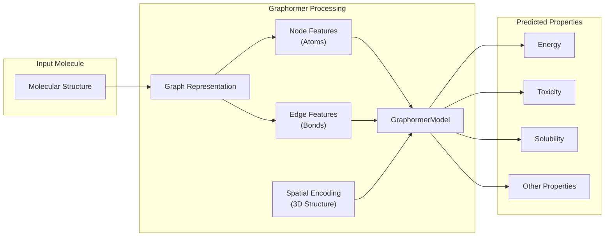
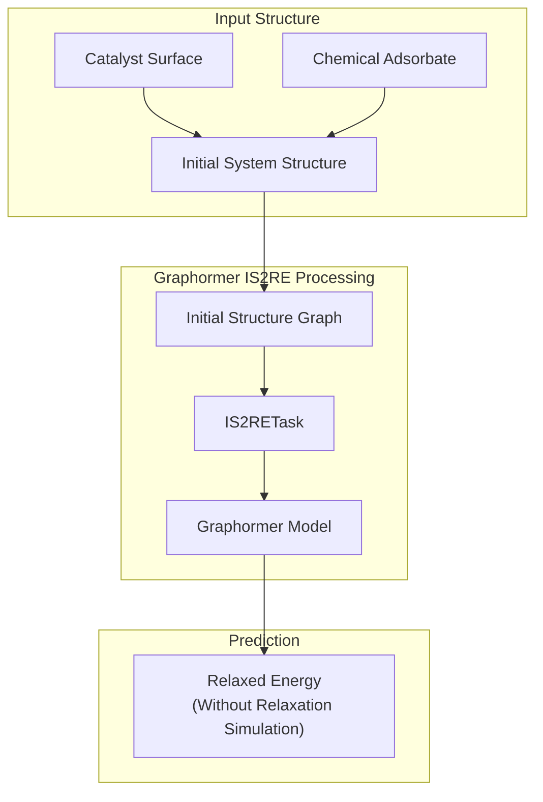
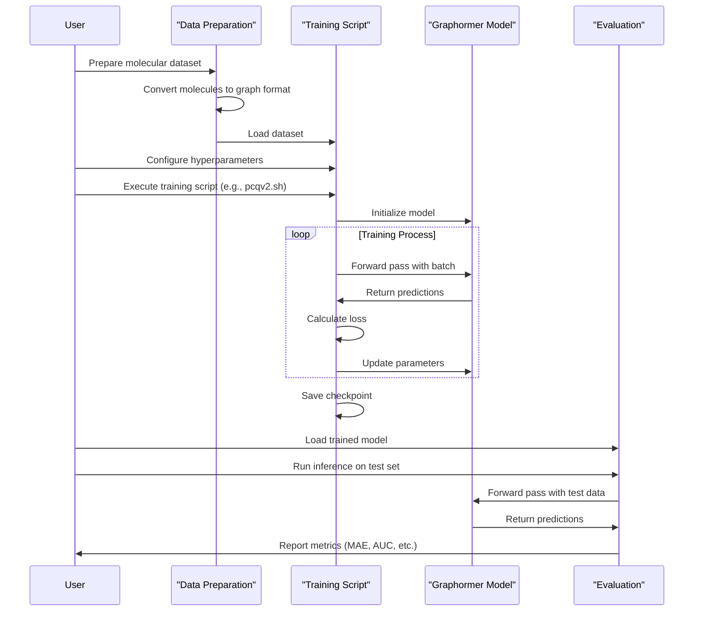
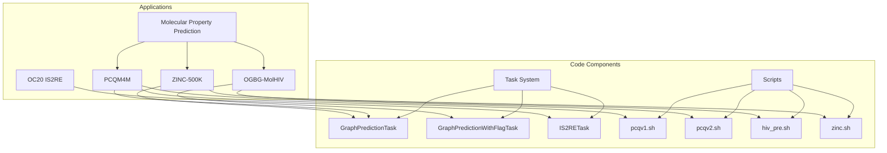

<!-- source: DeepWiki mcp.deepwiki.com · repo microsoft/Graphormer · page 8 Example Applications · fetched 2026-10-26 -->

# Example Applications

Relevant source files

The following files were used as context for generating this wiki page:

- [examples/property_prediction/README.md](examples/property_prediction/README.md)

This page documents real-world applications of Graphormer, showcasing how the framework can be utilized for various graph-based machine learning tasks. It details specific benchmark datasets, performance metrics, and practical use cases where Graphormer has demonstrated state-of-the-art results. For information about the underlying architecture, see [Core Model Architecture](#3), and for training procedures, see [Training and Evaluation](#7).

## Molecular Property Prediction

Graphormer excels at predicting molecular properties from graph representations of molecules, which is critical for drug discovery, material science, and computational chemistry.

Sources: [examples/property_prediction/README.md:37-58]()

### PCQM4M Dataset (Open Graph Benchmark - KDD Cup 2021)

The PCQM4M dataset is part of the Open Graph Benchmark Large-Scale Challenge and focuses on quantum chemistry. Graphormer has achieved state-of-the-art results on both PCQM4Mv1 and PCQM4Mv2 datasets, predicting molecular properties such as HOMO-LUMO energy gap.

To train Graphormer on PCQM4M datasets:
- For PCQM4Mv1: Execute `pcqv1.sh`
- For PCQM4Mv2: Execute `pcqv2.sh`

Note that batch size should be adjusted to achieve a total batch size of 1024.

Performance comparison on PCQM4Mv2:

| Method | Parameters | Valid MAE |
|--------|------------|-----------|
| GCN | 2.0M | 0.1379 |
| GIN | 3.8M | 0.1195 |
| GCN-VN | 4.9M | 0.1153 |
| GIN-VN | 6.7M | 0.1083 |
| Graphormer-v2 | 48.3M | 0.0865 |

Sources: [examples/property_prediction/README.md:1-36]()

### OGBG-MolHIV (HIV Molecule Classification)

The OGBG-MolHIV dataset is a binary classification task for predicting whether a molecule inhibits HIV virus replication. Graphormer demonstrates superior performance through pre-training and fine-tuning.

To fine-tune a pre-trained Graphormer model on OGBG-MolHIV:
- Execute `hiv_pre.sh`

Performance comparison:

| Method | Parameters | Test AUC (%) |
|--------|------------|--------------|
| GCN-GraphNorm | 526K | 78.83 |
| PNA | 326K | 79.05 |
| PHC-GNN | 111K | 79.34 |
| DeeperGCN-FLAG | 532K | 79.42 |
| DGN | 114K | 79.70 |
| Graphormer | 47.0M | 80.51 |
| Graphormer-v2 | 48.3M | 80.56 |

Sources: [examples/property_prediction/README.md:37-58]()

### ZINC-500K (Molecular Graph Regression)

The ZINC-500K dataset is widely used for benchmarking graph neural networks in chemistry. It involves predicting a molecular property (constrained solubility) based on the molecular graph.

To train Graphormer-Slim on ZINC-500K:
- Execute `zinc.sh`

Performance comparison:

| Method | Parameters | Test MAE |
|--------|------------|----------|
| GIN | 509.5K | 0.526 |
| GraphSage | 505.3K | 0.398 |
| GAT | 531.3K | 0.384 |
| GCN | 505.1K | 0.367 |
| GT | 588.9K | 0.226 |
| GatedGCN-PE | 505.0K | 0.214 |
| MPNN (sum) | 480.8K | 0.145 |
| PNA | 387.2K | 0.142 |
| SAN | 508.6K | 0.139 |
| Graphormer-Slim | 489.3K | 0.122 |

Sources: [examples/property_prediction/README.md:59-84]()

## OC20 Catalyst Challenge (IS2RE Task)

The Open Catalyst 2020 (OC20) challenge focuses on catalytic materials discovery for renewable energy applications. The Initial Structure to Relaxed Energy (IS2RE) task involves predicting the energy of a relaxed adsorbate-catalyst system given only the initial structure.

The IS2RE task is particularly challenging because it requires the model to approximate the outcome of a complex physical relaxation process without explicitly simulating it. Graphormer's ability to model spatial and structural information makes it well-suited for this task.

Key aspects of the OC20 IS2RE application:
- Prediction of relaxed energy directly from initial structure
- Handling of complex 3D spatial information
- Representation of both catalyst surface and adsorbate molecules
- Capture of quantum chemical interactions

This task demonstrates Graphormer's capability to learn complex physical processes and provide computationally efficient approximations of expensive simulations.

Sources: [examples/property_prediction/README.md:85-96]()

## Application Workflow

The following diagram illustrates the typical workflow when applying Graphormer to a molecular prediction task:

This workflow shows how users interact with the Graphormer system from data preparation through training to final evaluation. The execution of specific scripts (like `pcqv2.sh`, `hiv_pre.sh`, or `zinc.sh`) encapsulates this process for different applications.

Sources: [examples/property_prediction/README.md:5-12](), [examples/property_prediction/README.md:42-47](), [examples/property_prediction/README.md:67-69]()

## Code to Application Mapping

The following diagram maps the example applications to their corresponding code components in the Graphormer repository:

This mapping shows how each application example relates to specific task implementations and scripts in the codebase, helping users understand the relationship between the high-level applications and their implementation details.

Sources: [examples/property_prediction/README.md:5-12](), [examples/property_prediction/README.md:42-47](), [examples/property_prediction/README.md:67-69]()

## Performance Summary

Graphormer has consistently demonstrated state-of-the-art performance across multiple graph-based machine learning benchmarks:

| Application | Dataset | Metric | Graphormer Performance | Best Previous Result |
|-------------|---------|--------|------------------------|----------------------|
| Molecular Property | PCQM4Mv2 | Valid MAE | 0.0865 (Graphormer-v2) | 0.1083 (GIN-VN) |
| Molecular Property | PCQM4Mv1 | Valid MAE | 0.1201 (Graphormer-v2) | 0.1395 (GIN-VN) |
| Molecular Property | OGBG-MolHIV | Test AUC (%) | 80.56 (Graphormer-v2) | 79.70 (DGN) |
| Molecular Property | ZINC-500K | Test MAE | 0.122 (Graphormer-Slim) | 0.139 (SAN) |

These results demonstrate Graphormer's versatility and effectiveness across different molecular property prediction tasks, highlighting its potential for practical applications in drug discovery, materials science, and computational chemistry.

Sources: [examples/property_prediction/README.md:17-36](), [examples/property_prediction/README.md:49-58](), [examples/property_prediction/README.md:71-84]()

---

