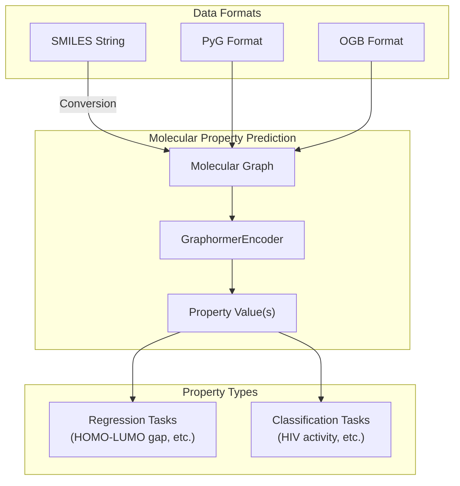
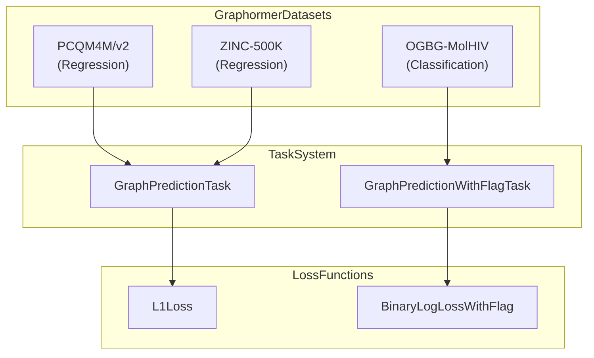
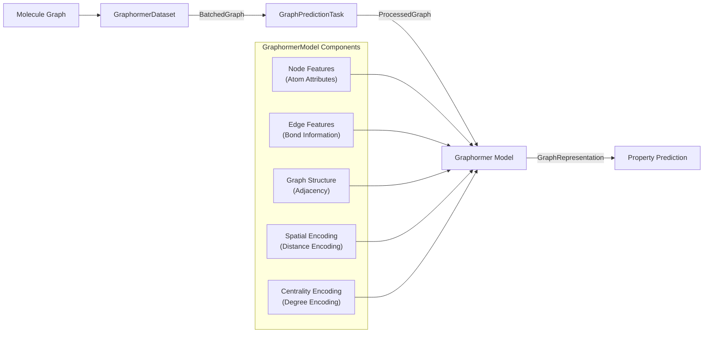
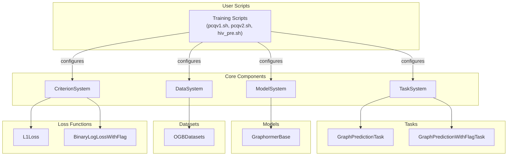

<!-- source: DeepWiki mcp.deepwiki.com · repo microsoft/Graphormer · page 8.1 Molecular Property Prediction · fetched 2026-10-26 -->

# Molecular Property Prediction

<details>
<summary>Relevant source files</summary>

The following files were used as context for generating this wiki page:

- [examples/oc20/oc20.sh](examples/oc20/oc20.sh)
- [examples/property_prediction/README.md](examples/property_prediction/README.md)
- [examples/property_prediction/hiv_pre.sh](examples/property_prediction/hiv_pre.sh)
- [examples/property_prediction/pcqv1.sh](examples/property_prediction/pcqv1.sh)
- [examples/property_prediction/pcqv2.sh](examples/property_prediction/pcqv2.sh)

</details>


## Purpose and Scope

This document details how to use Graphormer for molecular property prediction tasks. Molecular property prediction involves predicting physical, chemical, or biological properties of molecules based on their structures, which are naturally represented as graphs. For information about the OC20 Catalyst Challenge, see [OC20 Catalyst Challenge](#8.2).

## Overview

Molecular property prediction is one of the primary applications of Graphormer. The system leverages Graphormer's powerful graph encoding capabilities to achieve state-of-the-art performance on various molecular property prediction benchmarks.



Sources: [examples/property_prediction/README.md]()

## Supported Datasets

Graphormer supports several benchmark datasets for molecular property prediction:

### PCQM4M/PCQM4Mv2 (OGB-LSC)

The PCQM4M dataset from the Open Graph Benchmark Large-Scale Challenge (OGB-LSC) contains quantum chemical properties of molecules. The primary prediction task is the HOMO-LUMO energy gap, a regression task.

### OGBG-MolHIV

Part of the Open Graph Benchmark (OGB), this dataset involves predicting HIV activity of molecules, a binary classification task.

### ZINC-500K

A subset of the ZINC database used for regression tasks, specifically predicting the constrained solubility property.



Sources: [examples/property_prediction/README.md](), [examples/property_prediction/pcqv1.sh](), [examples/property_prediction/pcqv2.sh](), [examples/property_prediction/hiv_pre.sh]()

## System Architecture for Molecular Property Prediction

When predicting molecular properties, Graphormer processes molecule graphs through the following pipeline:



Sources: [examples/property_prediction/pcqv1.sh](), [examples/property_prediction/pcqv2.sh](), [examples/property_prediction/hiv_pre.sh]()

## Training Models for Property Prediction

Graphormer provides several example scripts for training models on different molecular datasets.

### Training on PCQM4Mv2

```bash
bash pcqv2.sh
```

The script configures Graphormer for the PCQM4Mv2 dataset with the following key parameters:

| Parameter | Value | Purpose |
|-----------|-------|---------|
| --dataset-name | pcqm4mv2 | Dataset identifier |
| --dataset-source | ogb | Dataset source (Open Graph Benchmark) |
| --task | graph_prediction | Task type for regression |
| --criterion | l1_loss | Loss function for regression |
| --arch | graphormer_base | Model architecture |
| --batch-size | 256 | Training batch size |
| --lr | 2e-4 | Learning rate |
| --warmup-updates | 60000 | Number of warmup steps |
| --total-num-update | 1000000 | Total number of training steps |

Sources: [examples/property_prediction/pcqv2.sh]()

### Training on OGBG-MolHIV

```bash
bash hiv_pre.sh
```

This script fine-tunes a pre-trained Graphormer model on the OGBG-MolHIV dataset:

| Parameter | Value | Purpose |
|-----------|-------|---------|
| --dataset-name | ogbg-molhiv | Dataset identifier |
| --task | graph_prediction_with_flag | Task type with FLAG augmentation |
| --criterion | binary_logloss_with_flag | Loss function for binary classification |
| --num-classes | 1 | Number of output classes |
| --pretrained-model-name | pcqm4mv1_graphormer_base_for_molhiv | Pre-trained model to use |
| --flag-m | 3 | FLAG augmentation iterations |
| --flag-step-size | 0.01 | FLAG step size |

Sources: [examples/property_prediction/hiv_pre.sh]()

## Performance Benchmarks

Graphormer achieves state-of-the-art performance on molecular property prediction tasks:

### PCQM4Mv2 (Regression, MAE)

| Method | Parameters | Valid MAE |
|--------|------------|-----------|
| GCN | 2.0M | 0.1379 |
| GIN | 3.8M | 0.1195 |
| GCN-VN | 4.9M | 0.1153 |
| GIN-VN | 6.7M | 0.1083 |
| Graphormer-v2 | 48.3M | **0.0865** |

### OGBG-MolHIV (Classification, ROC-AUC)

| Method | Parameters | Test AUC (%) |
|--------|------------|--------------|
| GCN-GraphNorm | 526K | 78.83 |
| PNA | 326K | 79.05 |
| PHC-GNN | 111K | 79.34 |
| DeeperGCN-FLAG | 532K | 79.42 |
| DGN | 114K | 79.70 |
| Graphormer | 47.0M | 80.51 |
| Graphormer-v2 | 48.3M | **80.56** |

### ZINC-500K (Regression, MAE)

| Method | Parameters | Test MAE |
|--------|------------|----------|
| GIN | 509.5K | 0.526 |
| GraphSage | 505.3K | 0.398 |
| GAT | 531.3K | 0.384 |
| GCN | 505.1K | 0.367 |
| GT | 588.9K | 0.226 |
| GatedGCN-PE | 505.0K | 0.214 |
| MPNN (sum) | 480.8K | 0.145 |
| PNA | 387.2K | 0.142 |
| SAN | 508.6K | 0.139 |
| Graphormer-Slim | 489.3K | **0.122** |

Sources: [examples/property_prediction/README.md]()

## Implementation Details

The molecular property prediction pipeline uses the following components from the Graphormer framework:



Sources: [examples/property_prediction/pcqv1.sh](), [examples/property_prediction/pcqv2.sh](), [examples/property_prediction/hiv_pre.sh]()

## Advanced Usage

### Fine-tuning Pre-trained Models

The Graphormer framework supports transferring knowledge from pre-trained models to downstream tasks. For example, the `hiv_pre.sh` script demonstrates fine-tuning a pre-trained model on the OGBG-MolHIV dataset:

```bash
--pretrained-model-name pcqm4mv1_graphormer_base_for_molhiv
```

This approach typically improves performance on datasets with fewer training examples, leveraging knowledge from larger pre-training datasets like PCQM4M.

### Using FLAG Augmentation

For classification tasks like OGBG-MolHIV, the FLAG (Free Large-scale Adversarial Augmentation) technique can improve model performance and robustness:

```bash
--task graph_prediction_with_flag
--criterion binary_logloss_with_flag
--flag-m 3
--flag-step-size 0.01
--flag-mag 0
```

FLAG generates adversarial examples during training to improve model robustness.

Sources: [examples/property_prediction/hiv_pre.sh]()

## Conclusion

Graphormer provides a powerful framework for molecular property prediction, consistently achieving state-of-the-art performance across various benchmark datasets. The model's transformer-based architecture, combined with specialized graph structural encodings, allows it to effectively capture complex molecular structures and their relationships to various properties.