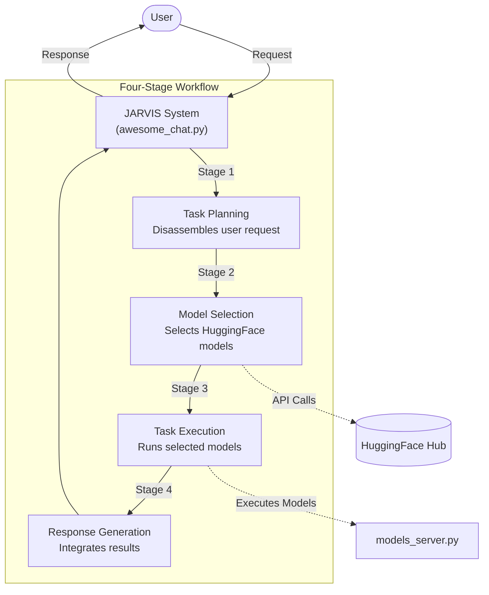
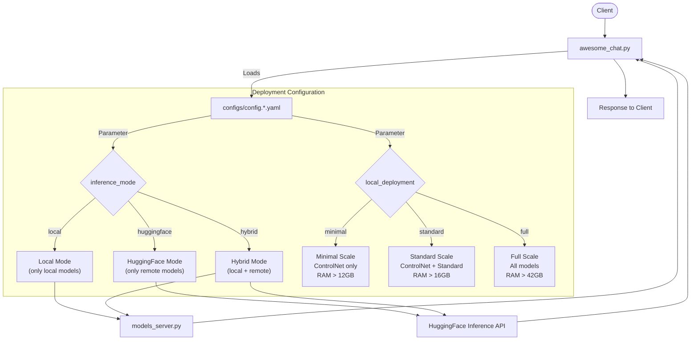
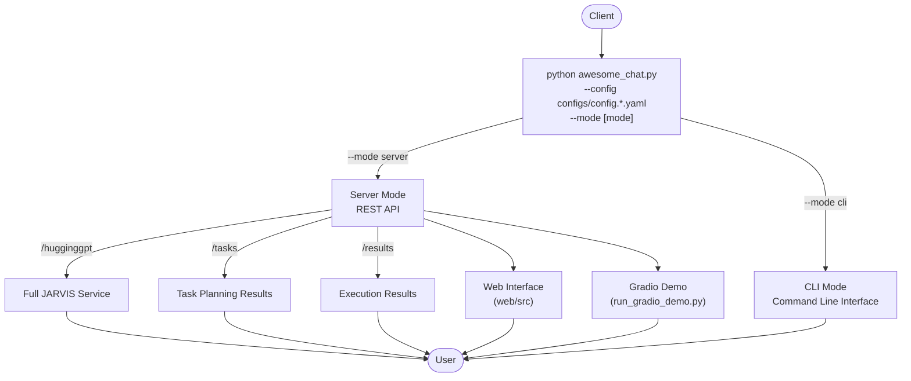

<!-- source: DeepWiki mcp.deepwiki.com · repo microsoft/JARVIS · page 1 Overview · fetched 2026-10-26 -->

# Overview

Relevant source files

The following files were used as context for generating this wiki page:

- [.gitignore](.gitignore)
- [README.md](README.md)

This page provides an introduction to the JARVIS repository, a collaborative AI system that uses Large Language Models (LLMs) as controllers to orchestrate expert models for solving complex AI tasks. This document covers the high-level architecture, components, and deployment options of JARVIS. For more detailed information about specific components, please refer to their respective wiki pages.

## Introduction to JARVIS

JARVIS (Just A Rather Very Intelligent System) is an artificial general intelligence (AGI) research project that delivers cutting-edge research to the community. The mission of JARVIS is to explore AGI and make it accessible to researchers and developers.

The repository contains three main components:

- **JARVIS System**: The core system that uses an LLM controller to orchestrate expert models
- **TaskBench**: A benchmark for evaluating LLMs on task automation capabilities (for more details, see [TaskBench Benchmark](#3))
- **EasyTool**: A tool for enhancing LLM-based agents with concise tool instructions

Sources: [README.md:7-13]()

## JARVIS System Architecture

JARVIS operates through a four-stage workflow that enables it to understand user requests, plan appropriate tasks, select and execute relevant models, and generate coherent responses.

### Four-Stage Workflow

The four stages are:

1. **Task Planning**: The LLM analyzes user requests to understand their intention and disassembles them into possible solvable tasks.
2. **Model Selection**: The LLM selects appropriate expert models from HuggingFace Hub based on their descriptions.
3. **Task Execution**: The system invokes and executes each selected model, returning the results to the LLM.
4. **Response Generation**: The LLM integrates the predictions from all models to generate a coherent response.

This architecture allows JARVIS to leverage the strengths of both LLMs (for understanding, planning, and reasoning) and specialized models (for executing specific tasks).

Sources: [README.md:40-44]()

## Deployment Architecture

JARVIS provides flexible deployment options to accommodate different hardware capabilities and usage scenarios.

### Deployment Configuration

### Deployment Modes

JARVIS supports three deployment modes, configurable in the YAML configuration files:

1. **Local Mode** (`inference_mode: local`): Uses only locally deployed models
2. **HuggingFace Mode** (`inference_mode: huggingface`): Uses only HuggingFace's remote inference endpoints (no local deployment required)
3. **Hybrid Mode** (`inference_mode: hybrid`): Uses both local and remote models

For local deployments, JARVIS offers three scales:

1. **Minimal** (`local_deployment: minimal`): Deploys only ControlNet models (requires >12GB RAM)
2. **Standard** (`local_deployment: standard`): Deploys ControlNet and standard pipelines (requires >16GB RAM)
3. **Full** (`local_deployment: full`): Deploys all registered models (requires >42GB RAM)

Sources: [README.md:185-196]()

## Interfaces

JARVIS provides multiple interfaces for interaction, making it accessible through different methods based on user preferences and requirements.

The available interfaces include:

1. **Server API** (start with `--mode server`): Provides HTTP endpoints:
   - `/hugginggpt` - Full service (POST method)
   - `/tasks` - Task planning results (Stage #1) (POST method)
   - `/results` - Execution results (Stage #1-3) (POST method)
   
2. **Command-Line Interface** (start with `--mode cli`): A text-based interface for direct interaction
3. **Web Interface**: A user-friendly web page (requires running the server mode)
4. **Gradio Demo**: A simple interface that can be hosted locally or on HuggingFace Space

Sources: [README.md:76-157]()

## System Requirements

The system requirements depend on the deployment mode and scale:

| Deployment Mode | Scale | RAM Requirements | Disk Space |
|-----------------|-------|------------------|------------|
| HuggingFace     | N/A   | Minimal          | Minimal    |
| Local/Hybrid    | Minimal | >12GB          | ~126GB     |
| Local/Hybrid    | Standard | >16GB         | ~192GB     |
| Local/Hybrid    | Full  | >42GB            | >284GB     |

The disk space requirements for the full deployment include:
- 42GB for text-to-video model
- 126GB for ControlNet
- 66GB for stable-diffusion
- 50GB for other models

Sources: [README.md:48-68]()

## Repository Structure

The JARVIS repository is organized into several key directories:

- `server/`: Contains the core JARVIS system
  - `awesome_chat.py`: Main entry point for the JARVIS system
  - `models_server.py`: Local model server for running expert models
  - `configs/`: Configuration files (e.g., `config.default.yaml`, `config.lite.yaml`)
  - `models/`: Local model storage
- `web/`: Provides the web interface for interacting with JARVIS
- `taskbench/`: Contains the TaskBench benchmark for evaluating LLMs
- `easytool/`: Contains the EasyTool for enhancing LLM-based agents

Sources: [README.md, .gitignore]()

## Research Foundation

JARVIS is based on research described in the paper "HuggingGPT: Solving AI Tasks with ChatGPT and its Friends in HuggingFace" (Shen et al., 2023). The paper introduces the concept of using LLMs as controllers to orchestrate expert models from HuggingFace Hub for solving complex AI tasks.

The project is continuously evolving, with recent additions including:
- EasyTool (January 2024): For easier tool usage with LLMs
- TaskBench (November 2023): For evaluating task automation capability of LLMs
- Langchain version (July 2023): A lightweight implementation using the Langchain framework

Sources: [README.md:9-18, 38, 233-257]()

---

