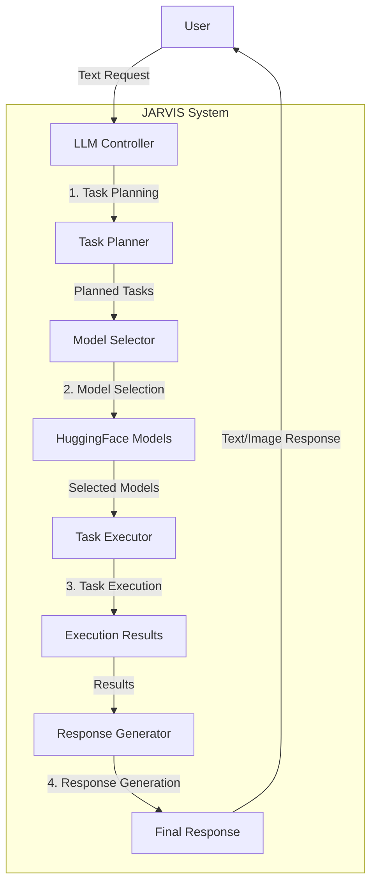
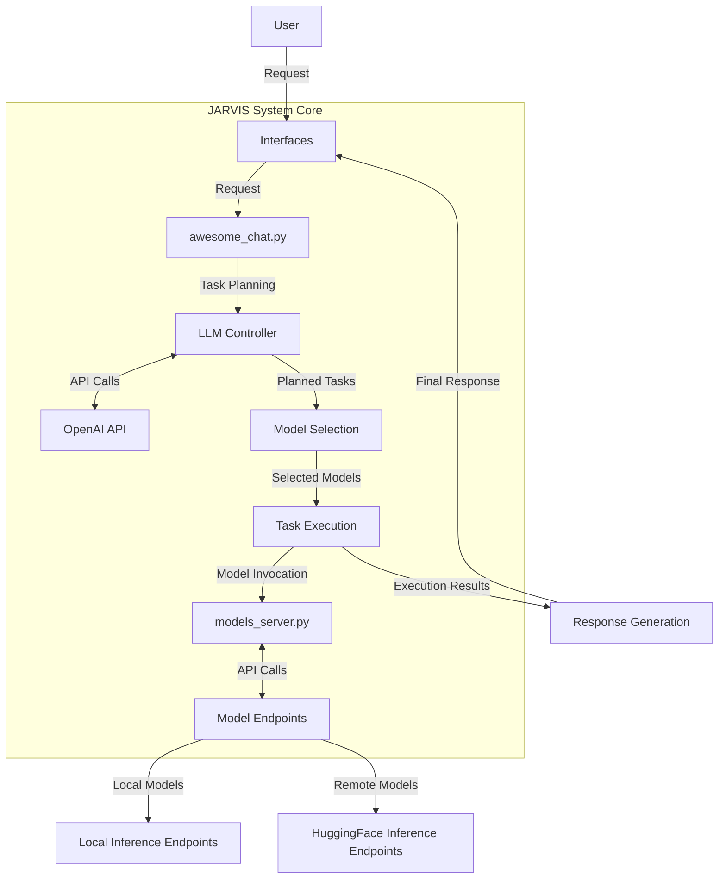
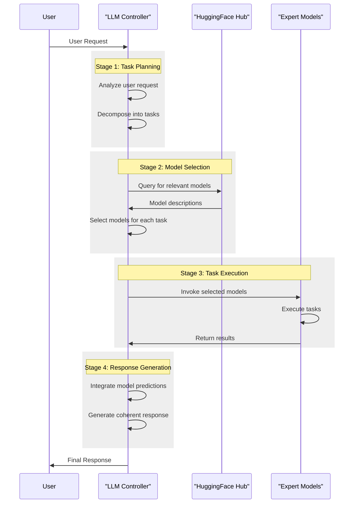
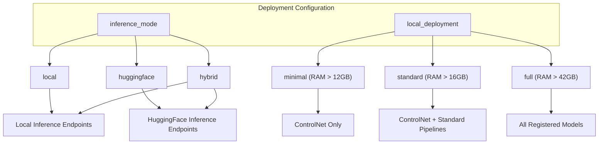

<!-- source: DeepWiki mcp.deepwiki.com · repo microsoft/JARVIS · page 2 JARVIS System · fetched 2026-10-26 -->

# JARVIS System

<details>
<summary>Relevant source files</summary>

The following files were used as context for generating this wiki page:

- [README.md](README.md)

</details>


This document provides a detailed overview of the JARVIS system, its architecture, workflow, and capabilities. It explains how the system components work together to create a collaborative AI system that leverages an LLM controller to orchestrate expert models. For information about TaskBench, which is used to evaluate JARVIS, see [TaskBench Benchmark](#3).

## Introduction

JARVIS (Just A Rather Very Intelligent System) is an exploratory artificial general intelligence (AGI) system that uses language as an interface to connect numerous AI models for solving complex AI tasks. The system's mission is to explore AGI capabilities and deliver cutting-edge research to the community.

At its core, JARVIS consists of an LLM (Large Language Model) as a controller that orchestrates numerous expert models (from HuggingFace Hub) as collaborative executors. This architecture enables JARVIS to perform a wide range of AI tasks by selecting and executing the appropriate expert models based on user requests.



Sources:
- [README.md:29-46]()

## System Architecture

JARVIS implements a modular architecture with the LLM controller at its center, orchestrating the selection and execution of expert models from HuggingFace. The system is designed to handle a wide variety of AI tasks by breaking them down into smaller, specialized tasks that can be handled by different models.

### Core Components



Sources:
- [README.md:38-46]()
- [README.md:78-97]()

### Interfaces and API Endpoints

JARVIS offers multiple ways to interact with the system:

1. **CLI Interface**: A command-line interface for direct interaction
2. **Server/Web API**: RESTful API endpoints for programmatic access
3. **Web Interface**: A user-friendly web page for visual interaction
4. **Gradio Demo**: A hosted demo on HuggingFace Space

The main Web API endpoints include:
- `/hugginggpt` (POST): Access the full service
- `/tasks` (POST): Access intermediate results for Stage #1 (Task Planning)
- `/results` (POST): Access intermediate results for Stages #1-3 (up to Task Execution)

Sources:
- [README.md:78-122]()
- [README.md:126-157]()

## Four-Stage Workflow

JARVIS operates through a four-stage workflow that enables it to understand user requests, select appropriate models, execute tasks, and generate comprehensive responses.



### Stage 1: Task Planning

In this stage, the LLM controller (ChatGPT) analyzes the user's request to understand their intention and decomposes it into possible solvable tasks. This involves:
- Understanding the user's request context
- Identifying the main tasks and subtasks
- Creating a task dependency graph
- Determining the order of execution

### Stage 2: Model Selection

Based on the planned tasks, the LLM selects appropriate expert models from HuggingFace Hub:
- Queries models based on task requirements
- Evaluates model descriptions 
- Selects the most suitable models for each task
- Considers model dependencies and capabilities

### Stage 3: Task Execution

During this stage, JARVIS:
- Invokes each selected model
- Passes the appropriate parameters
- Executes the models in the correct order
- Collects and stores the results from each model

### Stage 4: Response Generation

In the final stage, the LLM:
- Integrates the predictions from all models
- Synthesizes a comprehensive response
- Formats the output appropriately (text, images, etc.)
- Delivers a coherent and informative response to the user

Sources:
- [README.md:40-45]()

## Deployment Modes and Requirements

JARVIS offers flexible deployment options to accommodate different hardware capabilities and use cases.



### Inference Modes

JARVIS supports three inference modes:

1. **Local Mode**: Uses only local inference endpoints
   - Requires local model deployment
   - Provides more control and reliability
   - Higher hardware requirements

2. **HuggingFace Mode**: Uses only HuggingFace Inference Endpoints
   - No need for local model deployment
   - Minimal hardware requirements
   - May be limited due to remote endpoint availability

3. **Hybrid Mode**: Uses both local and HuggingFace Inference Endpoints
   - Balances local and remote resources
   - Provides flexibility in model selection
   - Recommended for most users

### Local Deployment Scales

When using local or hybrid inference modes, JARVIS offers three deployment scales:

1. **Minimal** (RAM > 12GB)
   - Includes only ControlNet models
   - Suitable for basic image generation tasks
   - Lowest hardware requirements

2. **Standard** (RAM > 16GB)
   - Includes ControlNet and standard pipelines
   - Supports most common AI tasks
   - Moderate hardware requirements

3. **Full** (RAM > 42GB)
   - Includes all registered models
   - Supports the full range of JARVIS capabilities
   - Highest hardware requirements

### System Requirements

The hardware requirements for running JARVIS depend on the chosen deployment configuration:

| Deployment Configuration | Minimum RAM | Disk Space | GPU VRAM | Notes |
|--------------------------|-------------|------------|----------|-------|
| Local (Minimal) | 12GB | >126GB | ≥24GB | Only ControlNet models |
| Local (Standard) | 16GB | >234GB | ≥24GB | ControlNet + Standard Pipelines |
| Local (Full) | 42GB | >284GB | ≥24GB | All registered models |
| HuggingFace Mode | Minimal | Minimal | Not required | Limited by HF Endpoints availability |
| Hybrid (Minimal) | 12GB | >126GB | ≥24GB | Recommended for personal laptops |

Sources:
- [README.md:48-69]()
- [README.md:182-195]()

## Getting Started with JARVIS

To use JARVIS, you need to configure your environment and start the necessary components.

### Basic Setup

1. Clone the repository
2. Replace `openai.key` and `huggingface.token` in the configuration file or set them as environment variables
3. Install the required dependencies
4. Download the necessary models (if using local or hybrid inference mode)
5. Start the models server and the main application

### Running Different Interfaces

#### Server Mode

```bash
cd server
python models_server.py --config configs/config.default.yaml  # Required for local/hybrid mode
python awesome_chat.py --config configs/config.default.yaml --mode server
```

#### CLI Mode

```bash
cd server
python awesome_chat.py --config configs/config.default.yaml --mode cli
```

#### Web Interface

```bash
cd web
npm install
npm run dev
```

#### Gradio Demo

```bash
python models_server.py --config configs/config.gradio.yaml
python run_gradio_demo.py --config configs/config.gradio.yaml
```

Sources:
- [README.md:72-157]()

## Configuration Options

JARVIS is highly configurable through YAML configuration files:

```yaml
# Main configuration parameters
model: text-davinci-003  # LLM model to use
inference_mode: hybrid   # local, huggingface, or hybrid
local_deployment: standard  # minimal, standard, or full

# API keys
openai:
  key: your_openai_key_here
huggingface:
  token: your_huggingface_token_here
```

The most important parameters are:

- `model`: The LLM to use as the controller (currently supports text-davinci-003)
- `inference_mode`: Determines which inference endpoints to use
- `local_deployment`: Specifies the scale of locally deployed models

For personal laptops, the recommended configuration is `inference_mode: hybrid` and `local_deployment: minimal`.

Sources:
- [README.md:182-195]()

## Conclusion

JARVIS represents a significant advancement in collaborative AI systems, demonstrating how language can serve as an interface for connecting multiple AI models to solve complex tasks. By combining the reasoning capabilities of LLMs with the specialized abilities of expert models, JARVIS provides a powerful and flexible platform for addressing a wide range of AI challenges.

The system's modular architecture, four-stage workflow, and flexible deployment options make it suitable for various use cases and hardware configurations. Whether you're a researcher exploring AGI capabilities, a developer building on top of existing AI models, or an end-user seeking powerful AI assistance, JARVIS offers a comprehensive solution.

---

