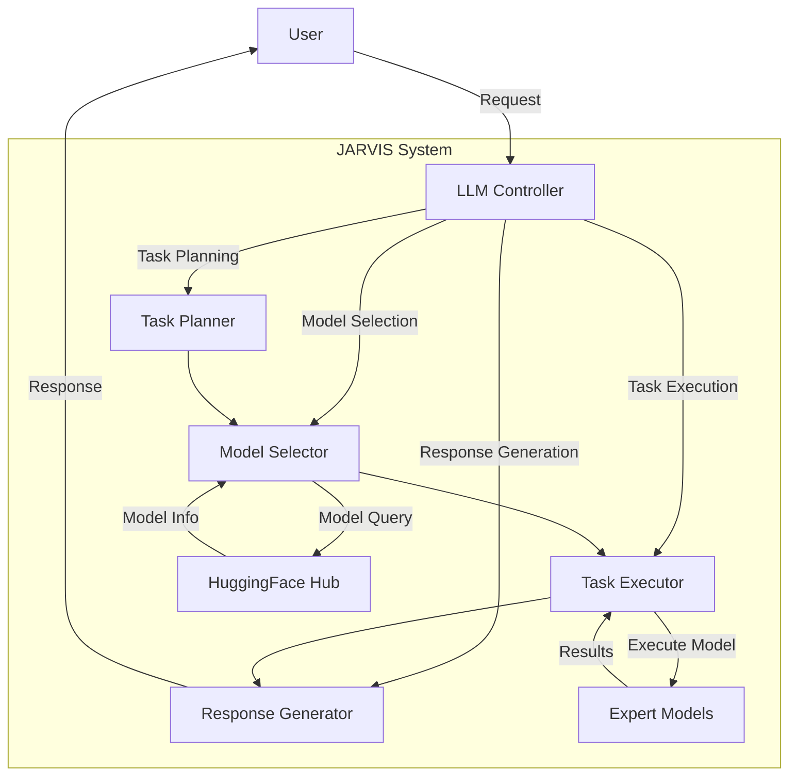
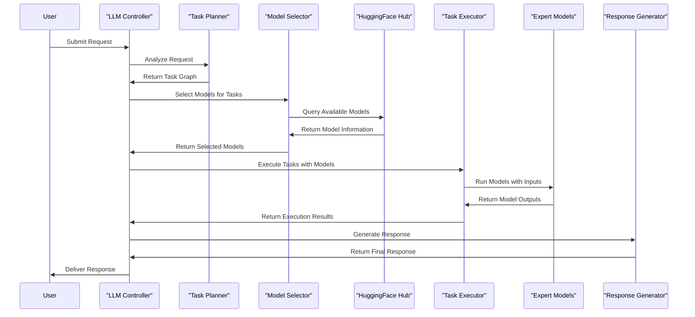
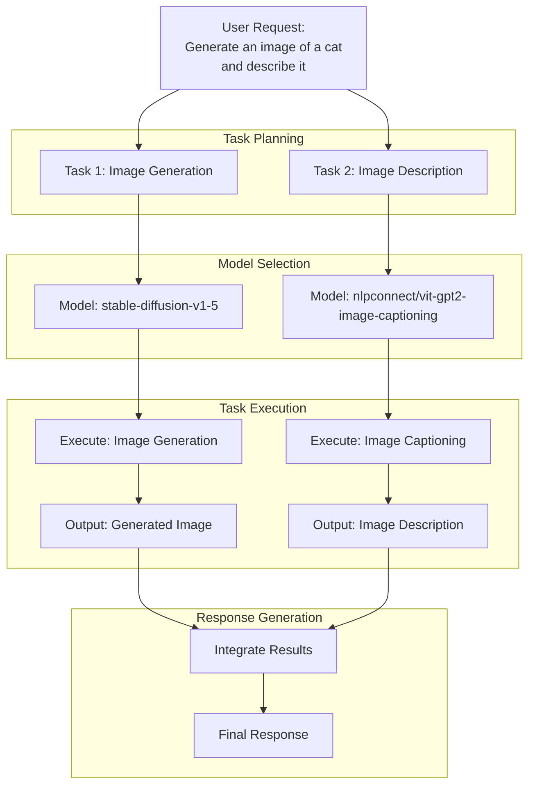
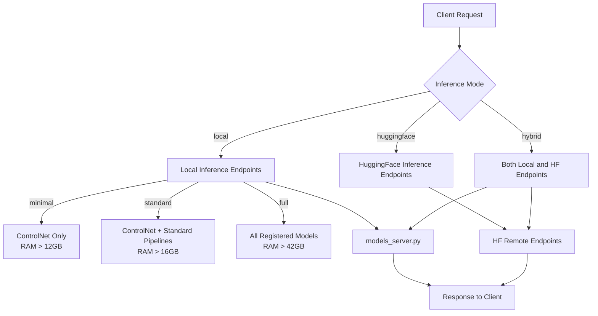
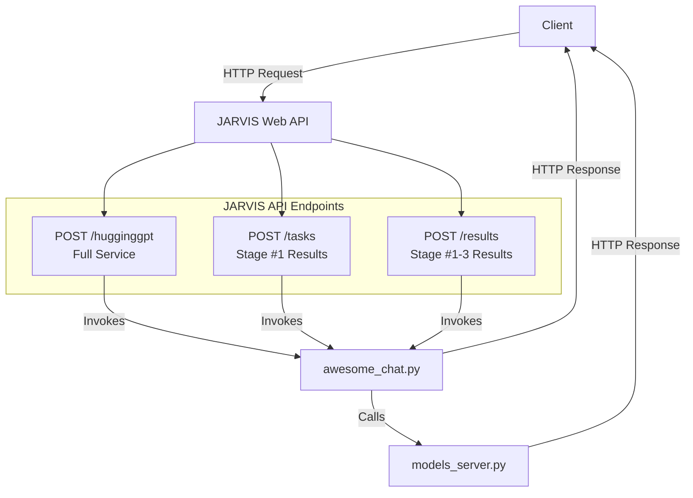
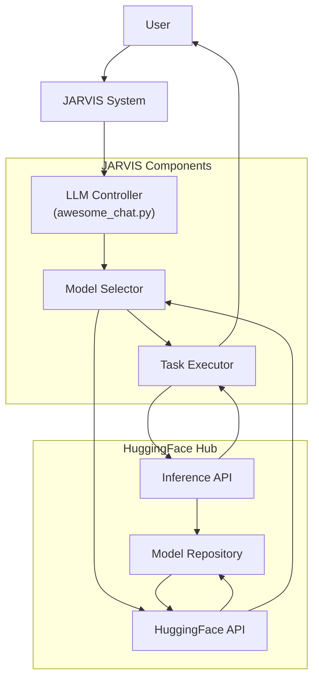

<!-- source: DeepWiki mcp.deepwiki.com · repo microsoft/JARVIS · page 2.1 System Architecture · fetched 2026-10-26 -->

# System Architecture

Relevant source files

The following files were used as context for generating this wiki page:

- [README.md](README.md)

## Purpose and Scope

This document describes the architectural design of the JARVIS system, focusing on its core components and their interactions. It explains how the LLM controller orchestrates expert models to collaboratively solve AI tasks. For details on the four-stage workflow that implements this architecture, see [Four-Stage Workflow](#2.2). For deployment configuration options, see [Deployment Modes](#2.3).

## High-Level Architecture

The JARVIS system is designed as a collaborative AI system where a Large Language Model (LLM) serves as the central controller that orchestrates specialized expert models to solve complex AI tasks. The architecture is built on the premise that natural language can function as an effective interface for connecting and coordinating these diverse models.

The diagram illustrates the flow of a user request through the system. The LLM Controller manages the four stages of processing, coordinating with the HuggingFace Hub and expert models to fulfill the request.

Sources: [README.md:38-44]()

## Core Components

### LLM Controller

The LLM Controller functions as the system's central orchestrator. It:
- Analyzes and interprets user requests in natural language
- Breaks down complex requests into smaller, executable tasks
- Selects appropriate models for each task
- Manages task execution dependencies
- Integrates results and generates coherent responses

Currently, JARVIS primarily supports OpenAI's models (like text-davinci-003) as the controller, with ongoing work to integrate more open-source LLMs.

### Expert Models

Expert models are specialized AI models sourced primarily from the HuggingFace Hub. These models excel at specific tasks such as:
- Image generation and manipulation
- Object detection and recognition
- Text classification and analysis
- Speech processing
- Video generation and editing

Depending on the deployment configuration, these models can be run locally, accessed through HuggingFace's Inference Endpoints, or both.

### Communication Layer

The communication layer facilitates interactions between components:
- Converts natural language task descriptions into structured model inputs
- Handles the transmission of data between components
- Processes model outputs and formats them for the LLM Controller
- Manages dependencies between tasks and models
- Handles error cases and recovery strategies

Sources: [README.md:29-46]()

## Component Interaction Flow

The following sequence diagram illustrates how components interact during a typical request:

This diagram shows the sequential flow of information through the system, highlighting how the LLM Controller coordinates the entire process from request to response.

Sources: [README.md:40-44]()

## Task Processing Example

To illustrate how the system processes a specific request, here's an example of a multi-step task execution:

The diagram demonstrates how a user request is decomposed into tasks, mapped to appropriate models, executed to produce outputs, and finally integrated into a coherent response.

Sources: [README.md:40-44](), [README.md:170-178]()

## Deployment Architecture

JARVIS supports a flexible deployment configuration to accommodate different resource constraints and use cases:

The deployment architecture is controlled by two main configuration parameters:

1. **Inference Mode**: Determines where model inference is performed
   - `local`: Only uses locally deployed models
   - `huggingface`: Only uses HuggingFace's Inference Endpoints 
   - `hybrid`: Uses both local and remote inference capabilities

2. **Local Deployment Scale**: When using local or hybrid modes, this determines which models are deployed locally
   - `minimal`: Requires >12GB RAM, only deploys ControlNet models
   - `standard`: Requires >16GB RAM, deploys ControlNet plus standard pipelines
   - `full`: Requires >42GB RAM, deploys all registered models

These parameters can be configured in the YAML configuration files:
- `server/configs/config.default.yaml`
- `server/configs/config.lite.yaml`
- `server/configs/config.gradio.yaml`

Sources: [README.md:48-52](), [README.md:182-196]()

## Web API Architecture

JARVIS exposes a web API that allows clients to interact with the system:

The API provides three main endpoints:
- `/hugginggpt` (POST): Provides access to the full JARVIS service
- `/tasks` (POST): Returns intermediate results from Stage #1 (Task Planning)
- `/results` (POST): Returns intermediate results from Stages #1-3 (Task Planning, Model Selection, Task Execution)

These endpoints are particularly useful for client applications that need to access intermediate processing results or implement custom UIs.

Sources: [README.md:75-121]()

## Integration with External Systems

### HuggingFace Hub Integration

JARVIS is tightly integrated with the HuggingFace Hub:

The integration enables:
- Model discovery and selection based on task requirements
- Direct model execution through HuggingFace's Inference Endpoints
- Model downloading for local deployment
- Access to a vast ecosystem of specialized AI models

Sources: [README.md:29-35](), [README.md:182-196]()

## Client Interfaces

JARVIS supports multiple client interfaces:

| Interface | Description | Entry Point |
|-----------|-------------|-------------|
| CLI | Command-line interface for direct interaction | `awesome_chat.py --mode cli` |
| Server | Web API for programmatic access | `awesome_chat.py --mode server` |
| Web UI | User-friendly web interface | Requires running the server and `npm run dev` in the web directory |
| Gradio Demo | Hosted demo interface on Hugging Face Space | `run_gradio_demo.py` |

These interfaces provide flexible options for interacting with JARVIS based on user needs and preferences.

Sources: [README.md:75-159]()

## Implementation Notes

The system is implemented primarily in Python, with the web interface using JavaScript/TypeScript. Key implementation files include:

- `server/awesome_chat.py`: The main entry point that implements the LLM controller logic
- `server/models_server.py`: Manages local model deployment and execution
- `server/configs/*.yaml`: Configuration files for different deployment scenarios
- `web/`: Frontend web interface

The system is designed to be modular and extensible, allowing for the integration of new models and capabilities over time.

Sources: [README.md:75-159]()

---

