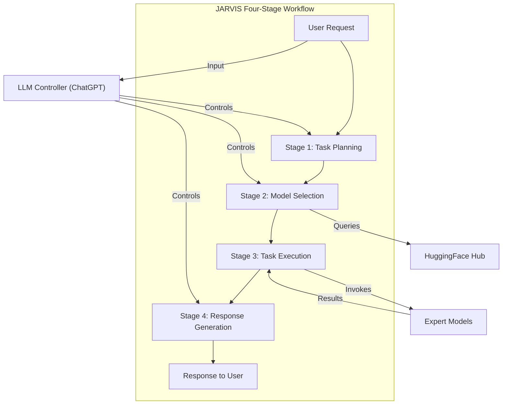
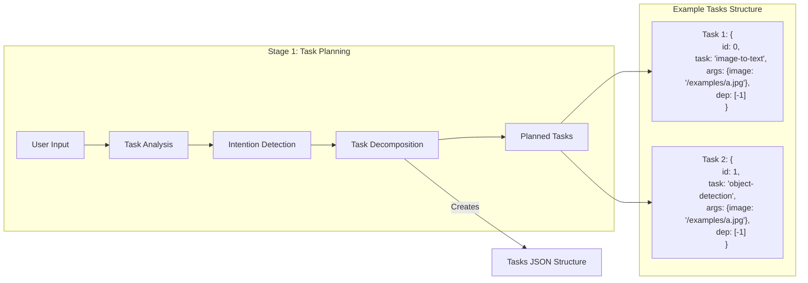
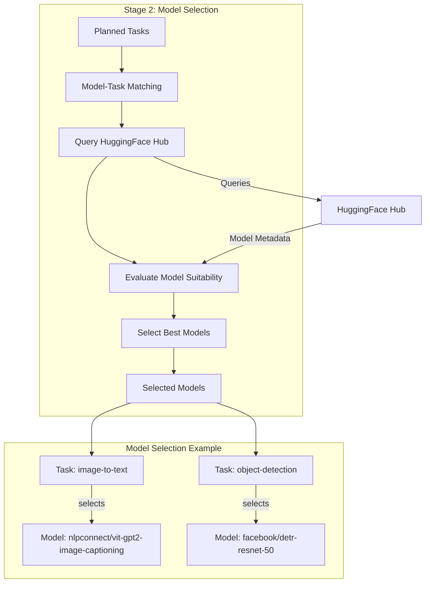
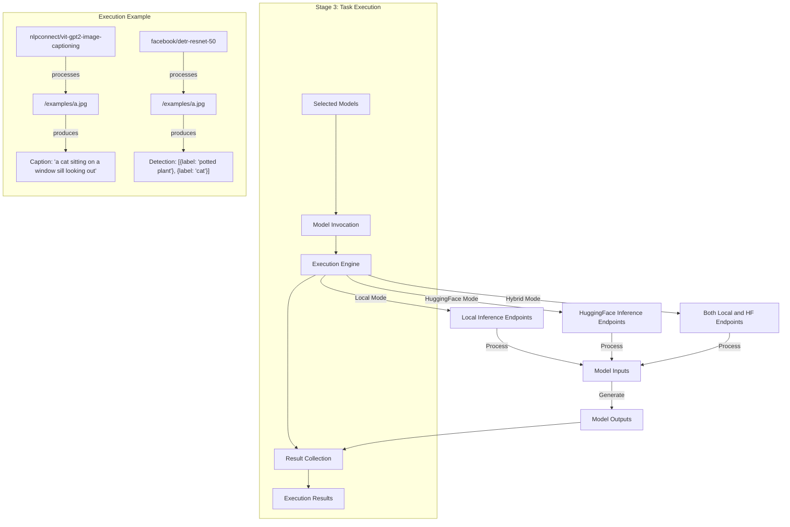
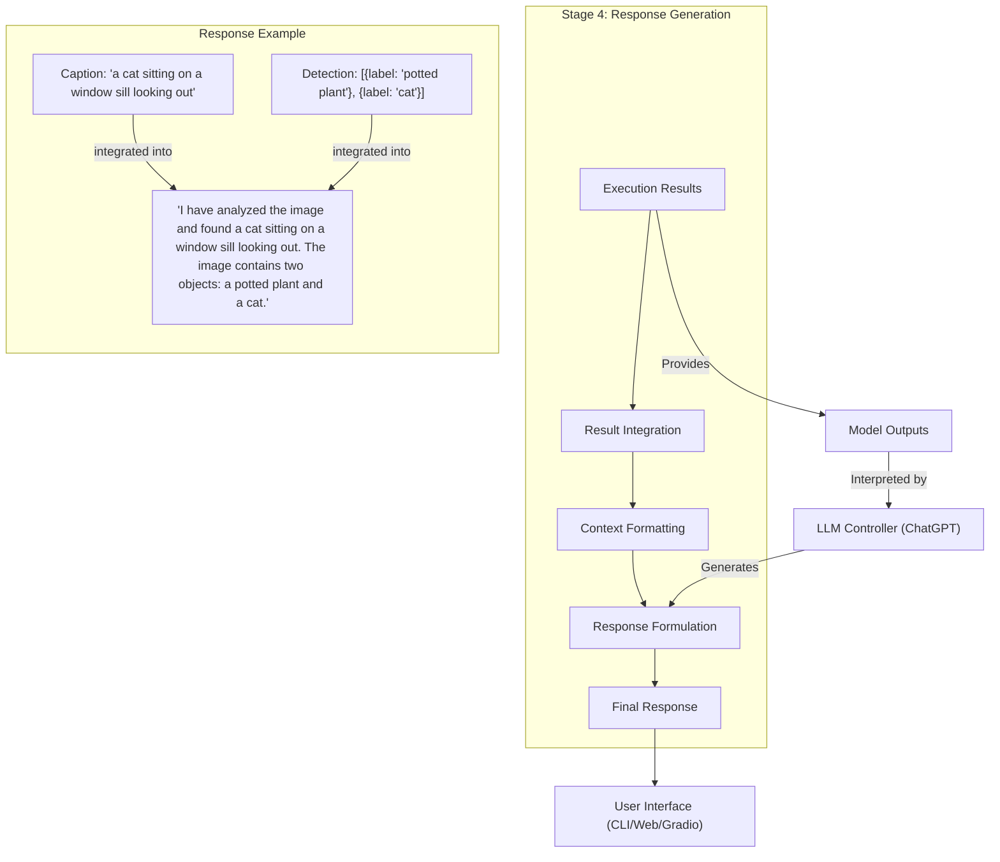
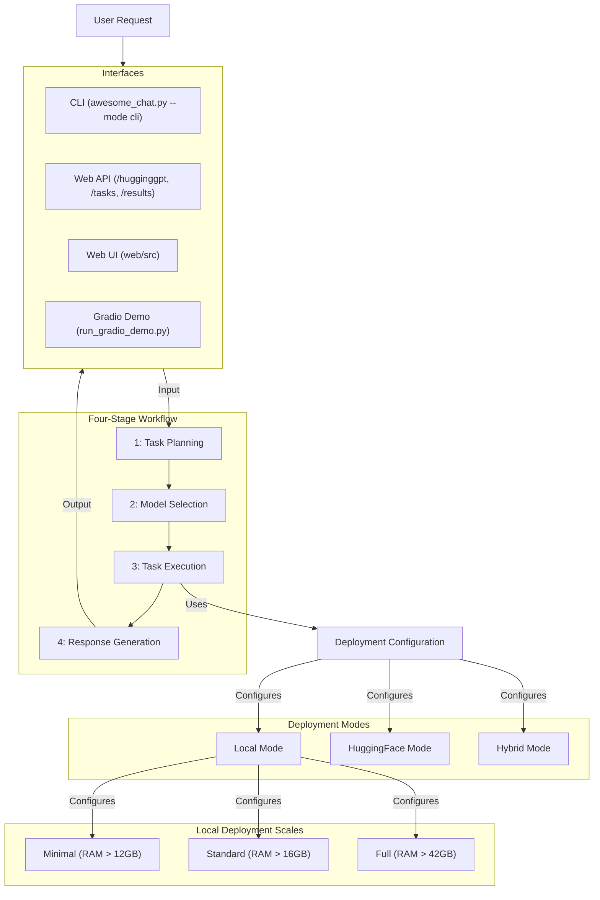

<!-- source: DeepWiki mcp.deepwiki.com · repo microsoft/JARVIS · page 2.2 Four-Stage Workflow · fetched 2026-10-26 -->

# Four-Stage Workflow

Relevant source files

The following files were used as context for generating this wiki page:

- [README.md](README.md)

## Purpose and Scope

This document details the four-stage workflow that forms the core operational model of the JARVIS system. Each stage represents a distinct phase in the process of handling user requests, from initial analysis to final response. This workflow enables JARVIS to function as a collaborative AI system where an LLM controller orchestrates expert models to solve complex AI tasks. For details on the overall system architecture, see [System Architecture](#2.1), and for deployment options, see [Deployment Modes](#2.3).

## Overview of the Four-Stage Workflow

The JARVIS system employs a four-stage pipeline to process user requests and generate comprehensive responses. This workflow represents the core operational logic of the system and dictates how different components interact with each other.

**Diagram: High-Level Four-Stage Workflow**

Sources: [README.md:40-44]()

## Stage 1: Task Planning

In the first stage, the LLM controller (typically ChatGPT) analyzes the user's request to understand the intention and decomposes it into solvable tasks. This critical step transforms natural language inputs into structured tasks that can be delegated to appropriate expert models.

**Diagram: Task Planning Process**

During this stage, JARVIS transforms the user request into a structured task list, identifying dependencies between tasks where applicable. The `/tasks` API endpoint provides access to these intermediate results, showing the planned task structure.

Sources: [README.md:41](), [README.md:106-120]()

## Stage 2: Model Selection

In the second stage, the LLM controller selects appropriate expert models from HuggingFace Hub to solve each planned task. The selection is based on model descriptions and capabilities in relation to the specific tasks identified in Stage 1.

**Diagram: Model Selection Process**

The LLM controller evaluates potential models based on their descriptions, popularity, and suitability for the specific tasks. This stage results in a mapping between planned tasks and selected HuggingFace models that will be executed in the next stage.

Sources: [README.md:42]()

## Stage 3: Task Execution

The third stage involves invoking and executing the selected models to perform the planned tasks. This is where the actual computation happens, with models processing inputs and generating outputs according to their specific capabilities.

**Diagram: Task Execution Process**

Depending on the configured inference mode (local, huggingface, or hybrid), JARVIS will execute models either locally, via HuggingFace Inference Endpoints, or both. The results from all model executions are collected and prepared for the final stage.

The `/results` API endpoint provides access to the intermediate results from Stages 1-3, allowing visibility into both the planning and execution process.

Sources: [README.md:43](), [README.md:106-120]()

## Stage 4: Response Generation

In the final stage, the LLM controller integrates the outputs from all executed models and generates a comprehensive response to the user's request. This involves interpreting the model results in context and formulating a natural language response.

**Diagram: Response Generation Process**

The LLM controller synthesizes the information from all executed models, creating a coherent narrative that addresses the user's original request. This generated response is then returned to the user through the selected interface (CLI, Web API, Web UI, or Gradio).

Sources: [README.md:44]()

## Workflow Integration with System Components

The four-stage workflow integrates with various system components to provide a complete user experience. This diagram illustrates how the workflow connects with different interfaces and deployment modes.

**Diagram: Workflow Integration with System Components**

The workflow is accessed through various interfaces, and the task execution stage adapts to the configured deployment mode and scale. This flexible architecture allows JARVIS to run in different environments with varying resource constraints.

Sources: [README.md:78-157](), [README.md:181-195]()

## Technical Implementation Details

The four-stage workflow is central to JARVIS's architecture and directly influences how the system is configured and deployed. The key configuration parameters that affect this workflow include:

| Parameter | Description | Options |
|-----------|-------------|---------|
| `model` | LLM used as controller | `text-davinci-003` (default) |
| `inference_mode` | Mode of inference endpoints | `local`, `huggingface`, `hybrid` |
| `local_deployment` | Scale of locally deployed models | `minimal`, `standard`, `full` |

These parameters determine how Stage 3 (Task Execution) operates, particularly in terms of which models are available and how they are accessed. The choice of deployment mode affects the system's resource requirements and capabilities.

Sources: [README.md:181-195]()

## Workflow API Access

The JARVIS workflow exposes specific API endpoints that provide access to intermediate results at different stages:

| Endpoint | Method | Description |
|----------|--------|-------------|
| `/hugginggpt` | POST | Access the full service (all stages) |
| `/tasks` | POST | Access Stage 1 results (task planning) |
| `/results` | POST | Access Stage 1-3 results (planning through execution) |

These endpoints allow developers to interact with specific parts of the workflow for debugging, integration, or custom applications.

Sources: [README.md:98-120]()

## Summary

The four-stage workflow represents the core operational model of JARVIS, transforming user requests into comprehensive responses through a series of well-defined stages. Each stage has a specific purpose and interfaces with different system components, creating a flexible and powerful AI collaboration framework.

The workflow enables JARVIS to leverage both an LLM controller and specialized expert models, combining their strengths to address complex AI tasks that would be difficult for any single model to handle alone.

---

