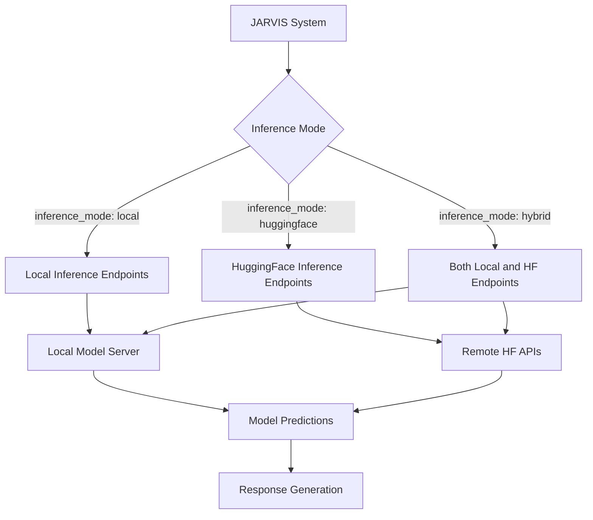
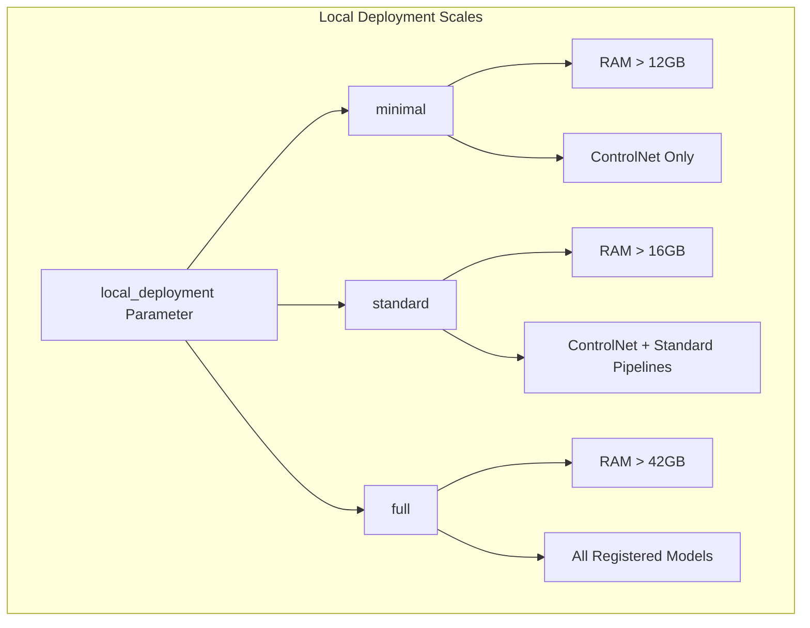
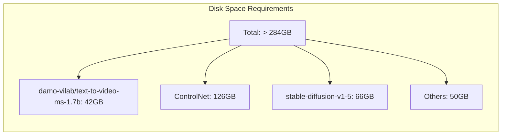
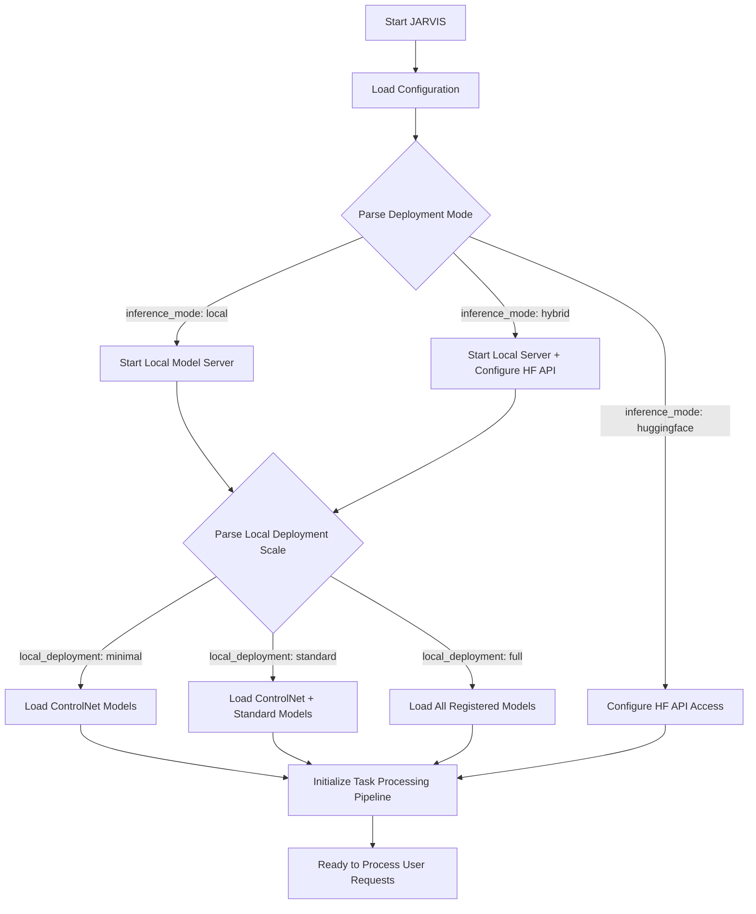
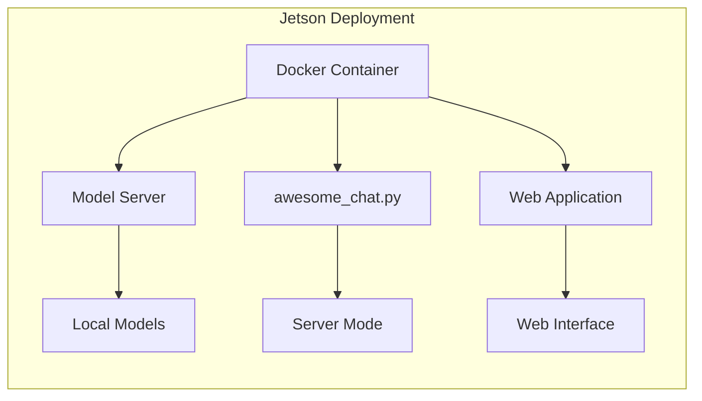

<!-- source: DeepWiki mcp.deepwiki.com · repo microsoft/JARVIS · page 2.3 Deployment Modes · fetched 2026-10-26 -->

# Deployment Modes

<details>
<summary>Relevant source files</summary>

The following files were used as context for generating this wiki page:

- [README.md](README.md)

</details>


## Purpose and Scope

This document details the various deployment modes available in the JARVIS system. It explains the differences between local, huggingface, and hybrid inference modes, along with their respective resource requirements and configuration options. For information about using the different interfaces to interact with JARVIS, see [Interfaces and Usage](#2.4).

## Deployment Mode Overview

JARVIS supports three primary deployment modes that determine where the AI models are executed. Each mode has different resource requirements, performance characteristics, and setup complexity.



**Diagram: JARVIS Inference Mode Architecture**

Sources: [README.md:185-189]()

### Local Mode

In local mode, JARVIS exclusively uses locally deployed models for inference. This offers greater reliability and potentially faster performance, but requires substantial local resources (RAM, disk space, and GPU).

- **Configuration**: Set `inference_mode: local` in the configuration file
- **Advantages**: Consistent performance, no dependency on external services, potentially lower latency
- **Disadvantages**: Higher resource requirements, requires model downloads
- **Use Case**: Production environments, systems with sufficient resources, scenarios requiring reliability

### HuggingFace Mode

In HuggingFace mode, JARVIS exclusively relies on HuggingFace's remote inference endpoints for model execution, eliminating the need for local model deployment.

- **Configuration**: Set `inference_mode: huggingface` in the configuration file
- **Advantages**: Minimal local resource requirements, no model downloads needed
- **Disadvantages**: Dependent on the availability and stability of remote endpoints
- **Use Case**: Testing, limited resource environments, quick setup scenarios

### Hybrid Mode

Hybrid mode combines both local and remote inference capabilities, leveraging local endpoints for some models while utilizing HuggingFace's remote endpoints for others.

- **Configuration**: Set `inference_mode: hybrid` in the configuration file 
- **Advantages**: Flexibility, balanced resource utilization, broader model availability
- **Disadvantages**: More complex configuration, potential inconsistency in performance
- **Use Case**: Personal laptops, development environments, scenarios requiring specific model combinations

Sources: [README.md:185-189](), [README.md:195-196]()

## Local Deployment Scales

When using either the `local` or `hybrid` inference modes, you can configure the scale of locally deployed models to match your available resources.



**Diagram: Local Deployment Scale Requirements**

Sources: [README.md:190-194]()

### Minimal Scale

The minimal deployment scale requires the least resources but supports only a limited set of models.

- **Configuration**: Set `local_deployment: minimal` in the configuration file
- **Resource Requirements**: RAM > 12GB
- **Models Deployed**: ControlNet models only
- **Use Case**: Resource-constrained environments, testing scenarios

### Standard Scale

The standard deployment scale offers a balance between resource utilization and model availability.

- **Configuration**: Set `local_deployment: standard` in the configuration file
- **Resource Requirements**: RAM > 16GB
- **Models Deployed**: ControlNet + Standard Pipelines
- **Use Case**: Most development scenarios, personal computers with decent specifications

### Full Scale

The full deployment scale provides access to all registered models but requires substantial resources.

- **Configuration**: Set `local_deployment: full` in the configuration file
- **Resource Requirements**: RAM > 42GB
- **Models Deployed**: All registered models
- **Use Case**: Production environments, high-performance systems, comprehensive model support

Sources: [README.md:190-194]()

## System Requirements

Different deployment configurations have varying system requirements, particularly for disk space and memory.



**Diagram: Disk Space Requirements for Full Deployment**

Sources: [README.md:48-62]()

The primary system requirements for default configuration:

- Ubuntu 16.04 LTS (recommended)
- VRAM ≥ 24GB
- RAM requirements vary by deployment scale:
  - Minimal: > 12GB
  - Standard: > 16GB
  - Full: > 80GB
- Disk space: > 284GB (for full deployment with all models)

For the lite configuration (`config.lite.yaml`), which uses only HuggingFace inference endpoints, there are minimal local requirements beyond the basic operating system.

Sources: [README.md:48-70]()

## Configuration Examples

JARVIS uses YAML configuration files to define deployment settings. The configuration files are located in the `server/configs/` directory.

### Default Configuration Example

```yaml
model: text-davinci-003
inference_mode: hybrid
local_deployment: standard
```

This configuration uses both local and HuggingFace endpoints, with standard local deployment (RAM > 16GB).

### Lite Configuration Example

```yaml
model: text-davinci-003
inference_mode: huggingface
```

This configuration uses only HuggingFace inference endpoints with no local model deployment, ideal for systems with limited resources.

Sources: [README.md:184-194](), [README.md:24-25]()

## Deployment Process Flow

The following diagram illustrates the deployment process flow from configuration to model execution:



**Diagram: JARVIS Deployment Process Flow**

Sources: [README.md:185-194](), [README.md:92-95]()

## Special Deployment: NVIDIA Jetson Support

JARVIS provides experimental support for NVIDIA Jetson embedded devices through a dedicated Docker container.



**Diagram: NVIDIA Jetson Deployment Architecture**

Sources: [README.md:197-224]()

Key considerations for Jetson deployment:

- Requires Jetson AGX Orin family devices (64GB on-board RAM preferred)
- Configuration must use:
  - `inference_mode: local`
  - `local_deployment: standard`
- Docker container provides accelerated ffmpeg, pytorch, torchaudio, and torchvision dependencies
- Models and configs are recommended to be provided through volume mounts

Sources: [README.md:197-224]()

## Best Practices and Recommendations

### Mode Selection Guidelines

| Available Resources | Recommended Mode | Deployment Scale |
|---------------------|------------------|------------------|
| Limited RAM (<12GB) | huggingface      | N/A              |
| Moderate RAM (12-16GB) | hybrid         | minimal          |
| Substantial RAM (16-42GB) | hybrid      | standard         |
| High RAM (>42GB)    | local or hybrid  | full             |

### Performance Considerations

- **Local mode** generally provides the most consistent performance but requires significant resources
- **HuggingFace mode** performance depends on the availability and load of remote endpoints
- **Hybrid mode** with minimal deployment offers a good balance for personal laptops

Sources: [README.md:195-196]()

## Model Acquisition and Startup

When using `local` or `hybrid` mode, models must be downloaded before starting the server:

1. Download models: `cd models && bash download.sh`
2. Start model server: `python models_server.py --config configs/config.default.yaml`
3. Start JARVIS: `python awesome_chat.py --config configs/config.default.yaml --mode server`

For the `huggingface` mode, only step 3 is required, making it the quickest to set up.

Sources: [README.md:88-94]()

---

