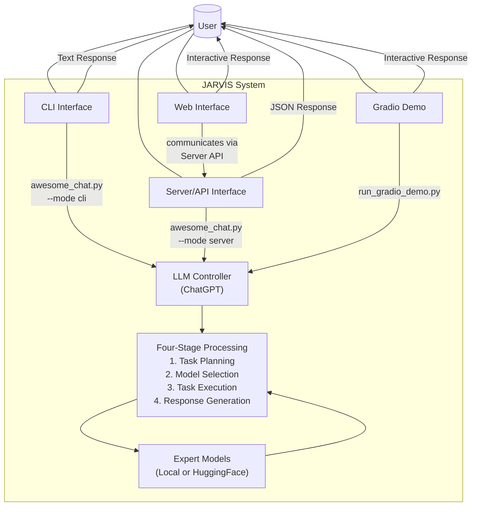
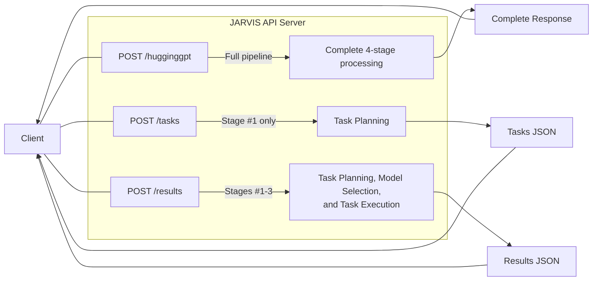
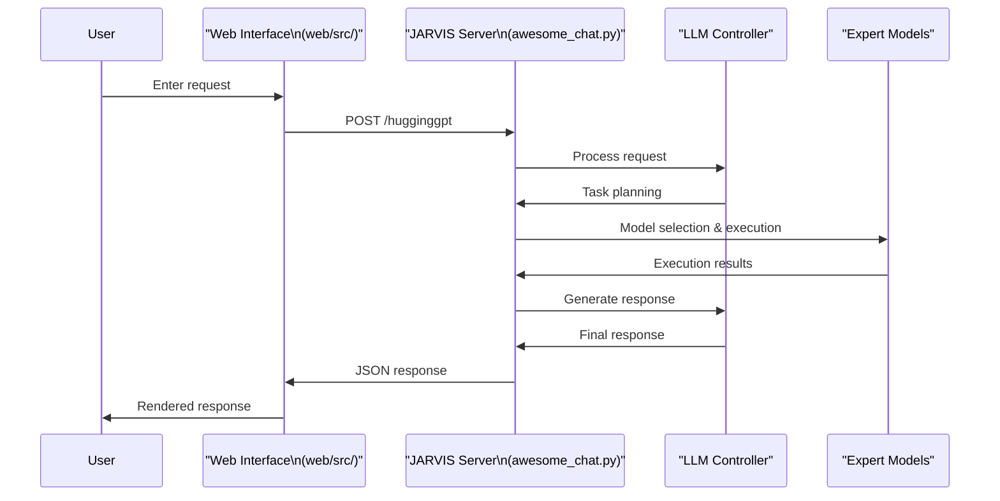
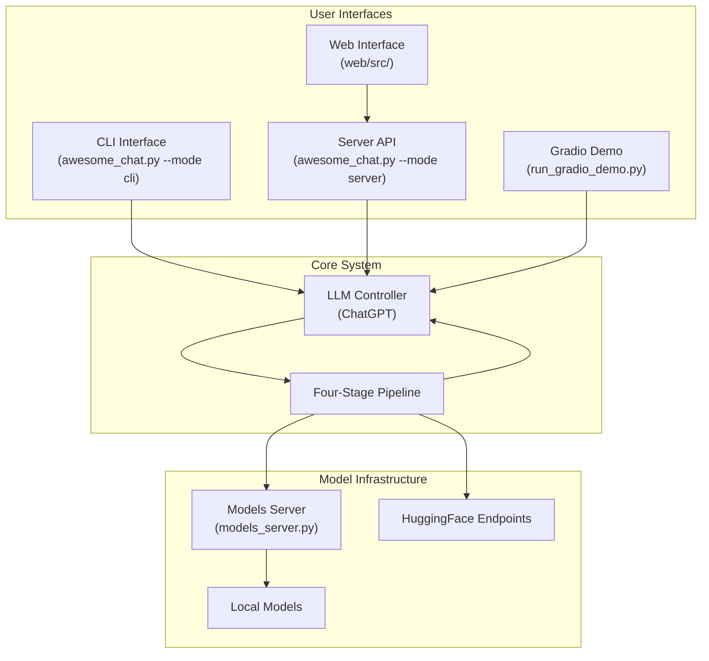

<!-- source: DeepWiki mcp.deepwiki.com · repo microsoft/JARVIS · page 2.4 Interfaces and Usage · fetched 2026-10-26 -->

# Interfaces and Usage

<details>
<summary>Relevant source files</summary>

The following files were used as context for generating this wiki page:

- [README.md](README.md)

</details>


This document describes the various interfaces available for interacting with the JARVIS system and instructions on how to use each one. JARVIS provides multiple ways to interact with its core functionality, including a Command Line Interface (CLI), Server API, Web Interface, and Gradio Demo. Each interface allows users to access JARVIS's four-stage workflow described in [Four-Stage Workflow](#2.2).

## Interface Overview

JARVIS provides four primary interfaces, each catering to different use cases and user preferences.



Sources: [README.md:72-173]()

## Interface Modes and Configuration

Before using any interface, you need to configure JARVIS. The configuration file determines which models are used and how they're deployed.

### Key Configuration Parameters

| Parameter | Options | Description |
|-----------|---------|-------------|
| `inference_mode` | `local`, `huggingface`, `hybrid` | Determines which inference endpoints to use |
| `local_deployment` | `minimal`, `standard`, `full` | Scale of locally deployed models |
| `model` | e.g., `text-davinci-003` | The LLM to use as the controller |

- **inference_mode**:
  - `local`: Only uses locally deployed models
  - `huggingface`: Only uses Hugging Face's remote inference endpoints
  - `hybrid`: Uses both local and remote endpoints

- **local_deployment**:
  - `minimal`: Only deploys ControlNet models (RAM > 12GB)
  - `standard`: Deploys ControlNet + standard pipelines (RAM > 16GB)
  - `full`: Deploys all registered models (RAM > 42GB)

Sources: [README.md:181-195]()

## Command Line Interface (CLI)

The CLI provides a straightforward text-based interaction with JARVIS, ideal for quick tests or environments without a graphical interface.

### Starting the CLI

```bash
cd server
python awesome_chat.py --config configs/config.default.yaml --mode cli
```

### CLI Usage

After starting, you'll be prompted to enter your requests. Type your message and press Enter to send it to JARVIS. Type `exit` to quit the CLI.

```
Welcome to Jarvis! A collaborative system that consists of an LLM as the controller and numerous expert models as collaborative executors...
[ User ]: Please generate a canny image based on /examples/f.jpg
[ Jarvis ]: Sure. I have generated a canny image based on /examples/f.jpg...
```

Sources: [README.md:159-178]()

## Server API Interface

The Server API allows programmatic access to JARVIS through HTTP endpoints. It's useful for integrating JARVIS with other applications or services.

### Starting the Server

```bash
cd server
# Start the models server first (required for local or hybrid inference modes)
python models_server.py --config configs/config.default.yaml
# Then start the main server
python awesome_chat.py --config configs/config.default.yaml --mode server
```

### API Endpoints



| Endpoint | Method | Description | Response |
|----------|--------|-------------|----------|
| `/hugginggpt` | POST | Access the full JARVIS service | Complete response with all stages |
| `/tasks` | POST | Access results from Stage #1 (Task Planning) | JSON array of planned tasks |
| `/results` | POST | Access results from Stages #1-3 | JSON with execution results |

### Example Request and Response

```bash
# Request to /tasks endpoint
curl --location 'http://localhost:8004/tasks' \
--header 'Content-Type: application/json' \
--data '{
    "messages": [
        {
            "role": "user",
            "content": "based on pose of /examples/d.jpg and content of /examples/e.jpg, please show me a new image"
        }
    ]
}'

# Response
[{"args":{"image":"/examples/d.jpg"},"dep":[-1],"id":0,"task":"openpose-control"},{"args":{"image":"/examples/e.jpg"},"dep":[-1],"id":1,"task":"image-to-text"},{"args":{"image":"<GENERATED>-0","text":"<GENERATED>-1"},"dep":[1,0],"id":2,"task":"openpose-text-to-image"}]
```

Sources: [README.md:76-121]()

## Web Interface

The Web Interface provides a user-friendly graphical interface for interacting with JARVIS. It communicates with the Server API and presents results in a visually appealing manner.

### Setting Up and Starting the Web Interface

```bash
# First, ensure the server is running
cd server
python models_server.py --config configs/config.default.yaml
python awesome_chat.py --config configs/config.default.yaml --mode server

# Then, in a separate terminal, start the web interface
cd web
npm install
npm run dev
```

### Web Interface Configuration

If you're running the Web client on a different machine than the server, you need to configure the server's URL:

- Edit `web/src/config/index.ts` and set `HUGGINGGPT_BASE_URL` to `http://{LAN_IP_of_the_server}:{port}/`

### Web Interface Features

- Interactive chat-like interface
- Support for uploading and displaying images
- Ability to switch to ChatGPT by double-clicking the settings icon
- Video generation support (requires ffmpeg with H.264 support)



Sources: [README.md:124-143]()

## Gradio Demo

The Gradio Demo provides another user-friendly interface that's easy to deploy and share. It's hosted on Hugging Face Spaces and can also be run locally.

### Starting the Gradio Demo Locally

```bash
# Start the models server first
python models_server.py --config configs/config.gradio.yaml
# Then start the Gradio demo
python run_gradio_demo.py --config configs/config.gradio.yaml
```

### Using the Hugging Face Space

The Gradio demo is hosted on Hugging Face Space, which you can access directly. Alternatively, you can run the Docker image:

```bash
docker run -it -p 7860:7860 --platform=linux/amd64 registry.hf.space/microsoft-hugginggpt:latest python app.py
```

The Gradio demo uses a hybrid inference mode and standard local deployment, providing a balance between performance and resource usage.

Sources: [README.md:146-157]()

## Interface Comparison

| Feature | CLI | Server API | Web Interface | Gradio Demo |
|---------|-----|------------|---------------|-------------|
| Ease of Use | Simple | Technical | Very User-Friendly | User-Friendly |
| Visual Features | Text Only | JSON Only | Full Visuals | Full Visuals |
| Setup Complexity | Low | Medium | High | Medium |
| Integration Potential | Limited | High | Medium | Medium |
| Resource Requirements | Based on config | Based on config | Based on config + Web | Based on config |
| Best For | Quick Testing | Integration | Regular Use | Sharing/Demo |

## JARVIS Interface Architecture

The following diagram shows how the different interface components interact with the core JARVIS system and each other:



Sources: [README.md:72-195]()

## Common Configuration Examples

For different use cases, you might want to use different configuration settings:

| Use Case | Recommended Config | Description |
|----------|-------------------|-------------|
| Lightweight Laptop | `inference_mode: hybrid` + `local_deployment: minimal` | Balances local and remote processing, minimal resources |
| Powerful Desktop | `inference_mode: local` + `local_deployment: full` | Full local deployment for best performance and reliability |
| Server with Limited Resources | `inference_mode: huggingface` | Uses only remote endpoints, no local model deployment needed |
| Demo Environment | `inference_mode: hybrid` + `local_deployment: standard` | Balanced approach for demo purposes |

Sources: [README.md:181-195]()

## Usage Examples

Here are some example use cases for different interfaces:

### CLI Example

```
[ User ]: Please generate a canny image based on /examples/f.jpg
[ Jarvis ]: Sure. I have generated a canny image based on /examples/f.jpg. To do this, I first used the image-to-text model nlpconnect/vit-gpt2-image-captioning to generate the text description of the image, which is "a herd of giraffes and zebras grazing in a field". Then I used the canny-control model to generate the canny image of the original image, which is stored in the path "/images/1ea2.png". Finally, I used the canny-text-to-image model lllyasviel/sd-controlnet-canny to generate the canny image based on the text description and the canny image, which is stored in the path "/images/ba66.png". Do you need anything else?
```

### Server API Example

```bash
curl --location 'http://localhost:8004/hugginggpt' \
--header 'Content-Type: application/json' \
--data '{
    "messages": [
        {
            "role": "user", 
            "content": "Tell me what is in this image: /examples/a.jpg"
        }
    ]
}'
```

Sources: [README.md:107-176]()

---

