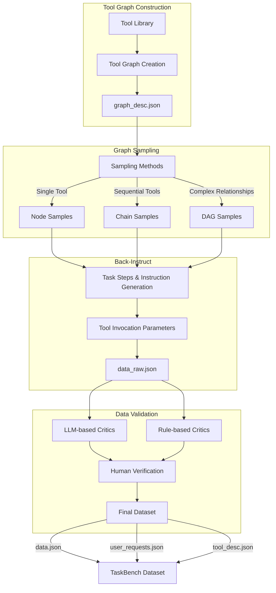
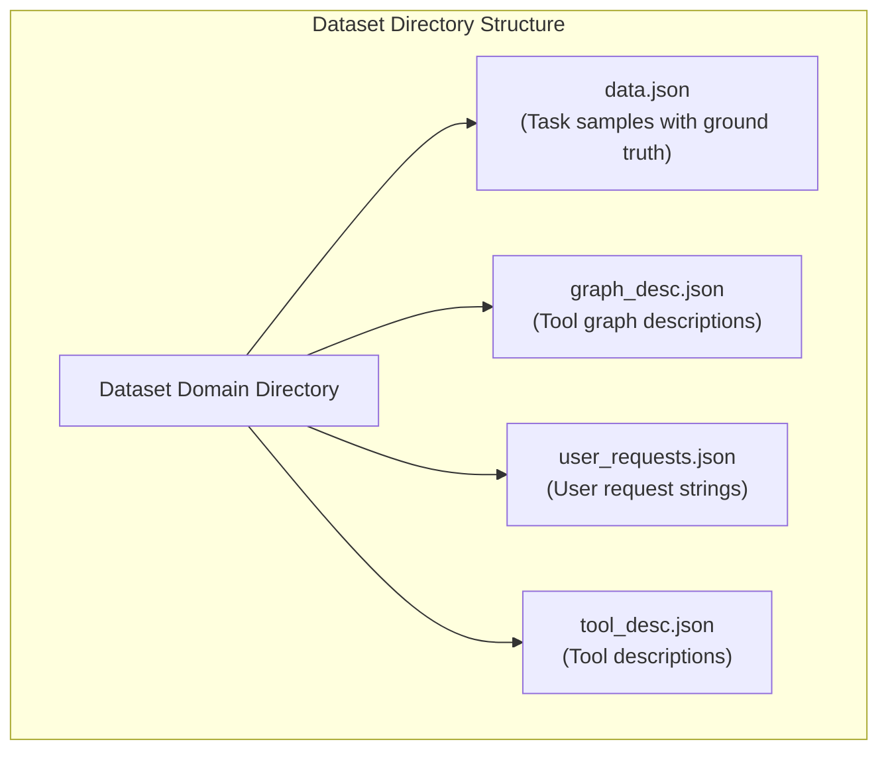
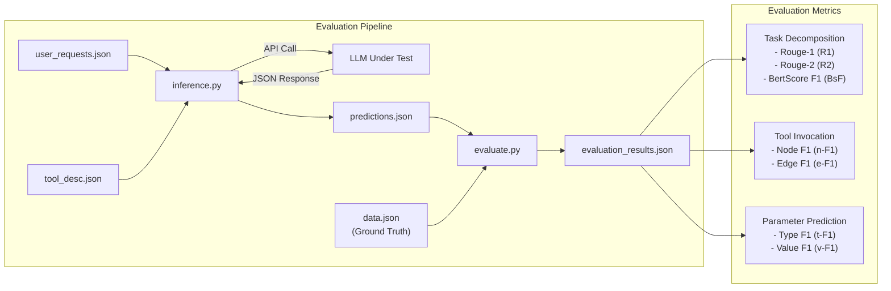
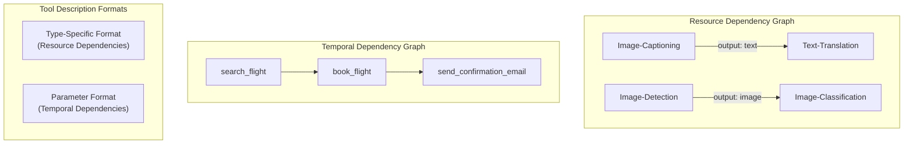
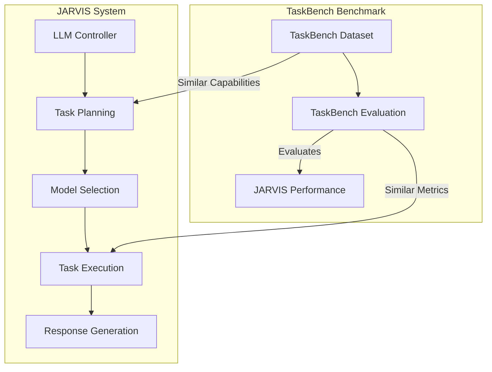

<!-- source: DeepWiki mcp.deepwiki.com · repo microsoft/JARVIS · page 3 TaskBench Benchmark · fetched 2026-10-26 -->

# TaskBench Benchmark

<details>
<summary>Relevant source files</summary>

The following files were used as context for generating this wiki page:

- [taskbench/README.md](taskbench/README.md)

</details>


## Purpose and Scope

This document describes TaskBench, a comprehensive benchmark for evaluating large language models (LLMs) on task automation capabilities. TaskBench focuses on three critical aspects of task automation: task decomposition, tool invocation, and parameter prediction. This page covers the benchmark's architecture, data generation methodology, evaluation framework, and usage within the JARVIS ecosystem. For information about using JARVIS itself, see [JARVIS System](#2).

Sources: [taskbench/README.md:38-40]()

## Overview of TaskBench

TaskBench addresses the challenge of evaluating LLMs on complex task automation workflows. Unlike conventional NLP benchmarks, TaskBench assesses an LLM's ability to break down user requests, select appropriate tools, and correctly provide parameters to those tools—capabilities essential for systems like JARVIS.

The benchmark includes datasets across three domains:
- HuggingFace Tools
- Multimedia Tools
- Daily Life APIs

Each domain contains carefully crafted evaluation tasks constructed through a tool graph-based data generation pipeline.

Sources: [taskbench/README.md:38-40](), [taskbench/README.md:43-53]()

## TaskBench Architecture

### Data Generation Pipeline



TaskBench employs a sophisticated data generation pipeline that consists of four main stages:

1. **Tool Graph Construction**: Creates a directed graph where nodes represent tools and edges represent dependencies between tools. Two dependency types are supported:
   - Resource dependencies (input/output relationships)
   - Temporal dependencies (sequencing relationships)

2. **Graph Sampling**: Samples the tool graph to generate different structures:
   - Node: Single tool invocation
   - Chain: Sequential tool invocations
   - DAGs: Complex dependency relationships

3. **Back-Instruct**: Generates high-quality data using the sampled graph:
   - Creates task steps and user instructions
   - Generates tool invocation parameters
   - Constructs complete tool invocation graphs

4. **Data Validation**: Ensures data quality through:
   - LLM-based critics (69-76% of samples pass)
   - Rule-based critics (82-88% of samples pass)
   - Human verification (60-63% of samples retained)

Sources: [taskbench/README.md:43-57](), [taskbench/README.md:189-237]()

### Dataset Structure

Each dataset domain contains several key files:



The dataset is distributed across three domain-specific directories:
- `data_huggingface/` (12,217 samples, 61.76% human-verified)
- `data_multimedia/` (8,904 samples, 62.71% human-verified)
- `data_dailylifeapis/` (7,150 samples, 60.42% human-verified)

The samples are distributed across different tool graph structures:
- Node (single tool): ~20-25% of samples
- Chain (sequential tools): ~50-55% of samples
- DAG (complex relationships): ~5-15% of samples

Sources: [taskbench/README.md:59-86](), [taskbench/README.md:96-101]()

## Evaluation Framework

TaskBench evaluates task automation capability through three distinct stages, each with specialized metrics:



### Evaluation Stages and Metrics

1. **Task Decomposition**
   - Assesses how well the LLM breaks down complex tasks
   - Metrics: Rouge-1 (R1), Rouge-2 (R2), BertScore F1 (BsF)
   - High scores indicate better understanding of required steps

2. **Tool Invocation**
   - Measures accuracy in selecting the right tools and their dependencies
   - Metrics: Node F1 (n-F1), Edge F1 (e-F1)
   - Edge F1 specifically evaluates correct identification of tool dependencies

3. **Parameter Prediction**
   - Evaluates precision in providing correct parameters to tools
   - Metrics: Type/Name F1 (t-F1), Value F1 (v-F1)
   - Critical for successful tool execution

Sources: [taskbench/README.md:118-125](), [taskbench/README.md:148-186]()

## Tool Graph Concept

The Tool Graph is a fundamental concept in TaskBench:



### Tool Description Formats

TaskBench supports two formats for tool descriptions:

1. **Type-Specific Format** (for resource dependencies):
   ```
   {
     "id": "Image-to-Image",
     "desc": "Image-to-image is the task of transforming...",
     "input-type": ["image"],
     "output-type": ["image"]
   }
   ```

2. **Parameter Format** (for temporal dependencies):
   ```
   {
     "id": "send_sms",
     "desc": "Send an sms to a specific phone number",
     "parameters": [
       {
         "name": "phone_number",
         "type": "string",
         "desc": "The phone number to send the sms to"
       },
       ...
     ]
   }
   ```

Sources: [taskbench/README.md:193-225]()

## Using TaskBench

### Setup and Dependencies

TaskBench requires Python 3.8+ and specific dependencies:

```bash
conda create -n taskbench python=3.8
conda activate taskbench
pip install -r requirements.txt
```

For evaluating open-source LLMs, an OpenAI-compatible API must be deployed:

```bash
pip install fastchat vllm "fastapi[all]"
python3 -m fastchat.serve.controller
python3 -m fastchat.serve.vllm_worker --model-path lmsys/vicuna-7b-v1.3
python3 -m fastchat.serve.openai_api_server --host localhost --port 4000
```

Sources: [taskbench/README.md:129-146]()

### Running Inference

To generate predictions with a specific LLM:

```bash
python inference.py \
    --llm gpt-4 \
    --data_dir data_multimedia \
    --temperature 0.2 \
    --top_p 0.1 \
    --api_addr localhost \
    --api_port 4000 \
    --api_key $YOUR_API_KEY \
    --multiworker 5 \
    --use_demos 2 \
    --dependency_type resource \
    --tag true
```

Key parameters:
- `--llm`: Specifies the LLM to evaluate
- `--data_dir`: Dataset domain to use
- `--dependency_type`: Type of dependency (resource or temporal)
- `--use_demos`: Number of few-shot examples to include (0-3)

Sources: [taskbench/README.md:148-170]()

### Evaluation

After generating predictions, evaluate performance with:

```bash
python evaluate.py \
    --data_dir data_multimedia \
    --prediction_dir $prediction_dir \
    --llm gpt-4 \
    --splits all \
    --n_tools all \
    --mode add \
    --dependency_type resource \
    -m all
```

This will calculate all evaluation metrics and save results to the `metrics` folder.

Sources: [taskbench/README.md:172-186]()

## Current Leaderboard Results

TaskBench has been used to evaluate 17 LLMs, including proprietary models like GPT-4 and Claude-2, as well as open-source models like Vicuna and CodeLlama. Below is a summary of performance on the Multimedia Tools domain:

| LLM | R1 | R2 | BsF | n-F1 | e-F1 | t-F1 | v-F1 |
|-----|----|----|-----|------|------|------|------|
| gpt-4 | 60.84 | 40.08 | 91.19 | 90.90 | 69.27 | 87.06 | 72.31 |
| claude-2 | 48.85 | 23.59 | 89.22 | 80.94 | 53.01 | 71.63 | 51.58 |
| gpt-3.5-turbo | 49.66 | 28.51 | 89.54 | 72.83 | 44.02 | 65.91 | 40.80 |
| codellama-13b | 44.46 | 23.30 | 88.66 | 62.78 | 24.61 | 48.19 | 29.13 |
| vicuna-13b-v1.5 | 44.75 | 23.75 | 88.94 | 60.61 | 14.78 | 41.62 | 23.62 |

Note: Full results across all domains and models can be found in the TaskBench README.

Sources: [taskbench/README.md:279-348]()

## Relationship to JARVIS



TaskBench serves as an evaluation framework for systems like JARVIS that need to decompose tasks, select appropriate tools, and provide parameters. While JARVIS is a complete task automation system, TaskBench focuses on benchmarking these specific capabilities in isolation. The metrics from TaskBench can help guide improvements to JARVIS's LLM controller and tool invocation mechanisms.

Sources: [taskbench/README.md:38-40]()

## Creating Your Own Benchmark Data

TaskBench provides tools to generate custom benchmark datasets:

1. **Create Tool Library**: Define tools in either type-specific format (for resource dependencies) or parameter format (for temporal dependencies)

2. **Generate Tool Graph**:
   ```bash
   python generate_graph.py \
       --tool_desc tool_desc.json \
       --dependency_type resource \
       --data_dir custom_data
   ```

3. **Generate Dataset**:
   ```bash
   python data_engine.py \
       --graph_desc custom_data/graph_desc.json \
       --tool_desc custom_data/tool_desc.json \
       --llm gpt-4 \
       --dependency_type resource \
       --check true
   ```

4. **Format Data**:
   ```bash
   python format_data.py \
       --data_dir custom_data \
       --dependency_type resource
   ```

This process allows for domain-specific benchmark creation to evaluate specialized task automation capabilities.

Sources: [taskbench/README.md:188-277]()

---

