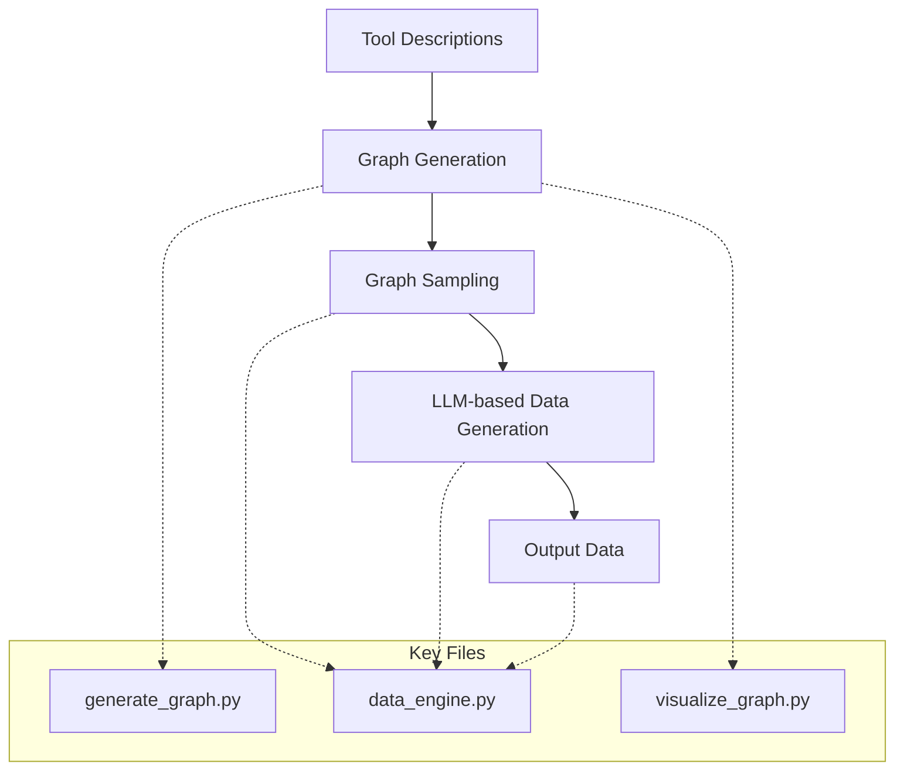
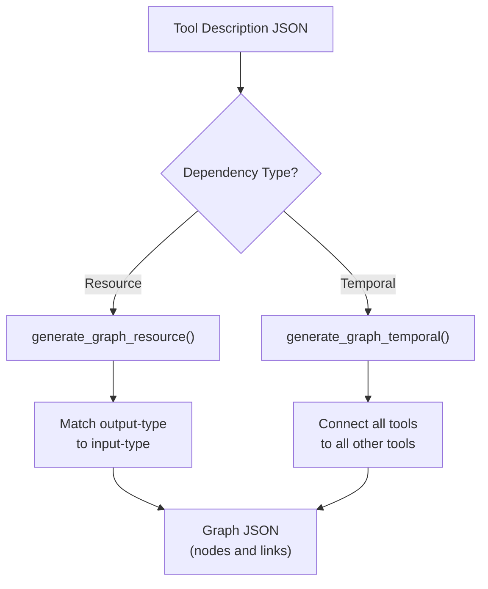
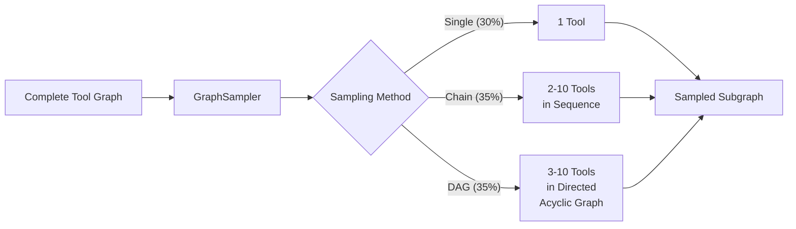
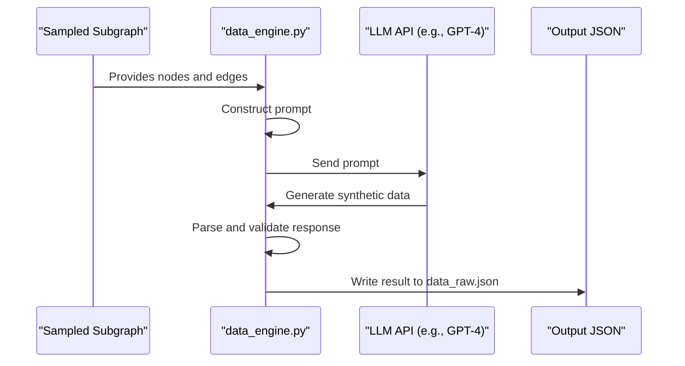
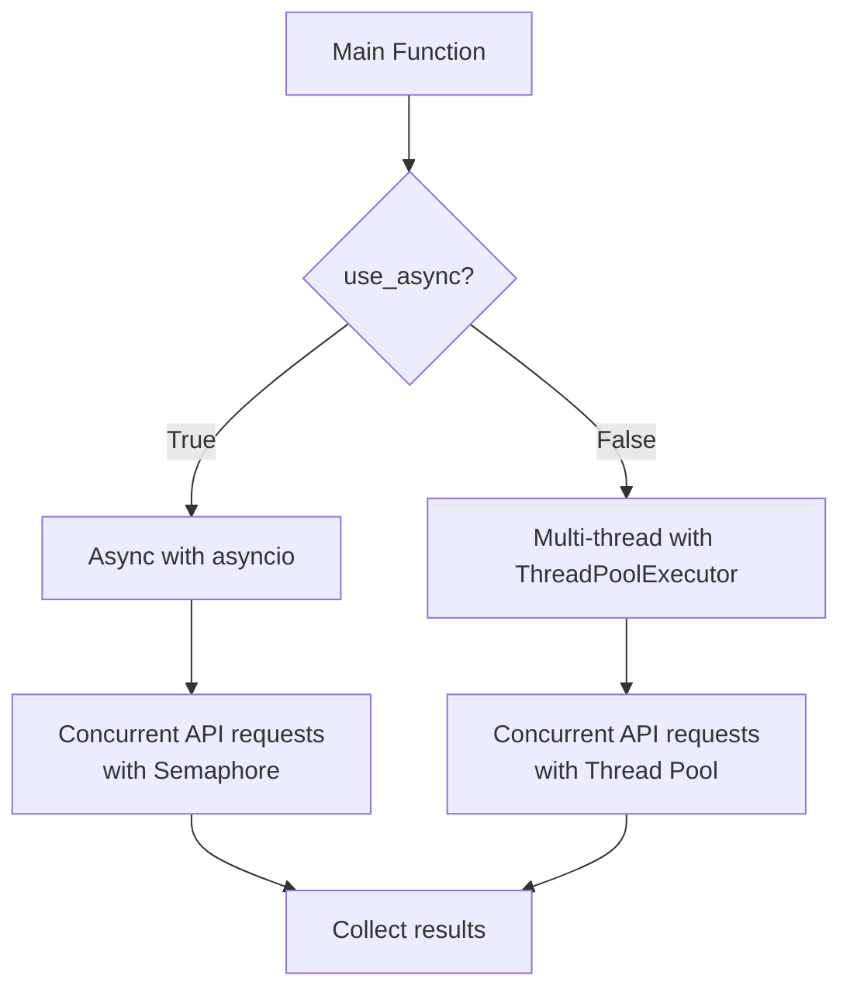
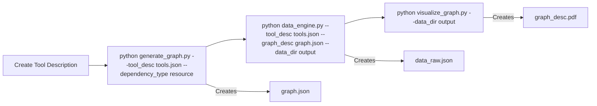

<!-- source: DeepWiki mcp.deepwiki.com · repo microsoft/JARVIS · page 3.1 Data Generation Pipeline · fetched 2026-10-26 -->

# Data Generation Pipeline

<details>
<summary>Relevant source files</summary>

The following files were used as context for generating this wiki page:

- [taskbench/data_engine.py](taskbench/data_engine.py)
- [taskbench/generate_graph.py](taskbench/generate_graph.py)
- [taskbench/requirements.txt](taskbench/requirements.txt)
- [taskbench/visualize_graph.py](taskbench/visualize_graph.py)

</details>


## Purpose and Scope

The Data Generation Pipeline is a key component of the TaskBench benchmark system. It generates synthetic task data used to evaluate large language models (LLMs) on their task automation capabilities. This pipeline creates datasets of user requests, task steps, and tool invocation graphs that represent various task automation scenarios.

This document explains the pipeline components, workflow, and configuration options. For information about how to perform inference on the generated data, see [Inference Process](#3.2), and for evaluation of the benchmark results, see [Evaluation Framework](#3.3).

## Pipeline Overview

The Data Generation Pipeline transforms tool descriptions into a comprehensive dataset of task automation scenarios through a multi-stage process. It creates dependencies between tools, samples different graph structures, and uses LLMs to generate realistic user requests and task decompositions.



Sources: [taskbench/generate_graph.py](), [taskbench/data_engine.py](), [taskbench/visualize_graph.py]()

## Pipeline Components

### Tool Description Format

The pipeline starts with tool descriptions that define the available tools, their inputs/outputs, and parameters. These are stored in a JSON file with the following structure:

```mermaid
classDiagram
    class "Tool Description" {
        nodes: Tool[]
    }
    
    class "Tool" {
        id: string
        desc: string
        input-type: string[] (for resource dependency)
        output-type: string[] (for resource dependency)
        parameters: Parameter[] (for temporal dependency)
    }
    
    class "Parameter" {
        name: string
        type: string
        desc: string
    }
    
    "Tool Description" --> "Tool" : contains
    "Tool" --> "Parameter" : has (temporal only)
```

Sources: [taskbench/generate_graph.py:4-20](), [taskbench/generate_graph.py:22-43]()

### Graph Generation

The `generate_graph.py` script creates a graph representation of possible tool connections based on the tool descriptions. It supports two dependency types:

1. **Resource Dependencies** - Tools are connected when the output type of one tool matches the input type of another
2. **Temporal Dependencies** - All tools can potentially follow one another in sequence



Sources: [taskbench/generate_graph.py:4-20](), [taskbench/generate_graph.py:22-43](), [taskbench/generate_graph.py:45-59]()

### Graph Sampling

The data generation engine samples subgraphs from the complete tool graph using one of three methods:

1. **Single** - A single tool is selected
2. **Chain** - A linear sequence of tools is selected
3. **DAG (Directed Acyclic Graph)** - A more complex structure with multiple paths is selected

The sampling is done with weighted random selection of both the method and the number of tools to include.



Sources: [taskbench/data_engine.py:84-84](), [taskbench/data_engine.py:119-135](), [taskbench/data_engine.py:160-167](), [taskbench/data_engine.py:202-210](), [taskbench/data_engine.py:236-236]()

### LLM-based Data Generation

The core of data generation happens in the `sample()` function in `data_engine.py` which:

1. Takes a sampled subgraph
2. Constructs a prompt describing the tool graph with its nodes and edges
3. Sends the prompt to an LLM (default is GPT-4)
4. Parses the LLM's response to extract:
   - Task steps
   - User request
   - Tool invocation graph

The function ensures that the generated data aligns with the sampled graph structure.



Sources: [taskbench/data_engine.py:233-352]()

## Configuration and Usage

### Command-line Options

The data generation pipeline is controlled through command-line options in `data_engine.py`, with major options including:

| Option | Default | Description |
|--------|---------|-------------|
| `--temperature` | 0.7 | Controls randomness of LLM |
| `--top_p` | 1 | Controls diversity of LLM |
| `--data_dir` | None | Output directory for results |
| `--graph_desc` | None | Path to graph description file |
| `--tool_desc` | None | Path to tool description file |
| `--method` | None | Sampling method (single/chain/dag) |
| `--tool_number` | None | Number of tools to sample |
| `--number_of_samples` | 5000 | Number of samples to generate |
| `--llm` | "gpt-4" | LLM to use for generation |
| `--dependency_type` | "resource" | Type of dependency (resource/temporal) |

Sources: [taskbench/data_engine.py:28-47](), [taskbench/data_engine.py:48-59]()

### Scaling and Parallelization

The pipeline supports parallel data generation through two methods:

1. **Multi-threading** - Using Python's ThreadPoolExecutor
2. **Asynchronous processing** - Using asyncio with semaphores to control concurrency



Sources: [taskbench/data_engine.py:139-200](), [taskbench/data_engine.py:182-221]()

## Output Format

The pipeline produces several output files:

1. **data_raw.json** - The main output containing all generated samples
2. **statistics.json** - Statistics about the generation process
3. **task_graphs/** (optional) - Visualizations of sampled graphs

Each sample in data_raw.json has the following structure:

```mermaid
classDiagram
    class "Sample" {
        id: string
        seed: int
        method: string
        number_of_tools: int
        sampled_nodes: object[]
        sampled_links: object[]
        result: Result
    }
    
    class "Result" {
        task_steps: string[]
        user_request: string
        invoking_graph: Graph
    }
    
    class "Graph" {
        nodes: Node[]
        links: Link[]
    }
    
    "Sample" --> "Result" : contains
    "Result" --> "Graph" : contains
```

Sources: [taskbench/data_engine.py:100-100](), [taskbench/data_engine.py:316-319]()

## Example Workflow

A typical workflow for using the data generation pipeline:

1. Create a tool description JSON file
2. Run `generate_graph.py` to create the graph description
3. Run `data_engine.py` to generate samples
4. (Optional) Use `visualize_graph.py` to visualize the tool graph



Sources: [taskbench/generate_graph.py:45-62](), [taskbench/data_engine.py:28-355](), [taskbench/visualize_graph.py:6-36]()

## Requirements

The pipeline depends on several Python packages that handle graph operations, HTTP requests, and visualization:

```
networkx==2.8.4
matplotlib==3.7.1
click==8.0.4
aiohttp==3.8.1
```

Sources: [taskbench/requirements.txt]()

This data generation pipeline is critical for creating comprehensive benchmarks that can evaluate LLMs on complex, multi-step tasks that require tool use and reasoning. The generated datasets serve as the foundation for the evaluation process described in [Evaluation Framework](#3.3).

---

