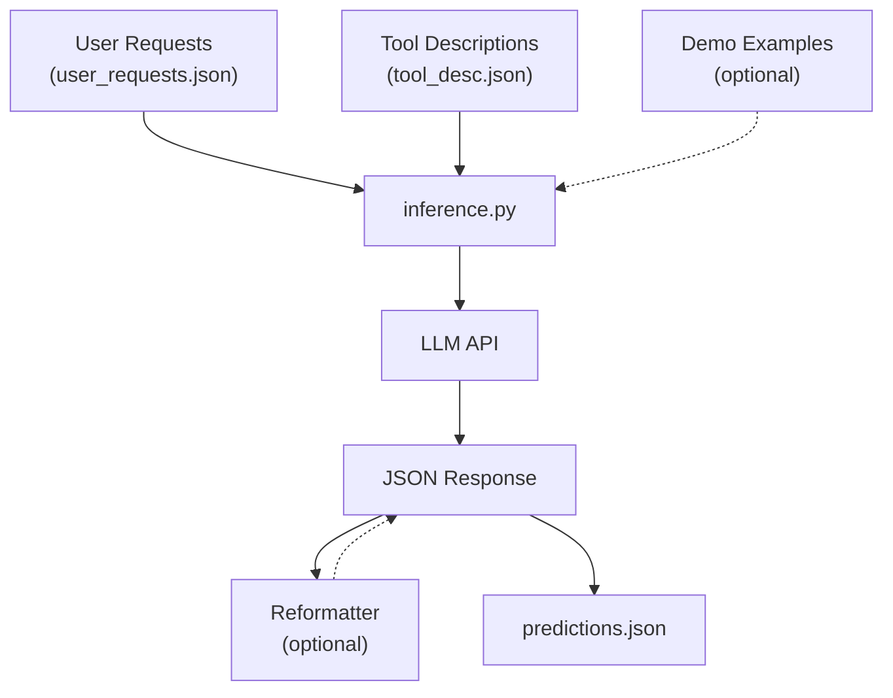
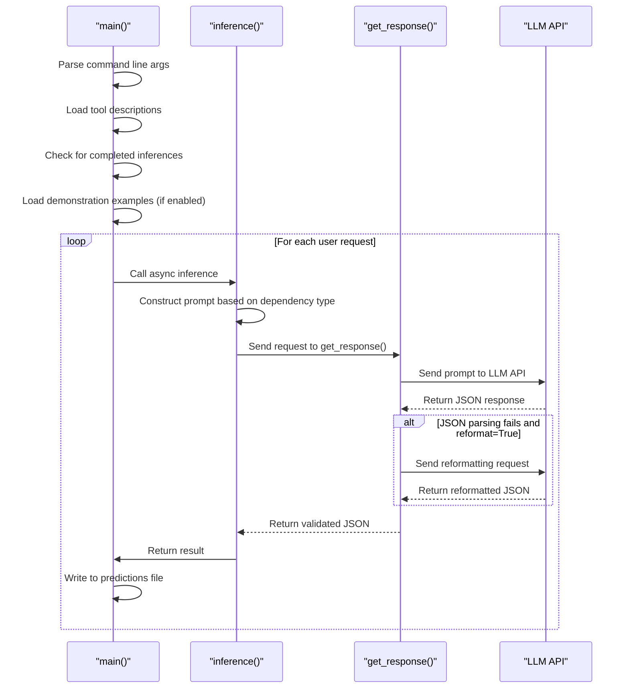
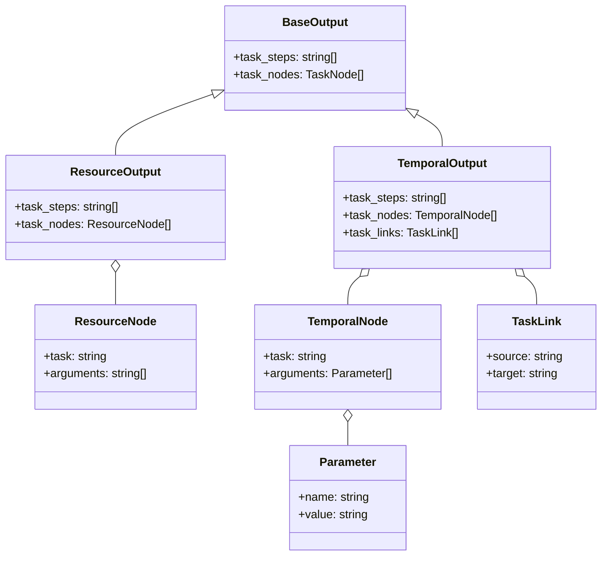
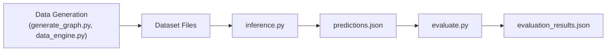

<!-- source: DeepWiki mcp.deepwiki.com · repo microsoft/JARVIS · page 3.2 Inference Process · fetched 2026-10-26 -->

# Inference Process

<details>
<summary>Relevant source files</summary>

The following files were used as context for generating this wiki page:

- [taskbench/inference.py](taskbench/inference.py)

</details>


The Inference Process is a critical component of the TaskBench benchmark that generates structured predictions for task automation using Large Language Models (LLMs). This document explains how the TaskBench inference system processes user requests and transforms them into structured task plans using various LLMs.

For information about the data that serves as input to this inference process, see [Data Generation Pipeline](#3.1). For details on how these inference results are evaluated, see [Evaluation Framework](#3.3).

## Architecture Overview

The inference process transforms natural language user requests into structured task plans by leveraging LLMs to decompose tasks and identify appropriate tools.

**TaskBench Inference Architecture**


Sources: [taskbench/inference.py:37-171]()

## Input Components

### User Requests

The inference process reads user requests from `user_requests.json`, which contains natural language task descriptions with unique identifiers. These requests represent the tasks to be automated.

Example:
```json
{
  "id": "12345678",
  "user_request": "Analyze the sentiment of tweets about climate change"
}
```

### Tool Descriptions

Tool descriptions define the available tools that can be used in task automation. These are loaded from `tool_desc.json` and include metadata such as tool name, parameters, and type information.

The format varies depending on the dependency type:

| Dependency Type | Description | Applicable Domains |
|-----------------|-------------|-------------------|
| Resource | Based on input/output relationships between tools | HuggingFace, Multimedia |
| Temporal | Based on sequential execution order | Daily Life APIs |

Sources: [taskbench/inference.py:62-82]()

## Execution Workflow

The inference process follows a structured workflow to generate predictions efficiently.

**Inference Execution Flow**


Sources: [taskbench/inference.py:150-171](), [taskbench/inference.py:173-214]()

### Prompt Construction

The LLM prompt is carefully crafted based on the dependency type:

1. **Resource Dependency Prompt**: 
   - Instructs the LLM to generate task steps and nodes
   - Arguments can reference outputs of previous nodes using `<node-j>` notation
   - Used for HuggingFace and Multimedia domains

2. **Temporal Dependency Prompt**:
   - Instructs the LLM to generate task steps, nodes, and temporal links
   - Arguments explicitly name parameters and values
   - Used for Daily Life APIs domain

Both prompt types include the complete tool descriptions, detailed requirements, and the user request. If demonstration examples are enabled, they are incorporated into the prompt to improve LLM performance through few-shot learning.

Sources: [taskbench/inference.py:174-187]()

### Parallel Execution

The inference process leverages asyncio to manage concurrent requests, with a configurable limit on parallel workers to avoid API rate limiting issues.

```python
sem = asyncio.Semaphore(multiworker)

async def inference_wrapper(input, url, header, temperature, top_p, tool_string, wf, llm, demos, reformat, reformat_by, dependency_type, log_detail = False):
    async with sem:
        await inference(input, url, header, temperature, top_p, tool_string, wf, llm, demos, reformat, reformat_by, dependency_type, log_detail)
```

Sources: [taskbench/inference.py:137-171]()

## Output Format

### Resource Dependency Output

For HuggingFace and Multimedia domains, the output follows this structure:

```json
{
  "task_steps": [
    "Step 1: Analyze sentiment using TextClassificationPipeline",
    "Step 2: Visualize the results using DataVisualizationPipeline"
  ],
  "task_nodes": [
    {
      "task": "TextClassificationPipeline",
      "arguments": ["tweets about climate change"]
    },
    {
      "task": "DataVisualizationPipeline",
      "arguments": ["<node-0>"]
    }
  ]
}
```

### Temporal Dependency Output

For Daily Life APIs, the output includes explicit temporal links:

```json
{
  "task_steps": [
    "Step 1: Search for climate change news",
    "Step 2: Analyze the sentiment of the search results"
  ],
  "task_nodes": [
    {
      "task": "GoogleSearch",
      "arguments": [
        {
          "name": "query",
          "value": "climate change news"
        }
      ]
    },
    {
      "task": "SentimentAnalysis",
      "arguments": [
        {
          "name": "text",
          "value": "GoogleSearch"
        }
      ]
    }
  ],
  "task_links": [
    {
      "source": "GoogleSearch",
      "target": "SentimentAnalysis"
    }
  ]
}
```

**Output Formats by Dependency Type**


Sources: [taskbench/inference.py:174-187](), [taskbench/inference.py:216-293]()

## Error Handling and Reformatting

The inference process includes robust error handling to ensure valid JSON outputs:

1. **Response Extraction**: The system extracts the actual content from the LLM API response
2. **JSON Parsing**: The system attempts to parse the response as structured JSON
3. **Reformatting (Optional)**: If JSON parsing fails and reformatting is enabled:
   - A new prompt instructs the LLM to fix the formatting issues
   - The reformatted response is parsed again

This approach ensures that even if an LLM generates improperly formatted JSON, the system can still produce valid predictions in most cases.

```python
# Simplified excerpt of the reformatting logic
if reformat:
    prompt = """Please format the result # RESULT # to a strict JSON format..."""
    # Send reformatting request to LLM
    # Parse the reformatted response
```

Sources: [taskbench/inference.py:216-293]()

## Configuration Options

The inference process can be customized through numerous command-line arguments:

| Parameter | Description | Default |
|-----------|-------------|---------|
| data_dir | Data directory | "data_huggingface" |
| temperature | Temperature for LLM generation | 0.2 |
| top_p | Top-p sampling parameter | 0.1 |
| api_addr | API address | "localhost" |
| api_port | API port | 4000 |
| api_key | API key | "your api key" |
| multiworker | Number of parallel workers | 1 |
| llm | LLM to use | "gpt-4" |
| use_demos | Number of demos (0 = disabled) | 0 |
| reformat | Enable reformatting | False |
| reformat_by | Model for reformatting | "self" |
| dependency_type | Dependency type | "resource" |

Sources: [taskbench/inference.py:22-36]()

## Integration with TaskBench

The inference process is a critical link in the TaskBench evaluation pipeline:

**TaskBench Evaluation Pipeline**


The inference module processes user requests to generate predictions that are later compared against ground truth data to measure LLM performance on task automation.

Sources: [taskbench/inference.py:1-296]()

## Conclusion

The TaskBench inference process provides a flexible and robust framework for evaluating how well LLMs can decompose tasks, select appropriate tools, and specify correct parameters. By supporting different dependency types and offering extensive configuration options, it enables comprehensive evaluation across various domains and use cases.

---

