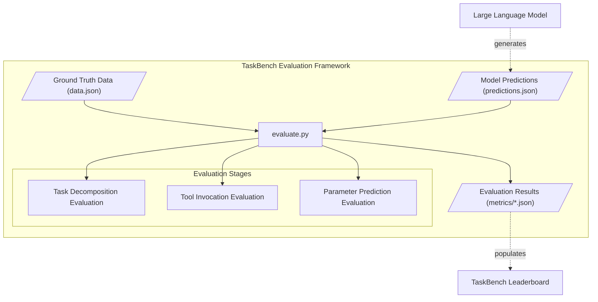
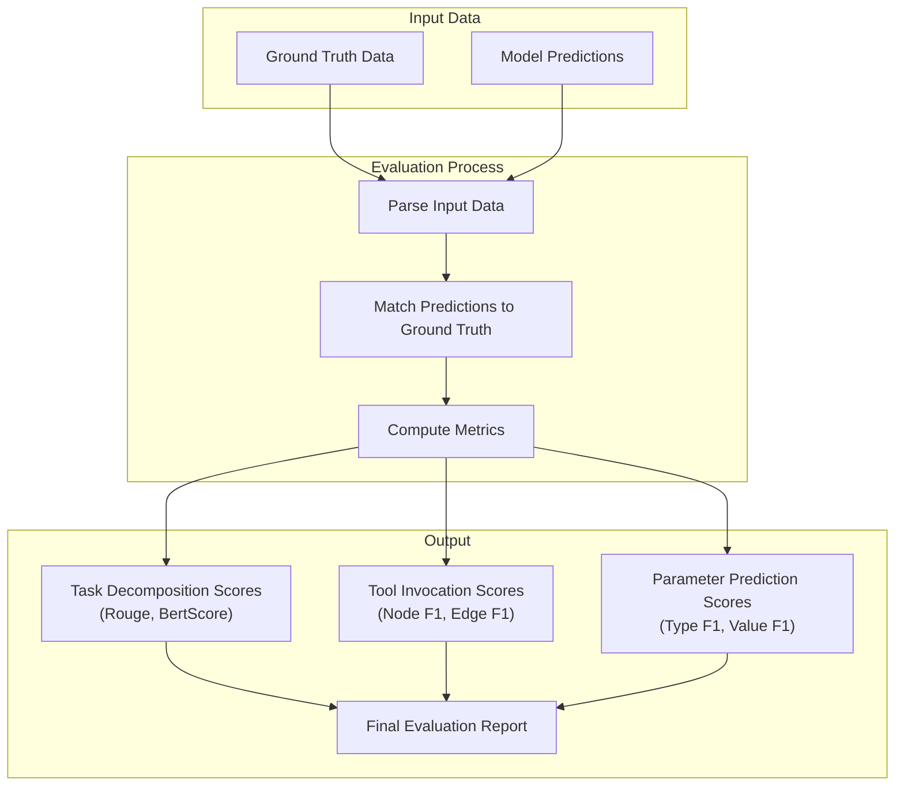
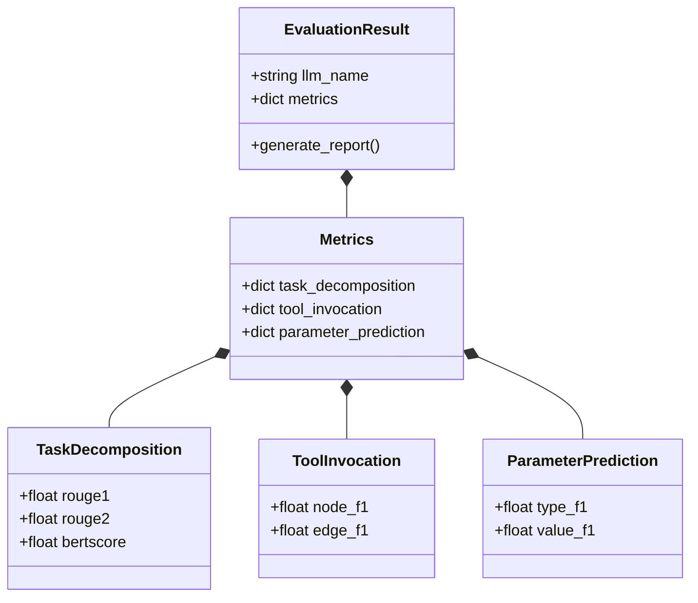

<!-- source: DeepWiki mcp.deepwiki.com · repo microsoft/JARVIS · page 3.3 Evaluation Framework · fetched 2026-10-26 -->

# Evaluation Framework

<details>
<summary>Relevant source files</summary>

The following files were used as context for generating this wiki page:

- [taskbench/README.md](taskbench/README.md)
- [taskbench/evaluate.py](taskbench/evaluate.py)

</details>


The TaskBench Evaluation Framework provides a comprehensive system for assessing how well large language models (LLMs) perform on task automation. This document describes the metrics, methodology, and technical implementation used to evaluate LLM performance across three critical stages of task automation: task decomposition, tool invocation, and parameter prediction.

## Overview

The Evaluation Framework is a core component of the TaskBench benchmark, designed to provide standardized evaluation metrics for comparing different LLMs on their ability to automate tasks. It processes model predictions against ground truth data and calculates various performance metrics.



Sources: [taskbench/README.md:119-125](), [taskbench/evaluate.py:166-186]()

## Evaluation Metrics

TaskBench evaluates LLMs on three critical stages of task automation, each with its own set of metrics:

### 1. Task Decomposition Metrics

Task decomposition metrics evaluate how well a model breaks down a complex user request into individual steps:

| Metric | Description |
|--------|-------------|
| Rouge-1 (R1) | Word-level overlap between predicted and reference task steps |
| Rouge-2 (R2) | Bigram overlap between predicted and reference task steps |
| BertScore F1 (BsF) | Semantic similarity between predicted and reference task steps using contextual embeddings |

These metrics are applied to the textual description of task steps, with higher scores indicating better decomposition quality.

### 2. Tool Invocation Metrics

Tool invocation metrics assess the model's ability to select the right tools and establish correct dependencies between them:

| Metric | Description |
|--------|-------------|
| Node F1 (n-F1) | F1 score for correctly predicting which tools to use |
| Edge F1 (e-F1) | F1 score for correctly predicting dependencies between tools |

These metrics evaluate the structural aspects of the predicted tool invocation graph against the ground truth.

### 3. Parameter Prediction Metrics

Parameter prediction metrics measure how accurately a model predicts the parameters for tool invocation:

| Metric | Description |
|--------|-------------|
| Type F1 (t-F1) | F1 score for correctly predicting parameter types/names |
| Value F1 (v-F1) | F1 score for correctly predicting parameter values |

These metrics are critical for assessing whether the model can correctly parameterize the tools it invokes.

Sources: [taskbench/README.md:120-125](), [taskbench/evaluate.py:468-550]()

## Evaluation Process



### Input Data Processing

The evaluation framework processes two main inputs:

1. **Ground Truth Data**: JSON files containing reference task decompositions, tool invocation graphs, and parameters
2. **Model Predictions**: JSON files containing the model's predicted task decomposition, tool invocation graph, and parameters

The framework supports filtering evaluation by:
- Dataset splits (overall, single tool, chain, DAG)
- Number of tools (1-10 or overall)
- Dependency types (resource or temporal)

### Matching Algorithm

For tool invocation evaluation, the framework uses a matching algorithm to align predicted tools with ground truth tools, accounting for potential order differences. This alignment is performed using:

1. Node similarity calculation
2. Link (edge) similarity calculation
3. Cost matrix creation
4. Linear sum assignment to find optimal matching

The resulting alignment is then used to calculate F1 scores for nodes and edges.

### Metric Calculation

The framework calculates metrics using established libraries:
- Rouge scores using the HuggingFace `datasets` library
- BertScore using the HuggingFace `datasets` library
- F1 scores for classification using scikit-learn's `precision_recall_fscore_support`

Sources: [taskbench/evaluate.py:20-63](), [taskbench/evaluate.py:166-186](), [taskbench/evaluate.py:255-550]()

## Using the Evaluation Framework

### Setup and Requirements

Before using the evaluation framework, you need to:

1. Install the required dependencies:
```bash
pip install -r requirements.txt
```

2. Set up an environment with Python 3.8+

### Running Evaluation

To evaluate model predictions, use the `evaluate.py` script with appropriate parameters:

```bash
python evaluate.py \
    --data_dir data_multimedia \
    --prediction_dir predictions \
    --llm gpt-4 \
    --splits all \
    --n_tools all \
    --mode add \
    --dependency_type resource \
    -m all
```

Key parameters include:
- `--data_dir`: Directory containing ground truth data
- `--prediction_dir`: Directory containing model predictions
- `--llm`: Name of the LLM being evaluated
- `--splits`: Dataset splits to evaluate (e.g., "all", "single", "chain", "dag")
- `--n_tools`: Tool counts to evaluate (e.g., "all" or specific numbers)
- `--dependency_type`: Type of dependencies in the tool graph (resource or temporal)
- `-m`: Metrics to compute (e.g., "all", "f1", "rouge", "bertscore", etc.)

### Output Format

The evaluation framework generates:

1. Log files with detailed evaluation results
2. JSON files with structured metrics
3. Optional support for leaderboard population



The resulting metrics allow for comprehensive comparison of different LLMs on task automation capabilities.

Sources: [taskbench/README.md:127-186](), [taskbench/evaluate.py:166-186]()

## Implementation Details

### Key Components

The evaluation framework consists of several components:

1. **Data Processing Functions**:
   - Functions to parse ground truth and prediction data
   - Functions to convert tool invocation graphs into comparable formats

2. **Matching Algorithm**:
   - Similarity calculation between nodes and edges
   - Linear sum assignment for optimal matching

3. **Metric Calculation**:
   - Integration with Rouge and BertScore libraries
   - Custom F1 score calculations for nodes, edges, and parameters

4. **Result Formatting**:
   - Functions to organize and format evaluation results
   - Output generation in both human-readable and machine-readable formats

### Technical Challenges

The evaluation framework addresses several technical challenges:

1. **Handling Different Graph Structures**: The framework supports different tool graph structures (single, chain, DAG) and dependency types (resource, temporal).

2. **Flexible Metric Calculation**: Users can choose which metrics to calculate based on their needs.

3. **Alignment Between Predictions and Ground Truth**: The framework implements algorithms to align predictions with ground truth, even when tool ordering differs.

4. **Support for Multiple Dataset Domains**: The framework works with different TaskBench domains (HuggingFace Tools, Multimedia Tools, Daily Life APIs).

Sources: [taskbench/evaluate.py:20-63](), [taskbench/evaluate.py:255-550]()

## Leaderboard and Comparison

The evaluation framework powers the TaskBench leaderboard, which compares the performance of various LLMs on task automation. The leaderboard presents metrics across all evaluation dimensions, allowing for comprehensive comparison.

Current leaderboard results demonstrate significant performance gaps between proprietary and open-source LLMs, with models like GPT-4 and Claude-2 consistently outperforming others across most metrics. The framework's multidimensional evaluation provides insights into specific strengths and weaknesses of different models.

Sources: [taskbench/README.md:279-347]()

---

