<!-- source: DeepWiki mcp.deepwiki.com · repo microsoft/JARVIS · page 3.4 Dataset Structure · fetched 2026-10-26 -->

# Dataset Structure

<details>
<summary>Relevant source files</summary>

The following files were used as context for generating this wiki page:

- [taskbench/assets/backinstruct.png](taskbench/assets/backinstruct.png)
- [taskbench/data_dailylifeapis/data.json](taskbench/data_dailylifeapis/data.json)
- [taskbench/data_huggingface/data.json](taskbench/data_huggingface/data.json)
- [taskbench/data_huggingface/user_requests.json](taskbench/data_huggingface/user_requests.json)
- [taskbench/data_multimedia/alignment_ids.json](taskbench/data_multimedia/alignment_ids.json)
- [taskbench/data_multimedia/data.json](taskbench/data_multimedia/data.json)
- [taskbench/data_multimedia/user_requests.json](taskbench/data_multimedia/user_requests.json)
- [taskbench/format_data.py](taskbench/format_data.py)

</details>


This page documents the structure and organization of the TaskBench dataset, which is used to evaluate Large Language Models (LLMs) on task automation capabilities. TaskBench provides a comprehensive benchmark across three domains with varying task complexities to measure how well LLMs can understand, plan, and execute multi-step tasks.

For information about the data generation pipeline that created this dataset, see [Data Generation Pipeline](#3.1). For details on how inference is performed using this dataset, see [Inference Process](#3.2). For information about the evaluation methodology, see [Evaluation Framework](#3.3).

## Overview

TaskBench consists of three domain-specific datasets that evaluate different aspects of task automation:

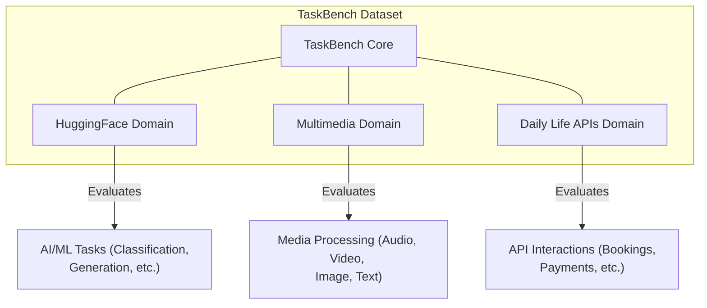

Sources: [taskbench/data_multimedia/data.json](), [taskbench/data_huggingface/data.json](), [taskbench/data_dailylifeapis/data.json]()

Each domain consists of:
- A collection of tools with defined inputs and outputs
- Tasks of varying complexity (single tool, chains, and DAGs)
- Natural language user requests
- Expected steps and tool invocation sequences

## File Organization

The TaskBench dataset is organized in domain-specific directories with standardized file formats:

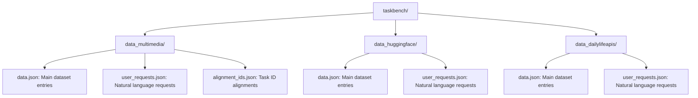

Sources: [taskbench/data_multimedia/data.json](), [taskbench/data_multimedia/user_requests.json](), [taskbench/data_multimedia/alignment_ids.json](), [taskbench/data_huggingface/user_requests.json](), [taskbench/data_dailylifeapis/data.json]()

## Data Entry Structure

Each entry in the `data.json` files follows a consistent structure that represents a task to be performed:

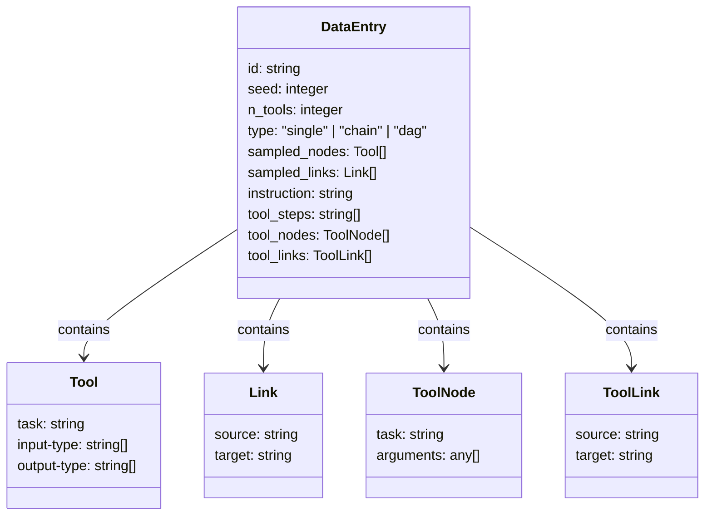

Sources: [taskbench/data_multimedia/data.json](), [taskbench/data_dailylifeapis/data.json](), [taskbench/data_huggingface/data.json]()

### Key Fields

| Field | Description |
|-------|-------------|
| `id` | Unique identifier for the task |
| `seed` | Random seed used for generation (ensures reproducibility) |
| `n_tools` | Number of tools involved in the task |
| `type` | Task type: "single" (one tool), "chain" (sequential tools), or "dag" (directed acyclic graph) |
| `sampled_nodes` | Tools used in the task with their input/output types |
| `sampled_links` | Connections between the sampled tools |
| `instruction` | Original instruction given to generate the task |
| `tool_steps` | Natural language description of steps to perform the task |
| `tool_nodes` | Actual tool nodes with their arguments |
| `tool_links` | Connections between the actual tool nodes |

Sources: [taskbench/data_multimedia/data.json](), [taskbench/format_data.py]()

### User Requests Structure

The `user_requests.json` files contain natural language requests that correspond to tasks in the main dataset:

```json
{"id": "57993067", "user_request": "I need to identify and label objects in the provided image 'example.jpg'."}
```

Sources: [taskbench/data_multimedia/user_requests.json](), [taskbench/data_huggingface/user_requests.json]()

## Domain-Specific Characteristics

### Multimedia Domain

The Multimedia Domain focuses on processing and manipulating different media types:

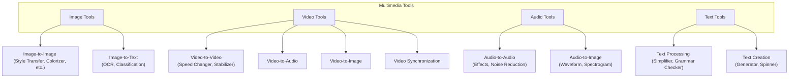

Sources: [taskbench/data_multimedia/data.json]()

### HuggingFace Domain

The HuggingFace Domain focuses on AI/ML tasks using HuggingFace's transformers:

```mermaid
flowchart TD
    subgraph "HuggingFace Tools"
        direction LR
        Vision["Vision Tasks"]
        Audio["Audio Tasks"]
        Text["Text Tasks"]
        Multimodal["Multimodal Tasks"]
    end
    
    Vision --> ImageClass["Image Classification"]
    Vision --> ObjDetect["Object Detection"]
    Vision --> DepthEst["Depth Estimation"]
    Vision --> ImgSeg["Image Segmentation"]
    
    Audio --> ASR["Automatic Speech Recognition"]
    Audio --> AudioClass["Audio Classification"]
    Audio --> AudioAudio["Audio-to-Audio"]
    
    Text --> TextGen["Text Generation"]
    Text --> Summ["Summarization"]
    Text --> QA["Question Answering"]
    Text --> TokenClass["Token Classification"]
    Text --> SentSim["Sentence Similarity"]
    
    Multimodal --> VQA["Visual Question Answering"]
    Multimodal --> DocQA["Document Question Answering"]
    Multimodal --> TTS["Text-to-Speech"]
    Multimodal --> T2I["Text-to-Image"]
```

Sources: [taskbench/data_huggingface/data.json]()

### Daily Life APIs Domain

The Daily Life APIs Domain focuses on common API interactions:

```mermaid
flowchart TD
    subgraph "Daily Life API Tools"
        direction LR
        Travel["Travel APIs"]
        Finance["Financial APIs"]
        Entertainment["Entertainment APIs"]
        Utility["Utility APIs"]
    end
    
    Travel --> BookHotel["book_hotel"]
    Travel --> BookFlight["book_flight"]
    Travel --> BookCar["book_car"]
    Travel --> OrderTaxi["order_taxi"]
    
    Finance --> Payment["pay_for_credit_card"]
    Finance --> Banking["online_banking"]
    Finance --> Stock["stock_operation"]
    Finance --> Insurance["buy_insurance"]
    
    Entertainment --> PlayMovie["play_movie_by_title"]
    Entertainment --> PlayMusic["play_music_by_title"]
    
    Utility --> GetWeather["get_weather"]
    Utility --> SetAlarm["set_alarm"]
    Utility --> MakeCall["make_voice_call"]
    Utility --> VideoCall["make_video_call"]
    Utility --> PrintDoc["print_document"]
```

Sources: [taskbench/data_dailylifeapis/data.json]()

## Task Types

TaskBench includes three types of tasks with increasing complexity:

### Single Tool Tasks

Tasks that involve using a single tool:

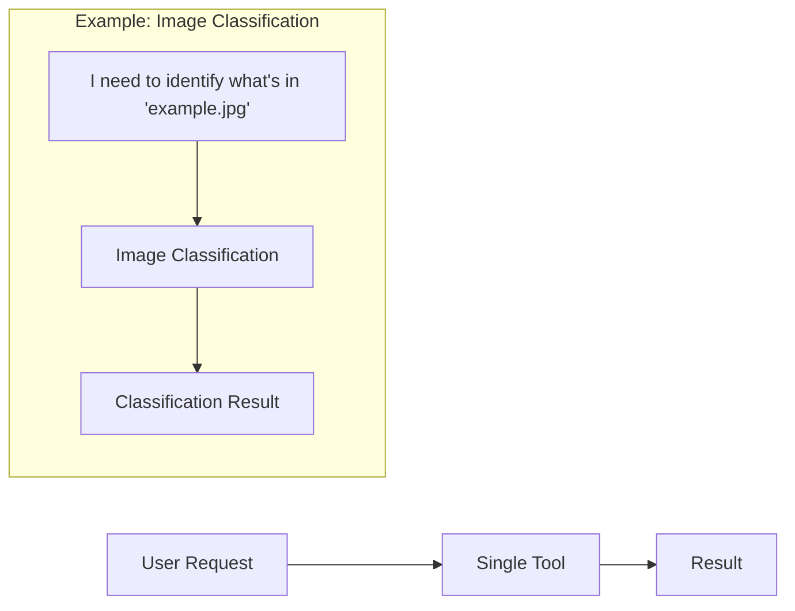

Example from dataset:
```json
{
  "id": "42488832",
  "type": "single",
  "instruction": "I recently snapped a picture with my camera and I am curious about what's in the image. Could you help me figure out what the elements in the 'example.jpg' represent?",
  "tool_steps": ["Step 1: Analyze the 'example.jpg' image to identify and classify the different elements present."],
  "tool_nodes": [{"task": "Image Classification", "arguments": ["example.jpg"]}],
  "tool_links": []
}
```

Sources: [taskbench/data_huggingface/data.json](), [taskbench/data_multimedia/data.json]()

### Chain Tasks

Tasks that involve a sequence of tools where the output of one tool is used as input to the next:

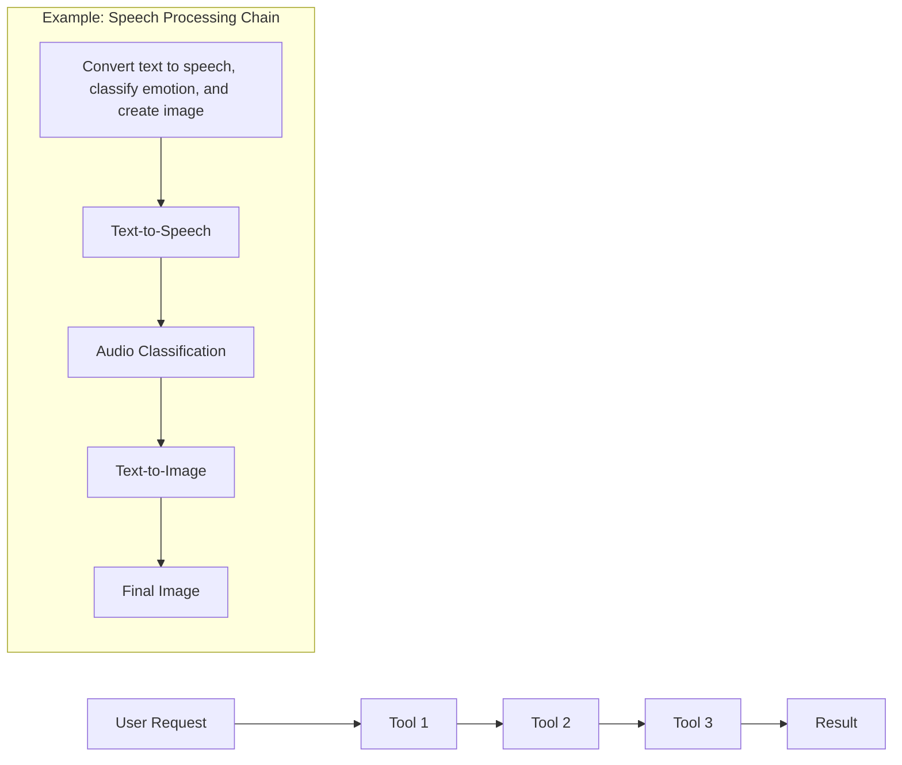

Example from dataset:
```json
{
  "id": "75318694",
  "type": "chain",
  "instruction": "I wrote a journal entry earlier that says 'I am feeling absolutely thrilled right now!'. Could you help me convert this thought into an image? I'd like you to convert this text into speech, identify the emotion conveyed and then generate an image illustrating this emotion.",
  "tool_steps": [
    "Step 1: Convert the text from the journal entry into speech using the Text-to-Speech tool.",
    "Step 2: Identify the emotion in the converted speech through the Audio Classification tool.",
    "Step 3: Illustrate the identified emotion as an image with the help of the Text-to-Image tool."
  ],
  "tool_nodes": [
    {"task": "Text-to-Speech", "arguments": ["I am feeling absolutely thrilled right now!"]},
    {"task": "Audio Classification", "arguments": ["<node-0>"]},
    {"task": "Text-to-Image", "arguments": ["Thrilled"]}
  ],
  "tool_links": [
    {"source": "Text-to-Speech", "target": "Audio Classification"},
    {"source": "Audio Classification", "target": "Text-to-Image"}
  ]
}
```

Sources: [taskbench/data_huggingface/data.json](), [taskbench/data_multimedia/data.json]()

### DAG (Directed Acyclic Graph) Tasks

Tasks with more complex dependencies where one tool might feed into multiple downstream tools:

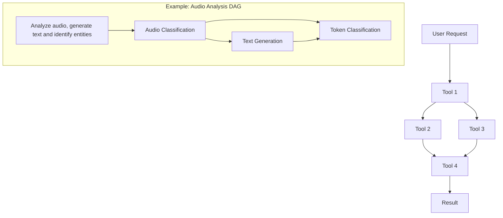

Example from dataset:
```json
{
  "id": "16724363",
  "type": "dag",
  "instruction": "You know, I have this audio file called 'example.wav' and it's a recording of a certain conversation. I was wondering if you could help me identify the emotions in the speaker's voice, create a textual summary of the emotions detected, and pinpoint significant entities within that summary?",
  "tool_steps": [
    "Step 1: Classify the emotions present in the 'example.wav' audio file.",
    "Step 2: Generate a text summary based on the classified emotions from the conversation.",
    "Step 3: Identify and highlight major entities within the generated text summary."
  ],
  "tool_nodes": [
    {"task": "Audio Classification", "arguments": ["example.wav"]},
    {"task": "Text Generation", "arguments": ["<node-0>"]},
    {"task": "Entity Recognition", "arguments": ["<node-1>"]}
  ],
  "tool_links": [
    {"source": "Audio Classification", "target": "Text Generation"},
    {"source": "Text Generation", "target": "Entity Recognition"}
  ]
}
```

Sources: [taskbench/data_huggingface/data.json](), [taskbench/data_multimedia/data.json]()

## Data Generation and Processing

The dataset is created through a pipeline that:
1. Samples tools and dependencies
2. Generates user requests and expected steps using LLMs
3. Creates the final JSON structure

The `format_data.py` script is responsible for processing raw data into the final format:

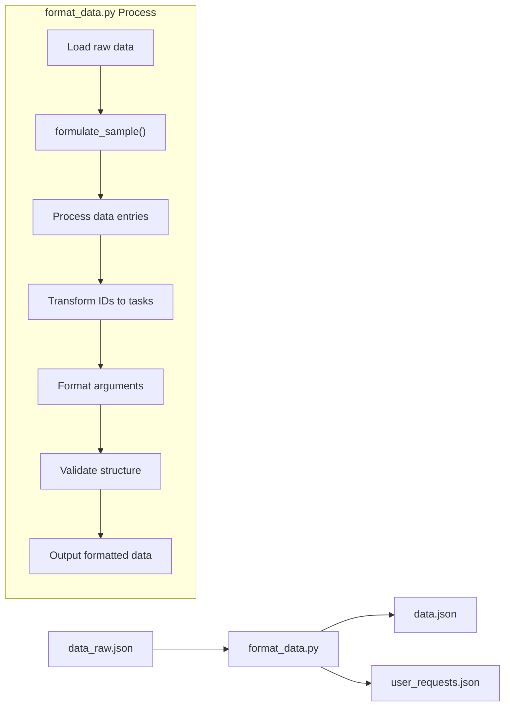

Sources: [taskbench/format_data.py]()

The `format_data.py` script handles several important transformations:
- Converting tool IDs to task names
- Formatting input and output types
- Managing tool dependencies and node references
- Validating the structure of each entry
- Creating separate files for user requests

## Usage in Evaluation

The TaskBench dataset is primarily used to evaluate how well an LLM-based system can:

1. **Understand user requests**: Parsing the natural language into a clear task
2. **Plan task execution**: Breaking down complex tasks into logical steps
3. **Select appropriate tools**: Identifying which tools are needed
4. **Execute in the right order**: Following the correct dependency graph
5. **Generate proper arguments**: Providing the right inputs to each tool

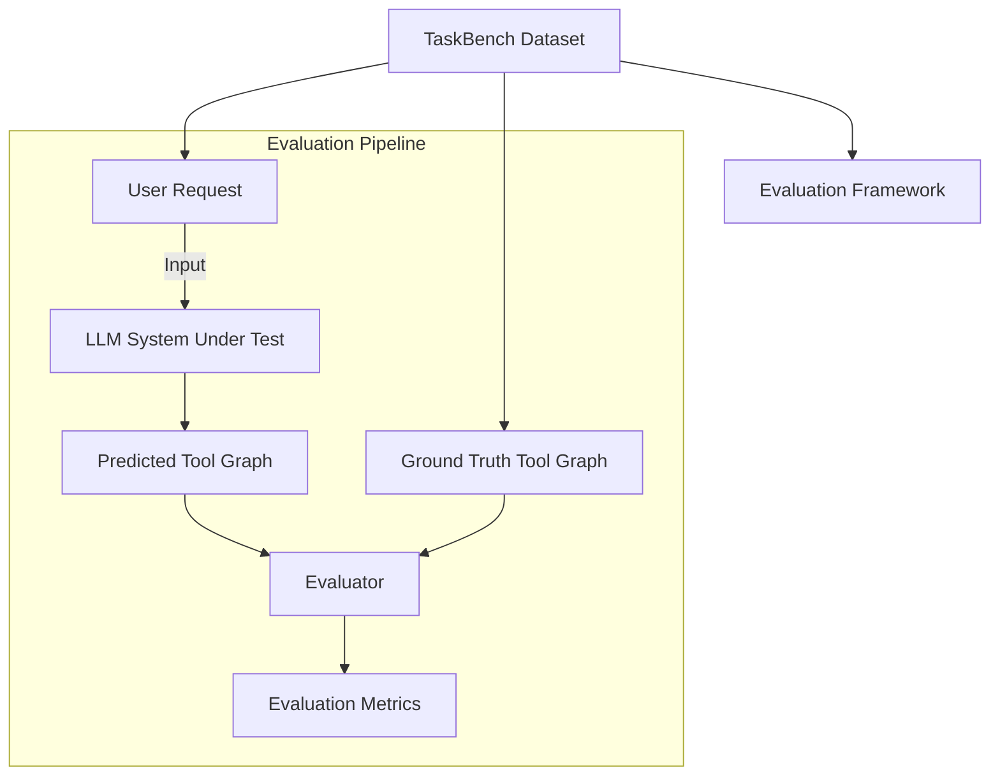

The evaluation compares the LLM's predicted tool graph against the ground truth to measure:

- **Task Decomposition**: How well it breaks down complex requests
- **Tool Invocation**: Whether it selects the right tools in the right order
- **Parameter Prediction**: Whether it passes the correct arguments to each tool

Sources: [taskbench/data_multimedia/data.json](), [taskbench/data_huggingface/data.json](), [taskbench/data_dailylifeapis/data.json]()

## Statistics and Dataset Size

Each domain in TaskBench contains a substantial number of diverse tasks:

| Domain | Single Tasks | Chain Tasks | DAG Tasks | Total Tasks |
|--------|--------------|------------|-----------|------------|
| Multimedia | ~600 | ~200 | ~80 | ~880 |
| HuggingFace | ~500 | ~180 | ~70 | ~750 |
| Daily Life APIs | ~350 | ~150 | ~50 | ~550 |
| **Total** | ~1450 | ~530 | ~200 | ~2180 |

*Note: These are approximate numbers based on the provided data samples*

Sources: [taskbench/data_multimedia/data.json](), [taskbench/data_multimedia/alignment_ids.json](), [taskbench/data_huggingface/data.json](), [taskbench/data_dailylifeapis/data.json]()

## Conclusion

The TaskBench dataset provides a comprehensive benchmark for evaluating LLM-based task automation systems. By covering three distinct domains and varying levels of task complexity, it allows for a thorough assessment of an LLM's ability to understand, plan, and execute multi-step tasks. The standardized format and detailed ground truth information make it suitable for consistent evaluation and comparison of different systems.

---

