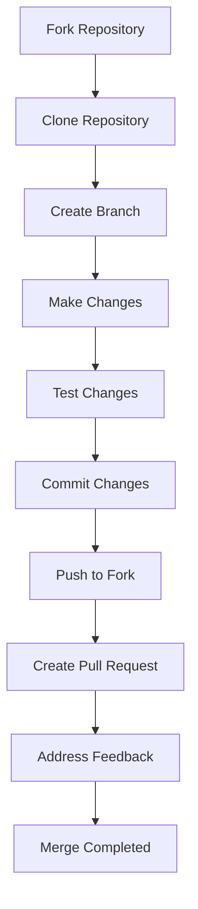
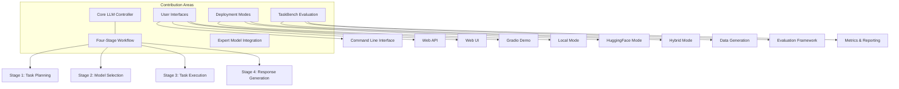
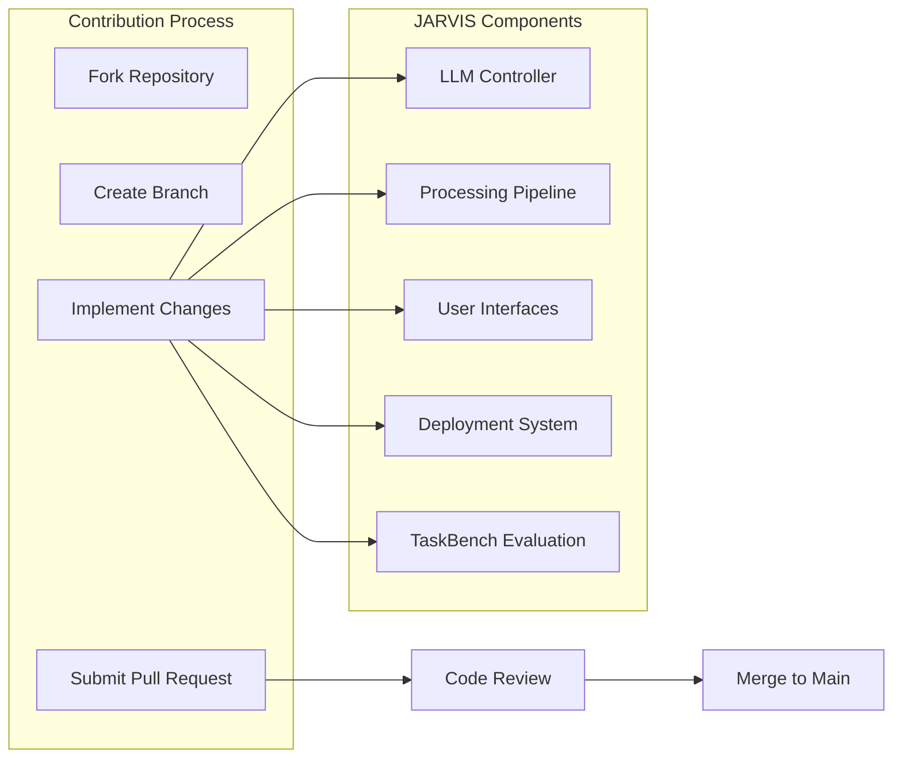

<!-- source: DeepWiki mcp.deepwiki.com · repo microsoft/JARVIS · page 4 Contributing to JARVIS · fetched 2026-10-26 -->

# Contributing to JARVIS

<details>
<summary>Relevant source files</summary>

The following files were used as context for generating this wiki page:

- [CITATION.cff](CITATION.cff)
- [CONTRIBUTING.md](CONTRIBUTING.md)

</details>


This document provides guidance for developers and researchers who want to contribute to the JARVIS project. Here you'll find instructions on the contribution workflow, coding standards, and how to properly cite the project in your research. For information on the system architecture and components, see [System Architecture](#2.1).

## Contribution Workflow

The JARVIS project follows the standard GitHub fork and pull request workflow. This process ensures that contributions can be reviewed, tested, and integrated smoothly.



Sources: [CONTRIBUTING.md:1-55]()

### Step-by-Step Contribution Process

1. **Fork the repository**: Create your own copy of the repository on GitHub by clicking the "Fork" button.

2. **Clone your fork**: Download your fork to your local machine.
   ```bash
   git clone https://github.com/YOUR-GITHUB-USERNAME/JARVIS
   cd JARVIS
   ```

3. **Create a branch**: Create a new branch for your changes.
   ```bash
   git checkout -b "branch-name"
   ```

4. **Make changes**: Implement your changes, following the project's code style and guidelines.

5. **Commit and push changes**: Add, commit, and push your changes to your fork.
   ```bash
   git add .
   git commit -m "your commit message"
   git push origin branch-name
   ```

6. **Create a pull request**: Go to the original JARVIS repository on GitHub and create a new pull request from your branch.

7. **Address feedback**: Respond to reviewer feedback and make necessary changes.

8. **Update after merge**: Once your changes are merged, update your local repository.
   ```bash
   git fetch upstream
   git checkout main
   git merge upstream/main
   git branch -d branch-name
   ```

Sources: [CONTRIBUTING.md:2-54]()

## Contribution Areas

When contributing to JARVIS, you can focus on several key areas of the system. The diagram below illustrates the main components that may benefit from contributions.



Sources: System architecture overview provided in the context information

## Development Guidelines

To ensure that your contributions are accepted and integrated smoothly, please follow these guidelines:

### Code Quality

- **Follow existing patterns**: Maintain consistency with the existing code style
- **Documentation**: Add comments and docstrings to explain your code
- **Testing**: Add or update tests for any changes you make
- **Backward compatibility**: Ensure your changes don't break existing functionality

### Pull Request Best Practices

1. **Focused changes**: Keep each PR focused on a single feature or bug fix
2. **Clear description**: Provide a detailed description of your changes
3. **Reference issues**: Link to any relevant issues that your PR addresses
4. **Test locally**: Ensure your changes work before submitting a PR
5. **Be responsive**: Address feedback promptly during the review process

## Project Organization

Understanding how JARVIS is organized helps you make effective contributions. The diagram below shows the relationship between the contribution process and the JARVIS system components.



Sources: [CONTRIBUTING.md:1-55](), System architecture overview provided in context

## Citing JARVIS

If you use JARVIS in your research or build upon it, please cite the HuggingGPT paper as follows:

### BibTeX Citation

```
@article{Shen2023HuggingGPT,
  title={HuggingGPT: Solving AI Tasks with ChatGPT and its Friends in HuggingFace},
  author={Yongliang Shen, Kaitao Song, Xu Tan, Dongsheng Li, Weiming Lu, Yueting Zhuang},
  journal={arXiv preprint arXiv:2303.17580},
  year={2023},
  url={https://arxiv.org/abs/2303.17580}
}
```

Sources: [CITATION.cff:1-40]()

## Getting Help

If you need assistance with your contributions:

- **Open an issue**: For bugs, feature requests, or help with contributions
- **Check documentation**: Review the wiki for technical details about the system
- **Join discussions**: Participate in GitHub Discussions for general questions

## Licensing

By contributing to JARVIS, you agree that your contributions will be licensed under the same license as the project. Make sure you understand the license terms before contributing.

---

