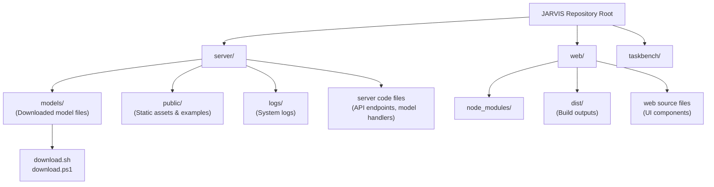
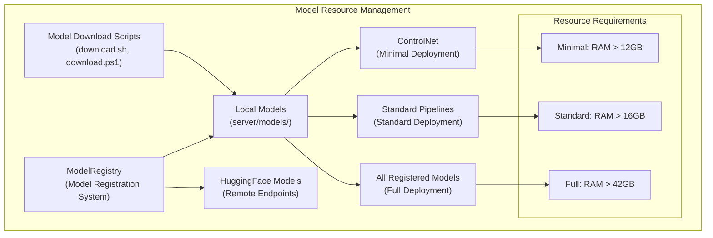
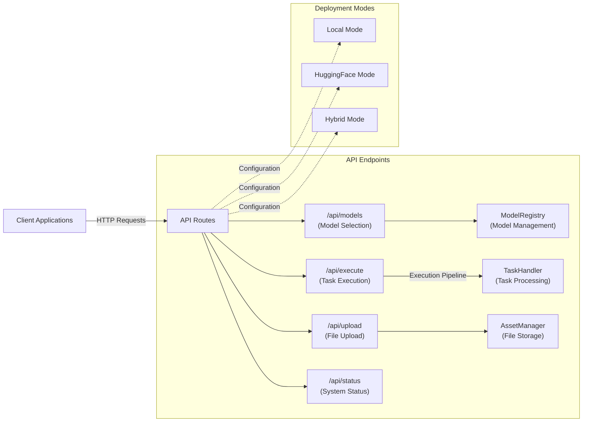

<!-- source: DeepWiki mcp.deepwiki.com · repo microsoft/JARVIS · page 5 API and System Resources · fetched 2026-10-26 -->

# API and System Resources

Relevant source files

The following files were used as context for generating this wiki page:

- [.gitignore](.gitignore)
- [taskbench/assets/eval.png](taskbench/assets/eval.png)
- [taskbench/assets/logo2.png](taskbench/assets/logo2.png)

This document provides an overview of the JARVIS system resources, file structure, and API architecture. It covers how models and assets are managed, essential system resources, and the API endpoints available in different deployment configurations. For information about the JARVIS system architecture and workflow, see [System Architecture](#2.1) and [Four-Stage Workflow](#2.2).

## File Structure Overview

The JARVIS system follows a well-organized directory structure that separates core components, models, and interfaces.

Sources: [.gitignore:6-21]()

### Key Directories

| Directory | Purpose |
|-----------|---------|
| `server/` | Contains the core JARVIS server components including API endpoints and model handlers |
| `server/models/` | Stores downloaded model files with different configurations based on deployment scale |
| `server/public/` | Contains static assets and example images for the system |
| `server/logs/` | Stores system logs for debugging and monitoring |
| `web/` | Contains the web interface components and build system |
| `taskbench/` | Contains the TaskBench benchmark system for evaluating JARVIS |

## Model Resources Management

The JARVIS system manages various AI models that are invoked by the LLM controller. Models are organized based on deployment modes (local, huggingface, hybrid) and deployment scales (minimal, standard, full).

Sources: [.gitignore:7-9]()

### Model Distribution and Download

The system includes download scripts (`download.sh` for Linux/macOS and `download.ps1` for Windows) that fetch the required model files based on the selected deployment scale. These scripts populate the `server/models/` directory with the appropriate model files.

## API Endpoints Architecture

The JARVIS system exposes various API endpoints through different interfaces, including a web server, CLI, and Gradio demo.

### Available API Interfaces

The JARVIS system can be accessed through several interfaces:

| Interface | Description | Main Entry Point |
|-----------|-------------|------------------|
| Web API | RESTful HTTP API for programmatic access | Server API endpoints |
| Web UI | Browser-based user interface | Web application build |
| CLI | Command-line interface for local usage | Command-line scripts |
| Gradio Demo | Interactive demo interface | Gradio interface script |

## Asset Management

JARVIS manages various assets including input files, generated outputs, and example resources.

### Public Assets

The system includes several example images in the `server/public/examples/` directory that are used for demonstration and testing purposes:

- Example images named alphabetically (a.jpg through g.jpg)
- These examples are preserved in the repository while other generated content is excluded

### User Assets

When users upload files through the API, these files are temporarily stored in the `server/public/` directory. These uploaded assets are not tracked by git, as shown in the `.gitignore` configuration.

## System Configuration

JARVIS system configuration can be customized through various configuration files. Development-specific configurations are typically kept in files with the `.dev.yaml` extension and are excluded from version control.

### Environment Management

The system supports different environment configurations:

- Development environments (excluded from git via `.gitignore`)
- Environment variable configuration (via `.env` files, also excluded from git)
- Docker deployment configuration

## Logging System

JARVIS includes a logging system that stores logs in the `server/logs/` directory. These logs are essential for debugging, performance monitoring, and audit trails, but are excluded from version control.

## Security Considerations

When deploying JARVIS, consider the following security aspects:

1. Model files stored in `server/models/` may be large and should be properly secured
2. Uploaded user content in `server/public/` should be monitored and cleaned regularly
3. API endpoints should implement proper authentication and authorization depending on the deployment context

Sources: [.gitignore:1-167]()