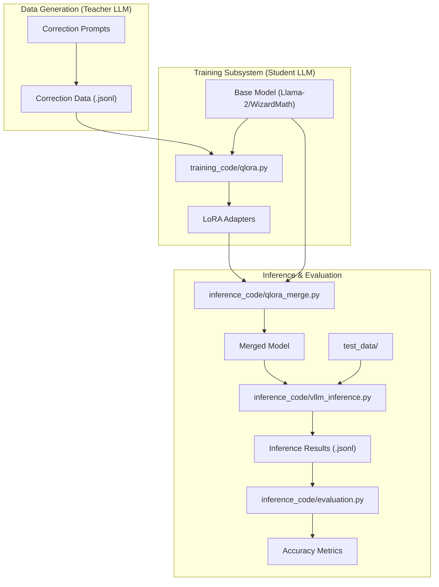
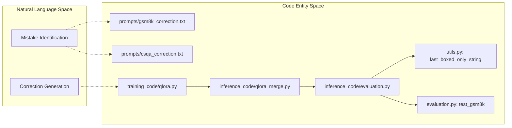

<!-- source: DeepWiki mcp.deepwiki.com · repo microsoft/LEMA · page 1 LEMA: Overview and Architecture · fetched 2026-10-26 -->

# LEMA: Overview and Architecture

Relevant source files

The following files were used as context for generating this wiki page:

- [README.md](README.md)
- [pictures/overall.png](pictures/overall.png)

The **Learning From Mistakes (LEMA)** framework is a specialized fine-tuning methodology designed to improve the multi-step reasoning capabilities of Large Language Models (LLMs). By mimicking the human process of learning from errors, LEMA transitions models from standard imitation learning to a **mistake-correction paradigm**.

## Purpose and Scope
Standard Supervised Fine-Tuning (SFT) typically focuses on training models to follow correct reasoning paths. LEMA extends this by training models to identify, explain, and correct reasoning errors. This repository provides the complete pipeline for:
1.  **Synthesizing correction data** using teacher LLMs (e.g., GPT-4).
2.  **Fine-tuning** models using QLoRA for efficient parameter updates.
3.  **Evaluating** performance across mathematical (GSM8K, MATH) and commonsense (CSQA) reasoning benchmarks.

For detailed installation instructions, see [Environment Setup and Dependencies](#1.2).

## Core Methodology
The LEMA methodology follows a three-stage process:
1.  **Mistake Generation**: A student model attempts to solve a problem. If the answer is incorrect, the failed reasoning path is collected.
2.  **Correction Synthesis**: A teacher LLM is prompted with the problem and the failed reasoning path to generate a structured correction.
3.  **Correction-Tuning**: The student model is fine-tuned on these (Problem, Mistake, Correction) triplets.

For a deep dive into the paradigm and supported benchmarks, see [Core Concepts and Methodology](#1.1).

### High-Level System Architecture
The following diagram illustrates the relationship between the major subsystems, from data generation to final evaluation.

**Diagram: LEMA System Workflow**

**Sources:** [README.md:21-40](), [README.md:94-116]()

## Major Subsystems

### 1. Data Synthesis
The framework utilizes specific prompt templates to guide a teacher model in generating corrections. These prompts are categorized by the nature of the reasoning task:
*   **Math Reasoning**: Focuses on identifying the first incorrect step and providing a corrected derivation [prompts/gsm8k_correction.txt]().
*   **Commonsense Reasoning**: Focuses on categorical errors (e.g., taxonomic, specificity) and providing a logical justification for the correct choice [prompts/csqa_correction.txt]().

### 2. Training Pipeline
LEMA uses **QLoRA** (Quantized Low-Rank Adaptation) to enable the fine-tuning of large models (up to 70B parameters) on consumer-grade or limited enterprise hardware.
*   **Entrypoint**: `training_code/llama_2_70b_gsm8k.sh` [training_code/llama_2_70b_gsm8k.sh:1-35]()
*   **Core Logic**: The `train()` function in `qlora.py` manages model quantization via `BitsAndBytesConfig` and adapter injection via `peft` [training_code/qlora.py:615-863]().

### 3. Inference and Evaluation
Post-training, the framework requires a specific sequence to validate performance:
1.  **Merging**: The `qlora_merge.py` script integrates adapter weights into the base model using `PeftModel.merge_and_unload()` [inference_code/qlora_merge.py:28-55]().
2.  **Batch Inference**: The `vllm_inference.py` script leverages the **vLLM** engine for high-throughput greedy decoding [inference_code/vllm_inference.py:53-102]().
3.  **Scoring**: The `evaluation.py` script handles dataset-specific answer extraction, such as LaTeX normalization for MATH or numerical filtering for GSM8K [inference_code/evaluation.py:75-155]().

## Code Entity Mapping
The following diagram maps the logical framework components to their specific implementations in the codebase.

**Diagram: Logical Components to Code Entities**

**Sources:** [inference_code/evaluation.py:75-100](), [inference_code/qlora_merge.py:1-20](), [training_code/qlora.py:1-50]()

## Quick Links to Details
*   For the mathematical foundation and mistake-correction logic, see **[Core Concepts and Methodology](#1.1)**.
*   For hardware requirements and library dependencies, see **[Environment Setup and Dependencies](#1.2)**.
*   For details on the training scripts and hyperparameters, see **[Training Pipeline](#3)**.
*   For the evaluation and answer extraction logic, see **[Inference and Evaluation Pipeline](#4)**.

---

