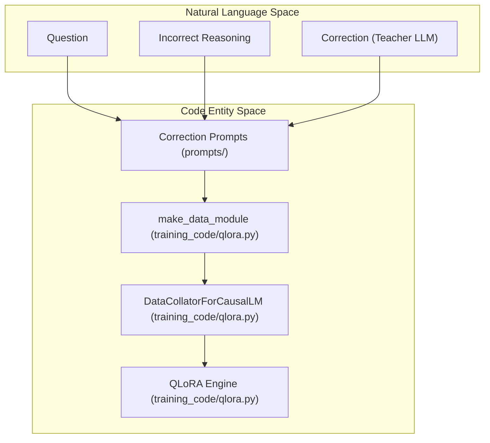
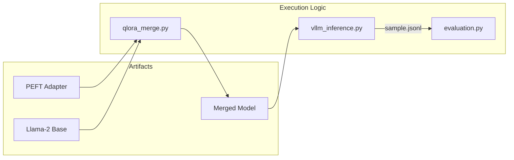

<!-- source: DeepWiki mcp.deepwiki.com · repo microsoft/LEMA · page 1.1 Core Concepts and Methodology · fetched 2026-10-26 -->

# Core Concepts and Methodology

Relevant source files

The following files were used as context for generating this wiki page:

- [README.md](README.md)
- [test_data/csqa_dev.jsonl](test_data/csqa_dev.jsonl)
- [test_data/gsm8k_test.jsonl](test_data/gsm8k_test.jsonl)
- [test_data/math_test.jsonl](test_data/math_test.jsonl)

This page provides a technical deep dive into the **Learning From Mistakes (LEMA)** methodology. LEMA is a training paradigm designed to enhance the reasoning capabilities of Large Language Models (LLMs) by fine-tuning them on mistake-correction data pairs rather than just correct solutions [README.md:21-26]().

## The Mistake-Correction Paradigm

Standard Supervised Fine-Tuning (SFT) typically focuses on maximizing the likelihood of a "Golden" correct answer given a question. LEMA introduces a third component: the **Incorrect Reasoning Path**.

### Conceptual Data Flow
The LEMA process mimics human learning by identifying a failure, explaining the cause of the failure, and providing a corrected path.

1.  **Question**: The original problem (e.g., from GSM8K or MATH).
2.  **Incorrect Reasoning**: A generated reasoning path that leads to a wrong answer.
3.  **Correction**: A teacher LLM (e.g., GPT-4) identifies the specific error and provides the correct logic.

### Comparison: SFT vs. LEMA
| Feature | Standard SFT | LEMA (Ours) |
| :--- | :--- | :--- |
| **Input** | Question | Question + Incorrect Reasoning |
| **Target** | Correct Solution | Explanation of Mistake + Corrected Solution |
| **Learning Goal** | Imitate correctness | Recognize and rectify errors |

**Sources:** [README.md:21-40]()

## Supported Benchmarks and Tasks

LEMA is implemented and evaluated across three primary domains: mathematical reasoning and commonsense reasoning.

### 1. Mathematical Reasoning (GSM8K & MATH)
For math tasks, the model is trained to identify arithmetic or logical slips. The evaluation pipeline handles complex LaTeX and numerical extraction to verify performance.
*   **GSM8K**: Grade school math word problems [test_data/gsm8k_test.jsonl:1-12]().
*   **MATH**: Competition-level mathematics requiring rigorous LaTeX formatting [test_data/math_test.jsonl:1-12]().

### 2. Commonsense Reasoning (CSQA)
For CommonsenseQA (CSQA), the methodology shifts to a structured explanation schema. The model must explain why candidate answers are incorrect before selecting the most relevant one.
*   **Schema**: Explanation -> Reason -> Mistakes -> Corrected Answer [test_data/csqa_dev.jsonl:1-16]().

**Sources:** [README.md:27-41](), [test_data/gsm8k_test.jsonl:1-12](), [test_data/math_test.jsonl:1-12](), [test_data/csqa_dev.jsonl:1-16]()

## System Architecture: Data to Model

The following diagram illustrates the relationship between the natural language reasoning tasks and the code entities responsible for processing them.

### Data Processing and Training Flow

**Sources:** [README.md:60-68](), [training_code/qlora.py:642-658](), [training_code/qlora.py:516-525]()

## Model Variants and Published Weights

The LEMA methodology has been applied to various Llama-2 base models, with weights published on HuggingFace under the `LEMAv1` organization [README.md:6-7]().

### Model Types
1.  **PEFT Adapters**: LoRA weights that must be merged with base Llama-2 models.
    *   Example: `LEMAv1/peft-Llama-2-70b-csqa` [README.md:16]().
2.  **Merged Models**: Full model weights with adapters already integrated for immediate use.
    *   Example: `LEMAv1/merged-Llama-2-70b-gsm8k` [README.md:18]().

### Performance Improvements
LEMA consistently improves upon base Llama-2 models and even specialized models like WizardMath.

| Base Model | Benchmark | Base Accuracy | LEMA Accuracy |
| :--- | :--- | :--- | :--- |
| LLaMA-2-7B | GSM8K | 14.6 | 54.1 |
| LLaMA-2-70B | GSM8K | 56.8 | 83.5 |
| WizardMath-70B | MATH | 22.7 | 27.1 |

**Sources:** [README.md:27-41](), [README.md:84-99]()

## Technical Execution Pipeline

The transition from training to a verifiable result involves a specific sequence of script executions.

### Inference and Evaluation Pipeline

### Key Functions and Entrypoints
*   **Merging**: The `save_trained_model()` function in `qlora_merge.py` handles the `PeftModel.merge_and_unload()` operation to prepare the model for high-throughput inference [README.md:94-99]().
*   **Inference**: The `inference()` function in `vllm_inference.py` utilizes the vLLM engine for batch processing of test datasets [README.md:101-108]().
*   **Accuracy Calculation**: The `evaluation.py` script dispatches to specific extraction functions (e.g., LaTeX stripping for MATH or numerical filtering for GSM8K) to produce final metrics [README.md:110-116]().

**Sources:** [README.md:94-116](), [training_code/qlora.py:848-860]()

---

