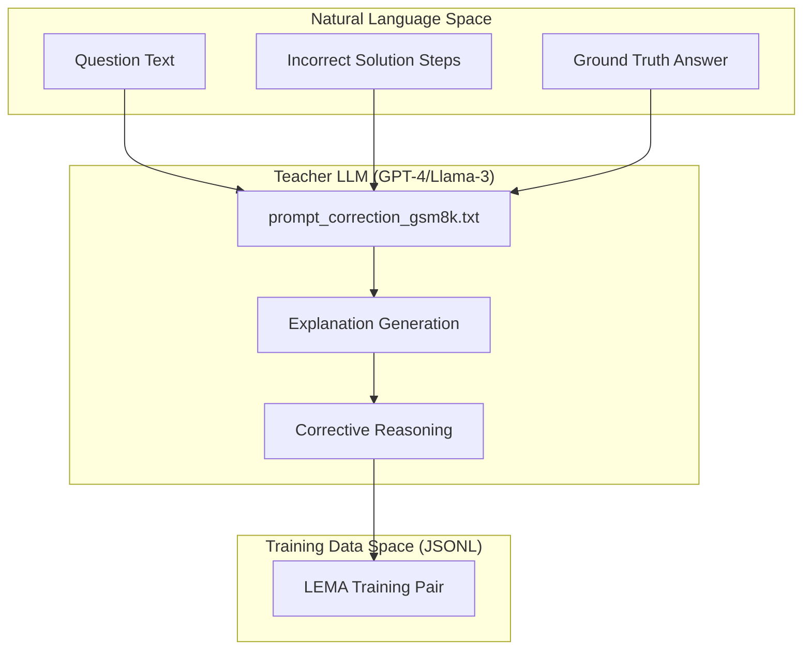
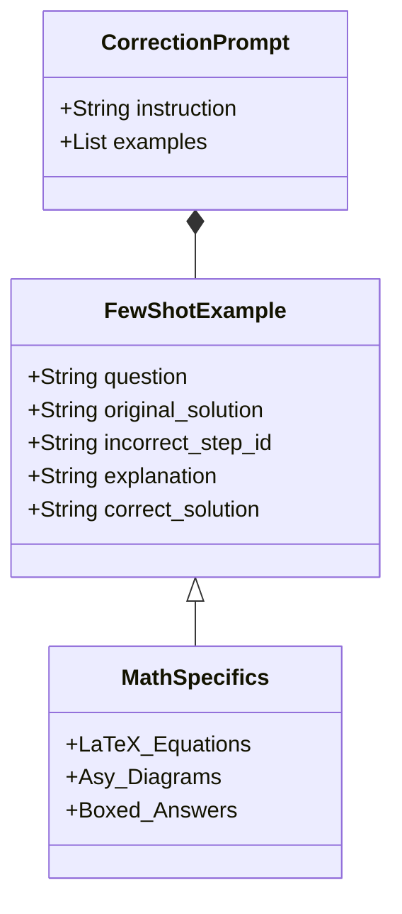

<!-- source: DeepWiki mcp.deepwiki.com · repo microsoft/LEMA · page 2.1 GSM8K and MATH Correction Prompts · fetched 2026-10-26 -->

# GSM8K and MATH Correction Prompts

Relevant source files

The following files were used as context for generating this wiki page:

- [prompts/prompt_correction_gsm8k.txt](prompts/prompt_correction_gsm8k.txt)
- [prompts/prompt_correction_math.txt](prompts/prompt_correction_math.txt)

The LEMA (Learning From Mistakes) framework relies on a "Teacher" LLM to synthesize training data by correcting erroneous reasoning steps in math problems. This page details the structured few-shot prompts used to guide the Teacher LLM in identifying mistakes and generating corrected rationales for the **GSM8K** (Grade School Math 8K) and **MATH** (Competition Mathematics) datasets.

## Prompt Purpose and Logic

The correction prompts are designed to transform a triplet of (Question, Incorrect Solution, Ground Truth Answer) into a structured correction entry. The goal is to produce a "Mistake-Correction" pair that can be used for supervised fine-tuning (SFT). 

The Teacher LLM is instructed to:
1.  **Locate**: Identify the specific step where the reasoning first deviates from the correct path.
2.  **Explain**: Articulate in natural language why that specific step is logically or computationally flawed.
3.  **Correct**: Rewrite the solution starting from the point of failure, ensuring the final answer matches the known ground truth.

### Prompt Structure
Both GSM8K and MATH prompts follow a consistent block-based structure:
*   **System Instruction**: A high-level directive to identify errors and provide corrections [prompts/prompt_correction_gsm8k.txt:1-1](), [prompts/prompt_correction_math.txt:1-1]().
*   **Few-Shot Examples**: Multiple examples containing a `Question`, an `Original Solution` (partitioned into steps), an `Incorrect Step` identifier, an `Explanation`, and the `Correct Solution` [prompts/prompt_correction_gsm8k.txt:3-18]().
*   **Target Input**: The new problem and incorrect solution to be processed by the model.

---

## GSM8K Correction Prompt

The GSM8K prompt focuses on multi-step arithmetic word problems. The few-shot examples highlight common errors such as misinterpreting problem constraints or failing to account for all variables.

### Example Schema
| Field | Description |
| :--- | :--- |
| **Question** | The natural language math word problem. |
| **Original Solution** | A step-by-step reasoning chain (Step 1, Step 2, etc.) enclosed in curly braces `{}`. |
| **Incorrect Step** | A pointer to the specific step index (e.g., `Step 2`). |
| **Explanation** | A concise description of the logical fallacy (e.g., "The original solution incorrectly assumes that there are four ships instead of three") [prompts/prompt_correction_gsm8k.txt:31-32](). |
| **Correct Solution** | The revised reasoning chain leading to the final answer. |

### Data Flow: Natural Language to Correction Entity

**Sources:** [prompts/prompt_correction_gsm8k.txt:1-82]()

---

## MATH Correction Prompt

The MATH dataset prompt handles more complex competition-level problems involving LaTeX formatting, algebraic proofs, and geometric reasoning.

### Key Differences from GSM8K
1.  **LaTeX Integration**: The prompt explicitly handles LaTeX environments such as `\begin{cases}` and `[asy]` (Asymptote) code for geometry [prompts/prompt_correction_math.txt:4-7](), [prompts/prompt_correction_math.txt:60-67]().
2.  **Mathematical Rigor**: Explanations often target conceptual misunderstandings, such as incorrect assumptions about geometric properties or boundary conditions in piecewise functions [prompts/prompt_correction_math.txt:79-80]().
3.  **Final Answer Formatting**: Uses the `\boxed{}` notation standard for the MATH benchmark [prompts/prompt_correction_math.txt:17-17](), [prompts/prompt_correction_math.txt:29-29]().

### Prompt Components Association

**Sources:** [prompts/prompt_correction_math.txt:1-112]()

---

## Correction Patterns and Examples

The prompts instruct the teacher to identify specific types of reasoning failures:

### 1. Calculation Errors
In the MATH prompt, a common example involves a simple arithmetic mistake within a functional evaluation.
*   **Mistake**: $f(2) = 2(2)^2 - 3 = 8$ [prompts/prompt_correction_math.txt:13-13]().
*   **Explanation**: "The calculation for $f(2)$ in the first case is wrong. It should be $f(2) = 2(2)^2 - 3 = 2(4) - 3 = 8 - 3 = 5$" [prompts/prompt_correction_math.txt:21-21]().

### 2. Constraint Misinterpretation
In the GSM8K prompt, the teacher identifies when a model ignores a specific numerical constraint in the text.
*   **Mistake**: Calculating shoe cost by assuming the entire budget was spent [prompts/prompt_correction_gsm8k.txt:7-7]().
*   **Explanation**: "The problem states that Alexis has $16 left from her budget, not that she spent her entire budget" [prompts/prompt_correction_gsm8k.txt:11-11]().

### 3. Conceptual/Assumption Errors
Identifying when a model makes an incorrect mathematical assumption.
*   **Mistake**: Assuming the two given sides of a right triangle are always the legs when seeking the *least* possible third side [prompts/prompt_correction_math.txt:93-93]().
*   **Explanation**: "To find the least possible length of the third side, we should assume that the given side lengths are the hypotenuse and one of the legs" [prompts/prompt_correction_math.txt:102-102]().

**Sources:** [prompts/prompt_correction_gsm8k.txt:1-82](), [prompts/prompt_correction_math.txt:1-112]()

---

