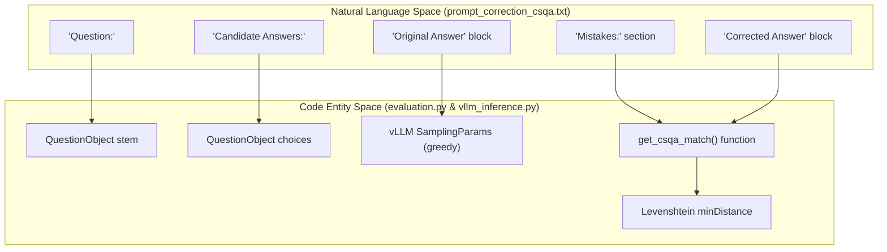
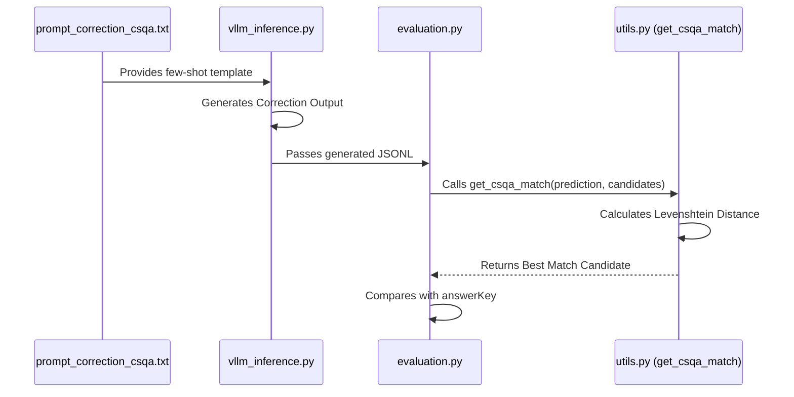

<!-- source: DeepWiki mcp.deepwiki.com · repo microsoft/LEMA · page 2.2 CommonsenseQA Correction Prompt · fetched 2026-10-26 -->

# CommonsenseQA Correction Prompt

Relevant source files

The following files were used as context for generating this wiki page:

- [prompts/prompt_correction_csqa.txt](prompts/prompt_correction_csqa.txt)

The CommonsenseQA (CSQA) correction prompt is a specialized few-shot template designed to instruct a teacher LLM to identify and rectify reasoning errors in commonsense tasks. Unlike mathematical tasks where errors are often computational, CSQA errors involve nuances in semantics, taxonomic relationships, and contextual relevance. This prompt facilitates the generation of the "Learning from Mistakes" (LEMA) dataset by transforming incorrect or suboptimal reasoning chains into structured corrections.

### Purpose and Scope
The correction prompt targets the gap between a model's initial incorrect prediction and the ground truth by forcing the teacher model to explicitly articulate the nature of the mistake before providing a corrected solution [prompts/prompt_correction_csqa.txt:1-18](). This structured output—consisting of Explanations, Reasons, Mistakes, and Corrected Answers—is later used to fine-tune student models (e.g., Llama-2-70B) to recognize and avoid similar pitfalls [qlora.py:1-20]().

---

### Prompt Structure and Schema
The template follows a rigid few-shot structure to ensure the generated data is parsable and consistent. Each example in the prompt consists of the following components:

| Component | Description |
| :--- | :--- |
| **Question** | The original commonsense question from the CSQA dataset [prompts/prompt_correction_csqa.txt:3](). |
| **Candidate Answers** | The five multiple-choice options provided in the dataset [prompts/prompt_correction_csqa.txt:4](). |
| **Original Answer** | A JSON-like block containing the initial (incorrect) `Explanations` for each candidate and the `Reasons and Final Answer` [prompts/prompt_correction_csqa.txt:5-16](). |
| **Mistakes** | A natural language description of why the original reasoning was flawed [prompts/prompt_correction_csqa.txt:17](). |
| **Corrected Answer** | A revised JSON-like block containing corrected `Explanations` and a valid `Reasons and Final Answer` [prompts/prompt_correction_csqa.txt:18-29](). |

#### Data Flow: Natural Language to Code Entity
The following diagram illustrates how the components of the `prompt_correction_csqa.txt` template map to the data structures used during inference and evaluation.

**CSQA Data Processing Flow**

**Sources:** [prompts/prompt_correction_csqa.txt:1-30](), [evaluation.py:126-150](), [vllm_inference.py:65-80]()

---

### Targeted Reasoning Errors
The CSQA correction prompt specifically instructs the teacher model to address four primary categories of reasoning errors identified in commonsense benchmarks:

1.  **Contextual Relevance**: Correcting instances where a model chooses an answer that is technically possible but contextually inferior (e.g., choosing "floor" over "trouble" when a cat rips things apart) [prompts/prompt_correction_csqa.txt:11-17]().
2.  **Taxonomic Errors**: Identifying failures to recognize category memberships (e.g., failing to acknowledge that a "rose garden" is a specific instance of "red flowers") [prompts/prompt_correction_csqa.txt:45-52]().
3.  **Likely vs. Serious Conflation**: Distinguishing between a consequence that is "serious" (like illness) versus one that is "likely" or "immediate" (like a stomach ache) based on the question's phrasing [prompts/prompt_correction_csqa.txt:66-75]().
4.  **Specificity vs. Generality**: Correcting the dismissal of specific answers as "too specific" when they are actually the most relevant choice given the constraints of the question [prompts/prompt_correction_csqa.txt:54-56]().

---

### Pipeline Interface and Evaluation
Once the teacher LLM generates the correction using the prompt, the output is processed through the LEMA evaluation pipeline.

#### Answer Extraction
The `evaluation.py` script utilizes the `get_csqa_match` function to handle the extraction of the final answer from the corrected block. Because LLMs may slightly rephrase the candidate answers (e.g., "rose garden" vs "the rose garden"), the system employs a Levenshtein distance-based matching strategy [evaluation.py:136-148]().

#### Evaluation Logic
1.  **Input**: The generated text from `vllm_inference.py` [vllm_inference.py:85-95]().
2.  **Matching**: `get_csqa_match` iterates through the `choices` list from the original `csqa_dev.jsonl` [evaluation.py:137-140]().
3.  **Distance Calculation**: It calculates the `minDistance` between the model's predicted string and the ground truth candidates [evaluation.py:141-145]().
4.  **Metric**: The system records a "1" if the matched candidate corresponds to the `answerKey` and "0" otherwise [evaluation.py:149-155]().

**System Component Interaction**

**Sources:** [evaluation.py:126-155](), [vllm_inference.py:30-50](), [prompts/prompt_correction_csqa.txt:1-29]()

### Technical Implementation Details
*   **Prompt File**: `prompts/prompt_correction_csqa.txt` [prompts/prompt_correction_csqa.txt:1-80]()
*   **Matching Function**: `get_csqa_match` in `evaluation.py` [evaluation.py:136-148]()
*   **Dataset Schema**: The prompt expects a format compatible with the CSQA `QuestionObject`, which includes `stem` and `choices` [evaluation.py:126-130]().
*   **Inference Settings**: During the generation of corrections, `vllm_inference.py` typically uses a `temperature=0` (greedy decoding) via `SamplingParams` to ensure the most logical correction is generated [vllm_inference.py:73-76]().

**Sources:**
* [prompts/prompt_correction_csqa.txt:1-80]()
* [evaluation.py:126-155]()
* [vllm_inference.py:65-95]()
* [qlora.py:1-20]()

---

