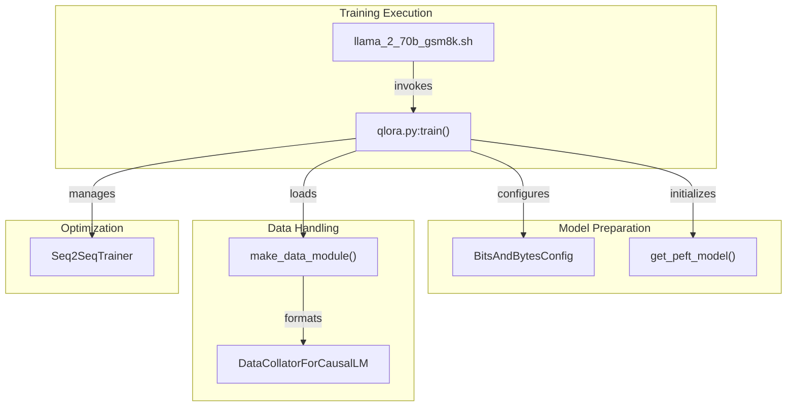
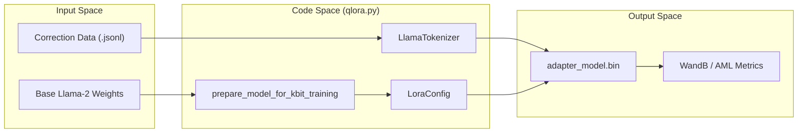

<!-- source: DeepWiki mcp.deepwiki.com · repo microsoft/LEMA · page 3 Training Pipeline · fetched 2026-10-26 -->

# Training Pipeline

Relevant source files

The following files were used as context for generating this wiki page:

- [README.md](README.md)
- [training_code/llama_2_70b_gsm8k.sh](training_code/llama_2_70b_gsm8k.sh)
- [training_code/qlora.py](training_code/qlora.py)

The LEMA training pipeline leverages **QLoRA** (Quantized Low-Rank Adaptation) to efficiently fine-tune Large Language Models on mistake-correction data pairs [README.md:67-67](). By utilizing 4-bit quantization and adapter-based tuning, the system can fine-tune models as large as Llama-2-70B on consumer-grade or mid-range enterprise hardware [README.md:35-36]().

The pipeline is designed to ingest structured correction data (Incorrect Step, Explanation, Correct Solution) and produce PEFT (Parameter-Efficient Fine-Tuning) adapters that enhance the model's reasoning capabilities across benchmarks like GSM8K, MATH, and CommonsenseQA [README.md:27-40]().

### Pipeline Architecture

The training process is orchestrated by a shell script that invokes a specialized Python engine. The engine handles model quantization, data tokenization, and the training loop.

#### Data to Code Entity Mapping
The following diagram illustrates how the conceptual training components map to specific code entities within the `training_code` directory.

**Sources:** [training_code/qlora.py:721-721](), [training_code/llama_2_70b_gsm8k.sh:1-1]()

---

### Training Configuration
The pipeline is highly configurable via command-line arguments. The primary entry point for users is the `llama_2_70b_gsm8k.sh` script, which defines hyperparameters such as:
*   **Quantization:** 4-bit NormalFloat (`nf4`) with double quantization [training_code/llama_2_70b_gsm8k.sh:26-28]().
*   **LoRA Settings:** Rank (`lora_r`), Alpha, and target modules (typically `all` linear layers) [training_code/llama_2_70b_gsm8k.sh:20-22]().
*   **Optimization:** Paged AdamW optimizer with constant learning rate schedules [training_code/llama_2_70b_gsm8k.sh:10-16]().

For a comprehensive breakdown of all available flags and their recommended values for different datasets, see **[Training Script Configuration (llama_2_70b_gsm8k.sh)](#3.1)**.

**Sources:** [training_code/llama_2_70b_gsm8k.sh:1-51]()

---

### QLoRA Implementation Engine
The core logic resides in `qlora.py`. This script manages the complex lifecycle of a quantized training run:
1.  **Argument Parsing:** Uses `ModelArguments`, `DataArguments`, and `TrainingArguments` dataclasses to validate inputs [training_code/qlora.py:80-206]().
2.  **Model Quantization:** Implements `get_accelerate_model` to load base models (e.g., Llama-2) in 4-bit while preparing them for adapter insertion [training_code/qlora.py:410-410]().
3.  **Data Processing:** Utilizes `make_data_module` and a custom `DataCollatorForCausalLM` to handle sequence padding and instruction-based formatting [training_code/qlora.py:530-530]().
4.  **Checkpointing:** Employs `SavePeftModelCallback` to ensure that only the lightweight adapter weights are saved, rather than the full quantized base model [training_code/qlora.py:454-454]().

For a deep dive into the internal functions and the hardware-specific optimizations (including IPEX/XPU support), see **[QLoRA Fine-Tuning Engine (qlora.py)](#3.2)**.

**Sources:** [training_code/qlora.py:80-721]()

---

### Pipeline Flow: From Data to Adapter
This diagram bridges the gap between the raw training data and the final generated artifacts.

**Sources:** [training_code/qlora.py:31-41](), [training_code/qlora.py:530-550](), [training_code/llama_2_70b_gsm8k.sh:46-50]()

---

