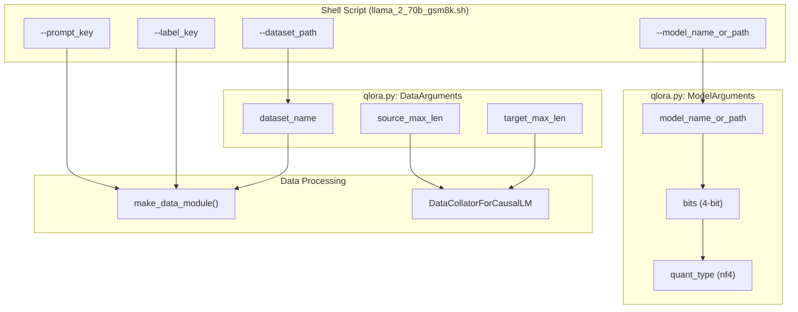
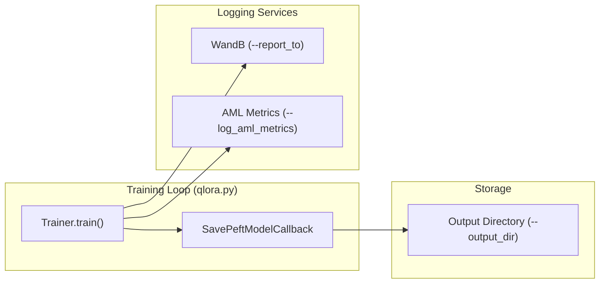

<!-- source: DeepWiki mcp.deepwiki.com · repo microsoft/LEMA · page 3.1 Training Script Configuration (llama_2_70b_gsm8k.sh) · fetched 2026-10-26 -->

# Training Script Configuration (llama_2_70b_gsm8k.sh)

Relevant source files

The following files were used as context for generating this wiki page:

- [README.md](README.md)
- [training_code/llama_2_70b_gsm8k.sh](training_code/llama_2_70b_gsm8k.sh)

The `llama_2_70b_gsm8k.sh` script serves as the primary entry point for fine-tuning Llama-2-70B models using the Learning from Mistakes (LEMA) methodology. It leverages the QLoRA (Quantized Low-Rank Adaptation) framework to enable high-parameter model training on consumer-grade or limited enterprise hardware by utilizing 4-bit quantization and parameter-efficient fine-tuning.

## Script Overview and Execution Flow

The script uses the `accelerate launch` utility to manage distributed training environments and executes `qlora.py` with a specific set of hyperparameters tailored for reasoning tasks like GSM8K and MATH.

### Data and Model Association Diagram
This diagram illustrates how the shell script variables map to the internal `qlora.py` argument structures and the resulting data flow into the training engine.

**Training Configuration Data Flow**

**Sources:** [training_code/llama_2_70b_gsm8k.sh:1-6](), [training_code/qlora.py:165-227]()

---

## Hyperparameter Configurations

The script defines several categories of hyperparameters that control the model's learning behavior, memory footprint, and adapter structure.

### 1. Model Quantization and LoRA Settings
The configuration utilizes 4-bit NormalFloat (`nf4`) quantization with double quantization to minimize memory usage while maintaining performance for the 70B parameter model.

| Parameter | Value | Description |
| :--- | :--- | :--- |
| `bits` | 4 | Quantization level for base model weights [training_code/llama_2_70b_gsm8k.sh:26](). |
| `quant_type` | nf4 | Uses NormalFloat4, optimized for normally distributed weights [training_code/llama_2_70b_gsm8k.sh:28](). |
| `double_quant` | True | Quantizes the quantization constants for further memory savings [training_code/llama_2_70b_gsm8k.sh:27](). |
| `lora_r` | 64 | The rank of the adapter matrices [training_code/llama_2_70b_gsm8k.sh:21](). |
| `lora_alpha` | 16 | Scaling factor for LoRA [training_code/llama_2_70b_gsm8k.sh:22](). |
| `lora_modules` | all | Applies LoRA to all linear layers in the transformer block [training_code/llama_2_70b_gsm8k.sh:20](). |

### 2. Learning Rate and Optimizer
LEMA uses a constant learning rate schedule, which has been found effective for fine-tuning on correction data pairs.

*   **Learning Rate:** Set to `0.0001` for models $\ge$ 34B parameters and `0.0002` for smaller models [training_code/llama_2_70b_gsm8k.sh:9]().
*   **Optimizer:** `paged_adamw_32bit` is used to handle memory spikes by paging optimizer states to CPU RAM [training_code/llama_2_70b_gsm8k.sh:16]().
*   **Schedule:** A `constant` scheduler with a `warmup_ratio` of `0.0` [training_code/llama_2_70b_gsm8k.sh:10-11]().

### 3. Sequence Length and Batching Strategy
The script differentiates settings between the GSM8K and MATH datasets to account for the varying complexity and length of reasoning chains.

| Setting | GSM8K Value | MATH Value | Source |
| :--- | :--- | :--- | :--- |
| `source_max_len` | 512 | 768 | [training_code/llama_2_70b_gsm8k.sh:12]() |
| `target_max_len` | 512 | 768 | [training_code/llama_2_70b_gsm8k.sh:13]() |
| `per_device_train_batch_size` | 6 | 3 | [training_code/llama_2_70b_gsm8k.sh:14]() |
| `gradient_accumulation_steps` | 4 | 8 | [training_code/llama_2_70b_gsm8k.sh:15]() |

**Total Batch Size Calculation:**
The effective batch size is calculated as:
`per_device_train_batch_size` × `gradient_accumulation_steps` × `num_gpus`.
For GSM8K on 4 GPUs: $6 \times 4 \times 4 = 96$ [training_code/llama_2_70b_gsm8k.sh:15]().

---

## Infrastructure and Logging

### Hardware Efficiency
To fit the 70B model during training, the script enables:
*   **Gradient Checkpointing:** Reduces VRAM usage by recomputing activations during the backward pass [training_code/llama_2_70b_gsm8k.sh:29]().
*   **Group by Length:** Groups sequences of similar lengths into batches to minimize padding tokens and increase throughput [training_code/llama_2_70b_gsm8k.sh:44]().
*   **BF16 Training:** Uses BFloat16 precision for training stability on supported hardware (e.g., A100/H100) [training_code/llama_2_70b_gsm8k.sh:24]().

### Reporting and Checkpointing
The script integrates with Weights & Biases (WandB) and Azure Machine Learning (AML) for experiment tracking.

**Reporting Architecture**

**Sources:** [training_code/llama_2_70b_gsm8k.sh:46-50](), [training_code/qlora.py:532-550]()

*   **Checkpointing:** Models are saved every 100 steps (`save_steps 100`) with a limit of 40 total checkpoints kept on disk [training_code/llama_2_70b_gsm8k.sh:40-41]().
*   **Logging:** Training metrics are logged every 10 steps (`logging_steps 10`) [training_code/llama_2_70b_gsm8k.sh:38]().

**Sources:**
* `training_code/llama_2_70b_gsm8k.sh`
* `training_code/qlora.py`
* `README.md`

---

