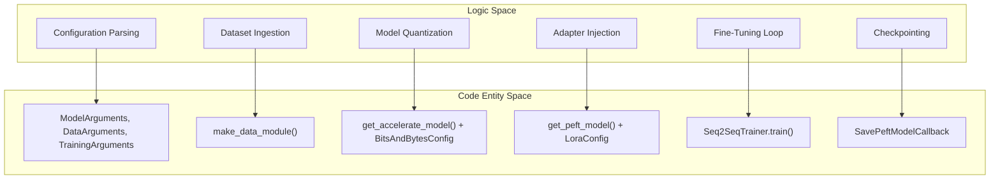
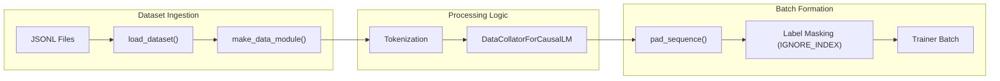

<!-- source: DeepWiki mcp.deepwiki.com · repo microsoft/LEMA · page 3.2 QLoRA Fine-Tuning Engine (qlora.py) · fetched 2026-10-26 -->

# QLoRA Fine-Tuning Engine (qlora.py)

Relevant source files

The following files were used as context for generating this wiki page:

- [training_code/qlora.py](training_code/qlora.py)

The `qlora.py` script is the core training engine of the LEMA framework. It implements the QLoRA (Quantized Low-Rank Adaptation) algorithm, enabling efficient fine-tuning of large language models (up to 70B parameters) on consumer-grade or mid-range hardware by combining 4-bit quantization with LoRA adapters [training_code/qlora.py:1-42]().

## System Architecture and Data Flow

The training engine follows a structured pipeline from argument parsing to model saving. It leverages the Hugging Face `transformers` and `peft` libraries to handle model quantization, adapter injection, and distributed training.

### High-Level Training Flow
The following diagram bridges the logical training stages to the specific code entities responsible for them.

**Diagram: Training Engine Logic to Code Entity Mapping**

**Sources:** [training_code/qlora.py:80-210](), [training_code/qlora.py:734-800](), [training_code/qlora.py:612-732](), [training_code/qlora.py:840-870]()

---

## Configuration Dataclasses

The engine uses four primary dataclasses to manage configuration, extending standard Hugging Face arguments:

| Class | Purpose | Key Parameters |
| :--- | :--- | :--- |
| `ModelArguments` | Model identification and loading. | `model_name_or_path`, `trust_remote_code` [training_code/qlora.py:80-93]() |
| `DataArguments` | Dataset paths and sequence lengths. | `dataset_path`, `source_max_len`, `target_max_len`, `prompt_key` [training_code/qlora.py:95-133]() |
| `TrainingArguments` | Optimization and QLoRA specifics. | `bits` (4 or 8), `quant_type` (nf4/fp4), `lora_r`, `lora_alpha`, `double_quant` [training_code/qlora.py:135-210]() |
| `GenerationArguments` | Evaluation-time decoding parameters. | `max_new_tokens`, `do_sample`, `temperature` [training_code/qlora.py:212-230]() |

**Sources:** [training_code/qlora.py:80-230]()

---

## Model Loading and Quantization

The `get_accelerate_model` function is responsible for the hardware-aware initialization of the model.

### Quantization Pipeline
1.  **Device Detection**: Checks for CUDA or Intel XPU (via `is_ipex_available`) [training_code/qlora.py:49-69]().
2.  **Quantization Config**: Initializes `BitsAndBytesConfig` using `args.bits`, `args.quant_type` (defaulting to `nf4`), and `args.double_quant` [training_code/qlora.py:633-640]().
3.  **Model Loading**: Loads the base model via `AutoModelForCausalLM.from_pretrained` with `low_cpu_mem_usage=True` [training_code/qlora.py:642-658]().
4.  **K-Bit Preparation**: Calls `prepare_model_for_kbit_training` to enable gradient checkpointing and prepare the model for adapter attachment [training_code/qlora.py:688-689]().

### Adapter Insertion
If `full_finetune` is false, the engine identifies all linear layers (e.g., `q_proj`, `v_proj`, `k_proj`) and injects LoRA adapters using `get_peft_model` [training_code/qlora.py:702-730]().

**Sources:** [training_code/qlora.py:612-732]()

---

## Data Processing and Ingestion

The data pipeline converts raw JSONL files (mistake-correction pairs) into tokenized tensors suitable for causal language modeling.

### `make_data_module` and `DataCollatorForCausalLM`
The engine uses a custom data module to handle the formatting of source (instruction/mistake) and target (correction) text.

**Diagram: Data Ingestion Flow**

**Sources:** [training_code/qlora.py:504-610](), [training_code/qlora.py:456-502]()

### Key Data Functions:
*   **`extract_nlp_data`**: Parses custom dataset formats, specifically extracting keys defined by `prompt_key` and `label_key` [training_code/qlora.py:516-522]().
*   **`DataCollatorForCausalLM`**: This class ensures that the model only calculates loss on the target tokens (the correction) and not the source tokens (the prompt/mistake). It achieves this by setting the `labels` for source tokens to `IGNORE_INDEX` (-100) [training_code/qlora.py:480-502]().

---

## Training Lifecycle and Checkpointing

The `train()` function acts as the entry point, orchestrating the setup and execution of the `Seq2SeqTrainer` [training_code/qlora.py:734-870]().

### Hardware-Specific Logic (IPEX/XPU)
The engine includes specific support for Intel GPUs (XPU). It checks for `intel_extension_for_pytorch` and, if present, ensures version compatibility between `torch` and `ipex` before proceeding [training_code/qlora.py:49-69]().

### `SavePeftModelCallback`
Standard Hugging Face trainers often save the full model state. This engine uses a custom `SavePeftModelCallback` to ensure that only the LoRA adapter weights and the `adapter_config.json` are saved during checkpointing, significantly reducing disk usage [training_code/qlora.py:438-454]().

### Checkpoint Resumption
The script automatically detects existing checkpoints in the `output_dir`. If a directory named `checkpoint-XXXX` is found, the trainer will attempt to resume training from the latest one [training_code/qlora.py:840-855]().

**Sources:** [training_code/qlora.py:438-454](), [training_code/qlora.py:840-870](), [training_code/qlora.py:49-69]()

---

