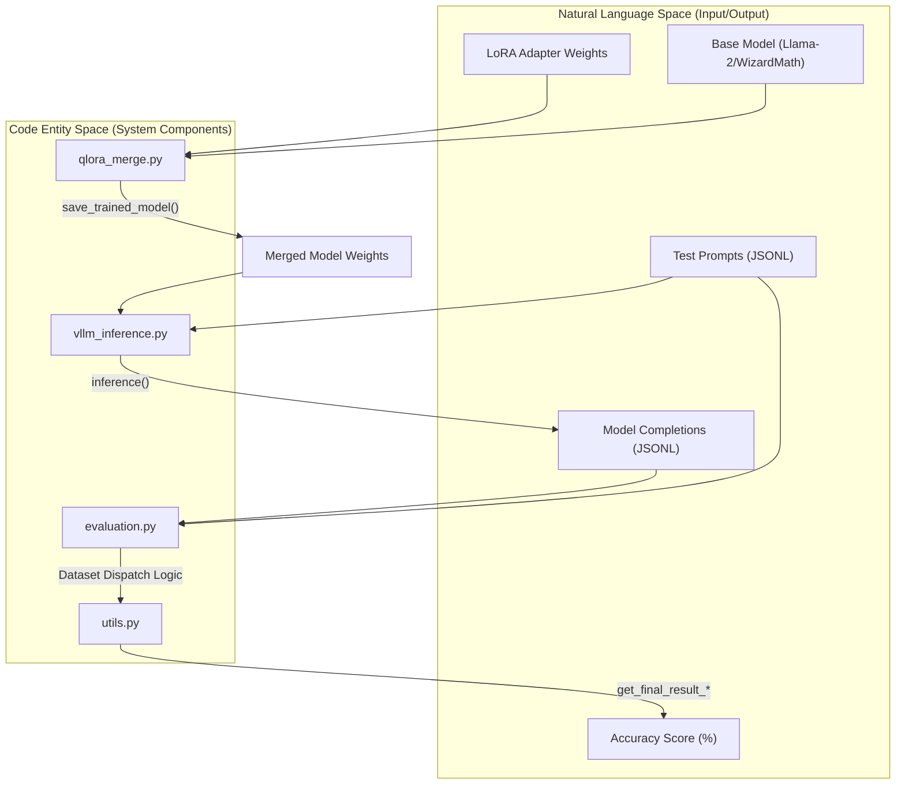
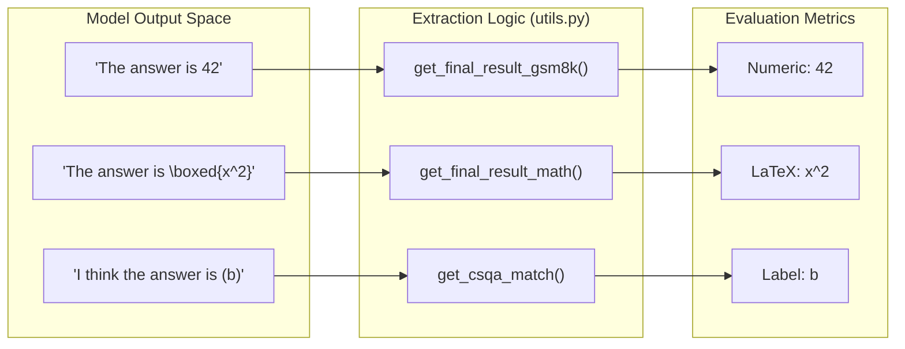

<!-- source: DeepWiki mcp.deepwiki.com · repo microsoft/LEMA · page 4 Inference and Evaluation Pipeline · fetched 2026-10-26 -->

# Inference and Evaluation Pipeline

Relevant source files

The following files were used as context for generating this wiki page:

- [README.md](README.md)
- [inference_code/evaluation.py](inference_code/evaluation.py)
- [inference_code/qlora_merge.py](inference_code/qlora_merge.py)
- [inference_code/vllm_inference.py](inference_code/vllm_inference.py)

The LEMA inference and evaluation pipeline transforms trained LoRA adapters into final accuracy metrics through a three-stage workflow. This process involves merging the parameter-efficient adapters back into the base model weights, executing high-throughput batch inference using the vLLM engine, and applying dataset-specific extraction logic to calculate performance scores.

### Pipeline Overview

The transition from a trained adapter to a performance metric follows a linear progression. First, the `qlora_merge.py` script prepares a standalone model [README.md:94-99](). Next, `vllm_inference.py` generates model completions in bulk [README.md:101-109](). Finally, `evaluation.py` parses these completions to determine if the reasoning reached the correct conclusion [README.md:111-115]().

#### System Architecture and Code Entities
The following diagram illustrates how the logical stages of the pipeline map to specific scripts and functions within the `inference_code` directory.

**Sources:** [inference_code/qlora_merge.py:21-53](), [inference_code/vllm_inference.py:12-54](), [inference_code/evaluation.py:35-97]()

---

### 4.1 Adapter Merging
The initial step after training is weight consolidation. Because LEMA uses QLoRA for parameter-efficient tuning, the resulting checkpoints contain only the adapter weights. The `save_trained_model()` function in `qlora_merge.py` loads the base model in `torch.bfloat16` and uses `PeftModel.merge_and_unload()` to create a unified model architecture compatible with standard inference engines.

For details, see [Adapter Merging (qlora_merge.py)](#4.1).

**Sources:** [inference_code/qlora_merge.py:21-53](), [inference_code/qlora_merge.py:65-75]()

---

### 4.2 vLLM Batch Inference
LEMA utilizes the [vLLM](https://github.com/vllm-project/vllm) library to maximize inference throughput. The `vllm_inference.py` script manages the lifecycle of the vLLM `LLM` engine, configuring critical parameters such as `gpu_memory_utilization` and `tensor_parallel_size` for multi-GPU setups. It processes inputs in batches (default `batch_size=128`) and utilizes greedy decoding (`temperature=0.0`) via `SamplingParams` to ensure reproducible results.

For details, see [vLLM Batch Inference (vllm_inference.py)](#4.2).

**Sources:** [inference_code/vllm_inference.py:27-36](), [inference_code/vllm_inference.py:41-51]()

---

### 4.3 Answer Extraction and Accuracy Evaluation
The final stage converts raw text completions into structured accuracy metrics. The `evaluation.py` script acts as a dispatcher, identifying the dataset type (e.g., GSM8K, MATH, or CSQA) and calling specialized extraction functions from `utils.py`. 

#### Data Flow to Code Mapping
The following diagram shows how raw model outputs are processed by specific extraction utilities to bridge the gap between free-form text and the final evaluation metric.

The evaluation logic handles complex edge cases, such as LaTeX normalization for the MATH benchmark, numerical filtering for GSM8K, and Levenshtein distance matching for CommonsenseQA options.

For details, see [Answer Extraction and Accuracy Evaluation](#4.3).

**Sources:** [inference_code/evaluation.py:37-92](), [inference_code/evaluation.py:9](), [README.md:110-116]()

---

