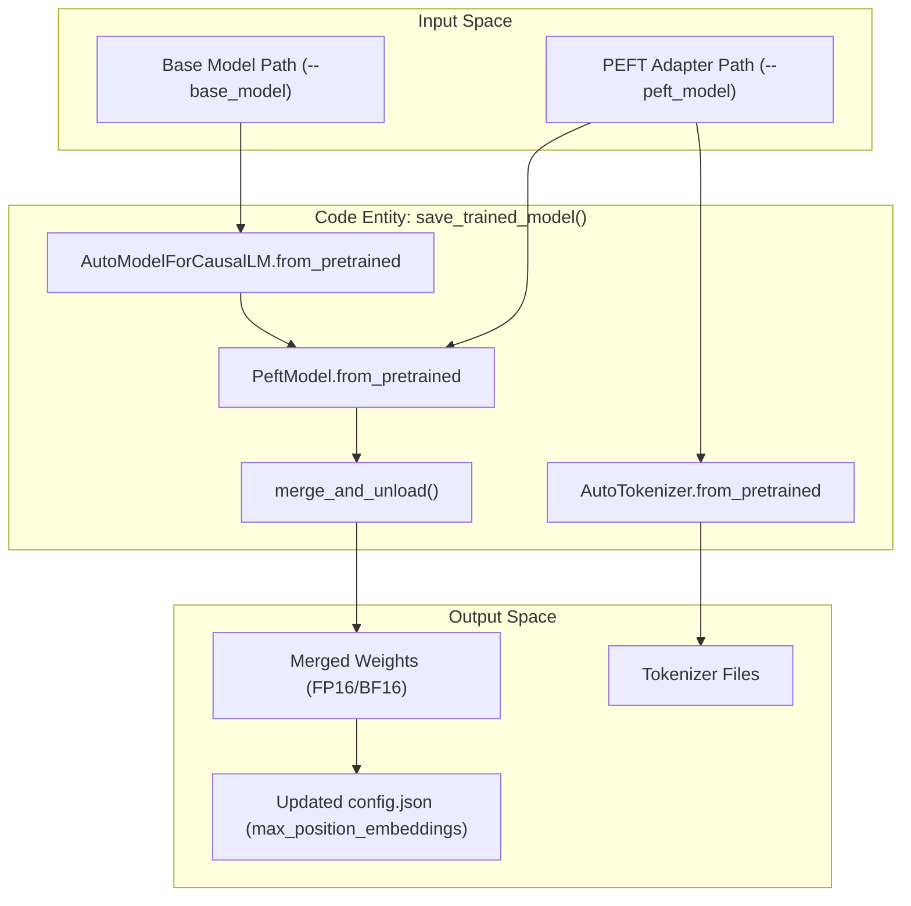
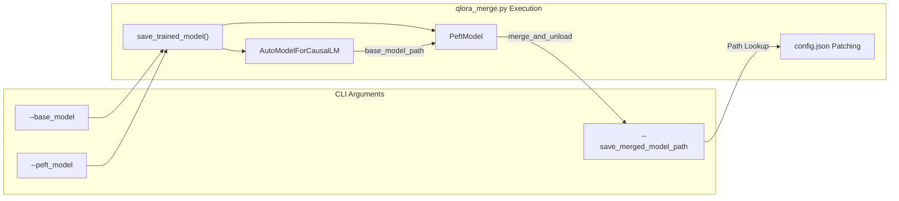

<!-- source: DeepWiki mcp.deepwiki.com · repo microsoft/LEMA · page 4.1 Adapter Merging (qlora_merge.py) · fetched 2026-10-26 -->

# Adapter Merging (qlora_merge.py)

<details>
<summary>Relevant source files</summary>

The following files were used as context for generating this wiki page:

- [README.md](README.md)
- [inference_code/qlora_merge.py](inference_code/qlora_merge.py)

</details>


The LEMA framework utilizes **QLoRA** (Quantized Low-Rank Adaptation) for parameter-efficient fine-tuning. Because QLoRA trains only a small set of adapter weights while keeping the base model frozen and quantized, the resulting checkpoints are not standalone models. The `qlora_merge.py` script serves as a mandatory post-training utility that integrates these LoRA adapter weights back into the full-parameter base model, producing a unified model ready for high-performance inference via engines like **vLLM** [README.md:81-82]().

## Functional Overview

The merging process follows a linear pipeline: loading the base model in high precision, applying the PEFT (Parameter-Efficient Fine-Tuning) adapter, performing a mathematical merge of the weights, and applying a configuration patch to ensure compatibility with long-sequence reasoning tasks.

### Logic Flow: Adapter to Merged Model


**Sources:** [inference_code/qlora_merge.py:21-53](), [inference_code/qlora_merge.py:65-71]()

## Key Implementation Details

### Model Loading and Precision
The script explicitly loads the base model using `torch.bfloat16` precision [inference_code/qlora_merge.py:27](). This is critical for maintaining the numerical accuracy of the LEMA models (e.g., Llama-2-70b) after they have been fine-tuned on complex reasoning tasks. The `device_map="auto"` argument is used to handle multi-GPU memory distribution automatically during the loading phase [inference_code/qlora_merge.py:28]().

### The Merging Mechanism
The core of the script is the `merge_and_unload()` method provided by the `peft` library. 
1. **`PeftModel.from_pretrained`**: Wraps the base model with the LoRA layers found in the `peft_model_path` [inference_code/qlora_merge.py:42]().
2. **`merge_and_unload()`**: Physically adds the LoRA adapter weights ($W = W_0 + BA$) to the base model's weight matrices and removes the adapter overhead, returning a standard `transformers` model object [inference_code/qlora_merge.py:46]().

### Tokenizer Handling
The tokenizer is loaded from the `peft_model_path` rather than the base model path [inference_code/qlora_merge.py:32-33](). This ensures that any special tokens or vocabulary modifications introduced during the LEMA training phase are preserved. The script forces `padding_side="right"` and `truncation_side="left"` to align with standard causal language modeling requirements [inference_code/qlora_merge.py:34-35]().

### The Max Position Embeddings Patch
A specific post-processing step is applied to the `config.json` of the merged model. The script checks the `max_position_embeddings` attribute; if it is less than 4096, it is manually updated to 4096 [inference_code/qlora_merge.py:65-72](). This patch ensures that the model can handle the longer sequence lengths often required for multi-step mistake correction and mathematical reasoning.

## CLI Arguments and Usage

The script is executed via the command line with four primary arguments:

| Argument | Type | Description |
| :--- | :--- | :--- |
| `--base_model` | `str` | Path or HuggingFace ID of the original model (e.g., `meta-llama/Llama-2-70b-hf`). |
| `--peft_model` | `str` | Path to the directory containing `adapter_model.bin`. |
| `--save_merged_model_path` | `str` | Destination directory for the final merged model. |
| `--trust_remote_code` | `bool` | Whether to allow custom code from the model repository (default: `False`). |

**Example Execution:**
```bash
python qlora_merge.py \
--base_model meta-llama/Llama-2-70b-hf \
--peft_model LEMAv1/peft-Llama-2-70b-gsm8k \
--save_merged_model_path ./Llama-2-70b-GSM8K-LEMA-merged
```
**Sources:** [README.md:96-99](), [inference_code/qlora_merge.py:56-61]()

## System Entity Mapping

The following diagram maps the CLI arguments and file-system artifacts to the internal `save_trained_model` execution context.


**Sources:** [inference_code/qlora_merge.py:21-25](), [inference_code/qlora_merge.py:63-65]()

## Sources
- `README.md`: [81-82](), [96-99]()
- `inference_code/qlora_merge.py`: [21-53](), [56-61](), [63-75]()

---

