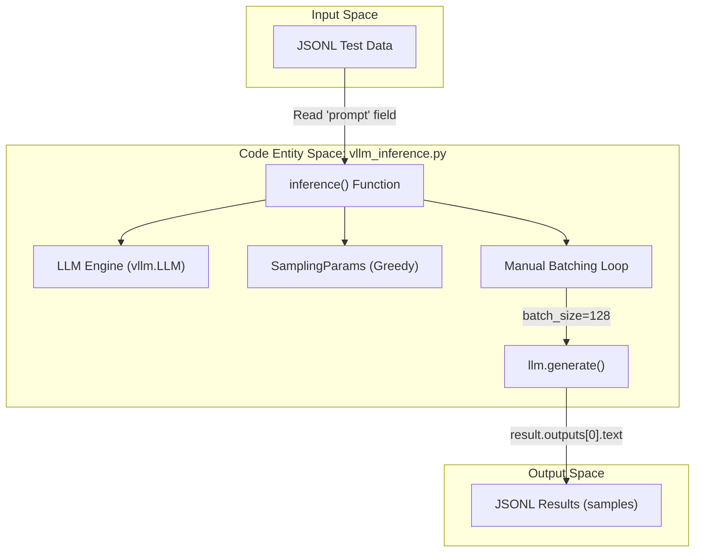
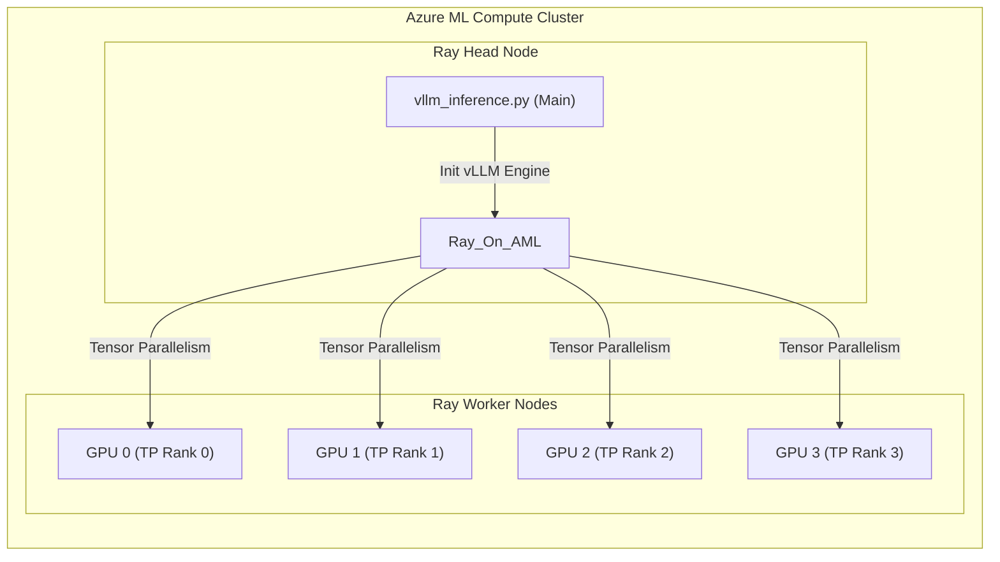

<!-- source: DeepWiki mcp.deepwiki.com · repo microsoft/LEMA · page 4.2 vLLM Batch Inference (vllm_inference.py) · fetched 2026-10-26 -->

# vLLM Batch Inference (vllm_inference.py)

<details>
<summary>Relevant source files</summary>

The following files were used as context for generating this wiki page:

- [inference_code/vllm_inference.py](inference_code/vllm_inference.py)

</details>


The `vllm_inference.py` script serves as the high-throughput inference engine for the LEMA framework. It leverages the **vLLM** library to perform batch processing of test prompts on fine-tuned and merged models. The script is designed to run within an Azure Machine Learning (AML) environment, utilizing Ray for distributed compute and tensor parallelism to handle large-scale models like Llama-2-70B.

## Overview and Lifecycle

The script follows a linear lifecycle: initializing the Ray-on-AML environment (implied by imports), loading a merged model into the vLLM engine, reading JSONL test data, executing inference in manual batches, and persisting results for downstream evaluation.

### Inference Lifecycle Diagram

The following diagram illustrates the flow from input data to the final generated samples.

**vLLM Inference Data Flow**

**Sources:** [inference_code/vllm_inference.py:12-54]()

## Engine Configuration

The script initializes the vLLM engine with specific hardware and performance optimizations. 

### vLLM Engine Settings
The `LLM` class is instantiated with parameters tailored for high-memory GPU environments:
*   **Model Path**: Loads the model from `--merged_model_path`, which typically contains the base model weights merged with LEMA LoRA adapters [inference_code/vllm_inference.py:27-27]().
*   **Tensor Parallelism**: Controlled by `--tensor_parallel_size` (default: 4), allowing the model to be partitioned across multiple GPUs [inference_code/vllm_inference.py:28-28](), [inference_code/vllm_inference.py:64-64]().
*   **Memory Management**: `gpu_memory_utilization` is set to `0.8` to reserve buffer for KV cache and prevent OOM (Out-of-Memory) errors during large batch operations [inference_code/vllm_inference.py:31-31]().
*   **Throughput**: `max_num_batched_tokens` is set to `8192` to optimize the number of tokens processed in a single iteration [inference_code/vllm_inference.py:30-30]().

### Sampling Parameters
For evaluation consistency, the script uses **Greedy Decoding**:
*   `temperature=0.0`: Ensures deterministic output by selecting the most likely next token [inference_code/vllm_inference.py:33-33]().
*   `top_p=1.0`: Disables nucleus sampling [inference_code/vllm_inference.py:33-33]().
*   `max_tokens=2048`: Sets a hard limit on the generated sequence length, accommodating long reasoning chains required for MATH and GSM8K [inference_code/vllm_inference.py:33-33]().

**Sources:** [inference_code/vllm_inference.py:27-33](), [inference_code/vllm_inference.py:63-65]()

## Batching Logic and Data Format

While vLLM handles continuous batching internally, `vllm_inference.py` implements a manual batching layer to manage memory and logging effectively.

### Input Format
The script expects a JSONL file where each line contains a `prompt` key:
```json
{"prompt": "Question: ... Answer: "}
```
**Sources:** [inference_code/vllm_inference.py:21-22]()

### Batch Processing Loop
1.  **Read**: All prompts are loaded into a list `test_prompts` [inference_code/vllm_inference.py:22-22]().
2.  **Chunk**: The list is divided into chunks of `batch_size = 128` [inference_code/vllm_inference.py:35-36]().
3.  **Generate**: Each batch is passed to `llm.generate()` [inference_code/vllm_inference.py:46-46]().
4.  **Collect**: The first output choice (`result.outputs[0].text`) is extracted and stored in a dictionary under the key `samples` [inference_code/vllm_inference.py:49-50]().

### Output Format
The results are saved as a JSONL file where each line represents a single completion:
```json
{"samples": ["The generated solution text..."]}
```
**Sources:** [inference_code/vllm_inference.py:52-54]()

## Distributed Compute Integration

The script is built to function within the `Ray_On_AML` ecosystem, which facilitates running distributed workloads on Azure Machine Learning clusters.

**Distributed Inference Architecture**

**Sources:** [inference_code/vllm_inference.py:7-9](), [inference_code/vllm_inference.py:28-28]()

## CLI Arguments Reference

| Argument | Type | Default | Description |
| :--- | :--- | :--- | :--- |
| `--testdata_folder` | `str` | Required | Path to the directory containing test files. |
| `--testdata_file` | `str` | Required | Specific JSONL file name to process. |
| `--output_folder` | `str` | Required | Directory where the inference results will be saved. |
| `--output_file` | `str` | `sample.jsonl` | Filename for the output results. |
| `--merged_model_path` | `str` | Required | Path to the model (after `qlora_merge.py`). |
| `--tensor_parallel_size`| `int` | `4` | Number of GPUs to split the model across. |
| `--trust_remote_code` | `bool`| `False` | Whether to allow custom code from HuggingFace. |

**Sources:** [inference_code/vllm_inference.py:58-66]()

---

