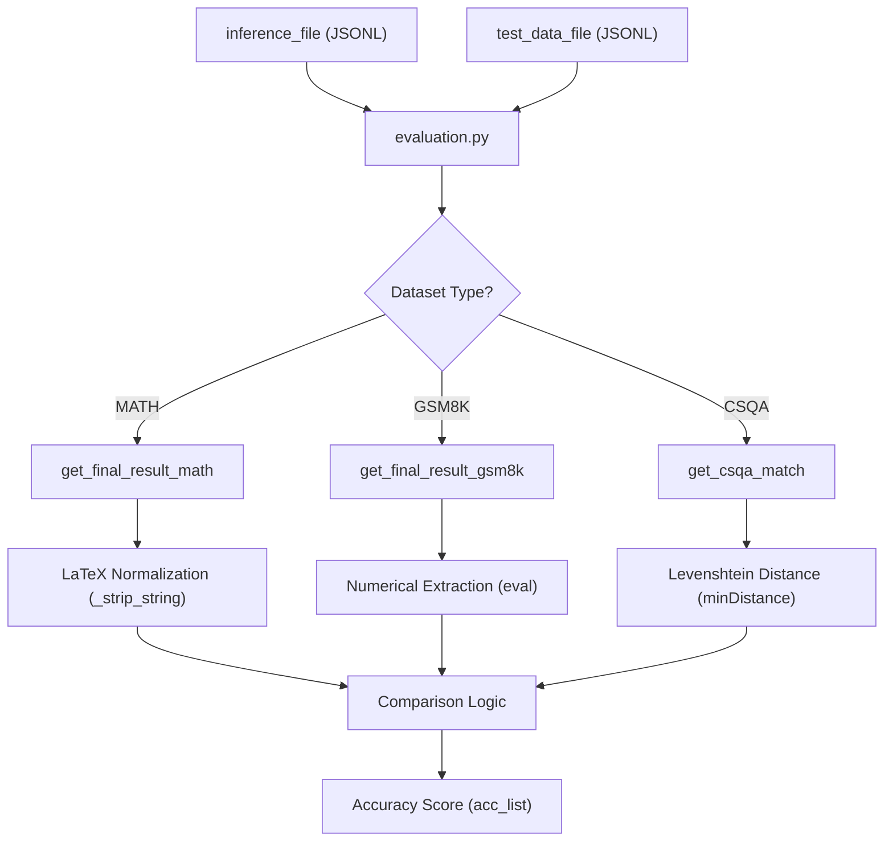
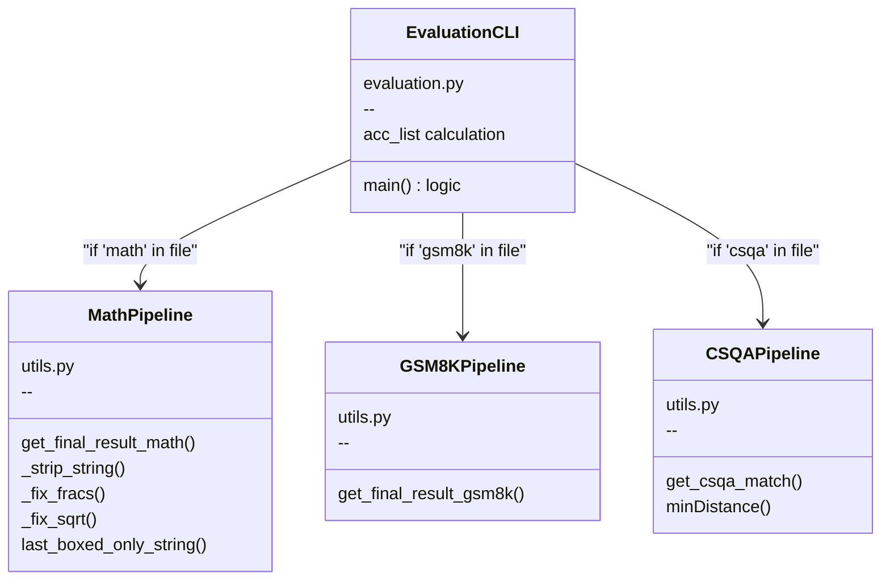

<!-- source: DeepWiki mcp.deepwiki.com · repo microsoft/LEMA · page 4.3 Answer Extraction and Accuracy Evaluation · fetched 2026-10-26 -->

# Answer Extraction and Accuracy Evaluation

<details>
<summary>Relevant source files</summary>

The following files were used as context for generating this wiki page:

- [inference_code/evaluation.py](inference_code/evaluation.py)
- [inference_code/utils.py](inference_code/utils.py)

</details>


This page details the evaluation subsystem of the LEMA framework, focusing on how model-generated completions are parsed, normalized, and compared against ground-truth labels. The logic is primarily housed in `evaluation.py` and `utils.py`, providing specialized pipelines for mathematical notation (MATH), numerical reasoning (GSM8K, ASDiv, MAWPS, SVAMP), and commonsense reasoning (CSQA).

## Evaluation Architecture and Data Flow

The evaluation process operates as a post-processing step after batch inference. It consumes the JSONL output from `vllm_inference.py` and the original test dataset to calculate accuracy.

### Data Dispatch Logic
The `evaluation.py` script acts as the entry point, dispatching samples to specific extraction functions based on the filename of the test data.

| Dataset Category | Dispatch Condition | Key Extraction Function |
| :--- | :--- | :--- |
| **MATH** | `'math' in args.test_data_file` | `get_final_result_math` |
| **GSM8K** | `'gsm8k' in args.test_data_file` | `get_final_result_gsm8k` |
| **ASDiv/MAWPS/SVAMP** | `'asdiv'`, `'mawps'`, or `'svamp'` | `get_final_result_gsm8k` (with rounding) |
| **CSQA** | `'csqa' in args.test_data_file` | `get_csqa_match` |

**Sources:**
- `inference_code/evaluation.py:37-92`

### Pipeline Overview
The following diagram illustrates the flow from raw model output to final accuracy score:

**Evaluation Pipeline Flow**

**Sources:**
- `inference_code/evaluation.py:12-97`
- `inference_code/utils.py:49-65`
- `inference_code/utils.py:140-207`

---

## MATH LaTeX Normalization

The MATH dataset evaluation requires handling diverse LaTeX representations of the same mathematical entity. The `get_final_result_math` function isolates the model's answer and passes it through a normalization pipeline.

### Extraction Logic
1. **Boxed Extraction**: The system first attempts to find the content within a `\boxed{...}` or `\fbox{...}` environment using `last_boxed_only_string` `[inference_code/utils.py:218-243]()`.
2. **Fallback**: If no boxed content is found, it splits by common markers like `"The answer is "` `[inference_code/utils.py:246-253]()`.

### Normalization Pipeline (`_strip_string`)
The `_strip_string` function standardizes the extracted LaTeX string to ensure fair comparison:

*   **Fraction Handling**: Converts `\tfrac` and `\dfrac` to `\frac` `[inference_code/utils.py:153-155]()`. It also uses `_fix_fracs` to handle shorthand like `\frac12` by converting it to `\frac{1}{2}` `[inference_code/utils.py:68-97]()`.
*   **Square Roots**: `_fix_sqrt` ensures square roots are properly braced (e.g., `\sqrt3` becomes `\sqrt{3}`) `[inference_code/utils.py:125-137]()`.
*   **Unit/Symbol Removal**: Strips linebreaks, inverse spaces (`\!`), `\left/\right` delimiters, degree symbols (`^\circ`), and percentage signs `[inference_code/utils.py:141-176]()`.
*   **Numerical Cleanup**: Standardizes leading zeros (e.g., `.5` to `0.5`) and converts the specific case of `0.5` to `\frac{1}{2}` `[inference_code/utils.py:177-203]()`.

**Sources:**
- `inference_code/utils.py:68-243`

---

## GSM8K and Numerical Extraction

For GSM8K and related arithmetic datasets (ASDiv, MAWPS, SVAMP), the system focuses on extracting a final numerical value.

### Numerical Extraction Logic
The `get_final_result_gsm8k` function (referenced in `evaluation.py` `[inference_code/evaluation.py:41]()`) processes the completion to find the last numerical sequence.
*   **Filtering**: It removes common distractors like commas (used as thousands separators).
*   **Expression Handling**: If the extracted string contains basic arithmetic operators, the system uses `eval()` to compute the final scalar value.

### Rounding Behavior
For the ASDiv, MAWPS, and SVAMP datasets, both the predicted result and the ground-truth label are rounded to two decimal places before comparison to account for floating-point variations:
```python
pred_result = round(pred_result, 2)
label_result = round(label_result, 2)
```
**Sources:**
- `inference_code/evaluation.py:69-82`

---

## CSQA Matching and Levenshtein Distance

CommonsenseQA (CSQA) evaluation differs because the model output is often a natural language phrase that must be matched against a set of fixed candidates.

### Levenshtein Distance (`minDistance`)
The system implements a standard edit distance algorithm to find the closest match between the model's predicted answer string and the ground-truth label.
*   **Implementation**: A dynamic programming approach using two rows (`v1`, `v2`) to compute the minimum number of insertions, deletions, or substitutions required to transform one string into another `[inference_code/utils.py:7-46]()`.

### Matching Logic (`get_csqa_match`)
1. **Cleaning**: The prediction is truncated at common prompt markers like `\n\nQ: ` and the prefix `The answer is: ` is removed `[inference_code/utils.py:50-57]()`.
2. **Scoring**: The script calculates the `minDistance` between the cleaned prediction and every available candidate in the `candidates` list `[inference_code/utils.py:59]()`.
3. **Selection**: The candidate with the lowest distance is selected. If this candidate matches the ground-truth `label`, the sample is marked correct `[inference_code/utils.py:60-65]()`.

**Sources:**
- `inference_code/utils.py:7-65`
- `inference_code/evaluation.py:84-92`

---

## Code Entity Mapping

The following diagram maps the high-level evaluation tasks to the specific functions and files responsible for them.

**Entity Mapping: Natural Language Tasks to Code Entities**


**Sources:**
- `inference_code/evaluation.py:37-92`
- `inference_code/utils.py:7-246`

---

