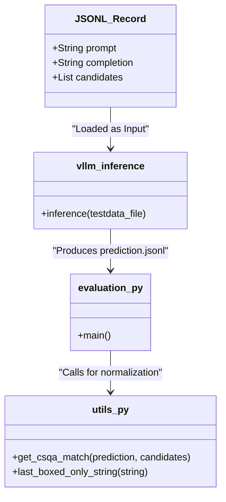

<!-- source: DeepWiki mcp.deepwiki.com · repo microsoft/LEMA · page 5 Test Data Reference · fetched 2026-10-26 -->

# Test Data Reference

<details>
<summary>Relevant source files</summary>

The following files were used as context for generating this wiki page:

- [test_data/csqa_dev.jsonl](test_data/csqa_dev.jsonl)
- [test_data/gsm8k_test.jsonl](test_data/gsm8k_test.jsonl)
- [test_data/gsm8k_test_wizardmath_prompt.jsonl](test_data/gsm8k_test_wizardmath_prompt.jsonl)
- [test_data/math_test.jsonl](test_data/math_test.jsonl)
- [test_data/math_test_wizardmath_prompt.jsonl](test_data/math_test_wizardmath_prompt.jsonl)

</details>


This page provides a high-level overview of the benchmark test datasets included in the LEMA repository. These datasets are used to evaluate the reasoning capabilities of models after they have undergone the "Learning from Mistakes" fine-tuning process. The repository contains test sets for mathematical reasoning (GSM8K, MATH) and commonsense reasoning (CommonsenseQA).

## Dataset Overview

The test data is primarily stored in the `test_data/` directory in JSONL format. These files are consumed by the inference engine to generate model predictions and by the evaluation scripts to calculate accuracy metrics.

### Data Flow Architecture

The following diagram illustrates how the test data files interact with the primary code entities in the inference and evaluation pipeline.

**Test Data Consumption Pipeline**
```mermaid
graph TD
    subgraph "Test Data Files"
        GSM["gsm8k_test.jsonl"]
        MATH["math_test.jsonl"]
        CSQA["csqa_dev.jsonl"]
    end

    subgraph "Inference Space"
        VLLM["vllm_inference.py"]
        INF_FUNC["inference() function"]
    end

    subgraph "Evaluation Space"
        EVAL["evaluation.py"]
        MAIN_EVAL["main() entrypoint"]
        EXTRACT["utils.py (Answer Extraction)"]
    end

    GSM -->|"--testdata_file"| VLLM
    MATH -->|"--testdata_file"| VLLM
    CSQA -->|"--testdata_file"| VLLM
    
    VLLM --> INF_FUNC
    INF_FUNC -->| "JSONL Output" | MAIN_EVAL
    
    MAIN_EVAL --> EXTRACT
    EXTRACT -->| "Final Metrics" | Results["Accuracy/Score"]
```
**Sources:** [vllm_inference.py:1-20](), [evaluation.py:1-30]()

## Math Benchmark Datasets (GSM8K and MATH)

The repository includes standard test sets for **GSM8K** (Grade School Math 8K) and the **MATH** dataset. These datasets are characterized by multi-step mathematical reasoning.

### Key Characteristics
*   **Format**: JSONL files containing `prompt` and `completion` keys [test_data/gsm8k_test.jsonl:1-5]().
*   **Prompt Variants**: The repository provides two versions of prompts for these datasets:
    1.  **Standard**: Uses a direct instruction ("Please solve the following math problem") [test_data/gsm8k_test.jsonl:1]().
    2.  **WizardMath**: Uses an Alpaca-style instruction template ("Below is an instruction... ### Instruction... ### Response") [test_data/gsm8k_test_wizardmath_prompt.jsonl:1]().
*   **Metadata**: The MATH dataset includes additional fields for `type` (e.g., Algebra, Geometry) and `level` (Level 1 to 5) to allow for fine-grained performance analysis [test_data/math_test.jsonl:1-5]().

For details on schema structure and prompt formatting, see **[Math Benchmark Datasets (GSM8K and MATH)](#5.1)**.

**Sources:** [test_data/gsm8k_test.jsonl:1-13](), [test_data/gsm8k_test_wizardmath_prompt.jsonl:1-11](), [test_data/math_test.jsonl:1-12]()

## CommonsenseQA Dataset

The **CommonsenseQA (CSQA)** dataset is used to evaluate the model's ability to perform reasoning based on general world knowledge.

### Key Characteristics
*   **Schema**: Unlike the math datasets, CSQA entries include a `candidates` list containing the multiple-choice options [test_data/csqa_dev.jsonl:1-5]().
*   **Evaluation Logic**: Because models may generate long-form explanations before the final answer, the evaluation pipeline uses specialized matching logic (e.g., Levenshtein distance) to map the model's output to one of the valid candidates [test_data/csqa_dev.jsonl:1]().
*   **Prompting**: The prompt instructs the model to explain each candidate answer before selecting the most relevant one [test_data/csqa_dev.jsonl:1]().

For details on the `QuestionObject` structure and label-to-text mapping, see **[CommonsenseQA Dataset (csqa_dev.jsonl)](#5.2)**.

**Sources:** [test_data/csqa_dev.jsonl:1-17]()

## Integration with Pipeline

The following table describes how these files are referenced by the system's CLI arguments.

| Dataset | Inference CLI Argument (`vllm_inference.py`) | Evaluation CLI Argument (`evaluation.py`) |
| :--- | :--- | :--- |
| **GSM8K** | `--testdata_file test_data/gsm8k_test.jsonl` | `--dataset gsm8k` |
| **MATH** | `--testdata_file test_data/math_test.jsonl` | `--dataset math` |
| **CSQA** | `--testdata_file test_data/csqa_dev.jsonl` | `--dataset csqa` |

**Sources:** [vllm_inference.py:1-20](), [evaluation.py:1-30]()

### Mapping Natural Language to Code Entities

The pipeline bridges the gap between raw JSONL data and programmatic evaluation through specific utility functions.

**Data Entity Mapping**

**Sources:** [vllm_inference.py:1-50](), [evaluation.py:1-50](), [test_data/csqa_dev.jsonl:1]()

---

