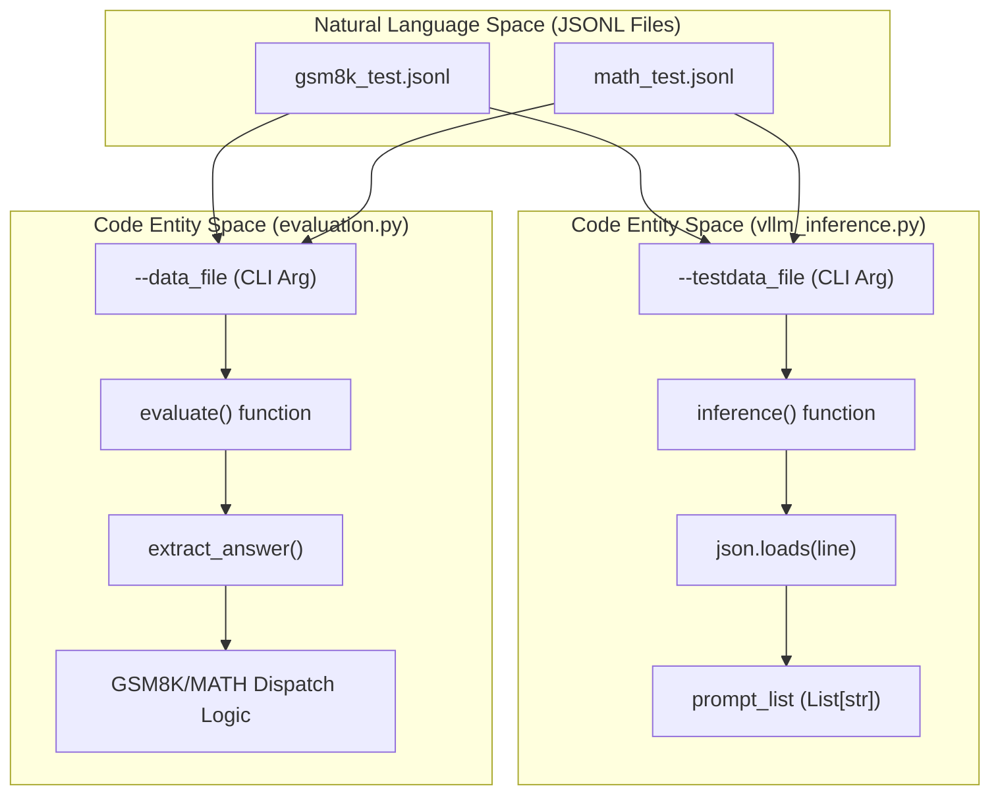
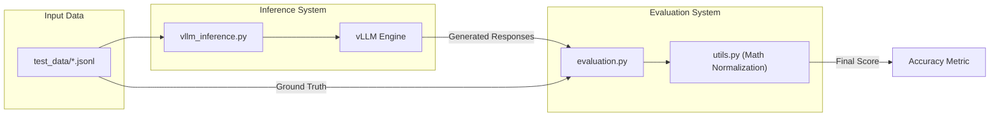

<!-- source: DeepWiki mcp.deepwiki.com · repo microsoft/LEMA · page 5.1 Math Benchmark Datasets (GSM8K and MATH) · fetched 2026-10-26 -->

# Math Benchmark Datasets (GSM8K and MATH)

<details>
<summary>Relevant source files</summary>

The following files were used as context for generating this wiki page:

- [test_data/gsm8k_test.jsonl](test_data/gsm8k_test.jsonl)
- [test_data/gsm8k_test_wizardmath_prompt.jsonl](test_data/gsm8k_test_wizardmath_prompt.jsonl)
- [test_data/math_test.jsonl](test_data/math_test.jsonl)
- [test_data/math_test_wizardmath_prompt.jsonl](test_data/math_test_wizardmath_prompt.jsonl)

</details>


This page documents the technical structure and schema of the GSM8K and MATH test datasets used within the LEMA framework. These datasets serve as the primary benchmarks for evaluating the mathematical reasoning capabilities of models fine-tuned using the "Learning from Mistakes" methodology.

## Dataset Schemas

The benchmark files are stored in JSONL (JSON Lines) format, where each line represents a single test case consisting of a prompt and a ground-truth completion.

### GSM8K Schema
The GSM8K (Grade School Math 8K) test set contains high-quality grade school math word problems.
*   **`prompt`**: Contains the question text prefixed with a standard instruction and suffixed with a chain-of-thought trigger (`Answer: Let's think step by step.`).
*   **`completion`**: Contains the full step-by-step reasoning path and the final numerical answer.

Example entry:
```json
{
  "prompt": "Please solve the following math problem.\nQuestion: Janet’s ducks lay 16 eggs per day... \nAnswer: Let's think step by step.\n",
  "completion": "Janet sells 16 - 3 - 4 = 9 duck eggs a day. ... The answer is 18."
}
```
**Sources:** `[test_data/gsm8k_test.jsonl:1-1]()`

### MATH Schema
The MATH dataset contains challenging competition-level problems. In addition to the standard fields, it includes metadata for categorization.
*   **`type`**: The mathematical sub-field (e.g., "Algebra", "Calculus").
*   **`level`**: Difficulty rating from Level 1 to Level 5.
*   **`completion`**: Contains LaTeX formatted reasoning and a final answer enclosed in a `\boxed{}` command.

Example entry:
```json
{
  "prompt": "Please solve the following math problem.\nQuestion: How many vertical asymptotes... \nAnswer: Let's think step by step.\n",
  "completion": "... the graph has \\boxed{2} vertical asymptotes.\nThe answer is 2.",
  "type": "Algebra", 
  "level": "Level 3"
}
```
**Sources:** `[test_data/math_test.jsonl:1-1]()`

---

## WizardMath Prompt Variants

The repository provides specialized versions of the test sets formatted for **WizardMath**. These variants use an instruction-following template rather than the simple "Question/Answer" format.

| Feature | Standard Prompt | WizardMath Prompt |
| :--- | :--- | :--- |
| **Header** | `Please solve the following math problem.` | `Below is an instruction that describes a task...` |
| **Question Tag** | `Question:` | `### Instruction:` |
| **Response Tag** | `Answer:` | `### Response:` |

**Sources:** `[test_data/gsm8k_test_wizardmath_prompt.jsonl:1-1]()`, `[test_data/math_test_wizardmath_prompt.jsonl:1-1]()`

---

## Data Flow in Inference and Evaluation

The test files are consumed by the inference engine to generate model outputs and then by the evaluation script to verify accuracy.

### Data Flow Diagram: Natural Language to Code Entity

This diagram illustrates how the raw JSONL files are mapped to specific variables and processing logic within the Python scripts.

**Title: Dataset Ingestion and Entity Mapping**

**Sources:** `[vllm_inference.py:28-66]()`, `[evaluation.py:126-155]()`

---

## System Integration Details

### 1. vLLM Inference (`vllm_inference.py`)
The script `vllm_inference.py` loads the test files using the `--testdata_file` argument. It iterates through the JSONL, extracting the `prompt` field to populate a batch for the vLLM engine.
*   The `inference()` function reads the file line-by-line.
*   Prompts are sent to `llm.generate(prompt_list, sampling_params)`.
*   The output is saved as a new JSONL containing the original prompt, the completion, and the model's generated response.

**Sources:** `[vllm_inference.py:75-92]()`

### 2. Accuracy Evaluation (`evaluation.py`)
The `evaluation.py` script compares the model's generated text against the `completion` field in the test data.
*   **GSM8K Processing**: Uses numerical extraction to find the final digit sequence.
*   **MATH Processing**: Employs heavy LaTeX normalization (stripping units, fixing fractions) to compare the contents of the `\boxed{}` tags.

### Component Interaction Diagram

**Title: Inference to Evaluation Pipeline**

**Sources:** `[vllm_inference.py:68-80]()`, `[evaluation.py:157-175]()`

---

## Summary of Test Files

| File Path | Problem Count | Format Type |
| :--- | :--- | :--- |
| `test_data/gsm8k_test.jsonl` | 1319 | Standard |
| `test_data/gsm8k_test_wizardmath_prompt.jsonl` | 1319 | WizardMath |
| `test_data/math_test.jsonl` | 5000 | Standard |
| `test_data/math_test_wizardmath_prompt.jsonl` | 5000 | WizardMath |

**Sources:** `[test_data/gsm8k_test.jsonl:1-1319]()`, `[test_data/math_test.jsonl:1-5000]()`

---

