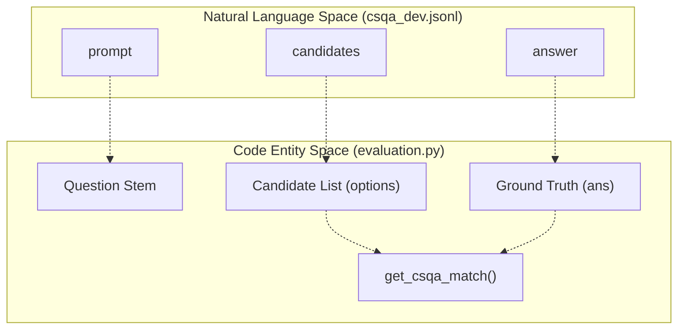
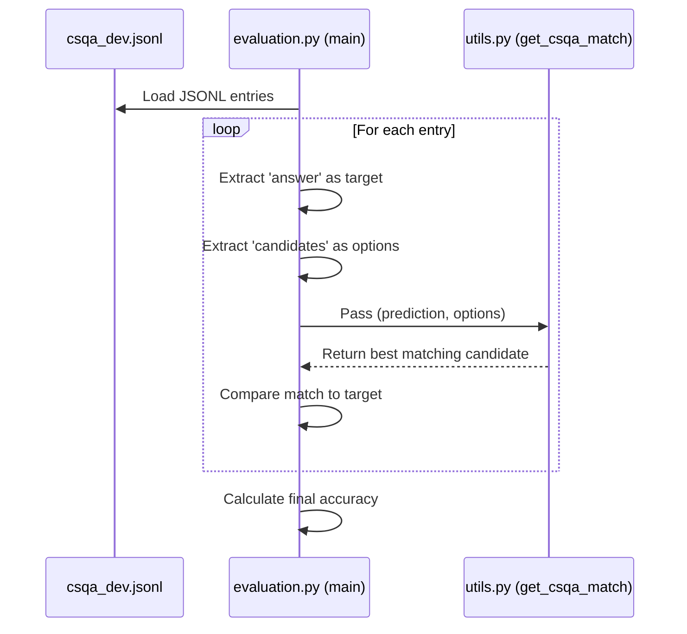

<!-- source: DeepWiki mcp.deepwiki.com · repo microsoft/LEMA · page 5.2 CommonsenseQA Dataset (csqa_dev.jsonl) · fetched 2026-10-26 -->

# CommonsenseQA Dataset (csqa_dev.jsonl)

Relevant source files

The following files were used as context for generating this wiki page:

- [test_data/csqa_dev.jsonl](test_data/csqa_dev.jsonl)

The CommonsenseQA (CSQA) development set is a critical component of the LEMA evaluation pipeline, used to assess the model's ability to perform commonsense reasoning and select appropriate answers from a set of candidates. Unlike the standard CSQA format which uses single-letter labels (A-E), the LEMA version focuses on text-based matching and reasoning explanations.

## Dataset Schema

The `csqa_dev.jsonl` file follows a specific JSON Lines format designed to facilitate few-shot prompting and automated evaluation. Each line represents a single `QuestionObject`.

### QuestionObject Structure

Each entry in the dataset contains the following fields:

| Field | Type | Description |
| :--- | :--- | :--- |
| `prompt` | String | The full input string provided to the model, including the question, candidate answers, and a "Let's think step by step" trigger. |
| `answer` | String | The ground truth text label for the correct answer. |
| `candidates` | List[String] | A list of all possible answer choices as strings. |

### Data Representation in Code

While the raw file contains the fields above, the system is designed to handle the standard CSQA `QuestionObject` structure during the training and evaluation phases. The following diagram maps the JSON schema to the logical entities used in the evaluation script.

**Diagram: CSQA Data Entity Mapping**

**Sources:**
- [test_data/csqa_dev.jsonl:1-17]()
- [evaluation.py:122-136]()

## Evaluation and Answer Extraction

The evaluation of CSQA results is handled by `evaluation.py`. Because the model is prompted to provide explanations before its final choice, the system must extract the final answer from a potentially long reasoning chain.

### The `get_csqa_match` Function

The extraction logic uses the `get_csqa_match` function defined in `utils.py`. This function performs the following steps:
1. **Normalization**: The model output is stripped of leading/trailing whitespace and converted to lowercase.
2. **Levenshtein Distance**: The function iterates through the `candidates` list provided in the JSONL entry.
3. **Best Match Selection**: It calculates the edit distance between the model's predicted string and each candidate. The candidate with the minimum distance is selected as the predicted answer.

**Sources:**
- [utils.py:46-56]()
- [evaluation.py:133-134]()

### Dataset Consumption Flow

The dataset is consumed by the `evaluate` function in `evaluation.py`. When the `--dataset` flag is set to `csqa`, the script executes the following logic:

**Diagram: CSQA Evaluation Data Flow**

**Sources:**
- [evaluation.py:122-136]()
- [utils.py:46-56]()

## Comparison to Standard CSQA

The `csqa_dev.jsonl` file in this repository differs from the original CommonsenseQA development set in its prompt construction:

1.  **Label-to-Text Mapping**: Instead of requiring the model to output "A", "B", or "C", the LEMA prompt specifically asks the model to "first explain each candidate answer, then select only one answer" [test_data/csqa_dev.jsonl:1-2]().
2.  **Prompt Structure**: The prompt includes the full text of candidates directly: `Candidate Answers: bank, library, department store, mall, new york.` [test_data/csqa_dev.jsonl:1]().
3.  **Inference Trigger**: Every prompt ends with `Answer: Let's think step by step.\n` to invoke Chain-of-Thought (CoT) reasoning [test_data/csqa_dev.jsonl:1-17]().

**Sources:**
- [test_data/csqa_dev.jsonl:1-17]()
- [evaluation.py:122-136]()

---

