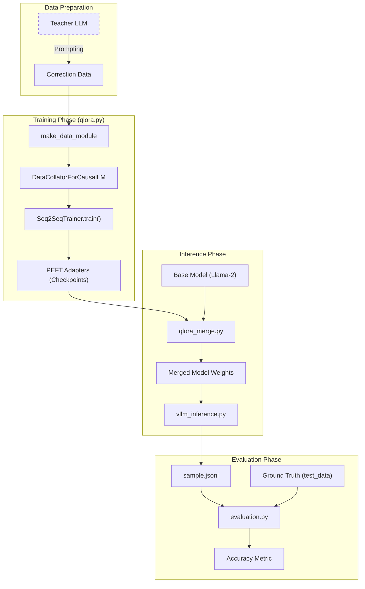
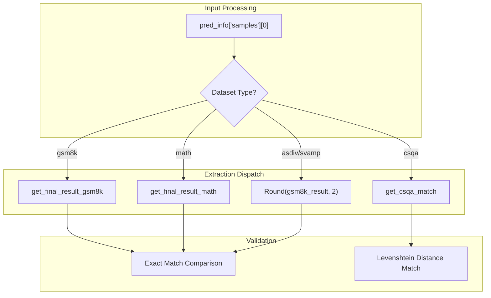

<!-- source: DeepWiki mcp.deepwiki.com · repo microsoft/LEMA · page 7 Glossary · fetched 2026-10-26 -->

# Glossary

Relevant source files

The following files were used as context for generating this wiki page:

- [README.md](README.md)
- [inference_code/evaluation.py](inference_code/evaluation.py)
- [inference_code/utils.py](inference_code/utils.py)
- [inference_code/vllm_inference.py](inference_code/vllm_inference.py)
- [prompts/prompt_correction_csqa.txt](prompts/prompt_correction_csqa.txt)
- [requirements.txt](requirements.txt)
- [training_code/qlora.py](training_code/qlora.py)

This page provides technical definitions and implementation details for terms, abbreviations, and domain concepts specific to the LEMA (Learning From Mistakes) codebase. It serves as a reference for engineers to understand how conceptual terms map to specific code entities and data structures.

## Core Methodology Terms

### LEMA (Learning From Mistakes)
The core fine-tuning paradigm introduced in this project. Unlike standard Supervised Fine-Tuning (SFT) which trains models only on correct solutions, LEMA trains models on **Mistake-Correction pairs**. The model learns to identify a reasoning error and then generate the correct path.
*   **Implementation**: The training is performed using the `qlora.py` engine [training_code/qlora.py:1-400]().
*   **Data Flow**: Mistake-correction data is synthesized by a teacher LLM using specific prompts [prompts/prompt_correction_csqa.txt:1-57]().

### Correction Data Pair
A structured training example consisting of an incorrect reasoning process followed by a correction.
*   **GSM8K/MATH Structure**: Usually contains "Incorrect Step", "Explanation of Mistake", and "Correct Solution".
*   **CSQA Structure**: Contains "Original Answer" (with mistakes), a "Mistakes" section identifying the error, and a "Corrected Answer" section [prompts/prompt_correction_csqa.txt:17-29]().

## System Architecture and Data Flow

The following diagram maps the conceptual data flow to the specific scripts and functions responsible for each stage.

**Diagram: LEMA Technical Data Flow**

**Sources**: [training_code/qlora.py:25-45](), [inference_code/vllm_inference.py:12-55](), [inference_code/evaluation.py:12-98]()

## Training & Model Terms

### QLoRA (Quantized Low-Rank Adaptation)
The primary training method used to fine-tune large models (like Llama-2-70B) on consumer-grade or limited enterprise hardware by quantizing the base model to 4-bit and training small adapter layers.
*   **Key Function**: `get_accelerate_model` in `qlora.py` handles the 4-bit quantization via `BitsAndBytesConfig` [training_code/qlora.py:30]().
*   **Key Parameters**: `lora_r` (rank), `lora_alpha`, and `bits` (quantization level) [training_code/qlora.py:179-190]().

### Adapter Merging
The process of combining the trained LoRA weights with the original frozen base model weights to create a standalone model compatible with high-performance inference engines like vLLM.
*   **Script**: `qlora_merge.py` [README.md:96-99]().
*   **Mechanism**: Uses `PeftModel.from_pretrained` followed by `merge_and_unload()`.

### Paged Optimizer
A memory management technique for training, specifically `paged_adamw_32bit`. It allows the optimizer state to be offloaded to CPU RAM when GPU memory is full, preventing Out-Of-Memory (OOM) errors.
*   **Code Pointer**: Defined as the default optimizer in `TrainingArguments` [training_code/qlora.py:204]().

## Inference & Evaluation Terms

### vLLM
A high-throughput inference engine used for generating model outputs during the evaluation phase.
*   **Integration**: Used in `vllm_inference.py` with `tensor_parallel_size` to distribute the model across multiple GPUs [inference_code/vllm_inference.py:27-31]().

### Answer Extraction
The process of parsing the model's free-text response to find the final numerical or categorical answer for scoring.
*   **GSM8K**: Uses `get_final_result_gsm8k` to find numerical values [inference_code/evaluation.py:41-42]().
*   **MATH**: Uses `last_boxed_only_string` and `_strip_string` to extract and normalize LaTeX answers from `\boxed{}` commands [inference_code/utils.py:140-243]().
*   **CSQA**: Uses `get_csqa_match` which utilizes Levenshtein distance (`minDistance`) to match model output to one of the multiple-choice candidates [inference_code/utils.py:7-65]().

**Diagram: Answer Extraction Logic (evaluation.py)**

**Sources**: [inference_code/evaluation.py:35-95](), [inference_code/utils.py:49-65]()

## Domain Concepts Table

| Term | Definition | Code Reference |
| :--- | :--- | :--- |
| **Double Quant** | A second round of quantization for the quantization constants themselves to save more memory. | [training_code/qlora.py:171-174]() |
| **NF4** | NormalFloat 4-bit; a data type optimized for normally distributed weights in LLMs. | [training_code/qlora.py:175-178]() |
| **Tensor Parallelism** | Splitting model layers across multiple GPUs to fit large models like Llama-70B. | [inference_code/vllm_inference.py:28]() |
| **Source Max Len** | The maximum number of tokens allowed for the input prompt during training. | [training_code/qlora.py:113-116]() |
| **Target Max Len** | The maximum number of tokens allowed for the generated correction during training. | [training_code/qlora.py:117-120]() |
| **Prompt Key** | The JSON key in the training data representing the input question/mistake. | [training_code/qlora.py:125-128]() |
| **Label Key** | The JSON key in the training data representing the expected correction output. | [training_code/qlora.py:129-132]() |

**Sources**: [training_code/qlora.py:113-204](), [inference_code/vllm_inference.py:28]()