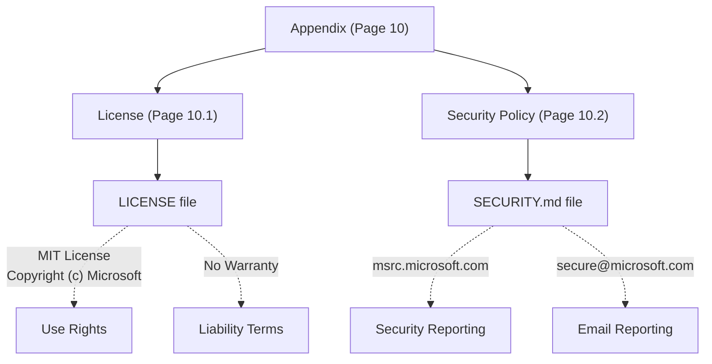
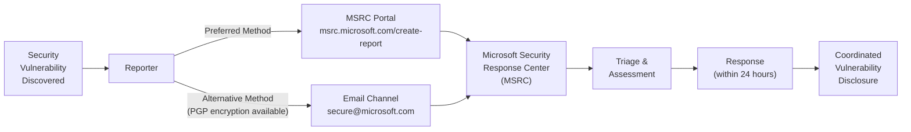
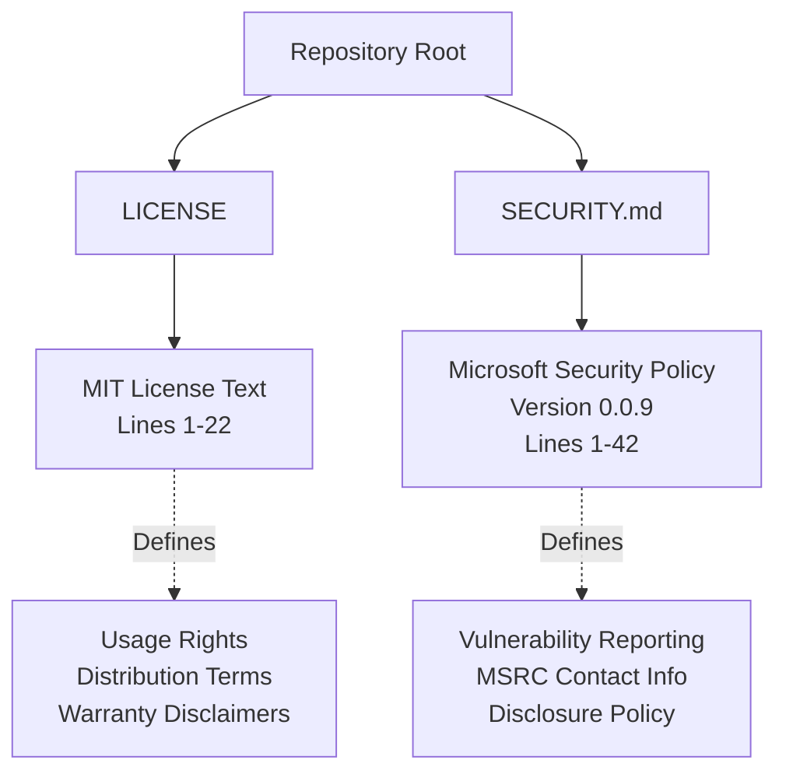

<!-- source: DeepWiki mcp.deepwiki.com · repo microsoft/LLM-Rubric · page 10 Appendix · fetched 2026-10-26 -->

# Appendix

Relevant source files

The following files were used as context for generating this wiki page:

- [LICENSE](LICENSE)
- [SECURITY.md](SECURITY.md)

## Purpose and Scope

This section contains supplementary reference material for the LLM-Rubric project, including legal and security information. The Appendix covers two primary areas:

- **License terms**: The MIT License governing the use and distribution of this software
- **Security policy**: Procedures for reporting security vulnerabilities to Microsoft

For information about development guidelines and contribution procedures, see [Contributing Guidelines](#9.3).

## Overview

The Appendix provides essential reference documentation that users and contributors should be aware of when working with the LLM-Rubric codebase. This material establishes the legal framework for using the software and outlines the process for handling security concerns responsibly.

### Appendix Structure

**Sources:** [LICENSE:1-22](), [SECURITY.md:1-42]()

## License Summary

The LLM-Rubric project is released under the **MIT License**, one of the most permissive open-source licenses. This license grants extensive rights to use, modify, and distribute the software with minimal restrictions.

### Key License Terms

| Aspect | Details |
|--------|---------|
| **Copyright Holder** | Microsoft Corporation |
| **License Type** | MIT License |
| **Permissions** | Use, copy, modify, merge, publish, distribute, sublicense, sell |
| **Conditions** | Include copyright notice and license text in all copies |
| **Warranty** | Provided "AS IS" without warranty of any kind |
| **Liability** | Authors not liable for claims or damages |

The license file is located at [LICENSE:1-22]() in the repository root. For complete legal terms and detailed explanations, see [License](#10.1).

**Sources:** [LICENSE:1-22]()

## Security Policy Summary

Microsoft maintains a comprehensive security policy for all repositories under its GitHub organizations. The LLM-Rubric project follows this standardized security framework to ensure responsible vulnerability disclosure and timely security response.

### Security Reporting Workflow

**Sources:** [SECURITY.md:1-42]()

### Critical Security Guidelines

**Do NOT:**
- Report security vulnerabilities through public GitHub issues
- Disclose vulnerabilities publicly before coordinated disclosure

**Do:**
- Report to MSRC at [https://msrc.microsoft.com/create-report](https://aka.ms/security.md/msrc/create-report)
- Alternatively, email to `secure@microsoft.com`
- Use PGP encryption for email reports (key available from MSRC)
- Provide detailed information to help with triage

### Required Information for Security Reports

When reporting a security vulnerability, include as much of the following information as possible:

| Information Type | Description |
|-----------------|-------------|
| **Issue Type** | e.g., buffer overflow, injection, XSS |
| **Source Files** | Full paths of affected files |
| **Source Location** | Tag, branch, commit, or direct URL |
| **Configuration** | Special setup required to reproduce |
| **Reproduction Steps** | Step-by-step instructions |
| **Proof of Concept** | Exploit code if available |
| **Impact Assessment** | How an attacker might exploit the issue |

### Response Timeline

- **Initial Response:** Within 24 hours of report submission
- **Follow-up:** Additional information may be requested during triage
- **Resolution:** Follows [Coordinated Vulnerability Disclosure](https://aka.ms/security.md/cvd) principles

For complete security procedures and additional details, see [Security Policy](#10.2).

**Sources:** [SECURITY.md:9-29]()

## File References

The Appendix section references the following files in the repository:

**Sources:** [LICENSE:1-22](), [SECURITY.md:1-42]()

### LICENSE File Structure

The [LICENSE:1-22]() file contains:
- License header: "MIT License"
- Copyright statement: "Copyright (c) Microsoft Corporation"
- Permission grant: Lines 5-10
- Conditions: Lines 11-13
- Disclaimer: Lines 14-21

### SECURITY.md File Structure

The [SECURITY.md:1-42]() file follows Microsoft's standard template (version 0.0.9) and contains:
- Security commitment statement: Lines 3-5
- Reporting instructions: Lines 9-17
- Required information checklist: Lines 19-29
- Bug bounty program reference: Line 31
- Language preference: Lines 33-35
- Disclosure policy: Lines 37-39

## Additional Resources

For information related to development and contribution processes that complement the security and legal framework, refer to:

- **Project Structure**: [Project Structure](#9.1) - Understanding the repository organization
- **Contributing Guidelines**: [Contributing Guidelines](#9.3) - How to contribute to the project
- **Dependencies and Environment**: [Dependencies and Environment](#9.2) - Development environment setup

These resources provide the technical context for working within the legal and security framework established in this Appendix.

**Sources:** [LICENSE:1-22](), [SECURITY.md:1-42]()

---

