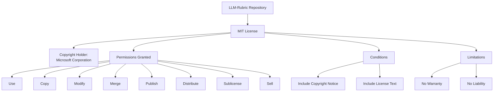
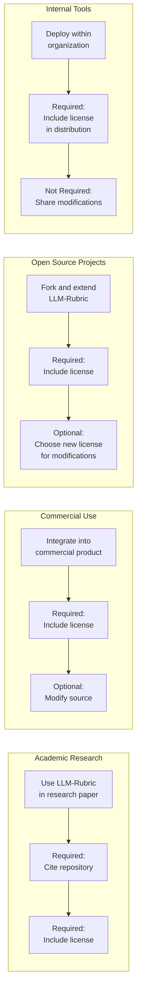

<!-- source: DeepWiki mcp.deepwiki.com · repo microsoft/LLM-Rubric · page 10.1 License · fetched 2026-10-26 -->

# License

<details>
<summary>Relevant source files</summary>

The following files were used as context for generating this wiki page:

- [LICENSE](LICENSE)

</details>


## Purpose and Scope

This page documents the license terms under which the LLM-Rubric project is distributed. It specifies the copyright holder, the permissions granted to users, and any conditions or limitations that apply. For information about security vulnerability reporting, see [Security Policy](#10.2). For general contribution guidelines, see [Contributing Guidelines](#9.3).

## License Type and Copyright Holder

The LLM-Rubric project is licensed under the **MIT License**, one of the most permissive open-source licenses. The copyright is held by **Microsoft Corporation**.

**Sources:** [LICENSE:1-3]()

## MIT License Overview

The MIT License is a permissive free software license that places minimal restrictions on reuse. The following diagram illustrates the key aspects of the MIT License as applied to this project:



**Sources:** [LICENSE:1-21]()

## Permissions Granted

Under the MIT License, users are granted extensive rights to the LLM-Rubric software and associated documentation. The following table summarizes these permissions:

| Permission | Description |
|------------|-------------|
| **Use** | Run the software for any purpose, including commercial applications |
| **Copy** | Make copies of the software |
| **Modify** | Alter, transform, or build upon the software |
| **Merge** | Combine the software with other software |
| **Publish** | Make the software publicly available |
| **Distribute** | Share copies of the software with others |
| **Sublicense** | Grant the same rights to others under different license terms |
| **Sell** | Commercially distribute or sell copies of the software |

These permissions apply to the entire codebase, including:
- Core model implementation (`PersonalizedCalibrationNetwork`)
- Training and prediction scripts
- Data processing utilities (`pd_utils`, `kfold_utils`)
- Baseline computation modules
- Evaluation frameworks
- Example datasets and configurations

**Sources:** [LICENSE:5-9]()

## Required Conditions

To exercise the permissions granted by the MIT License, users must comply with the following conditions:

### Copyright Notice Inclusion

The copyright notice must be included in all copies or substantial portions of the software:

```
Copyright (c) Microsoft Corporation.
```

### License Text Inclusion

The complete MIT License text must be included in all copies or substantial portions of the software. This ensures that downstream users are aware of their rights and obligations.

**Sources:** [LICENSE:10-13]()

## Limitations and Disclaimers

The MIT License includes important limitations on liability and warranty:

### No Warranty

The software is provided "AS IS" without any warranty of any kind, either express or implied. This includes, but is not limited to:

- **MERCHANTABILITY**: No guarantee that the software is suitable for commercial use
- **FITNESS FOR A PARTICULAR PURPOSE**: No guarantee that the software meets specific requirements
- **NONINFRINGEMENT**: No guarantee that the software does not infringe third-party rights

### No Liability

The authors and copyright holders are not liable for any claims, damages, or other liability arising from:
- Use of the software
- Inability to use the software
- Other dealings in the software

This limitation applies whether the claim arises from:
- Contract
- Tort
- Other legal theory

**Sources:** [LICENSE:15-21]()

## Practical Implications for Users

The following diagram illustrates how the MIT License applies to different usage scenarios:



**Sources:** [LICENSE:1-21]()

## Full License Text

The complete MIT License text as it applies to the LLM-Rubric project is reproduced below:

```
MIT License

Copyright (c) Microsoft Corporation.

Permission is hereby granted, free of charge, to any person obtaining a copy
of this software and associated documentation files (the "Software"), to deal
in the Software without restriction, including without limitation the rights
to use, copy, modify, merge, publish, distribute, sublicense, and/or sell
copies of the Software, and to permit persons to whom the Software is
furnished to do so, subject to the following conditions:

The above copyright notice and this permission notice shall be included in all
copies or substantial portions of the Software.

THE SOFTWARE IS PROVIDED "AS IS", WITHOUT WARRANTY OF ANY KIND, EXPRESS OR
IMPLIED, INCLUDING BUT NOT LIMITED TO THE WARRANTIES OF MERCHANTABILITY,
FITNESS FOR A PARTICULAR PURPOSE AND NONINFRINGEMENT. IN NO EVENT SHALL THE
AUTHORS OR COPYRIGHT HOLDERS BE LIABLE FOR ANY CLAIM, DAMAGES OR OTHER
LIABILITY, WHETHER IN AN ACTION OF CONTRACT, TORT OR OTHERWISE, ARISING FROM,
OUT OF OR IN CONNECTION WITH THE SOFTWARE OR THE USE OR OTHER DEALINGS IN THE
SOFTWARE
```

**Sources:** [LICENSE:1-21]()

## License Application to Project Components

The MIT License applies uniformly to all components of the LLM-Rubric repository. The following diagram maps license coverage to the major system components:

```mermaid
graph TD
    LIC["MIT License<br/>LICENSE file"]
    
    subgraph "Core Components"
        PCN["PersonalizedCalibrationNetwork<br/>model.py"]
        TRAIN["train_llm_rubric.py"]
        PRED["llm_rubric_predict.py"]
    end
    
    subgraph "Baseline Systems"
        MB["compute_machine_baseline.py"]
        HB["compute_human_baseline.py"]
        RB["compute_random_baseline.py"]
    end
    
    subgraph "Utilities"
        PDU["pd_utils.py"]
        KFU["kfold_utils.py"]
        LLME["llm_evaluator.py"]
    end
    
    subgraph "Data and Configuration"
        DATA["data/ directory<br/>TSV and JSON files"]
        CONFIG["config/ directory<br/>Hyperparameter specs"]
    end
    
    subgraph "Evaluation"
        EVAL["evaluate.py"]
        METRICS["Metric computation"]
    end
    
    LIC --> PCN
    LIC --> TRAIN
    LIC --> PRED
    LIC --> MB
    LIC --> HB
    LIC --> RB
    LIC --> PDU
    LIC --> KFU
    LIC --> LLME
    LIC --> DATA
    LIC --> CONFIG
    LIC --> EVAL
    LIC --> METRICS
```



**Sources:** [LICENSE:1-21]()

## Summary

The MIT License provides users with maximum freedom to use, modify, and distribute the LLM-Rubric project while requiring only attribution and inclusion of the license text. This permissive approach facilitates both academic research and commercial applications. Users should be aware that the software comes with no warranty and that Microsoft Corporation cannot be held liable for issues arising from its use.

For questions about licensing or permissions not explicitly covered by the MIT License, users should contact Microsoft Corporation directly.

**Sources:** [LICENSE:1-21]()

---

