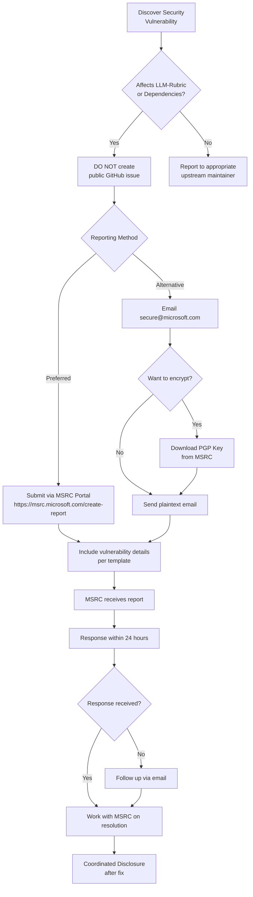
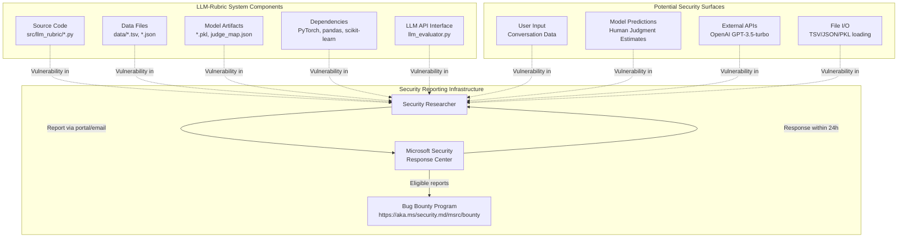
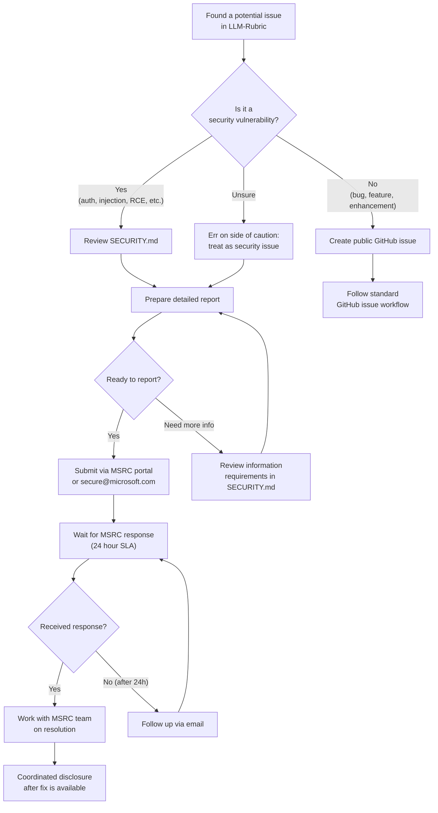

<!-- source: DeepWiki mcp.deepwiki.com · repo microsoft/LLM-Rubric · page 10.2 Security Policy · fetched 2026-10-26 -->

# Security Policy

Relevant source files

The following files were used as context for generating this wiki page:

- [SECURITY.md](SECURITY.md)

This document describes the security policy for the LLM-Rubric project, including procedures for reporting security vulnerabilities and Microsoft's security response process. This covers the entire codebase and all components of the system.

For general contribution guidelines and development practices, see [Contributing Guidelines](#9.3). For licensing terms, see [License](#10.1).

## Overview

Microsoft takes the security of all software products and services seriously, including the LLM-Rubric repository and all associated source code, data, and documentation. This security policy follows Microsoft's standard procedures for handling security vulnerabilities across all Microsoft-owned GitHub repositories.

**Sources:** [SECURITY.md:1-7]()

## Security Vulnerability Definition

A security vulnerability is defined according to [Microsoft's security vulnerability definition](https://aka.ms/security.md/definition). This includes, but is not limited to:

- Buffer overflows
- SQL injection vulnerabilities
- Cross-site scripting (XSS) issues
- Authentication bypass vulnerabilities
- Data exposure issues
- Remote code execution vulnerabilities
- Denial of service vulnerabilities

**Sources:** [SECURITY.md:7-7]()

## Reporting Security Issues

### Critical: Do Not Use Public Issues

**Security vulnerabilities must never be reported through public GitHub issues.** Public disclosure of security issues before they are addressed can put users at risk.

**Sources:** [SECURITY.md:11-11]()

### Reporting Workflow

**Diagram: Security Vulnerability Reporting Process**

**Sources:** [SECURITY.md:9-17]()

### Primary Reporting Channel: Microsoft Security Response Center (MSRC)

The preferred method for reporting security vulnerabilities is through the Microsoft Security Response Center:

- **Portal:** [https://msrc.microsoft.com/create-report](https://aka.ms/security.md/msrc/create-report)
- **Email:** secure@microsoft.com (for submissions without logging in)
- **PGP Encryption:** Available at [MSRC PGP Key page](https://aka.ms/security.md/msrc/pgp)

**Sources:** [SECURITY.md:13-15]()

### Response Time Expectations

You should receive a response within 24 hours of submitting your report. If you do not receive a response within this timeframe, follow up via email to ensure your report was received.

Additional information about the MSRC process is available at [microsoft.com/msrc](https://www.microsoft.com/msrc).

**Sources:** [SECURITY.md:17-17]()

## Information to Include in Security Reports

To help Microsoft triage and address security vulnerabilities effectively, please include as much of the following information as possible:

| Category | Details |
|----------|---------|
| **Issue Type** | Buffer overflow, SQL injection, cross-site scripting, authentication bypass, etc. |
| **Source Files** | Full paths of source file(s) related to the issue manifestation |
| **Code Location** | Tag, branch, commit hash, or direct URL to affected source code |
| **Configuration** | Any special configuration required to reproduce the issue |
| **Reproduction Steps** | Step-by-step instructions to reproduce the vulnerability |
| **Proof of Concept** | PoC or exploit code demonstrating the issue (if available) |
| **Impact Assessment** | Description of impact and how an attacker might exploit the issue |

More complete reports contribute to faster resolution and may result in higher bug bounty awards if eligible.

**Sources:** [SECURITY.md:19-29]()

## Security Context in LLM-Rubric

**Diagram: Security Surface Areas and Reporting Infrastructure**

**Sources:** [SECURITY.md:1-42]()

### Relevant Code Components for Security Considerations

When reporting security issues related to specific functionality:

| Component | File Path | Security Relevance |
|-----------|-----------|-------------------|
| **LLM API Interface** | `src/llm_rubric/llm_evaluator.py` | External API calls, credential handling |
| **Data Processing** | `src/llm_rubric/pd_utils.py` | File I/O, data validation, parsing |
| **Model Serialization** | `src/llm_rubric/llm_rubric_model.py` | Pickle file loading (deserialization) |
| **Training Scripts** | `src/llm_rubric/train_llm_rubric.py` | File operations, model persistence |
| **Prediction Scripts** | `src/llm_rubric/llm_rubric_predict.py` | Model loading, input processing |
| **Evaluation Scripts** | `src/llm_rubric/evaluate.py` | Data processing, output generation |

**Sources:** [SECURITY.md:1-42]()

## Microsoft Bug Bounty Program

Eligible security vulnerabilities may qualify for rewards under the [Microsoft Bug Bounty Program](https://aka.ms/security.md/msrc/bounty). More complete reports with detailed impact assessments and proof-of-concept exploits can contribute to higher bounty awards.

**Sources:** [SECURITY.md:31-31]()

## Communication Preferences

All communications regarding security vulnerabilities should be in English to ensure efficient processing by the Microsoft Security Response Center.

**Sources:** [SECURITY.md:33-35]()

## Security Policy Principles

Microsoft follows the principle of **Coordinated Vulnerability Disclosure (CVD)**. This means:

1. Security researchers report vulnerabilities privately to Microsoft
2. Microsoft investigates and develops fixes
3. Fixes are tested and deployed to users
4. Public disclosure occurs after mitigation is available
5. Credit is provided to researchers (if desired)

This approach protects users while acknowledging the important work of security researchers.

More information: [Coordinated Vulnerability Disclosure](https://aka.ms/security.md/cvd)

**Sources:** [SECURITY.md:37-39]()

## Security Decision Tree

**Diagram: Security Issue Identification and Reporting Decision Flow**

**Sources:** [SECURITY.md:1-42]()

## Summary

| Aspect | Details |
|--------|---------|
| **Do Not** | Report security vulnerabilities through public GitHub issues |
| **Do** | Report via MSRC portal or secure@microsoft.com |
| **Response Time** | Within 24 hours |
| **Encryption** | PGP key available from MSRC |
| **Language** | English preferred |
| **Disclosure** | Coordinated Vulnerability Disclosure (CVD) |
| **Rewards** | Eligible reports may qualify for bug bounty |
| **Policy Version** | Microsoft SECURITY.MD V0.0.9 |

**Sources:** [SECURITY.md:1-42]()

---

*This security policy applies to the LLM-Rubric project located at https://github.com/microsoft/LLM-Rubric and follows Microsoft's standard security procedures for all GitHub-hosted repositories.*