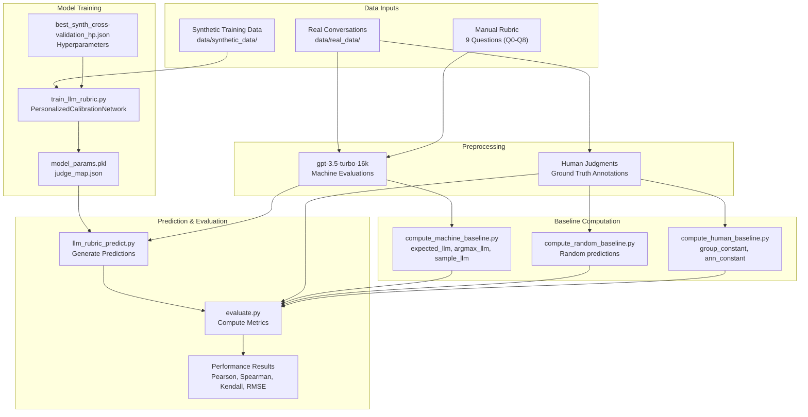
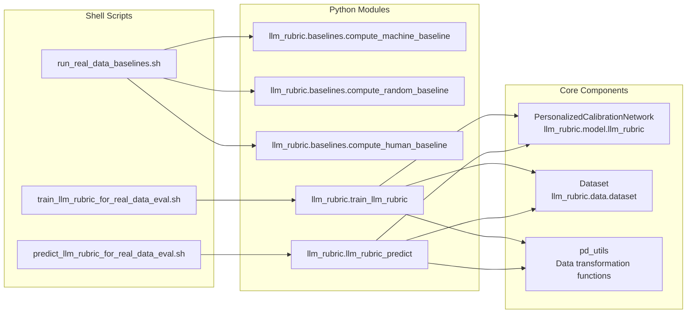

<!-- source: DeepWiki mcp.deepwiki.com · repo microsoft/LLM-Rubric · page 2 Getting Started · fetched 2026-10-26 -->

# Getting Started

Relevant source files

The following files were used as context for generating this wiki page:

- [README.md](README.md)
- [poetry.lock](poetry.lock)
- [pyproject.toml](pyproject.toml)

This page provides an overview of how to set up and begin using the LLM-Rubric system for automated evaluation of natural language texts. It covers the prerequisites, system workflow, and points to detailed guides for installation and running your first evaluation.

For detailed information about the core concepts and architecture, see [Core Concepts](#3). For step-by-step guides on specific tasks, see [User Guides](#4).

## Prerequisites

The LLM-Rubric system requires:

- **Python 3.10**: The codebase is compatible with Python versions 3.10 through 3.12
- **Poetry**: Used for dependency management and installation
- **PyTorch 2.3.0**: The neural network framework used for the PersonalizedCalibrationNetwork

For complete installation instructions including platform-specific steps for PyTorch, see [Installation](#2.1).

**Sources:** [README.md:32-56](), [pyproject.toml:9-17]()

## System Workflow Overview

The LLM-Rubric evaluation process follows a structured workflow from raw data to final performance metrics:

**Workflow: End-to-End Evaluation Process**

The system operates in three main phases:

1. **Baseline Computation**: Establish comparison benchmarks using various strategies (machine-derived, human-derived, and random)
2. **Model Training**: Train the PersonalizedCalibrationNetwork on synthetic data with optimized hyperparameters
3. **Prediction & Evaluation**: Apply the trained model to real conversations and compute correlation metrics

**Sources:** [README.md:58-103]()

## Execution Pipeline

The following diagram shows how shell scripts orchestrate the Python modules to execute the complete pipeline:

**Execution Pipeline: Scripts to Code Entities**

**Sources:** [README.md:62-103]()

## Data Organization

The repository includes pre-processed data for immediate experimentation:

| Data Type | Location | Contents |
|-----------|----------|----------|
| Real Conversations | `data/real_data/` | Natural language conversations for evaluation |
| Human Judgments | `data/real_data/*.tsv` | Ground truth annotations from 13-24 judges |
| Machine Evaluations | `data/real_data/*_predictions.json` | LLM probability distributions per criterion |
| Synthetic Data | `data/synthetic_data/` | Training data with fold assignments |
| Hyperparameters | `experiments/real_data/best_synth_cross-validation_hp.json` | Pre-optimized model configuration |

The data formats follow specific schemas with TSV files for human judgments (columnar format with Q0-Q8 columns) and JSON files for machine evaluations (row-wise format with probability distributions).

For detailed information about data formats and schemas, see [Data Formats and Schema](#5.1).

**Sources:** [README.md:60-103]()

## Quick Start Summary

To begin using LLM-Rubric, follow these high-level steps:

1. **Install Dependencies**: Use Poetry to set up the virtual environment and install required packages
2. **Compute Baselines**: Run baseline scripts to establish comparison benchmarks
3. **Train Model**: Execute the training script on synthetic data with pre-configured hyperparameters
4. **Generate Predictions**: Apply the trained model to real conversation data
5. **Evaluate Results**: Compare model predictions against baselines using correlation metrics

Each step is automated through shell scripts that orchestrate the Python modules.

For a complete walkthrough with detailed commands and expected outputs, see [Quick Start Tutorial](#2.2).

For individual task guides, see:
- [Computing Baselines](#4.1)
- [Training a Model](#4.2)
- [Making Predictions](#4.3)
- [Evaluating Results](#4.4)

**Sources:** [README.md:58-103]()

## Expected Performance

When running the complete pipeline on the included real conversation data, the system produces:

- **Baselines**: Performance metrics for 7 baseline methods (3 machine-based, 2 human-based, 1 random, 1 LLM-Rubric)
- **Model Output**: Trained PersonalizedCalibrationNetwork parameters saved to `model_params.pkl`
- **Predictions**: Per-judge, per-criterion predictions on 223 conversation samples
- **Metrics**: Pearson, Spearman, and Kendall correlation coefficients plus RMSE

Typical results show:
- Pearson correlation: ~0.31
- Spearman correlation: ~0.37
- Kendall tau: ~0.29

These metrics indicate moderate to strong correlation between model predictions and human judge assessments.

**Sources:** [README.md:66-103]()

## Next Steps

After completing the quick start:

1. **Understand the Architecture**: Learn about the PersonalizedCalibrationNetwork and its judge-specific parameters ([Core Concepts](#3))
2. **Explore Hyperparameter Tuning**: Optimize model configuration for your own data ([Hyperparameter Tuning](#4.5))
3. **Work with Custom Data**: Adapt the system to evaluate your own conversation datasets ([Data Reference](#5))
4. **Extend the Model**: Modify the neural network architecture or training process ([Model Reference](#6))

**Sources:** [README.md:1-103]()

---

