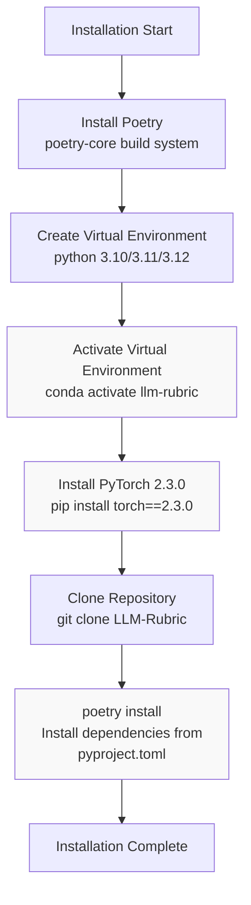
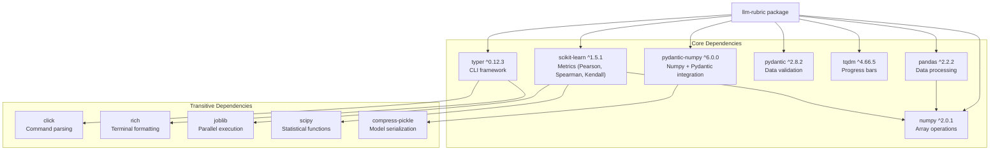

<!-- source: DeepWiki mcp.deepwiki.com · repo microsoft/LLM-Rubric · page 2.1 Installation · fetched 2026-10-26 -->

# Installation

<details>
<summary>Relevant source files</summary>

The following files were used as context for generating this wiki page:

- [README.md](README.md)
- [poetry.lock](poetry.lock)
- [pyproject.toml](pyproject.toml)

</details>


This page provides detailed instructions for installing the LLM-Rubric system and its dependencies. The installation process uses Poetry for dependency management and requires Python 3.10 or higher. For information about running your first evaluation after installation, see [Quick Start Tutorial](#2.2).

## Prerequisites

The LLM-Rubric system requires:

- **Python Version**: 3.10, 3.11, or 3.12 (3.13+ not supported)
- **Operating System**: macOS, Linux, or Windows
- **Package Manager**: Poetry 1.8.0 or higher
- **PyTorch**: 2.3.0 (installed separately before other dependencies)

**Sources:** [pyproject.toml:10](), [README.md:35-39](), [poetry.lock:746]()

---

## Installation Workflow

The following diagram shows the complete installation process:



**Sources:** [README.md:32-56]()

---

## Step 1: Install Poetry

Poetry is the dependency management tool used by LLM-Rubric. Install it using the official installer:

```bash
curl -sSL https://install.python-poetry.org | python3 -
```

Verify the installation:

```bash
poetry --version
```

Expected output: `Poetry (version 1.8.3)`

**Sources:** [README.md:34]()

---

## Step 2: Create and Activate Virtual Environment

Create a virtual environment with Python 3.10 using your preferred environment manager:

### Using Conda

```bash
conda create -n llm-rubric python=3.10
conda activate llm-rubric
```

### Using venv

```bash
python3.10 -m venv llm-rubric-env
source llm-rubric-env/bin/activate  # On Linux/macOS
# OR
llm-rubric-env\Scripts\activate  # On Windows
```

**Important:** Ensure the virtual environment is activated for all subsequent steps.

**Sources:** [README.md:35-40]()

---

## Step 3: Install PyTorch

PyTorch must be installed **before** installing other dependencies. Installation commands differ by platform:

| Platform | Command |
|----------|---------|
| **macOS** | `pip install torch==2.3.0` |
| **Linux** | `pip install torch==2.3.0 --index-url https://download.pytorch.org/whl/cpu` |
| **Windows** | `pip install torch==2.3.0 --index-url https://download.pytorch.org/whl/cpu` |

### Platform-Specific Notes

- **macOS**: Default PyPI package includes Metal Performance Shaders (MPS) support for Apple Silicon
- **Linux/Windows**: The CPU-only version is used; modify for CUDA if GPU support is needed

Verify PyTorch installation:

```python
python -c "import torch; print(f'PyTorch {torch.__version__}')"
```

Expected output: `PyTorch 2.3.0`

**Sources:** [README.md:42-50]()

---

## Step 4: Install LLM-Rubric

Clone the repository and install dependencies using Poetry:

```bash
git clone https://github.com/microsoft/LLM-Rubric.git
cd LLM-Rubric
poetry install
```

### What Gets Installed

The `poetry install` command reads [pyproject.toml:9-17]() and installs the following dependency tree:



**Sources:** [pyproject.toml:9-17](), [poetry.lock:1-747]()

---

## Step 5: Verify Installation

After installation completes, verify that the package is correctly installed:

### Check Python Environment

```bash
python -c "import llm_rubric; print('LLM-Rubric installed successfully')"
```

### Check Core Dependencies

```python
python -c "
import torch
import pandas as pd
import numpy as np
from sklearn.metrics import mean_squared_error
import pydantic
print(f'torch: {torch.__version__}')
print(f'pandas: {pd.__version__}')
print(f'numpy: {np.__version__}')
print(f'pydantic: {pydantic.__version__}')
print('All dependencies loaded successfully')
"
```

Expected output includes version numbers matching:
- torch: 2.3.0
- pandas: 2.2.2
- numpy: 2.0.1
- pydantic: 2.8.2

### Verify Scripts Are Available

The installation makes several command-line scripts available. Check that the repository scripts directory is accessible:

```bash
ls scripts/
```

You should see files including:
- `run_real_data_baselines.sh`
- `train_llm_rubric_for_real_data_eval.sh`
- `predict_llm_rubric_for_real_data_eval.sh`

**Sources:** [README.md:58-103](), [pyproject.toml:9-17]()

---

## Dependency Version Requirements

The following table summarizes critical version constraints enforced by [pyproject.toml:10]() and [poetry.lock:746]():

| Package | Version Constraint | Reason |
|---------|-------------------|---------|
| **Python** | `>=3.10,<3.13` | Compatibility with numpy 2.0.1 and PyTorch 2.3.0 |
| **PyTorch** | `==2.3.0` | Specific version for reproducibility |
| **numpy** | `^2.0.1` | Required by numpy 2.x API changes |
| **pandas** | `^2.2.2` | Data processing compatibility |
| **scikit-learn** | `^1.5.1` | Metrics computation |
| **pydantic** | `^2.8.2` | Data validation v2 API |
| **pydantic-numpy** | `^6.0.0` | Integration with pydantic v2 + numpy 2.x |

**Sources:** [pyproject.toml:10-17](), [poetry.lock:156-207](), [poetry.lock:210-280]()

---

## Troubleshooting

### Poetry Not Found After Installation

If `poetry` command is not recognized, add Poetry to your PATH:

```bash
export PATH="$HOME/.local/bin:$PATH"  # Linux/macOS
```

For Windows, add `%APPDATA%\Python\Scripts` to your PATH environment variable.

### Python Version Mismatch

If you encounter errors about Python version compatibility:

```bash
python --version  # Verify it shows 3.10, 3.11, or 3.12
```

Create a new virtual environment with the correct Python version before retrying installation.

### PyTorch Import Errors

If PyTorch fails to import, ensure it was installed **before** running `poetry install`:

```bash
pip list | grep torch  # Verify torch==2.3.0 is listed
```

If not present, install PyTorch following Step 3, then re-run `poetry install`.

### Platform-Specific PyTorch Issues

For Linux/Windows users, if the default PyTorch installation fails, ensure you're using the CPU-specific index URL:

```bash
pip uninstall torch
pip install torch==2.3.0 --index-url https://download.pytorch.org/whl/cpu
```

**Sources:** [README.md:40-50]()

---

## Next Steps

After successful installation, proceed to [Quick Start Tutorial](#2.2) to run your first evaluation with the included datasets.

For development setup and contributing guidelines, see [Development Guide](#9).

**Sources:** [README.md:58-103]()

---

