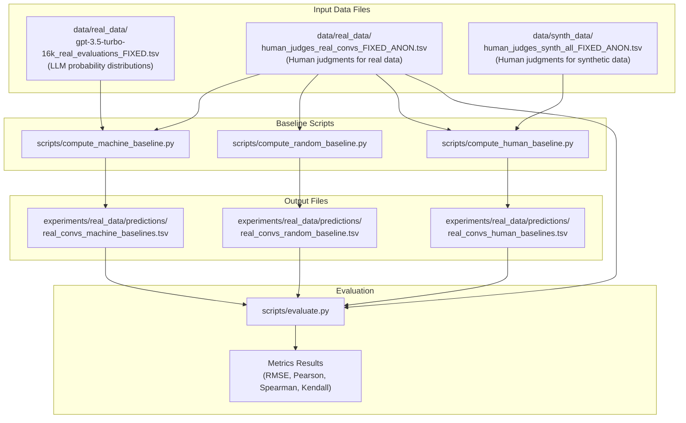
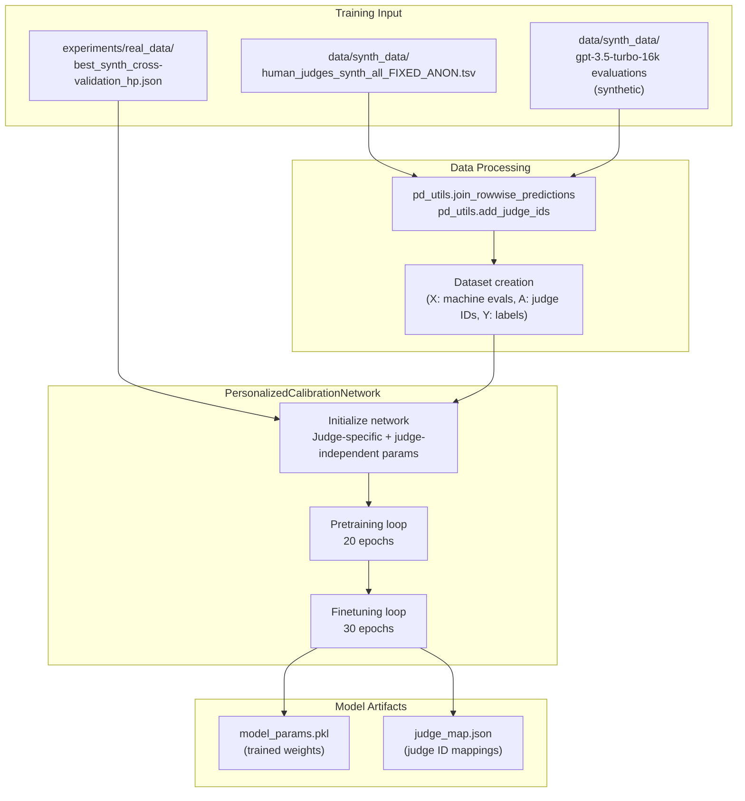
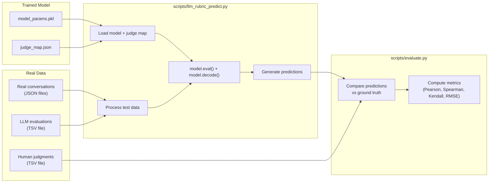

<!-- source: DeepWiki mcp.deepwiki.com · repo microsoft/LLM-Rubric · page 2.2 Quick Start Tutorial · fetched 2026-10-26 -->

# Quick Start Tutorial

<details>
<summary>Relevant source files</summary>

The following files were used as context for generating this wiki page:

- [README.md](README.md)
- [scripts/run_real_data_baselines.sh](scripts/run_real_data_baselines.sh)

</details>


## Purpose and Scope

This tutorial walks through the complete LLM-Rubric workflow using the included real conversation and synthetic training datasets. You will learn how to:

1. Compute baseline predictions using multiple methods
2. Train a PersonalizedCalibrationNetwork on synthetic data
3. Generate predictions on real conversation data
4. Evaluate and compare all methods

For detailed installation instructions, see [Installation](#2.1). For in-depth explanations of individual components, refer to [User Guides](#4).

---

## Overview of the Workflow

The quick start demonstrates the end-to-end evaluation pipeline on pre-provided data. The workflow consists of three main phases executed sequentially:

```mermaid
graph LR
    subgraph Phase1["Phase 1: Baseline Computation"]
        A["Compute Machine Baselines<br/>(sample_llm, argmax_llm, expected_llm)"]
        B["Compute Random Baseline"]
        C["Compute Human Baselines<br/>(group_constant, ann_constant)"]
    end
    
    subgraph Phase2["Phase 2: Model Training"]
        D["Load Best Hyperparameters<br/>from synthetic data CV"]
        E["Train PersonalizedCalibrationNetwork<br/>on synthetic data"]
        F["Save model artifacts<br/>(weights + judge_map)"]
    end
    
    subgraph Phase3["Phase 3: Prediction & Evaluation"]
        G["Generate LLM-Rubric predictions<br/>on real data"]
        H["Run evaluation script<br/>on all systems"]
        I["Compare correlation metrics<br/>(Pearson, Spearman, Kendall)"]
    end
    
    A --> B
    B --> C
    C --> D
    D --> E
    E --> F
    F --> G
    G --> H
    H --> I
```



**Sources:** [README.md:58-103]()

---

## Phase 1: Computing Baselines

Baselines provide comparison benchmarks for evaluating the LLM-Rubric model. The system computes three categories of baselines from the provided data.

### Running the Baseline Script

Execute all baseline computations with a single shell script:

```bash
bash scripts/run_real_data_baselines.sh
```

This script sequentially computes machine baselines, random baseline, human baselines, and evaluates them using the provided evaluation script.

**Sources:** [scripts/run_real_data_baselines.sh:1-38]()

### Data Flow for Baseline Computation



**Sources:** [scripts/run_real_data_baselines.sh:1-38]()

### Baseline Methods Summary

| Baseline Type | Method Name | Script | Description |
|--------------|-------------|--------|-------------|
| Machine | `sample_llm` | `compute_machine_baseline.py` | Sample from LLM probability distribution |
| Machine | `argmax_llm` | `compute_machine_baseline.py` | Select answer with highest probability |
| Machine | `expected_llm` | `compute_machine_baseline.py` | Compute expected value: Σ(p_i × score_i) |
| Random | `random` | `compute_random_baseline.py` | Uniform random selection from {1,2,3,4} |
| Human | `group_constant` | `compute_human_baseline.py` | Overall mean across all judges (from training data) |
| Human | `ann_constant` | `compute_human_baseline.py` | Per-annotator mean (from training data) |

**Sources:** [scripts/run_real_data_baselines.sh:3-26](), [README.md:62-77]()

### Expected Output

After running the baseline script, you should see output similar to:

```
                            rmse   pearson  spearman   kendall    N      mean       std
criterion system
Q0        random        1.453309 -0.054438 -0.043663 -0.036858  223  2.587444  1.152196
          sample_llm    1.207228  0.039810  0.045245  0.040967  223  3.322870  0.794469
          argmax_llm    1.201643  0.140091  0.086990  0.081134  223  3.614350  0.563597
          expected_llm  0.918676  0.177301  0.086675  0.065928  223  3.282864  0.300516
```

This table shows that:
- `N=223`: 223 real conversation samples evaluated
- Random baseline performs worst (near-zero or negative correlations)
- Machine baselines show positive but modest correlations with human judgments
- `expected_llm` achieves the best baseline performance

**Sources:** [README.md:66-75]()

---

## Phase 2: Training the Model

The PersonalizedCalibrationNetwork is trained on synthetic data to learn how to calibrate LLM probability distributions to match individual human judge preferences.

### Hyperparameter Configuration

The optimal hyperparameters have been pre-computed using cross-validation on synthetic data. These are stored in:

```
experiments/real_data/best_synth_cross-validation_hp.json
```

The file contains:

```json
{
  "input_size": 36,
  "output_size": 9,
  "num_judges": 13,
  "all_data_size": 223,
  "finetune_output": -1,
  "num_answers": 4,
  "batch_size": 64,
  "learning_rate": 0.001,
  "layer1_size": 25,
  "layer2_size": 25,
  "pretraining_epochs": 20,
  "finetuning_epochs": 30,
  "random_seed": 43
}
```

**Key Parameters:**
- `input_size=36`: 9 criteria × 4 answer probabilities
- `output_size=9`: Predictions for Q0-Q8
- `layer1_size=25`, `layer2_size=25`: Hidden layer dimensions
- `pretraining_epochs=20`, `finetuning_epochs=30`: Two-phase training

**Sources:** [README.md:81-86]()

### Training Execution

Train the model using the pre-determined best hyperparameters:

```bash
bash scripts/train_llm_rubric_for_real_data_eval.sh
```

This script performs:
1. Loads synthetic training data (223 samples with human judgments)
2. Loads corresponding LLM evaluations
3. Initializes PersonalizedCalibrationNetwork with specified hyperparameters
4. Executes pretraining phase (20 epochs) to learn general patterns
5. Executes finetuning phase (30 epochs) to refine predictions
6. Saves model parameters and judge mappings

**Sources:** [README.md:88-89]()

### Training Process Diagram



**Sources:** [README.md:88-89]()

---

## Phase 3: Prediction and Evaluation

After training, the model generates predictions on real conversation data and is evaluated against human judgments.

### Running Prediction and Evaluation

Execute prediction and evaluation with:

```bash
bash scripts/predict_llm_rubric_for_real_data_eval.sh
```

This script:
1. Loads the trained model parameters (`model_params.pkl`)
2. Loads the judge mapping (`judge_map.json`)
3. Processes real conversation data
4. Generates predictions for all judge-conversation pairs
5. Computes correlation metrics against ground truth human judgments

**Sources:** [README.md:91-102]()

### Expected Output

The prediction script produces output similar to:

```
Number of judges
24
Total rows: 223
9 4
test pearsonr 0.31304019363805424
test spearmanr 0.367664375396213
test kendallt 0.29084198763627717
```

**Interpretation:**
- 24 judges evaluated the real conversations
- 223 conversation samples total
- Pearson correlation: 0.313
- Spearman correlation: 0.368
- Kendall tau: 0.291

These correlations measure how well LLM-Rubric predictions align with human judgments on the overall satisfaction question (Q0).

**Sources:** [README.md:93-102]()

### Complete Evaluation Pipeline



**Sources:** [README.md:91-102]()

---

## Complete Workflow Command Summary

Execute the entire workflow with these three commands:

```bash
# Step 1: Compute baselines
bash scripts/run_real_data_baselines.sh

# Step 2: Train model on synthetic data
bash scripts/train_llm_rubric_for_real_data_eval.sh

# Step 3: Predict on real data and evaluate
bash scripts/predict_llm_rubric_for_real_data_eval.sh
```

**Sources:** [README.md:58-103]()

---

## Files Created During Quick Start

After completing the quick start, you will have the following output files:

| File Path | Description | Created By |
|-----------|-------------|------------|
| `experiments/real_data/predictions/real_convs_machine_baselines.tsv` | Machine baseline predictions | Phase 1 |
| `experiments/real_data/predictions/real_convs_random_baseline.tsv` | Random baseline predictions | Phase 1 |
| `experiments/real_data/predictions/real_convs_human_baselines.tsv` | Human baseline predictions | Phase 1 |
| `experiments/real_data/model_params.pkl` | Trained model weights | Phase 2 |
| `experiments/real_data/judge_map.json` | Judge ID mappings | Phase 2 |
| `experiments/real_data/predictions/llm_rubric_predictions.tsv` | LLM-Rubric predictions | Phase 3 |

**Sources:** [scripts/run_real_data_baselines.sh:1-38](), [README.md:88-102]()

---

## Next Steps

After completing this quick start tutorial:

- **Understand the Architecture**: See [System Architecture](#3.1) for details on how components interact
- **Explore Data Formats**: See [Data Formats and Schema](#5.1) to understand input/output structure
- **Custom Hyperparameters**: See [Hyperparameter Tuning](#4.5) to optimize for your own data
- **Train on Custom Data**: See [Training a Model](#4.2) for detailed training instructions
- **Baseline Methods**: See [Baseline Systems](#7) for detailed explanations of each baseline

**Sources:** [README.md:1-125]()

---

