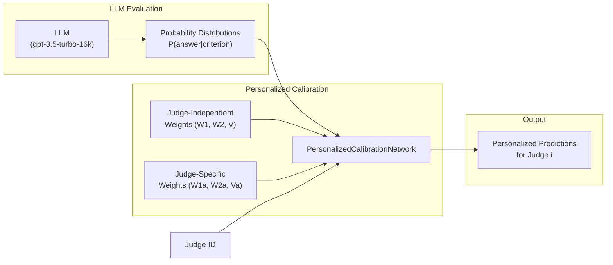
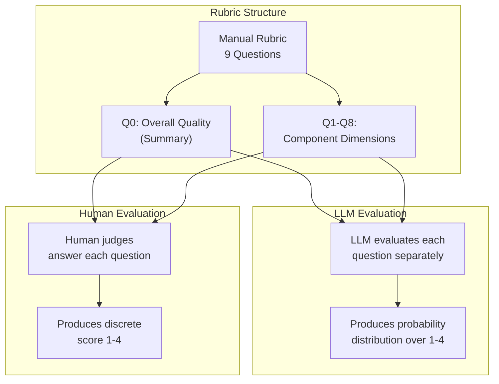
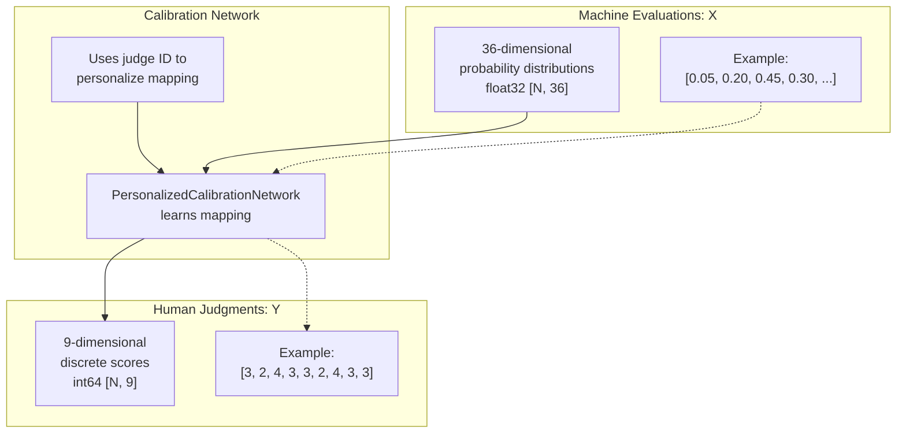
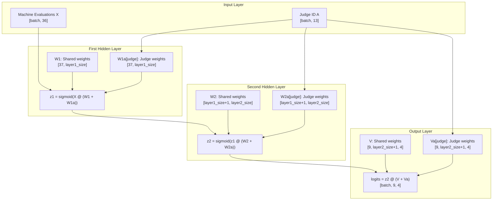
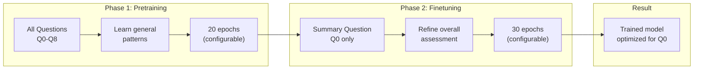
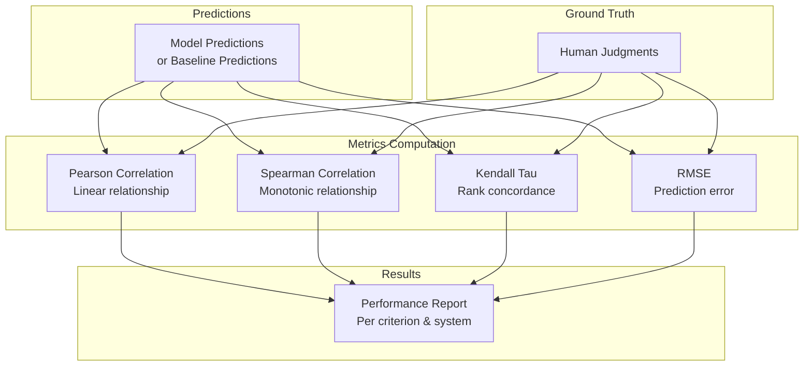
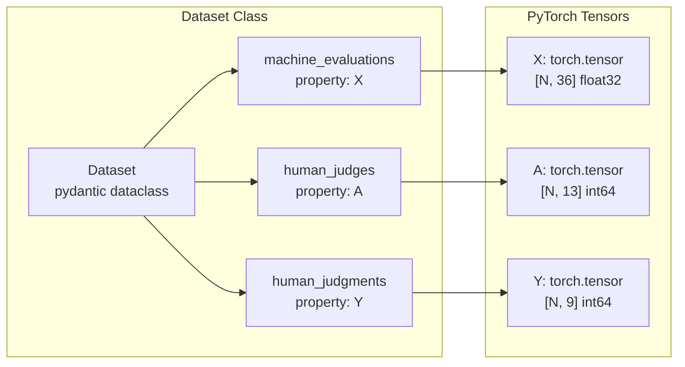

<!-- source: DeepWiki mcp.deepwiki.com · repo microsoft/LLM-Rubric · page 3 Core Concepts · fetched 2026-10-26 -->

# Core Concepts

<details>
<summary>Relevant source files</summary>

The following files were used as context for generating this wiki page:

- [README.md](README.md)
- [llm_rubric/model/torch_impl.py](llm_rubric/model/torch_impl.py)

</details>


This document explains the fundamental concepts underlying the LLM-Rubric system, including personalized calibration, the distinction between machine evaluations and human judgments, judge-specific parameters, and the evaluation framework. For architectural details about how these concepts are implemented, see [System Architecture](#3.1). For a detailed explanation of the neural network, see [Personalized Calibration Network](#3.2). For definitions of specific terminology, see [Key Terminology](#3.3).

## Personalized Calibration

**Personalized calibration** is the core innovation of LLM-Rubric. The fundamental problem is that large language model (LLM) predictions often fail to align well with human judgments, and furthermore, human judges themselves do not fully agree with one another. Rather than treating this as a limitation, LLM-Rubric leverages these individual differences.

The system learns to calibrate LLM probability distributions to match **individual** human judges' preferences. This is accomplished through a feed-forward neural network that includes both:
- **Judge-independent parameters**: Shared weights that capture general patterns
- **Judge-specific parameters**: Personalized weights for each judge's unique rating behavior



**Diagram: Personalized Calibration Flow**

The calibration network takes as input:
1. **Machine evaluations** (`X`): A 36-dimensional feature vector representing LLM probability distributions across 9 criteria and 4 possible answers
2. **Judge ID** (`A`): An integer identifier for the specific human judge

It outputs personalized predictions that match how that specific judge would evaluate the text.

**Sources:** [README.md:1-2](), [llm_rubric/model/torch_impl.py:47-163]()

## The Rubric Framework

The rubric consists of **9 evaluation questions** (Q0-Q8) that assess different dimensions of natural language text quality:

| Criterion | Purpose | Question Type |
|-----------|---------|---------------|
| Q0 | Overall assessment | Summary question |
| Q1-Q8 | Specific dimensions | Component questions |

Each question can be answered on a **1-4 scale**:
- 1: Poor
- 2: Fair
- 3: Good
- 4: Excellent



**Diagram: Rubric Framework Structure**

The **summary question (Q0)** is particularly important as it assesses overall user satisfaction or quality. LLM-Rubric uses a two-phase training approach where finetuning focuses specifically on predicting Q0 accurately.

**Sources:** [README.md:1-2](), [llm_rubric/model/torch_impl.py:9-22]()

## Machine Evaluations vs Human Judgments

The LLM-Rubric system bridges two fundamentally different types of assessments:

### Machine Evaluations

Machine evaluations are **probability distributions** generated by prompting an LLM with each rubric question. For each of the 9 criteria and 4 possible answers, the LLM provides a probability:

```
Criterion Q1:
  answer1_prob: 0.05
  answer2_prob: 0.20
  answer3_prob: 0.45
  answer4_prob: 0.30
```

This produces a **36-dimensional feature vector** (9 criteria × 4 answers) that captures the LLM's uncertainty and confidence distribution across all possible responses.

### Human Judgments

Human judgments are **discrete scores** where each judge selects a single answer (1, 2, 3, or 4) for each criterion. Multiple judges may evaluate the same text, producing a **9-dimensional label vector** per judge.

### The Calibration Gap



**Diagram: Machine Evaluations to Human Judgments Mapping**

The calibration network learns to transform the continuous probability distributions into predictions that match discrete human judgments, while accounting for judge-specific biases and preferences.

**Sources:** [llm_rubric/model/torch_impl.py:25-44](), [README.md:1-2]()

## Judge-Specific Personalization

Human judges exhibit **systematic differences** in how they rate texts. Some judges may be more lenient, others more critical. Some may weight certain criteria more heavily. The `PersonalizedCalibrationNetwork` captures these differences through judge-specific parameters.

### Parameter Architecture

| Parameter | Shape | Purpose |
|-----------|-------|---------|
| `W1` | `[input_size+1, layer1_size]` | Judge-independent first layer weights |
| `W1a` | `[num_judges, input_size+1, layer1_size]` | Judge-specific first layer weights |
| `W2` | `[layer1_size+1, layer2_size]` | Judge-independent second layer weights |
| `W2a` | `[num_judges, layer1_size+1, layer2_size]` | Judge-specific second layer weights |
| `V` | `[output_size, layer2_size+1, num_answers]` | Judge-independent output weights |
| `Va` | `[num_judges, output_size, layer2_size+1, num_answers]` | Judge-specific output weights |



**Diagram: Judge-Specific Parameter Flow**

In the forward pass [llm_rubric/model/torch_impl.py:112-134](), the judge ID is used to look up judge-specific parameters:
```python
W1a_lookup = self.W1a[X_human_judges[:,0]]
z1_pre = torch.einsum("bi,bio->bo", input_and_bias, self.W1[None, :, :] + W1a_lookup)
```

The effective weight at each layer is the **sum** of the shared weight and the judge-specific weight, allowing the network to capture both general patterns and individual preferences.

**Sources:** [llm_rubric/model/torch_impl.py:47-110](), [llm_rubric/model/torch_impl.py:112-134]()

## Two-Phase Training Strategy

LLM-Rubric employs a **two-phase training strategy** to effectively learn from the data:

### Phase 1: Pretraining

During pretraining [llm_rubric/model/torch_impl.py:165-184](), the model learns to predict **all 9 criteria** (Q0-Q8) simultaneously. This phase:
- Uses all available training data
- Learns general patterns across all dimensions
- Typically runs for 20 epochs
- Optimizes cross-entropy loss across all outputs

```python
loss = model.loss(X_machine_evals_th, X_human_judges_th, Y_human_judgments_th)
```

### Phase 2: Finetuning

During finetuning [llm_rubric/model/torch_impl.py:186-210](), the model focuses specifically on the **summary question (Q0)**. This phase:
- Narrows focus to the most important criterion
- Refines predictions for overall quality assessment
- Typically runs for 30 epochs
- Only computes loss on the finetune_output index

```python
loss = model.loss(
    X_machine_evals_th, X_human_judges_th, Y_human_judgments_th,
    I=[model.hyperparameters.finetune_output],
)
```



**Diagram: Two-Phase Training Pipeline**

The hyperparameters controlling these phases are configurable:
- `pretraining_epochs`: Number of epochs for phase 1
- `finetuning_epochs`: Number of epochs for phase 2
- `finetune_output`: Index of the criterion to focus on during finetuning (typically 0 for Q0)

**Sources:** [llm_rubric/model/torch_impl.py:165-210](), [llm_rubric/model/torch_impl.py:9-22]()

## The Evaluation Framework

LLM-Rubric uses multiple correlation metrics to evaluate prediction quality. Different metrics capture different aspects of prediction accuracy:

### Correlation Metrics

| Metric | Type | Purpose | Code Implementation |
|--------|------|---------|---------------------|
| **Pearson** | Parametric | Measures linear correlation | `scipy.stats.pearsonr` |
| **Spearman** | Non-parametric | Measures monotonic correlation | `scipy.stats.spearmanr` |
| **Kendall** | Non-parametric | Measures rank correlation | `scipy.stats.kendalltau` |
| **RMSE** | Error | Measures prediction error magnitude | Root mean squared error |



**Diagram: Evaluation Metrics Framework**

### Why Multiple Metrics Matter

- **Pearson** is sensitive to linear relationships and outliers
- **Spearman** is robust to monotonic transformations and non-linear relationships
- **Kendall** focuses on pairwise orderings, useful for ranking tasks
- **RMSE** provides interpretable error magnitude in the original scale (1-4)

Example output from evaluation [README.md:68-75]():
```
                        rmse   pearson  spearman   kendall    N      mean       std
criterion system
Q0        random        1.453309 -0.054438 -0.043663 -0.036858  223  2.587444  1.152196
          sample_llm    1.207228  0.039810  0.045245  0.040967  223  3.322870  0.794469
          argmax_llm    1.201643  0.140091  0.086990  0.081134  223  3.614350  0.563597
          expected_llm  0.918676  0.177301  0.086675  0.065928  223  3.282864  0.300516
```

The evaluation framework enables systematic comparison between:
- LLM-Rubric predictions
- Machine baselines (expected_llm, argmax_llm, sample_llm)
- Human baselines (group_constant, ann_constant)
- Random baseline (performance floor)

**Sources:** [README.md:66-102]()

## Data Representation

The LLM-Rubric system operates on three core tensors encapsulated in the `Dataset` class [llm_rubric/model/torch_impl.py:25-44]():

| Tensor | Alias | Shape | Data Type | Contents |
|--------|-------|-------|-----------|----------|
| `machine_evaluations` | `X` | `[N, 36]` | float32 | LLM probability distributions (9 criteria × 4 answers) |
| `human_judges` | `A` | `[N, 13]` | int64 | Judge ID encodings (one-hot or integer) |
| `human_judgments` | `Y` | `[N, 9]` | int64 | Human discrete scores for Q0-Q8 |



**Diagram: Dataset Structure and Tensor Properties**

The `Dataset` class provides convenient property accessors that convert numpy arrays to PyTorch tensors:
```python
@property
def X(self):
    return torch.tensor(self.machine_evaluations)
```

This abstraction ensures consistent data representation throughout training and inference while maintaining type safety through pydantic validation.

**Sources:** [llm_rubric/model/torch_impl.py:25-44]()

---

