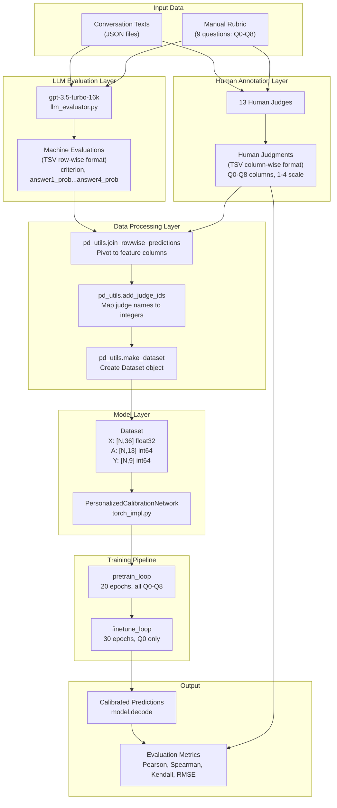
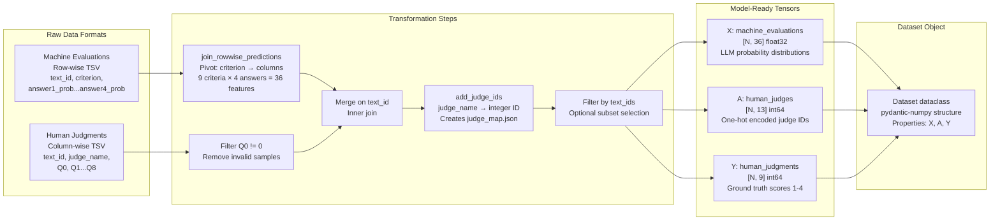
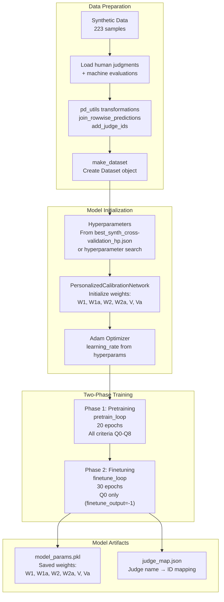
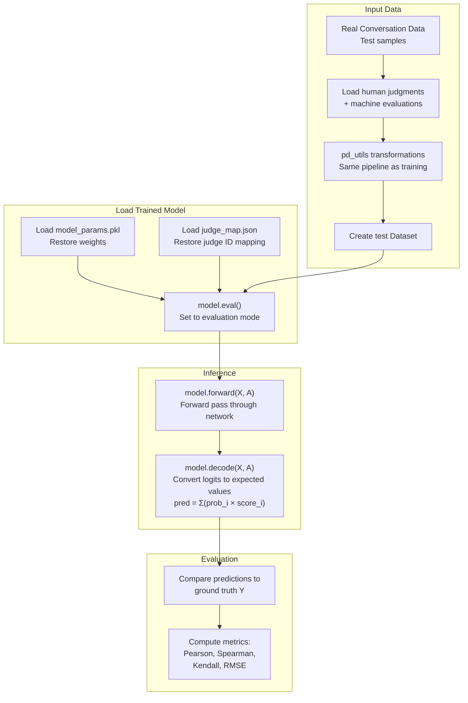
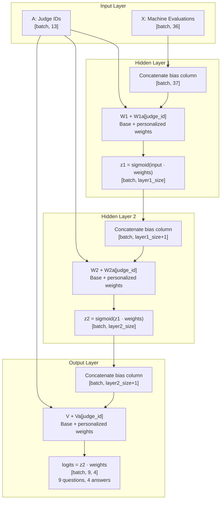
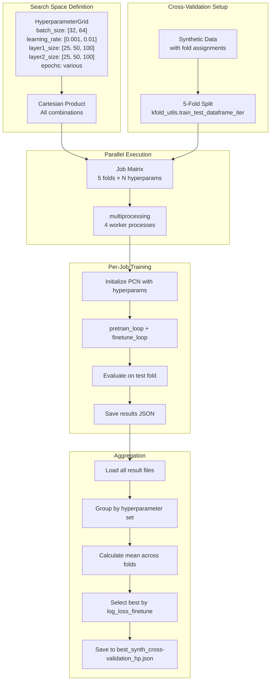
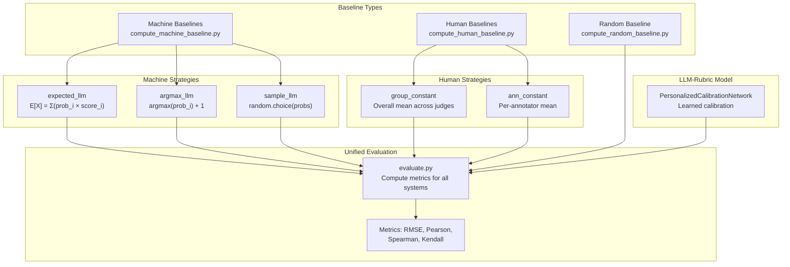

<!-- source: DeepWiki mcp.deepwiki.com · repo microsoft/LLM-Rubric · page 3.1 System Architecture · fetched 2026-10-26 -->

# System Architecture

Relevant source files

The following files were used as context for generating this wiki page:

- [README.md](README.md)
- [llm_rubric/model/torch_impl.py](llm_rubric/model/torch_impl.py)

## Purpose and Scope

This document describes the overall architecture of the LLM-Rubric system, including the data flow from raw conversation texts through LLM evaluation to calibrated predictions. It covers the major components, their interactions, and how data is transformed through the pipeline.

For detailed information about the neural network architecture itself, see [PersonalizedCalibrationNetwork](#3.2). For data format specifications, see [Data Formats and Schema](#5.1). For step-by-step usage instructions, refer to the User Guides ([section 4](#4)).

---

## System Overview

The LLM-Rubric system implements a calibration framework that learns to map LLM probability distributions to individual human judge preferences. The architecture consists of four primary layers:

1. **Data Layer**: Raw conversation data, human annotations, and LLM evaluations
2. **Processing Layer**: Data transformation and feature engineering utilities
3. **Model Layer**: `PersonalizedCalibrationNetwork` neural network with judge-specific parameters
4. **Evaluation Layer**: Baseline systems and metric computation

The system operates in two distinct modes: **training mode** (on synthetic data) and **prediction mode** (on real conversation data). Hyperparameter optimization uses k-fold cross-validation on synthetic data to find optimal model configurations before final training.

---

## High-Level Data Flow

The following diagram illustrates the complete data transformation pipeline from raw inputs to final predictions:

**Sources:** [README.md:1-103](), [llm_rubric/model/torch_impl.py:1-210]()

---

## Core Components and Code Mapping

The following table maps conceptual system components to their implementation in the codebase:

| Component | Code Entity | File Path | Description |
|-----------|-------------|-----------|-------------|
| **Neural Network** | `PersonalizedCalibrationNetwork` | [llm_rubric/model/torch_impl.py:47-163]() | Feed-forward network with judge-specific parameters |
| **Configuration** | `Hyperparameters` dataclass | [llm_rubric/model/torch_impl.py:8-23]() | Model hyperparameters and training settings |
| **Data Container** | `Dataset` dataclass | [llm_rubric/model/torch_impl.py:25-44]() | Encapsulates X, A, Y tensors for PyTorch |
| **Pretraining** | `pretrain_loop` function | [llm_rubric/model/torch_impl.py:165-184]() | Trains on all criteria Q0-Q8 |
| **Finetuning** | `finetune_loop` function | [llm_rubric/model/torch_impl.py:186-210]() | Trains on summary question Q0 only |
| **Data Transformation** | `pd_utils` module | `llm_rubric/utils/pd_utils.py` | Functions for joining, filtering, and transforming data |
| **Cross-Validation** | `kfold_utils` module | `llm_rubric/utils/kfold_utils.py` | K-fold splitting and fold iteration |
| **LLM Interface** | `llm_evaluator` module | `llm_rubric/utils/llm_evaluator.py` | API wrapper for GPT-3.5-turbo evaluations |
| **Training Script** | `train_llm_rubric.py` | `llm_rubric/train_llm_rubric.py` | Main training entry point |
| **Prediction Script** | `llm_rubric_predict.py` | `llm_rubric/llm_rubric_predict.py` | Inference entry point |
| **Evaluation Script** | `evaluate.py` | `llm_rubric/evaluate.py` | Metric computation for all systems |

**Sources:** [llm_rubric/model/torch_impl.py:1-210](), [README.md:79-92]()

---

## Data Processing Pipeline

The data processing layer transforms raw machine evaluations and human judgments into model-ready tensors. This pipeline is consistent across both training and prediction modes.

### Feature Engineering Flow

### Tensor Structure

The `Dataset` object exposes three tensor properties:

| Tensor | Shape | Data Type | Content |
|--------|-------|-----------|---------|
| **X** (machine_evaluations) | `[N, 36]` | `float32` | LLM probability distributions: 9 criteria × 4 answer probabilities |
| **A** (human_judges) | `[N, 13]` | `int64` | Judge ID encodings (0-12 for 13 judges) stored as one-hot-like structure |
| **Y** (human_judgments) | `[N, 9]` | `int64` | Human annotations: Q0-Q8 on 1-4 scale |

The input features (X) are flattened from the row-wise machine evaluation format where each criterion (Q0-Q8) has four probability values (answer1_prob through answer4_prob), resulting in 9 × 4 = 36 total features.

**Sources:** [llm_rubric/model/torch_impl.py:25-44]()

---

## Training and Inference Architecture

### Training Mode

Training occurs exclusively on synthetic conversation data (223 samples) and follows a two-phase approach:

The pretraining phase ([llm_rubric/model/torch_impl.py:165-184]()) trains on all rubric questions to learn general calibration patterns. The finetuning phase ([llm_rubric/model/torch_impl.py:186-210]()) specializes the model for the summary question Q0, which typically assesses overall quality or user satisfaction.

**Sources:** [llm_rubric/model/torch_impl.py:165-210](), [README.md:79-92]()

### Inference Mode

Prediction applies the trained model to real conversation data:

The `model.decode` method ([llm_rubric/model/torch_impl.py:151-162]()) converts output logits to expected values by computing the weighted sum: `prediction = Σ(prob_i × score_i)` where probabilities are derived via softmax over answer logits and scores are `[1.0, 2.0, 3.0, 4.0]`.

**Sources:** [llm_rubric/model/torch_impl.py:151-162]()

---

## Neural Network Forward Pass

The `PersonalizedCalibrationNetwork` implements a personalized feed-forward architecture where judge-specific parameters are added to judge-independent base weights:

The network architecture includes three sets of weight matrices, each with both judge-independent and judge-specific components:

| Weight Matrix | Shape | Purpose |
|---------------|-------|---------|
| **W1** | `[input_size+1, layer1_size]` | Judge-independent first layer |
| **W1a** | `[num_judges, input_size+1, layer1_size]` | Judge-specific first layer |
| **W2** | `[layer1_size+1, layer2_size]` | Judge-independent second layer |
| **W2a** | `[num_judges, layer1_size+1, layer2_size]` | Judge-specific second layer |
| **V** | `[output_size, layer2_size+1, num_answers]` | Judge-independent output layer |
| **Va** | `[num_judges, output_size, layer2_size+1, num_answers]` | Judge-specific output layer |

At each layer, the effective weight matrix is computed as `W + Wa[judge_id]`, enabling the model to learn both shared calibration patterns across all judges and individual judge preferences.

**Sources:** [llm_rubric/model/torch_impl.py:47-134]()

---

## Hyperparameter Optimization Workflow

Hyperparameter selection uses 5-fold cross-validation on synthetic data with parallel job execution:

The hyperparameter search explores a grid of configurations, training a separate model for each (fold, hyperparameter set) combination. Results are aggregated across folds to identify the configuration with the best average performance, typically using `log_loss_finetune` as the selection criterion. The best hyperparameters are saved to `experiments/real_data/best_synth_cross-validation_hp.json` for use in final model training on real data.

**Sources:** [README.md:82-86]()

---

## Baseline Systems Integration

The architecture includes multiple baseline systems for comparison, evaluated through a unified interface:

All baseline systems and the LLM-Rubric model produce predictions in the same format, enabling direct comparison through the `evaluate.py` script. This unified evaluation framework computes correlation coefficients and RMSE for each system, quantifying how well each approach predicts individual human judge preferences.

**Sources:** [README.md:62-77]()

---

## File Organization and Entry Points

The codebase is organized around distinct workflows with dedicated entry point scripts:

| Workflow | Entry Point | Purpose |
|----------|-------------|---------|
| **Baseline Computation** | `scripts/run_real_data_baselines.sh` | Compute machine, human, and random baseline predictions |
| **Hyperparameter Search** | `scripts/find_hyperparams_for_real_data_eval.sh` | Run cross-validation to find optimal hyperparameters |
| **Model Training** | `scripts/train_llm_rubric_for_real_data_eval.sh` | Train PersonalizedCalibrationNetwork on synthetic data |
| **Prediction & Evaluation** | `scripts/predict_llm_rubric_for_real_data_eval.sh` | Generate predictions on real data and compute metrics |

Each script orchestrates calls to Python modules in the `llm_rubric` package, which contains:

- `llm_rubric/model/torch_impl.py` - Core neural network implementation
- `llm_rubric/utils/pd_utils.py` - Data transformation functions
- `llm_rubric/utils/kfold_utils.py` - Cross-validation utilities
- `llm_rubric/utils/llm_evaluator.py` - LLM API interface
- `llm_rubric/train_llm_rubric.py` - Training orchestration
- `llm_rubric/llm_rubric_predict.py` - Inference orchestration
- `llm_rubric/evaluate.py` - Metric computation

**Sources:** [README.md:58-103]()

---

## Summary

The LLM-Rubric architecture implements a calibration framework that transforms LLM probability distributions into personalized predictions aligned with individual human judge preferences. The system's modular design separates data processing, model training, and evaluation into distinct layers, enabling experimentation with different configurations while maintaining consistent evaluation protocols. The two-phase training strategy (pretraining on all criteria, finetuning on summary question) balances learning general calibration patterns with specialization for the primary evaluation objective.

---

