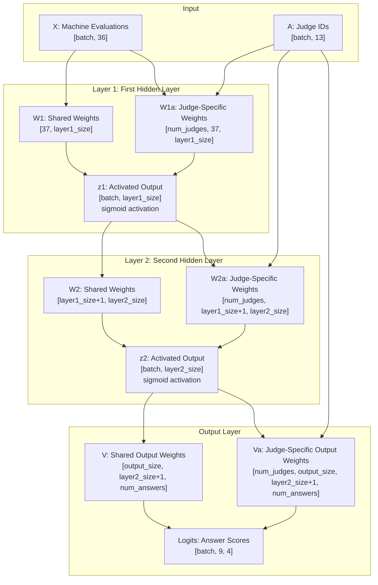
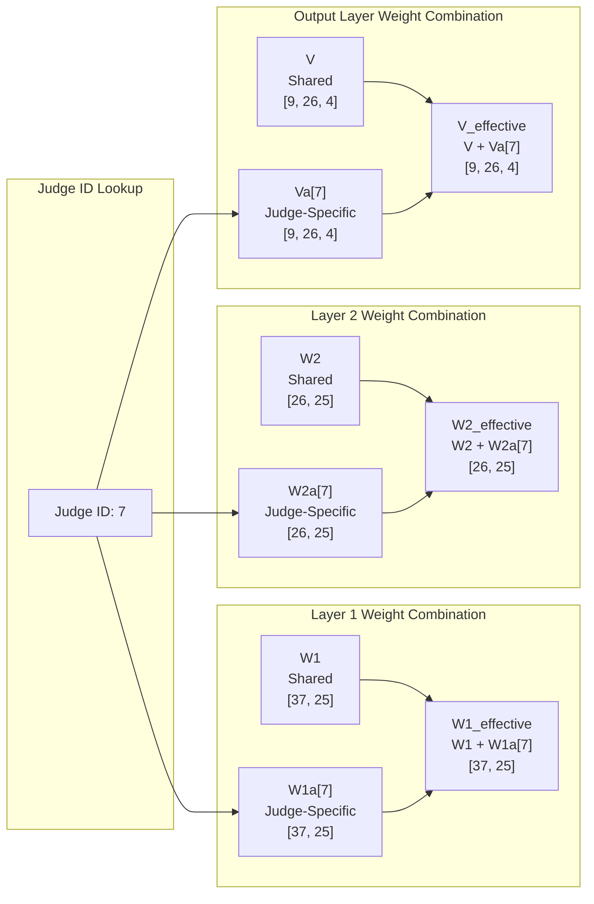
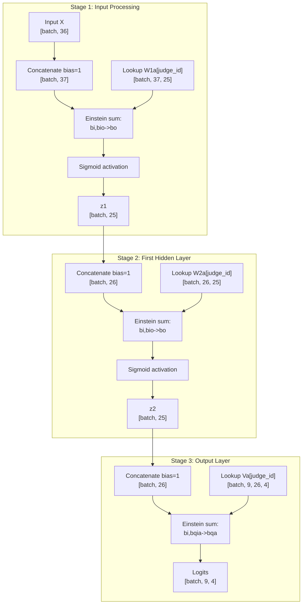
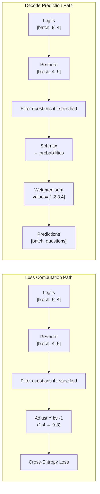

<!-- source: DeepWiki mcp.deepwiki.com · repo microsoft/LLM-Rubric · page 3.2 Personalized Calibration Network · fetched 2026-10-26 -->

# Personalized Calibration Network

<details>
<summary>Relevant source files</summary>

The following files were used as context for generating this wiki page:

- [README.md](README.md)
- [llm_rubric/model/torch_impl.py](llm_rubric/model/torch_impl.py)

</details>


## Purpose and Scope

This page documents the `PersonalizedCalibrationNetwork` class, the core neural network model in the LLM-Rubric system. The network learns to calibrate LLM probability distributions to match individual human judge preferences through judge-specific parameter learning. This page covers the network architecture, parameter structure, forward pass computation, and the personalization mechanism.

For information about the training process (pretraining and finetuning loops), see [Training Process](#6.2). For hyperparameter configuration details, see [Hyperparameters Configuration](#6.3). For the broader system context, see [System Architecture](#3.1).

## Network Architecture Overview

The `PersonalizedCalibrationNetwork` is a feed-forward neural network implemented in PyTorch with a unique personalization structure. The network combines **judge-independent** parameters (shared across all judges) with **judge-specific** parameters (unique to each judge) at each layer to produce personalized predictions.

### Architecture Components

The network consists of:
- **Input layer**: Accepts LLM probability distributions (36 dimensions = 9 criteria × 4 answer probabilities)
- **Hidden layer 1**: Configurable size (default 25 neurons), uses sigmoid activation
- **Hidden layer 2**: Configurable size (default 25 neurons), uses sigmoid activation  
- **Output layer**: Produces logits for 9 questions × 4 answer options



**Weight Combination Pattern**: At each layer, the network computes `W_combined = W + W_a[judge_id]`, where `W` is shared across judges and `W_a[judge_id]` is the judge-specific adjustment. This allows the model to learn both general calibration patterns and judge-specific preferences.

Sources: [llm_rubric/model/torch_impl.py:47-110]()

## Input and Output Structure

### Input Tensors

The network accepts three inputs through the `Dataset` class:

| Tensor | Name | Shape | Type | Description |
|--------|------|-------|------|-------------|
| `X` | `machine_evaluations` | `[N, 36]` | `float32` | LLM probability distributions: 9 criteria × 4 answer probabilities |
| `A` | `human_judges` | `[N, 13]` | `int64` | One-hot encoded judge identifiers (0-12 for 13 judges) |
| `Y` | `human_judgments` | `[N, 9]` | `int64` | Ground truth human ratings (1-4 scale) for 9 questions |

The `Dataset` class provides PyTorch tensor properties that wrap the numpy arrays:

```
Dataset.X → torch.tensor(machine_evaluations)
Dataset.A → torch.tensor(human_judges)
Dataset.Y → torch.tensor(human_judgments)
```

### Output Structure

The `forward()` method returns logits with shape `[batch, 9, 4]`:
- **Dimension 0**: Batch size
- **Dimension 1**: 9 questions (Q0-Q8, where Q0 is the summary question)
- **Dimension 2**: 4 answer options (corresponding to ratings 1, 2, 3, 4)

The `decode()` method converts these logits to expected values on the 1-4 scale by:
1. Applying softmax to get probability distributions
2. Computing weighted sum: `prediction = Σ(prob_i × value_i)` where values = [1.0, 2.0, 3.0, 4.0]

Sources: [llm_rubric/model/torch_impl.py:26-45](), [llm_rubric/model/torch_impl.py:151-162]()

## Network Parameters

### Judge-Independent Parameters

These parameters are shared across all judges and learn general calibration patterns:

| Parameter | Shape | Description |
|-----------|-------|-------------|
| `W1` | `[input_size+1, layer1_size]` | First layer weights (37 × 25 with defaults) |
| `W2` | `[layer1_size+1, layer2_size]` | Second layer weights (26 × 25 with defaults) |
| `V` | `[output_size, layer2_size+1, num_answers]` | Output layer weights (9 × 26 × 4) |

The `+1` dimensions account for bias terms, which are implemented by concatenating a column of ones to the activations rather than using separate bias parameters.

### Judge-Specific Parameters

These parameters capture individual judge preferences and calibration adjustments:

| Parameter | Shape | Description |
|-----------|-------|-------------|
| `W1a` | `[num_judges, input_size+1, layer1_size]` | Per-judge first layer adjustments (13 × 37 × 25) |
| `W2a` | `[num_judges, layer1_size+1, layer2_size]` | Per-judge second layer adjustments (13 × 26 × 25) |
| `Va` | `[num_judges, output_size, layer2_size+1, num_answers]` | Per-judge output adjustments (13 × 9 × 26 × 4) |

All parameters are initialized with random values drawn from a standard normal distribution using `torch.randn()` with a fixed random seed for reproducibility.

Sources: [llm_rubric/model/torch_impl.py:56-109]()

## Personalization Mechanism

The core innovation of the network is how it combines shared and judge-specific parameters. For a given judge ID, the effective weight matrix at each layer is:

```
W_effective = W_shared + W_judge_specific[judge_id]
```

This additive combination allows:
- **Shared parameters** to learn common patterns across all judges
- **Judge-specific parameters** to learn deviations from the common pattern for each individual judge



The implementation uses efficient tensor indexing and Einstein summation (`torch.einsum`) to perform batched matrix multiplications with judge-specific weight lookups:

```
W1a_lookup = self.W1a[X_human_judges[:,0]]  # Shape: [batch, 37, 25]
z1_pre = torch.einsum("bi,bio->bo", input_and_bias, self.W1[None,:,:] + W1a_lookup)
```

This approach is more efficient than creating separate networks for each judge and enables knowledge transfer across judges during training.

Sources: [llm_rubric/model/torch_impl.py:112-134]()

## Forward Pass Computation

The forward pass executes through three stages with bias augmentation and sigmoid activations:



### Detailed Computation Steps

**Layer 1**: 
1. Concatenate bias: `input_and_bias = torch.cat([X_machine_evals, ones], axis=1)` → `[batch, 37]`
2. Lookup judge weights: `W1a_lookup = self.W1a[X_human_judges[:,0]]` → `[batch, 37, 25]`
3. Combined matmul: `z1_pre = einsum("bi,bio->bo", input_and_bias, W1 + W1a_lookup)` → `[batch, 25]`
4. Activation: `z1 = sigmoid(z1_pre)` → `[batch, 25]`

**Layer 2**:
1. Concatenate bias: `z1_and_bias = torch.cat([z1, ones], axis=1)` → `[batch, 26]`
2. Lookup judge weights: `W2a_lookup = self.W2a[X_human_judges[:,0]]` → `[batch, 26, 25]`
3. Combined matmul: `z2_pre = einsum("bi,bio->bo", z1_and_bias, W2 + W2a_lookup)` → `[batch, 25]`
4. Activation: `z2 = sigmoid(z2_pre)` → `[batch, 25]`

**Output Layer**:
1. Concatenate bias: `z2_and_bias = torch.cat([z2, ones], axis=1)` → `[batch, 26]`
2. Lookup judge weights: `Va_lookup = self.Va[X_human_judges[:,0]]` → `[batch, 9, 26, 4]`
3. Combined matmul: `logits = einsum("bi,bqia->bqa", z2_and_bias, V + Va_lookup)` → `[batch, 9, 4]`

The use of Einstein summation notation enables efficient batched operations with judge-specific weights without explicit loops.

Sources: [llm_rubric/model/torch_impl.py:112-134]()

## Loss Function and Decoding

### Loss Computation

The `loss()` method computes cross-entropy loss between predicted logits and ground truth judgments:

1. **Forward pass**: Generate logits `[batch, 9, 4]`
2. **Permute**: Rearrange to `[batch, 4, 9]` for cross-entropy input format
3. **Optional filtering**: If parameter `I` is provided (used during finetuning), select only specific question indices
4. **Cross-entropy**: Apply `torch.nn.functional.cross_entropy()` with:
   - Target values adjusted by `-1` (since judgments are 1-4 but class indices are 0-3)
   - `ignore_index=-1` to skip invalid/missing judgments
   - `reduction='none'` followed by `.mean()` for batch averaging

The loss function signature: `loss(X, A, Y, I=None)` where `I` is an optional list of question indices to focus on (used during finetuning to train only on Q0).

### Prediction Decoding

The `decode()` method converts logits to expected rating values:

1. **Forward pass**: Generate logits `[batch, 9, 4]`
2. **Permute**: Rearrange to `[batch, 4, 9]`
3. **Optional filtering**: Select question subset if `I` is provided
4. **Softmax**: Convert logits to probabilities: `probs = softmax(logits, dim=1)`
5. **Expected value**: Compute `pred = Σ(values[i] × probs[i])` where `values = [1.0, 2.0, 3.0, 4.0]`

This produces continuous predictions on the 1-4 scale rather than discrete class predictions, which better matches the regression-like nature of the evaluation task.



Sources: [llm_rubric/model/torch_impl.py:137-162]()

## Hyperparameters

The network architecture is controlled by the `Hyperparameters` dataclass, which uses Pydantic for validation and configuration management:

| Parameter | Default | Description |
|-----------|---------|-------------|
| `input_size` | - | Input feature dimensions (36 for 9 criteria × 4 answers) |
| `output_size` | - | Number of questions to predict (9 for Q0-Q8) |
| `num_judges` | - | Number of unique human judges (13 in the dataset) |
| `num_answers` | 4 | Number of rating options (1-4 scale) |
| `layer1_size` | 100 | First hidden layer size (neurons) |
| `layer2_size` | 100 | Second hidden layer size (neurons) |
| `batch_size` | 32 | Training batch size |
| `learning_rate` | 0.01 | Adam optimizer learning rate |
| `pretraining_epochs` | 50 | Epochs for pretraining phase |
| `finetuning_epochs` | 50 | Epochs for finetuning phase |
| `finetune_output` | -1 | Question index to focus on during finetuning (-1 = all questions) |
| `all_data_size` | - | Total training dataset size |
| `random_seed` | 43 | Random seed for reproducibility |

The `Hyperparameters` class is frozen and hashable (`eq=True, frozen=True`), allowing it to be used as a dictionary key for hyperparameter search caching.

For detailed information on hyperparameter tuning and selection, see [Hyperparameter Tuning](#4.5) and [Hyperparameters Configuration](#6.3).

Sources: [llm_rubric/model/torch_impl.py:9-23]()

## Model Initialization and Parameter Count

The model parameters are initialized using PyTorch's random normal distribution with a fixed random seed specified in the hyperparameters. The seed is set before each parameter initialization to ensure reproducibility:

```
torch.manual_seed(self.hyperparameters.random_seed)
```

### Parameter Count Calculation

With default hyperparameters (layer1_size=25, layer2_size=25, 13 judges):

**Judge-Independent Parameters**:
- `W1`: 37 × 25 = 925
- `W2`: 26 × 25 = 650  
- `V`: 9 × 26 × 4 = 936
- **Subtotal**: 2,511 parameters

**Judge-Specific Parameters** (per judge):
- `W1a`: 37 × 25 = 925 per judge
- `W2a`: 26 × 25 = 650 per judge
- `Va`: 9 × 26 × 4 = 936 per judge
- **Subtotal**: 2,511 parameters per judge × 13 judges = 32,643 parameters

**Total**: 35,154 parameters (2,511 shared + 32,643 judge-specific)

This relatively small model size enables efficient training on limited datasets while providing sufficient capacity for personalized calibration.

Sources: [llm_rubric/model/torch_impl.py:48-110]()

---

