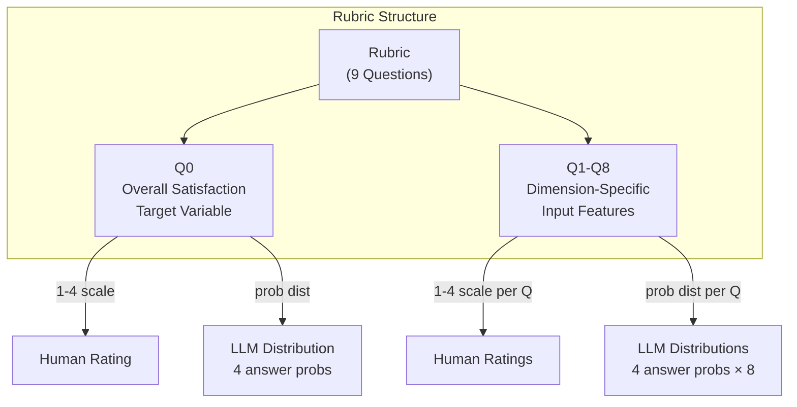
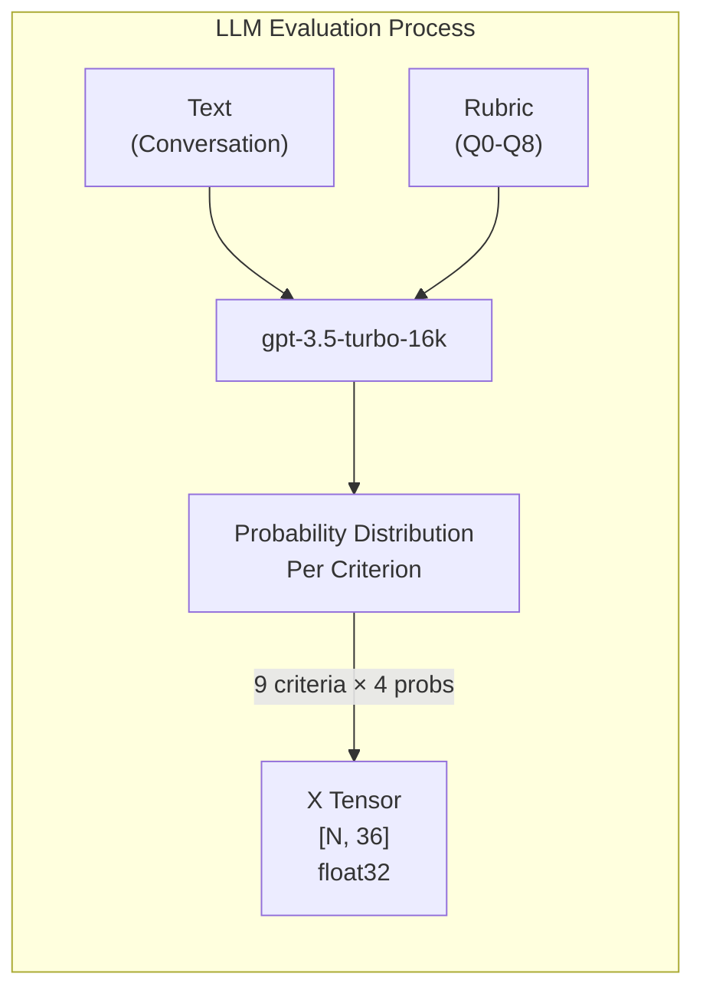
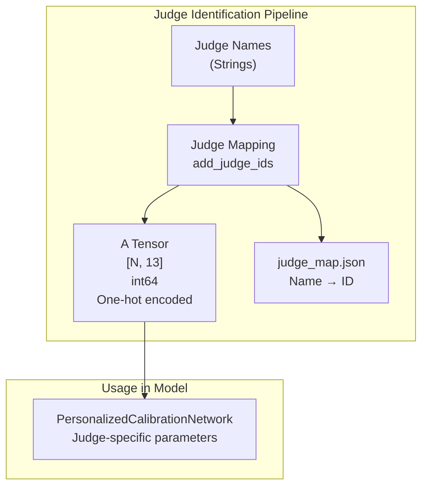
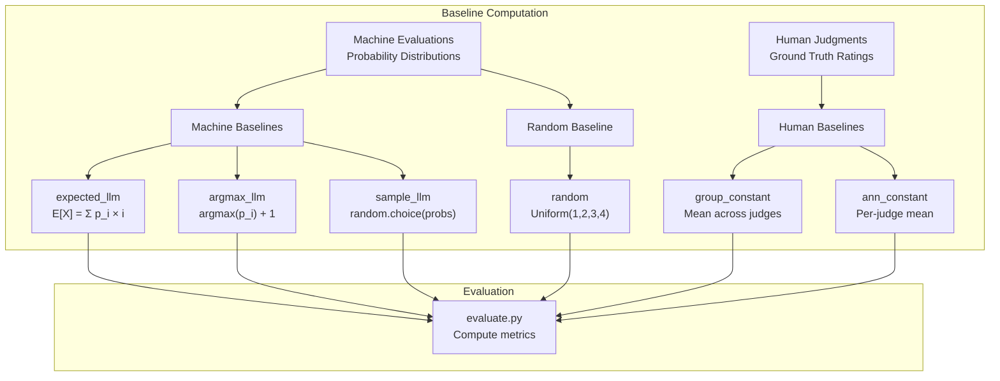
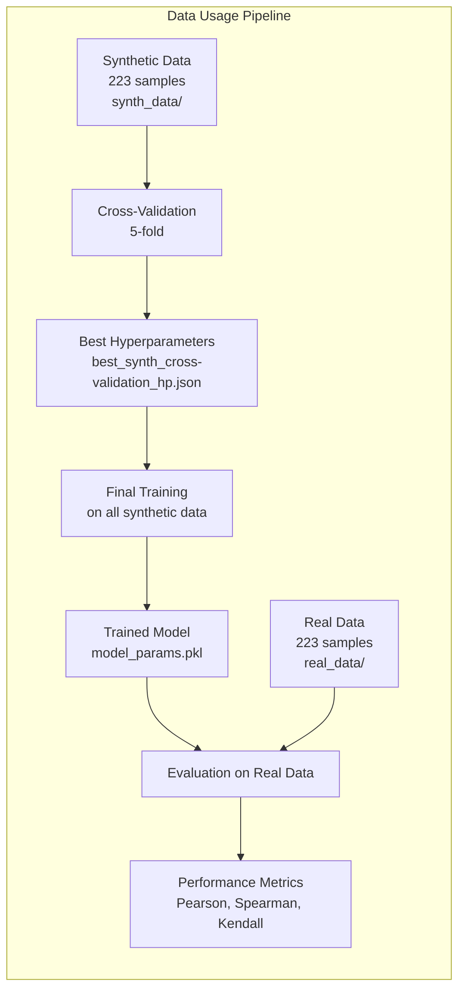
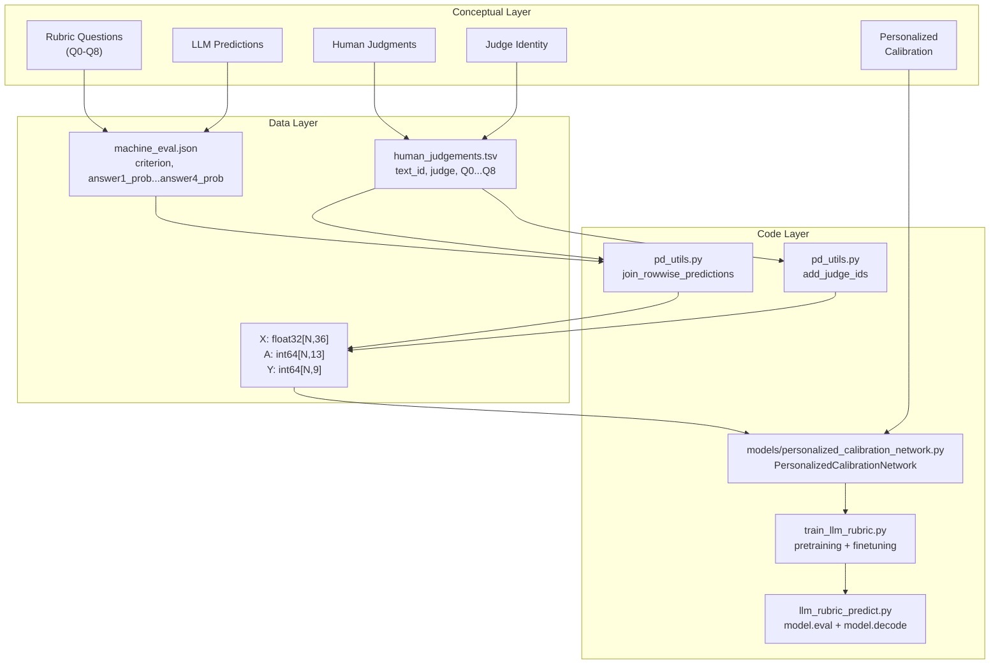

<!-- source: DeepWiki mcp.deepwiki.com · repo microsoft/LLM-Rubric · page 3.3 Key Terminology · fetched 2026-10-26 -->

# Key Terminology

<details>
<summary>Relevant source files</summary>

The following files were used as context for generating this wiki page:

- [README.md](README.md)
- [data/real_data/real_data.json](data/real_data/real_data.json)
- [data/synth_data/synth_data.json](data/synth_data/synth_data.json)

</details>


This page defines the core terminology used throughout the LLM-Rubric system. Understanding these terms is essential for working with the codebase, interpreting results, and extending the system. For architectural details, see [System Architecture](#3.1). For model implementation details, see [Personalized Calibration Network](#3.2).

---

## Core Evaluation Concepts

### Rubric

A **rubric** is a manually constructed evaluation framework that defines how to assess multiple dimensions of interest in natural language texts. In this system, the rubric consists of 9 questions (Q0-Q8) designed to evaluate different aspects of conversational quality.

**Code Entity**: The rubric questions are embedded in the prompts sent to `gpt-3.5-turbo-16k` via [llm_evaluator.py]().

**Structure**: Each rubric question expects a response on a 4-point scale (answer1, answer2, answer3, answer4), representing different quality levels.

Sources: [README.md:1-2]()

---

### Criteria (Q0-Q8)

**Criteria** are the individual evaluation questions in the rubric. The system uses 9 criteria indexed from Q0 to Q8:

| Criterion | Description | Role in System |
|-----------|-------------|----------------|
| **Q0** | Overall satisfaction/quality | Primary prediction target; summary assessment |
| **Q1-Q8** | Dimension-specific questions | Intermediate features (e.g., naturalness, conciseness, citation quality) |

**Data Format**: In human judgment files (TSV), criteria appear as column names. In machine evaluation files (JSON), criteria appear as the `criterion` field in row-wise format.

**Validation Rule**: Q0 != 0 is required for valid samples [pd_utils.py:filter operations]().



Sources: [README.md:1-2](), [data/real_data/real_data.json:1](), [data/synth_data/synth_data.json:1]()

---

### Dimensions of Interest

**Dimensions of interest** are the specific aspects of text quality being evaluated, such as:
- Naturalness of conversation flow
- Conciseness of responses
- Citation quality and accuracy
- Relevance to user needs
- Helpfulness of information

Each dimension corresponds to one of the Q1-Q8 criteria. These dimensions are domain-specific and can be customized for different evaluation scenarios.

Sources: [README.md:1-2]()

---

## Data and Predictions

### Text ID

A **text_id** is a unique identifier for each conversation or text being evaluated. 

**Code Entity**: String field used for joining data [pd_utils.py:join operations]()

**Format**: In the provided datasets, text_id values are MongoDB ObjectId strings (e.g., `"65c5b4b9f174b2897703736a"`)

Sources: [data/real_data/real_data.json:1]()

---

### LLM Predictions / Machine Evaluations

**LLM predictions** (also called **machine evaluations**) are probability distributions over the 4 possible answer choices for each rubric question, generated by prompting a large language model (`gpt-3.5-turbo-16k`).

**Format**: For each text and criterion, the LLM produces:
```
{
  "criterion": "Q0",
  "answer1_prob": 0.15,
  "answer2_prob": 0.35,
  "answer3_prob": 0.40,
  "answer4_prob": 0.10
}
```

**Tensor Representation**: After preprocessing, machine evaluations become the **X tensor**:
- Shape: `[N, 36]` where N = number of samples
- 36 features = 9 criteria × 4 answer probabilities
- Data type: `float32`

**Code Entity**: Generated by [llm_evaluator.py]() and processed by [pd_utils.py:join_rowwise_predictions]()



Sources: [README.md:1-2](), [data/real_data/machine_eval.json](), Diagram 1, Diagram 5

---

### Human Judgments

**Human judgments** are the ground truth annotations provided by human judges for each rubric question on a 1-4 scale.

**Format**: Each judgment consists of:
- `text_id`: Identifier of the evaluated text
- `judge`: Name/identifier of the annotator
- `Q0` through `Q8`: Integer ratings (1-4)

**Tensor Representation**: After preprocessing, human judgments become the **Y tensor**:
- Shape: `[N, 9]` where N = number of samples
- 9 dimensions = Q0 through Q8
- Data type: `int64`
- Value range: 1-4

**Code Entity**: Loaded from TSV files and processed by [pd_utils.py:make_dataset]()

Sources: [data/real_data/real_data_human_judgements.tsv](), Diagram 1, Diagram 5

---

### Judge / Annotator

A **judge** (also called an **annotator**) is a human who provides ratings for texts according to the rubric. The system supports personalized calibration to account for individual differences in how judges interpret the rubric.

**Number of Judges**: 13 human judges in the provided datasets

**Judge ID Mapping**: Judge names are mapped to integer IDs (0-12) for efficient neural network processing.

**Code Entity**: 
- Processed by [pd_utils.py:add_judge_ids]()
- Stored in `judge_map.json` after training

**Tensor Representation**: Judge identities become the **A tensor**:
- Shape: `[N, 13]` where N = number of samples
- One-hot encoding of judge IDs
- Data type: `int64`



Sources: [pd_utils.py:add_judge_ids](), Diagram 5

---

## Model Components

### Dataset (X, A, Y)

A **Dataset** is a structured container holding the three core tensors required for training and prediction:

| Tensor | Name | Shape | Type | Content |
|--------|------|-------|------|---------|
| **X** | Input Features | `[N, 36]` | float32 | LLM probability distributions (9 criteria × 4 answers) |
| **A** | Judge IDs | `[N, 13]` | int64 | One-hot encoded judge identifiers |
| **Y** | Target Labels | `[N, 9]` | int64 | Human judgments (Q0-Q8, scale 1-4) |

**Code Entity**: Defined as a pydantic-numpy structure in [pd_utils.py:make_dataset]() and used by [train_llm_rubric.py]() and [llm_rubric_predict.py]()

Sources: [pd_utils.py](), Diagram 1, Diagram 5

---

### Baseline Systems

**Baselines** are reference methods used to evaluate the performance of the LLM-Rubric model. Three categories exist:

#### Machine Baselines

Derived from LLM probability distributions without personalized calibration:

| Baseline | Description | Formula |
|----------|-------------|---------|
| **expected_llm** | Expected value | `Σ(p_i × score_i)` for i ∈ {1,2,3,4} |
| **argmax_llm** | Most probable answer | `argmax(p_i) + 1` |
| **sample_llm** | Sampled answer | `random.choice([1,2,3,4], probs=p)` |

**Code Entity**: [compute_machine_baseline.py]()

#### Human Baselines

Derived from aggregating human judgments:

| Baseline | Description |
|----------|-------------|
| **group_constant** | Overall mean across all judges |
| **ann_constant** | Per-annotator mean (judge-specific average) |

**Code Entity**: [compute_human_baseline.py]()

#### Random Baseline

**random**: Uniform random selection from {1, 2, 3, 4}

**Code Entity**: [compute_random_baseline.py]()



Sources: [compute_machine_baseline.py](), [compute_human_baseline.py](), [compute_random_baseline.py](), Diagram 6

---

### PersonalizedCalibrationNetwork

The **PersonalizedCalibrationNetwork** (often abbreviated as **PCN**) is the core neural network model that learns to calibrate LLM predictions to match individual human judge preferences.

**Architecture Components**:
- Judge-independent layers (shared across all judges)
- Judge-specific layers (personalized per judge)
- Two-layer feed-forward network

**Code Entity**: [models/personalized_calibration_network.py]()

For detailed architecture information, see [Personalized Calibration Network](#3.2) and [Network Architecture](#6.1).

Sources: [models/personalized_calibration_network.py](), README.md:1-2](), Diagram 1

---

### Judge-Specific vs Judge-Independent Parameters

The PersonalizedCalibrationNetwork contains two types of parameters:

| Parameter Type | Description | Purpose |
|----------------|-------------|---------|
| **Judge-Independent** | Shared weights across all judges | Capture universal patterns in LLM→human calibration |
| **Judge-Specific** | Separate weights for each judge | Capture individual judge preferences and biases |

**Key Insight**: This hybrid architecture allows the model to learn both common patterns and personalized calibration functions.

Sources: [models/personalized_calibration_network.py](), Diagram 1, README.md:1-2]()

---

## Training Concepts

### Pretraining vs Finetuning

The model uses a **two-phase training strategy**:

| Phase | Description | Typical Epochs | Purpose |
|-------|-------------|----------------|---------|
| **Pretraining** | Initial training on all criteria | 20 | Learn general patterns across Q0-Q8 |
| **Finetuning** | Focused training on Q0 only | 30 | Optimize for overall satisfaction prediction |

**Hyperparameter**: `finetune_output = -1` indicates training on all outputs (Q0-Q8 during pretraining) vs. specific output index

**Code Entity**: [train_llm_rubric.py:pretraining and finetuning loops]()

Sources: [train_llm_rubric.py](), Diagram 2, Diagram 3

---

### Synthetic Data vs Real Data

The system uses two distinct datasets:

| Dataset | Size | Purpose | File Location |
|---------|------|---------|---------------|
| **Synthetic Data** | 223 samples | Training and hyperparameter tuning | `data/synth_data/` |
| **Real Conversation Data** | 223 samples | Final evaluation and testing | `data/real_data/` |

**Training Strategy**: 
1. Train on synthetic data with cross-validation
2. Select best hyperparameters
3. Retrain on all synthetic data
4. Evaluate on real conversation data

**Rationale**: This prevents overfitting to the real evaluation set.



Sources: [data/synth_data/](), [data/real_data/](), Diagram 2, Diagram 3, Diagram 4

---

### Cross-Validation

**Cross-validation** is used to select optimal hyperparameters on synthetic data without overfitting.

**Strategy**: 5-fold cross-validation
- Synthetic data is split into 5 folds
- Each fold serves as test set once while others are training set
- Performance is averaged across folds

**Code Entity**: [kfold_utils.py:train_test_dataframe_iter]() and [find_hyperparams.py]()

**Output**: Mean metrics across folds for each hyperparameter combination

Sources: [kfold_utils.py](), Diagram 4

---

## Hyperparameters

**Hyperparameters** are configuration values that control model architecture and training behavior. Key hyperparameters include:

| Hyperparameter | Description | Typical Value |
|----------------|-------------|---------------|
| `input_size` | Input feature dimension | 36 (9 criteria × 4 answers) |
| `output_size` | Output dimension | 9 (Q0-Q8) |
| `num_judges` | Number of annotators | 13 |
| `layer1_size` | First hidden layer size | 25 |
| `layer2_size` | Second hidden layer size | 25 |
| `batch_size` | Training batch size | 64 |
| `learning_rate` | Optimizer learning rate | 0.001 |
| `pretraining_epochs` | Pretraining iterations | 20 |
| `finetuning_epochs` | Finetuning iterations | 30 |

**Storage**: Optimal hyperparameters are stored in `best_synth_cross-validation_hp.json`

**Code Entity**: [experiments/real_data/best_synth_cross-validation_hp.json]()

For complete hyperparameter reference, see [Hyperparameters Configuration](#6.3).

Sources: [README.md:82-85](), Diagram 4

---

## Evaluation Metrics

The system uses multiple correlation and error metrics to assess prediction quality:

| Metric | Type | Description | Interpretation |
|--------|------|-------------|----------------|
| **Pearson** | Correlation | Linear correlation coefficient | -1 to 1; higher = better linear fit |
| **Spearman** | Correlation | Rank correlation coefficient | -1 to 1; higher = better rank agreement |
| **Kendall** | Correlation | Tau correlation coefficient | -1 to 1; higher = better pairwise agreement |
| **RMSE** | Error | Root mean squared error | 0 to ∞; lower = better |

**Code Entity**: [evaluate.py]()

**Usage**: All baselines and the LLM-Rubric model are compared using these metrics on the test set.

Sources: [evaluate.py](), Diagram 1, Diagram 2, Diagram 6

---

## Model Artifacts

After training, the system produces **model artifacts** that enable prediction on new data:

| Artifact | File Name | Content |
|----------|-----------|---------|
| **Model Parameters** | `model_params.pkl` | Trained neural network weights |
| **Judge Mapping** | `judge_map.json` | Dictionary mapping judge names to IDs |

**Code Entity**: 
- Saved by [train_llm_rubric.py]()
- Loaded by [llm_rubric_predict.py]()

**Usage**: These files must be present for making predictions on new data.

Sources: [train_llm_rubric.py](), [llm_rubric_predict.py](), Diagram 3

---

## Terminology Mapping: Natural Language to Code

The following diagram maps high-level concepts to their concrete code representations:



Sources: [pd_utils.py](), [models/personalized_calibration_network.py](), [train_llm_rubric.py](), [llm_rubric_predict.py]()

---

## Key Terminology Summary Table

| Term | Definition | Code Symbol | Related Pages |
|------|------------|-------------|---------------|
| Rubric | Manual evaluation framework with 9 questions | Embedded in LLM prompts | [3.1](#3.1) |
| Q0-Q8 | Nine evaluation criteria (Q0=overall, Q1-Q8=dimensions) | TSV columns, DataFrame columns | [5.1](#5.1) |
| LLM Predictions | Probability distributions from gpt-3.5-turbo-16k | `X` tensor `[N,36]` | [5.3](#5.3) |
| Human Judgments | Ground truth ratings (1-4 scale) | `Y` tensor `[N,9]` | [5.1](#5.1) |
| Judge ID | Annotator identifier | `A` tensor `[N,13]` | [5.1](#5.1) |
| Dataset | Container of X, A, Y tensors | `pd_utils.make_dataset` | [8.1](#8.1) |
| PCN | PersonalizedCalibrationNetwork | `PersonalizedCalibrationNetwork` class | [3.2](#3.2), [6.1](#6.1) |
| Pretraining | First training phase (all criteria) | `train_llm_rubric.py` pretraining loop | [6.2](#6.2) |
| Finetuning | Second training phase (Q0 only) | `train_llm_rubric.py` finetuning loop | [6.2](#6.2) |
| Baseline | Reference prediction method | `compute_*_baseline.py` | [7](#7) |
| Synthetic Data | Training dataset (223 samples) | `data/synth_data/` | [5.2](#5.2) |
| Real Data | Evaluation dataset (223 samples) | `data/real_data/` | [5.2](#5.2) |

Sources: All sections above

---

