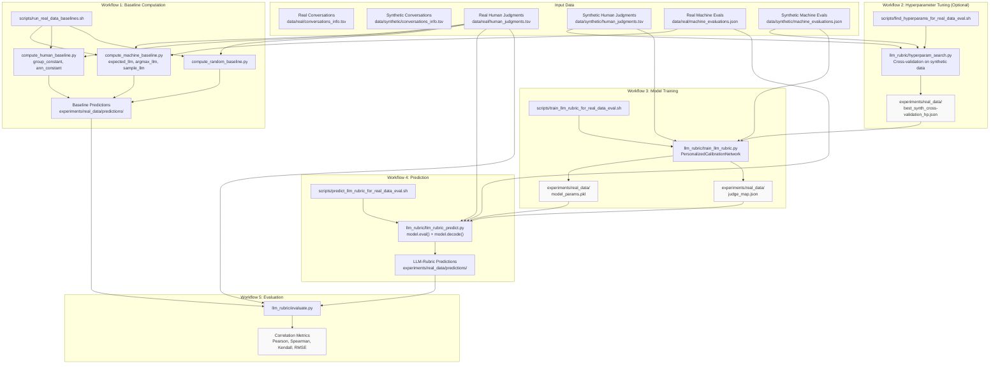
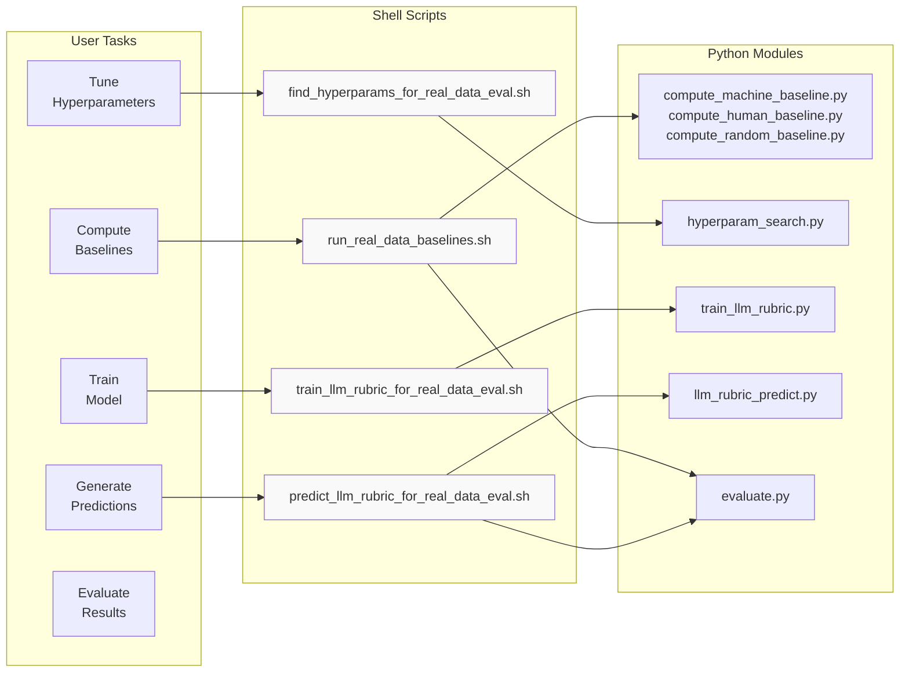
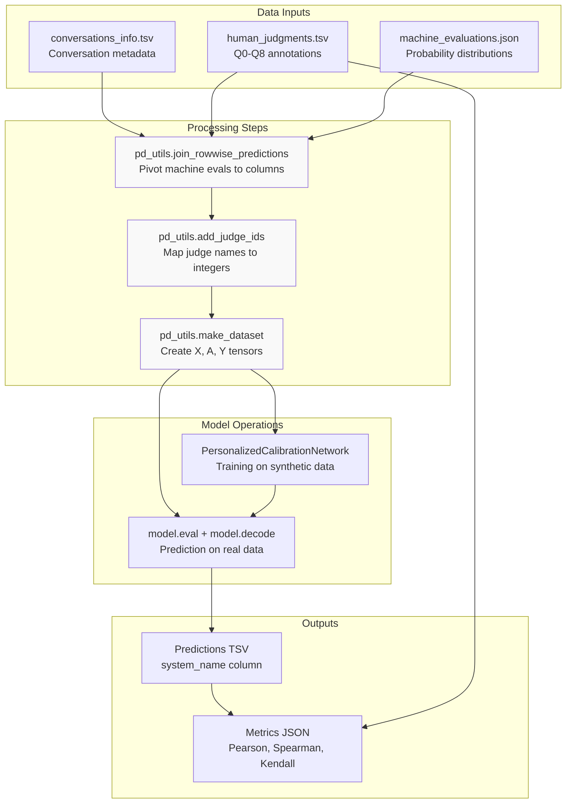
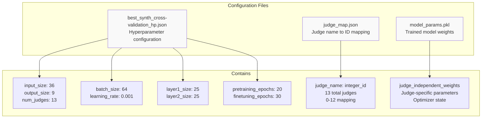

<!-- source: DeepWiki mcp.deepwiki.com · repo microsoft/LLM-Rubric · page 4 User Guides · fetched 2026-10-26 -->

# User Guides

<details>
<summary>Relevant source files</summary>

The following files were used as context for generating this wiki page:

- [README.md](README.md)

</details>


## Purpose and Scope

This section provides step-by-step instructions for common tasks and workflows when working with the LLM-Rubric system. It covers the complete evaluation pipeline from computing baseline systems through training personalized calibration models to generating and evaluating predictions.

The guides assume you have completed [Installation](#2.1) and are familiar with [Core Concepts](#3). For information about specific data formats and schemas, see [Data Reference](#5). For detailed technical documentation of model internals, see [Model Reference](#6).

## Overview of User Workflows

The LLM-Rubric system supports several interconnected workflows:

**Baseline Computation**: Generate predictions using simple aggregation methods (machine baselines), human judgment statistics (human baselines), and random selection. These provide performance benchmarks for comparison.

**Hyperparameter Tuning**: Perform cross-validation on synthetic data to identify optimal hyperparameters for the PersonalizedCalibrationNetwork. This step is optional if using pre-computed best hyperparameters.

**Model Training**: Train the PersonalizedCalibrationNetwork using synthetic conversation data with the two-phase (pretraining + finetuning) approach.

**Prediction Generation**: Apply a trained model to generate predictions on real conversation data, producing calibrated scores that match individual judge preferences.

**Evaluation**: Compute correlation metrics (Pearson, Spearman, Kendall) and RMSE to assess prediction quality against human judgments.

The typical workflow follows this sequence: (1) compute baselines, (2) optionally tune hyperparameters, (3) train model on synthetic data, (4) generate predictions on real data, (5) evaluate all systems. However, users may enter at any point depending on their needs.

## Complete Workflow Architecture



**Figure 1: Complete LLM-Rubric User Workflow**

This diagram shows the five primary workflows and how they interconnect. Baseline computation (Workflow 1) generates comparison benchmarks. Hyperparameter tuning (Workflow 2) is optional if using pre-computed configurations. Model training (Workflow 3) produces model artifacts on synthetic data. Prediction (Workflow 4) applies the trained model to real data. Evaluation (Workflow 5) compares all systems using standard metrics. Gray boxes indicate output artifacts that are saved to disk.

Sources: [README.md:58-103]()

## Script and Command Mapping



**Figure 2: Task to Script to Module Mapping**

This diagram maps user tasks to executable scripts and their underlying Python modules. Each shell script orchestrates one or more Python modules. The `evaluate.py` module is called by multiple scripts to compute metrics on different prediction sets.

Sources: [README.md:64-102]()

## Workflow Execution Order

The following table shows the recommended execution order for a complete evaluation pipeline:

| Step | Task | Script | Output | Required |
|------|------|--------|--------|----------|
| 1 | Compute baselines | `bash scripts/run_real_data_baselines.sh` | Baseline predictions in `experiments/real_data/predictions/` | Yes |
| 2 | Tune hyperparameters | `bash scripts/find_hyperparams_for_real_data_eval.sh` | `experiments/real_data/best_synth_cross-validation_hp.json` | Optional* |
| 3 | Train model | `bash scripts/train_llm_rubric_for_real_data_eval.sh` | `model_params.pkl`, `judge_map.json` in `experiments/real_data/` | Yes |
| 4 | Generate predictions | `bash scripts/predict_llm_rubric_for_real_data_eval.sh` | LLM-Rubric predictions in `experiments/real_data/predictions/` | Yes |
| 5 | Evaluate results | Included in steps 1 and 4 | Printed metrics to console | Automatic |

\* Step 2 is optional because pre-computed best hyperparameters are provided in the repository at `experiments/real_data/best_synth_cross-validation_hp.json`.

Sources: [README.md:58-103]()

## Data Flow Between Steps



**Figure 3: Data Transformation Pipeline**

This diagram shows how raw data files are processed through utility functions to create model-ready datasets. The `pd_utils` module handles data transformation, converting row-wise machine evaluations to columnar format, adding judge ID mappings, and creating tensors. The model operates on these tensors for training and prediction. Outputs are saved as TSV files with predictions and JSON files with metrics.

Sources: [README.md:58-103]()

## Typical Workflow Patterns

### Pattern 1: First-Time Setup and Evaluation

For users running the system for the first time:

```bash
# Step 1: Compute all baselines
bash scripts/run_real_data_baselines.sh

# Step 2: Train model using pre-computed hyperparameters
bash scripts/train_llm_rubric_for_real_data_eval.sh

# Step 3: Generate predictions and evaluate
bash scripts/predict_llm_rubric_for_real_data_eval.sh
```

This pattern uses pre-computed best hyperparameters stored at `experiments/real_data/best_synth_cross-validation_hp.json`. Evaluation metrics are printed to console after each script completes.

### Pattern 2: Hyperparameter Exploration

For users who want to tune hyperparameters on their own data:

```bash
# Step 1: Find best hyperparameters via cross-validation
bash scripts/find_hyperparams_for_real_data_eval.sh

# Step 2: Train with discovered hyperparameters
bash scripts/train_llm_rubric_for_real_data_eval.sh

# Step 3: Generate predictions
bash scripts/predict_llm_rubric_for_real_data_eval.sh
```

The hyperparameter search performs 5-fold cross-validation on synthetic data and saves the best configuration to `experiments/real_data/best_synth_cross-validation_hp.json`, which is automatically loaded by the training script.

### Pattern 3: Prediction-Only

For users with a pre-trained model who want to generate new predictions:

```bash
# Load existing model and generate predictions
bash scripts/predict_llm_rubric_for_real_data_eval.sh
```

This requires `model_params.pkl` and `judge_map.json` to exist in `experiments/real_data/`. The script loads these artifacts and applies the model to the real conversation data.

Sources: [README.md:58-103]()

## Key Configuration Files



**Figure 4: Configuration File Structure**

The system uses three key configuration files. `best_synth_cross-validation_hp.json` stores all hyperparameters including network architecture sizes, optimization parameters, and training epochs. `judge_map.json` maintains the mapping between judge names and integer IDs for consistent model behavior. `model_params.pkl` contains the trained neural network weights including both judge-independent and judge-specific parameters.

Sources: [README.md:82-85]()

## Output Directory Structure

All workflow outputs are organized under the `experiments/real_data/` directory:

```
experiments/real_data/
├── best_synth_cross-validation_hp.json    # Best hyperparameters from CV
├── model_params.pkl                        # Trained model weights
├── judge_map.json                          # Judge ID mapping
└── predictions/
    ├── random.tsv                          # Random baseline predictions
    ├── sample_llm.tsv                      # Sample LLM baseline
    ├── argmax_llm.tsv                      # Argmax LLM baseline
    ├── expected_llm.tsv                    # Expected LLM baseline
    ├── group_constant.tsv                  # Group constant baseline
    ├── ann_constant.tsv                    # Annotator constant baseline
    └── llm_rubric.tsv                      # LLM-Rubric predictions
```

Each prediction file in the `predictions/` subdirectory contains columns for `text_id`, `judge`, and predicted scores for criteria Q0-Q8. The evaluation scripts read these files to compute correlation metrics against human judgments.

## Baseline System Outputs

When running `bash scripts/run_real_data_baselines.sh`, the system generates predictions for six baseline methods and prints evaluation metrics:

```
                        rmse   pearson  spearman   kendall    N      mean       std
criterion system
Q0        random        1.453309 -0.054438 -0.043663 -0.036858  223  2.587444  1.152196
          sample_llm    1.207228  0.039810  0.045245  0.040967  223  3.322870  0.794469
          argmax_llm    1.201643  0.140091  0.086990  0.081134  223  3.614350  0.563597
          expected_llm  0.918676  0.177301  0.086675  0.065928  223  3.282864  0.300516
```

Each row shows metrics for one baseline system on criterion Q0 (overall satisfaction). The table includes RMSE (lower is better), three correlation coefficients (higher is better), sample size, and prediction statistics. For complete definitions of each baseline method, see [Machine Baselines](#7.1) and [Human Baselines](#7.2).

Sources: [README.md:64-77]()

## Model Training Outputs

When running `bash scripts/train_llm_rubric_for_real_data_eval.sh`, the training process produces console output showing the pretraining and finetuning progress. Key artifacts are saved to disk:

1. **model_params.pkl**: Contains the complete trained model state including:
   - Judge-independent weight matrices and biases
   - Per-judge weight matrices (13 judges)
   - Layer sizes and architecture configuration
   - Optimizer state for potential continued training

2. **judge_map.json**: Maps judge names to integer IDs (0-12) used by the model. This mapping must be consistent between training and prediction phases.

The training script automatically loads hyperparameters from `experiments/real_data/best_synth_cross-validation_hp.json` if available, or uses default values otherwise.

## Prediction Outputs

When running `bash scripts/predict_llm_rubric_for_real_data_eval.sh`, the system loads the trained model and generates predictions on real conversation data. Console output shows:

```
Number of judges
24
Total rows: 223
9 4
test pearsonr 0.31304019363805424
test spearmanr 0.367664375396213
test kendallt 0.29084198763627717
```

The metrics show correlations between LLM-Rubric predictions and human judgments on the real data. These values indicate how well the model, trained on synthetic data, generalizes to real conversations. The prediction TSV file is saved to `experiments/real_data/predictions/llm_rubric.tsv`.

Sources: [README.md:91-102]()

## Command-Line Arguments

Most scripts accept command-line arguments for customization. Common parameters include:

| Argument | Description | Default |
|----------|-------------|---------|
| `--data-dir` | Root directory containing data files | `data/` |
| `--experiment-dir` | Output directory for results | `experiments/real_data/` |
| `--hp-file` | Path to hyperparameter JSON file | `best_synth_cross-validation_hp.json` |
| `--model-file` | Path to trained model pickle file | `model_params.pkl` |
| `--judge-map-file` | Path to judge mapping JSON file | `judge_map.json` |

For detailed argument specifications for each script, see the subsections: [Computing Baselines](#4.1), [Training a Model](#4.2), [Making Predictions](#4.3), [Evaluating Results](#4.4), and [Hyperparameter Tuning](#4.5).

## Error Handling and Troubleshooting

Common issues and solutions:

**File Not Found Errors**: Ensure you are running scripts from the repository root directory. All relative paths assume execution from the LLM-Rubric root.

**Missing Dependencies**: Verify installation with `poetry install` and ensure PyTorch 2.3.0 is installed separately as described in [Installation](#2.1).

**Hyperparameter File Missing**: If `best_synth_cross-validation_hp.json` is not found, either run the hyperparameter search script or create the file manually with the structure shown in [README.md:82-85]().

**Judge Mapping Inconsistencies**: The `judge_map.json` file must contain the same judge names present in the data files. If adding new judges, retrain the model with updated data to create a new judge mapping.

**Memory Issues**: Large batch sizes may exceed available memory. Reduce `batch_size` in the hyperparameter configuration if encountering out-of-memory errors during training.

For additional support, see [Contributing Guidelines](#9.3) for information about reporting issues.

Sources: [README.md:32-56](), [README.md:104-116]()

---

