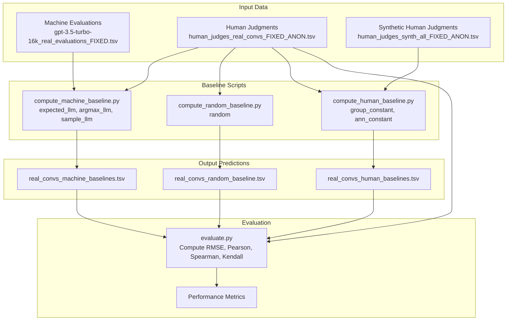
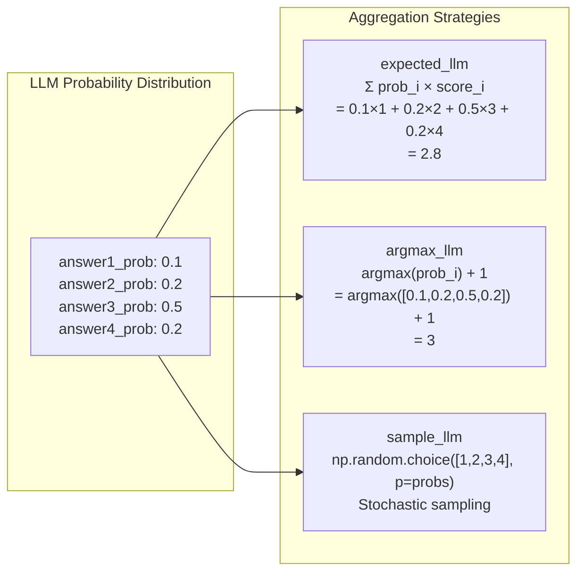
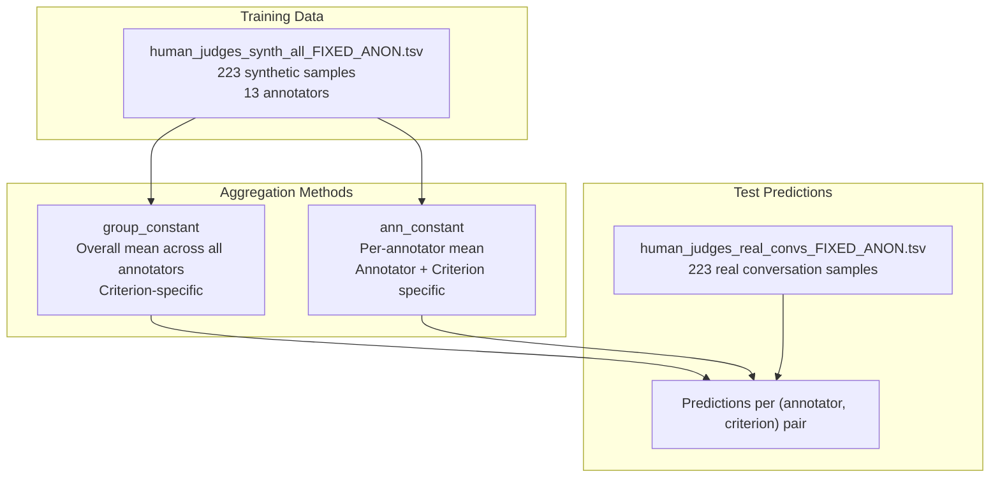
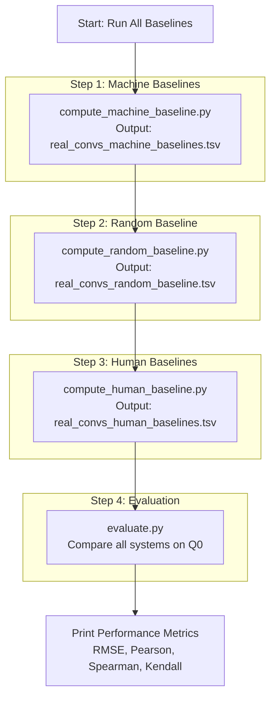
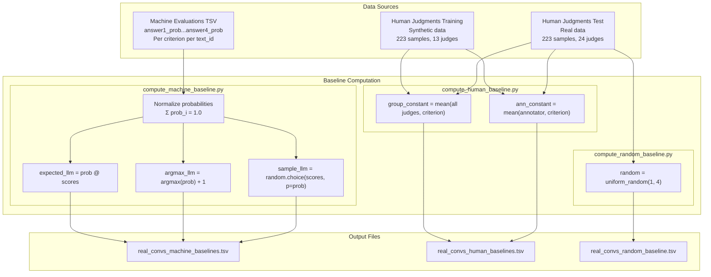

<!-- source: DeepWiki mcp.deepwiki.com · repo microsoft/LLM-Rubric · page 4.1 Computing Baselines · fetched 2026-10-26 -->

# Computing Baselines

<details>
<summary>Relevant source files</summary>

The following files were used as context for generating this wiki page:

- [README.md](README.md)
- [scripts/compute_machine_baseline.py](scripts/compute_machine_baseline.py)
- [scripts/run_real_data_baselines.sh](scripts/run_real_data_baselines.sh)

</details>


## Purpose and Scope

This page provides a step-by-step guide for computing baseline predictions that serve as comparison benchmarks for the LLM-Rubric model. Baselines are essential for quantifying the improvement that the PersonalizedCalibrationNetwork provides over simpler aggregation strategies.

This guide covers three types of baselines:
- **Machine baselines**: derived from LLM probability distributions (`expected_llm`, `argmax_llm`, `sample_llm`)
- **Human baselines**: derived from aggregating human judgments (`group_constant`, `ann_constant`)  
- **Random baseline**: uniform random sampling as a performance floor

For details on evaluating these baselines against ground truth, see [Evaluating Results](#4.4). For the underlying theory and comparison framework, see [Baseline Systems](#7).

---

## Overview of Baseline Systems

Baselines provide reference points for assessing model performance. Each baseline type represents a different strategy for predicting human judgments from available data.

### Baseline Computation Workflow



**Sources:** [scripts/run_real_data_baselines.sh:1-37](), [README.md:62-77]()

---

## Machine Baselines

Machine baselines derive predictions from the probability distributions output by the LLM evaluator (gpt-3.5-turbo-16k). Each rubric criterion has four possible answer scores (1, 2, 3, 4), and the LLM produces a probability distribution over these answers.

### Computing Machine Baselines

The script [scripts/compute_machine_baseline.py]() implements three aggregation strategies:



**Sources:** [scripts/compute_machine_baseline.py:22-33]()

### Implementation Details

#### Probability Normalization

The script first ensures all probability distributions sum to 1.0:

[scripts/compute_machine_baseline.py:24-28]()

This normalization handles edge cases where the LLM output may have rounding errors.

#### Baseline Calculation

Three baselines are computed per criterion:

| Baseline | Method | Formula | Code Reference |
|----------|--------|---------|----------------|
| `expected_llm` | Expected value | `E[X] = Σ p_i × score_i` | [scripts/compute_machine_baseline.py:31]() |
| `argmax_llm` | Most likely answer | `argmax(p_i) + 1` | [scripts/compute_machine_baseline.py:32]() |
| `sample_llm` | Stochastic sampling | `np.random.choice([1,2,3,4], p=probs)` | [scripts/compute_machine_baseline.py:33]() |

#### Output Format

For each human judgment, the script matches the corresponding machine evaluation by `text_id` and `criterion`, then creates a row with all three baseline predictions:

[scripts/compute_machine_baseline.py:36-54]()

The output TSV contains columns: `text_id`, `annotator_id`, `dialogue_system`, `criterion`, `sample_llm`, `argmax_llm`, `expected_llm`.

### Running Machine Baselines

Execute the script via the command line:

```bash
python scripts/compute_machine_baseline.py \
  --machine-evaluations data/real_data/gpt-3.5-turbo-16k_real_evaluations_FIXED.tsv \
  --human-judgments data/real_data/human_judges_real_convs_FIXED_ANON.tsv \
  --output-path experiments/real_data/predictions/real_convs_machine_baselines.tsv
```

**Parameters:**
- `--machine-evaluations`: Path to LLM probability distributions (TSV format, row-wise per criterion)
- `--human-judgments`: Path to human annotations (TSV format, columns Q0-Q8)
- `--output-path`: Destination for baseline predictions
- `--random-seed`: (Optional) Seed for `sample_llm` reproducibility (default: 4076609)
- `--criteria`: (Optional) Comma-separated list of criteria to evaluate (default: "Q1,Q2,Q3,Q4,Q5,Q6,Q7,Q8,Q0")

**Sources:** [scripts/compute_machine_baseline.py:10-16](), [scripts/run_real_data_baselines.sh:7-10]()

---

## Human Baselines

Human baselines aggregate existing human judgments to create simple statistical predictors. These baselines leverage the training set (synthetic data) to establish typical human response patterns.

### Baseline Types



**Sources:** [scripts/run_real_data_baselines.sh:23-26]()

### Computing Human Baselines

The script [scripts/compute_human_baseline.py]() implements two strategies:

1. **`group_constant`**: For each criterion, compute the mean score across all annotators and all samples in the training data. This single value is used for all predictions on that criterion.

2. **`ann_constant`**: For each (annotator, criterion) pair, compute the mean score across all samples in the training data where that annotator provided judgments. This personalized value is used for predictions involving that specific annotator-criterion combination.

### Running Human Baselines

Execute the script:

```bash
python scripts/compute_human_baseline.py \
  --train-human-judgments data/synth_data/human_judges_synth_all_FIXED_ANON.tsv \
  --human-judgments data/real_data/human_judges_real_convs_FIXED_ANON.tsv \
  --output-path experiments/real_data/predictions/real_convs_human_baselines.tsv
```

**Parameters:**
- `--train-human-judgments`: Path to training human judgments (synthetic data) for computing statistics
- `--human-judgments`: Path to test human judgments (real data) that defines which predictions to generate
- `--output-path`: Destination for baseline predictions

The output TSV contains columns: `text_id`, `annotator_id`, `dialogue_system`, `criterion`, `group_constant`, `ann_constant`.

**Sources:** [scripts/run_real_data_baselines.sh:23-26]()

---

## Random Baseline

The random baseline serves as a performance floor by generating uniform random predictions in the range [1, 4]. This baseline helps quantify whether more sophisticated methods perform better than chance.

### Computing Random Baseline

The script [scripts/compute_random_baseline.py]() generates random integers uniformly distributed across the four possible answer scores.

### Running Random Baseline

Execute the script:

```bash
python scripts/compute_random_baseline.py \
  --human-judgments data/real_data/human_judges_real_convs_FIXED_ANON.tsv \
  --output-path experiments/real_data/predictions/real_convs_random_baseline.tsv
```

**Parameters:**
- `--human-judgments`: Path to human annotations that defines which predictions to generate
- `--output-path`: Destination for baseline predictions
- `--random-seed`: (Optional) Seed for reproducibility

The output TSV contains columns: `text_id`, `annotator_id`, `dialogue_system`, `criterion`, `random`.

**Sources:** [scripts/run_real_data_baselines.sh:15-17]()

---

## Running All Baselines

The convenience script [scripts/run_real_data_baselines.sh]() executes all baseline computations and evaluates their performance in sequence.

### Complete Workflow



**Sources:** [scripts/run_real_data_baselines.sh:1-37]()

### Execution

Run the complete baseline pipeline:

```bash
bash scripts/run_real_data_baselines.sh
```

This script:
1. Computes machine baselines (`sample_llm`, `argmax_llm`, `expected_llm`)
2. Computes random baseline (`random`)
3. Computes human baselines (`group_constant`, `ann_constant`)
4. Evaluates all baselines on criterion Q0 (overall satisfaction)
5. Prints performance metrics

**Sources:** [scripts/run_real_data_baselines.sh:1-37]()

---

## Understanding Baseline Output

### Output Format

Each baseline script produces a TSV file with the following structure:

| Column | Description |
|--------|-------------|
| `text_id` | Unique identifier for the conversation |
| `annotator_id` | Human judge identifier |
| `dialogue_system` | System being evaluated (e.g., Azure service variant) |
| `criterion` | Rubric question (Q0-Q8) |
| `<system_name>` | Predicted score (1-4) for the baseline system |

Multiple baseline systems may be present in a single file (e.g., `sample_llm`, `argmax_llm`, `expected_llm` in machine baselines).

### Example Evaluation Results

When running [scripts/run_real_data_baselines.sh](), the evaluation step produces output similar to:

```
                            rmse   pearson  spearman   kendall    N      mean       std
criterion system
Q0        random        1.453309 -0.054438 -0.043663 -0.036858  223  2.587444  1.152196
          sample_llm    1.207228  0.039810  0.045245  0.040967  223  3.322870  0.794469
          argmax_llm    1.201643  0.140091  0.086990  0.081134  223  3.614350  0.563597
          expected_llm  0.918676  0.177301  0.086675  0.065928  223  3.282864  0.300516
```

This table shows:
- **rmse**: Root mean squared error (lower is better)
- **pearson**: Pearson correlation coefficient (higher is better, range [-1, 1])
- **spearman**: Spearman rank correlation (higher is better, range [-1, 1])
- **kendall**: Kendall tau correlation (higher is better, range [-1, 1])
- **N**: Number of predictions
- **mean**: Average predicted score
- **std**: Standard deviation of predictions

**Interpretation**: The `expected_llm` baseline typically performs best among machine baselines, achieving moderate correlation with human judgments. The LLM-Rubric model (see [Making Predictions](#4.3)) aims to improve upon these baseline correlations through personalized calibration.

**Sources:** [README.md:68-77](), [scripts/run_real_data_baselines.sh:29-36]()

---

## Baseline System Architecture Reference

The following diagram maps baseline types to their computational dependencies:



**Sources:** [scripts/compute_machine_baseline.py:1-62](), [scripts/run_real_data_baselines.sh:1-37]()

---

## Next Steps

After computing baselines:
- **Evaluate performance**: Use [scripts/evaluate.py]() to compute metrics (see [Evaluating Results](#4.4))
- **Train LLM-Rubric**: Compare baseline performance against the PersonalizedCalibrationNetwork (see [Training a Model](#4.2))
- **Understand baseline theory**: Read about the mathematical foundations of each baseline (see [Baseline Systems](#7))

---

