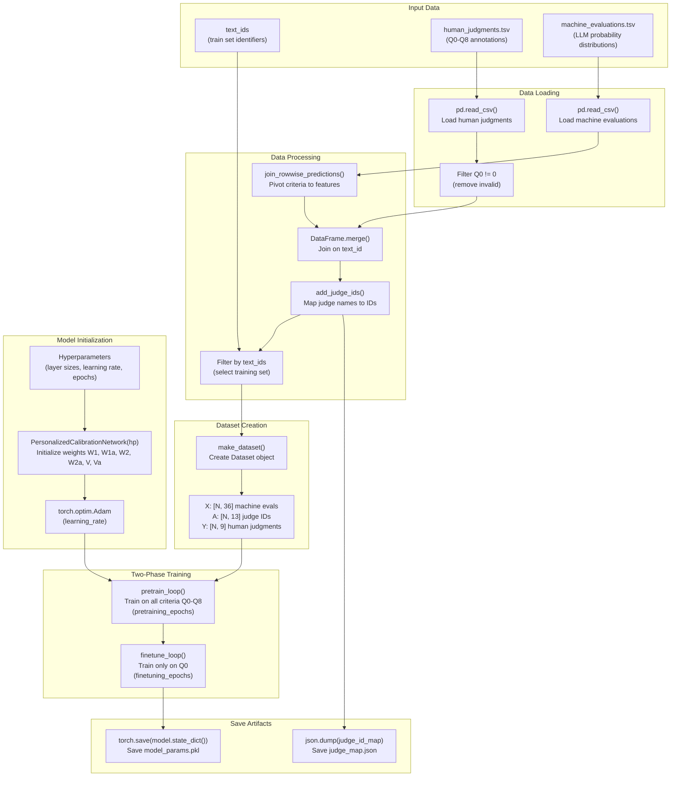
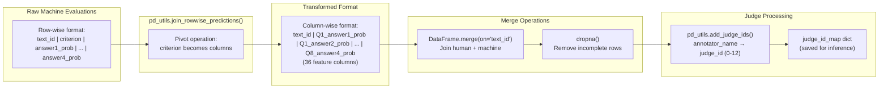
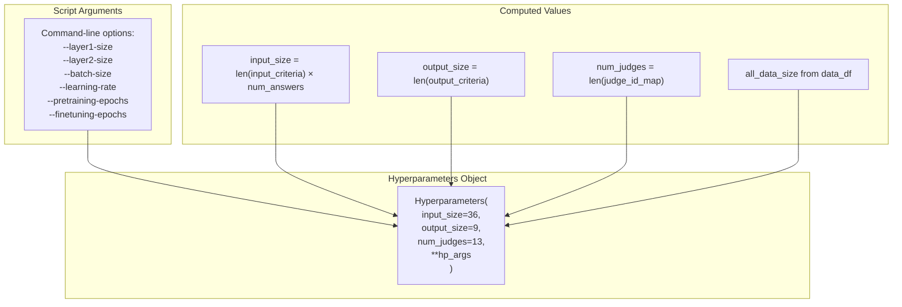
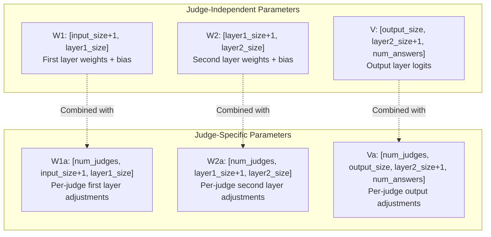
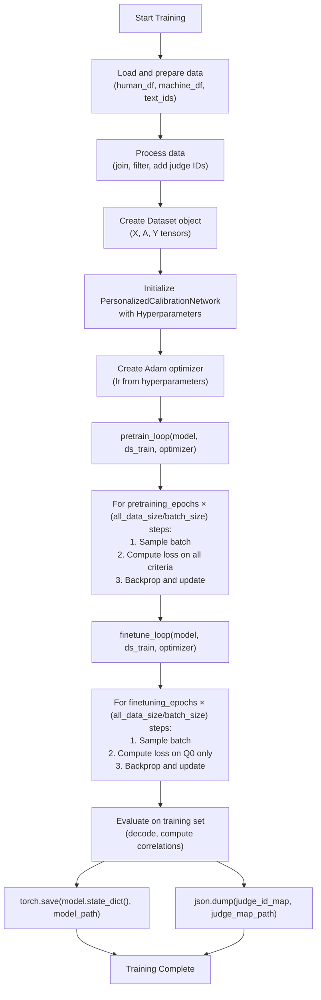

<!-- source: DeepWiki mcp.deepwiki.com · repo microsoft/LLM-Rubric · page 4.2 Training a Model · fetched 2026-10-26 -->

# Training a Model

<details>
<summary>Relevant source files</summary>

The following files were used as context for generating this wiki page:

- [README.md](README.md)
- [llm_rubric/model/torch_impl.py](llm_rubric/model/torch_impl.py)
- [scripts/llm_rubric_predict.py](scripts/llm_rubric_predict.py)
- [scripts/train_llm_rubric.py](scripts/train_llm_rubric.py)

</details>


This page describes how to train a `PersonalizedCalibrationNetwork` model using the LLM-Rubric framework. Training involves preparing data, configuring hyperparameters, and executing a two-phase training process (pretraining followed by finetuning) to learn judge-specific calibration parameters.

For information about hyperparameter optimization using cross-validation, see [Hyperparameter Tuning](#4.5). For information about using a trained model to generate predictions, see [Making Predictions](#4.3). For technical details about the neural network architecture, see [Network Architecture](#6.1) and [Training Process](#6.2).

---

## Overview

The training workflow transforms human judgments and machine evaluations into a trained neural network that can predict individual judge preferences. The system learns both judge-independent parameters (shared across all judges) and judge-specific parameters (personalized for each judge).

**Training Workflow Diagram**



**Sources:** [scripts/train_llm_rubric.py:20-176](), [llm_rubric/model/torch_impl.py:47-109](), [llm_rubric/model/torch_impl.py:165-210]()

---

## Prerequisites

Before training, you must have:

1. **Human Judgments**: TSV file with columns for `text_id`, `annotator_name`, and criteria columns `Q0` through `Q8`
2. **Machine Evaluations**: TSV file with columns for `text_id`, `criterion`, and probability distributions (`answer1_prob` through `answer4_prob`)
3. **Training Set IDs**: TSV file listing `text_id` values to include in training

The system filters out invalid entries where `Q0 == 0` during data loading.

**Sources:** [scripts/train_llm_rubric.py:42-68]()

---

## Data Preparation

### Loading and Filtering

The training script loads data and applies filtering:

| Step | Function/Operation | Purpose |
|------|-------------------|---------|
| 1. Load text IDs | `pd.read_csv(train_text_ids_path)` | Identify training samples |
| 2. Load human judgments | `pd.read_csv(human_path)` | Load ground truth annotations |
| 3. Filter invalid rows | `human_df[human_df["Q0"] != 0]` | Remove annotations with Q0=0 |
| 4. Load machine evaluations | `pd.read_csv(machine_path)` | Load LLM probability distributions |

**Sources:** [scripts/train_llm_rubric.py:42-54]()

### Data Transformation



**Sources:** [scripts/train_llm_rubric.py:46-73](), [llm_rubric/pd_utils.py]()

### Dataset Creation

The `make_dataset()` function converts the processed DataFrame into a `Dataset` object containing three tensors:

- **X (machine_evaluations)**: Shape `[N, 36]`, dtype `float32` - LLM probability distributions for 9 criteria × 4 answers
- **A (human_judges)**: Shape `[N, 13]`, dtype `int64` - One-hot encoded judge identifiers
- **Y (human_judgments)**: Shape `[N, 9]`, dtype `int64` - Human judgment scores (1-4) for criteria Q1-Q8 and Q0

**Sources:** [scripts/train_llm_rubric.py:147](), [llm_rubric/model/torch_impl.py:25-44]()

---

## Hyperparameter Configuration

Hyperparameters are specified via the `Hyperparameters` dataclass:

### Core Parameters

| Parameter | Type | Description | Typical Value |
|-----------|------|-------------|---------------|
| `input_size` | int | Number of input features (criteria × answers) | 36 |
| `output_size` | int | Number of output criteria | 9 |
| `num_judges` | int | Number of unique judges | 13 |
| `all_data_size` | int | Total training samples (for batch calculation) | 223 |

### Network Architecture Parameters

| Parameter | Default | Description |
|-----------|---------|-------------|
| `layer1_size` | 100 | Hidden units in first layer | 
| `layer2_size` | 100 | Hidden units in second layer |
| `num_answers` | 4 | Number of response options per criterion |

### Training Parameters

| Parameter | Default | Description |
|-----------|---------|-------------|
| `batch_size` | 32 | Mini-batch size for SGD |
| `learning_rate` | 0.01 | Adam optimizer learning rate |
| `pretraining_epochs` | 50 | Epochs for pretraining phase |
| `finetuning_epochs` | 50 | Epochs for finetuning phase |
| `random_seed` | 43 | Random seed for reproducibility |
| `finetune_output` | -1 | Index of criterion to finetune on (Q0) |

**Hyperparameter Creation in Code:**



**Sources:** [scripts/train_llm_rubric.py:78-105](), [llm_rubric/model/torch_impl.py:8-22]()

---

## Two-Phase Training Process

### Model Initialization

The `PersonalizedCalibrationNetwork` initializes with six weight matrices:



**Sources:** [llm_rubric/model/torch_impl.py:56-109]()

### Phase 1: Pretraining

**Function:** `pretrain_loop(model, dataset, optimizer)`

Pretraining optimizes the model to predict all criteria (Q1-Q8 and Q0) simultaneously.

**Algorithm:**
1. Calculate total steps: `pretraining_epochs × (all_data_size / batch_size)`
2. For each step:
   - Sample random batch indices
   - Extract batch data: `X[batch_index]`, `A[batch_index]`, `Y[batch_index]`
   - Compute cross-entropy loss on all criteria
   - Backpropagate and update parameters

**Loss Function:**
```
loss = CrossEntropyLoss(logits, Y-1)
```
Note: Y values (1-4) are shifted to 0-indexed (0-3) for cross-entropy calculation.

**Sources:** [llm_rubric/model/torch_impl.py:165-184]()

### Phase 2: Finetuning

**Function:** `finetune_loop(model, dataset, optimizer)`

Finetuning focuses exclusively on the summary criterion Q0, which typically assesses overall quality or satisfaction.

**Algorithm:**
1. Calculate total steps: `finetuning_epochs × (all_data_size / batch_size)`
2. For each step:
   - Sample random batch indices
   - Extract batch data: `X[batch_index]`, `A[batch_index]`, `Y[batch_index]`
   - Compute cross-entropy loss **only on Q0** (index -1)
   - Backpropagate and update parameters

**Loss Function:**
```
loss = CrossEntropyLoss(logits[:, :, [-1]], Y[:, [-1]] - 1)
```

The `I=[finetune_output]` parameter in `model.loss()` restricts loss calculation to the specified criterion index.

**Sources:** [llm_rubric/model/torch_impl.py:186-210](), [llm_rubric/model/torch_impl.py:137-149]()

### Training Loop Comparison

| Aspect | Pretraining | Finetuning |
|--------|------------|------------|
| **Criteria trained** | All (Q0-Q8) | Only Q0 (summary) |
| **Loss calculation** | `model.loss(X, A, Y)` | `model.loss(X, A, Y, I=[-1])` |
| **Purpose** | Learn general patterns | Specialize on primary outcome |
| **Batch sampling** | Random with replacement | Random with replacement |
| **Optimizer state** | Preserved across phases | Continues from pretraining |

**Sources:** [llm_rubric/model/torch_impl.py:165-210]()

---

## Training Execution Flow



**Sources:** [scripts/train_llm_rubric.py:147-173]()

---

## Model Artifacts

After training, two files are saved:

### 1. Model Parameters (`model_params.pkl`)

Binary file containing the PyTorch model state dictionary with all trained weights:
- `W1`, `W1a` - First layer parameters (judge-independent and judge-specific)
- `W2`, `W2a` - Second layer parameters
- `V`, `Va` - Output layer parameters

**Save operation:**
```python
torch.save(model.state_dict(), model_path)
```

**Sources:** [scripts/train_llm_rubric.py:169]()

### 2. Judge Mapping (`judge_map.json`)

JSON file mapping judge names to integer IDs:
```json
{
  "judge_name_1": 0,
  "judge_name_2": 1,
  ...
  "judge_name_N": N-1
}
```

This mapping ensures consistent judge ID assignment during inference.

**Save operation:**
```python
json.dump(judge_id_map, judge_map_path)
```

**Sources:** [scripts/train_llm_rubric.py:170-172]()

---

## Running the Training Script

### Command Structure

```bash
python scripts/train_llm_rubric.py \
  --ids <train_text_ids.tsv> \
  --human-judgments <human_judgments.tsv> \
  --machine-evaluations <machine_evaluations.tsv> \
  --model-path <output_model.pkl> \
  --judge-map <output_judge_map.json> \
  [--layer1-size 25] \
  [--layer2-size 25] \
  [--batch-size 64] \
  [--learning-rate 0.001] \
  [--pretraining-epochs 20] \
  [--finetuning-epochs 30]
```

### Required Arguments

| Argument | Description |
|----------|-------------|
| `--ids` | Path to TSV file with training `text_id` values |
| `--human-judgments` | Path to human annotations TSV |
| `--machine-evaluations` | Path to LLM evaluations TSV |
| `--model-path` | Output path for trained model weights |
| `--judge-map` | Output path for judge ID mapping JSON |

### Optional Hyperparameter Arguments

All hyperparameters from the `Hyperparameters` class can be overridden via command-line flags. If not specified, default values are used.

**Sources:** [scripts/train_llm_rubric.py:20-41]()

### Example: Training on Synthetic Data

From the README workflow:

```bash
bash scripts/train_llm_rubric_for_real_data_eval.sh
```

This script uses pre-optimized hyperparameters stored in:
```
experiments/real_data/best_synth_cross-validation_hp.json
```

**Sources:** [README.md:79-93]()

---

## Training Metrics

The script outputs training metrics after both phases:

### During Training

No metrics are printed during the training loops. Progress can be monitored by the number of steps completed.

### Post-Training Evaluation

After finetuning, the script evaluates the model on the training set and prints:

```
Train Loss (FT) <loss_value>
Train pearsonr <correlation>
Train spearmanr <correlation>
Train kendallt <correlation>
```

**Metric Calculation:**
- **Loss**: Cross-entropy on Q0 predictions
- **Pearson r**: Linear correlation between predicted and actual Q0 scores
- **Spearman ρ**: Rank correlation between predicted and actual Q0 scores
- **Kendall τ**: Concordance correlation between predicted and actual Q0 scores

**Computation:**
```python
yhat = model.decode(ds_train.X, ds_train.A, I=[-1])[:, 0]  # Predictions
y = ds_train.Y[:, -1]  # Actual Q0 scores
```

**Sources:** [scripts/train_llm_rubric.py:156-166]()

---

## Training Data Requirements

The training process expects specific data characteristics:

| Property | Requirement | Notes |
|----------|-------------|-------|
| **Minimum samples** | Sufficient for batch_size × epochs | Typical: 200+ samples |
| **Judge coverage** | Multiple samples per judge | Enables learning judge-specific parameters |
| **Criterion coverage** | All Q0-Q8 labeled | Required for pretraining phase |
| **Data format** | TSV with proper columns | See [Data Formats and Schema](#5.1) |
| **Missing values** | Handled via filtering | Q0=0 entries are excluded |

**Sources:** [scripts/train_llm_rubric.py:42-76]()

---

## Common Training Configurations

Based on the repository's best practices:

### Synthetic Data Training (for Real Data Evaluation)

```json
{
  "input_size": 36,
  "output_size": 9,
  "num_judges": 13,
  "all_data_size": 223,
  "batch_size": 64,
  "learning_rate": 0.001,
  "layer1_size": 25,
  "layer2_size": 25,
  "pretraining_epochs": 20,
  "finetuning_epochs": 30
}
```

**Sources:** [README.md:82-85]()

### Training Step Calculation

Total training steps = (pretraining_steps) + (finetuning_steps)

Where:
- `pretraining_steps = pretraining_epochs × (all_data_size / batch_size)`
- `finetuning_steps = finetuning_epochs × (all_data_size / batch_size)`

For the configuration above:
- Pretraining: 20 × (223 / 64) ≈ 70 steps
- Finetuning: 30 × (223 / 64) ≈ 105 steps
- Total: ~175 steps

**Sources:** [llm_rubric/model/torch_impl.py:168-170](), [llm_rubric/model/torch_impl.py:189-191]()

---

## Next Steps

After training a model:
1. **Evaluate performance**: See [Evaluating Results](#4.4) to compute metrics on test data
2. **Make predictions**: See [Making Predictions](#4.3) to use the trained model on new data
3. **Optimize hyperparameters**: See [Hyperparameter Tuning](#4.5) for cross-validation strategies

For technical details about the training algorithm, see [Training Process](#6.2). For information about the network architecture, see [Network Architecture](#6.1).

---

