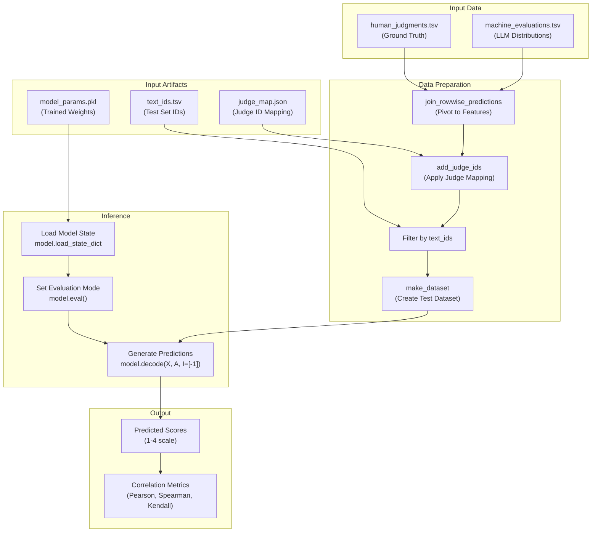
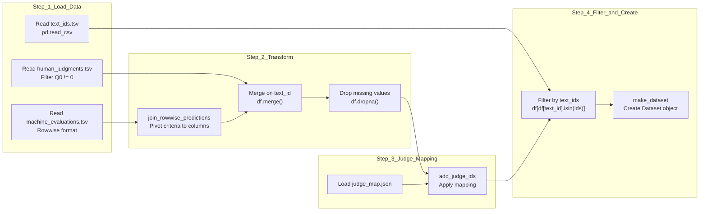
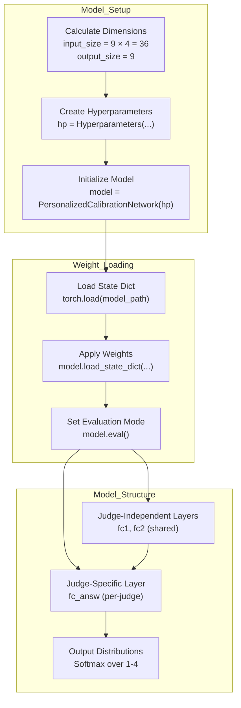
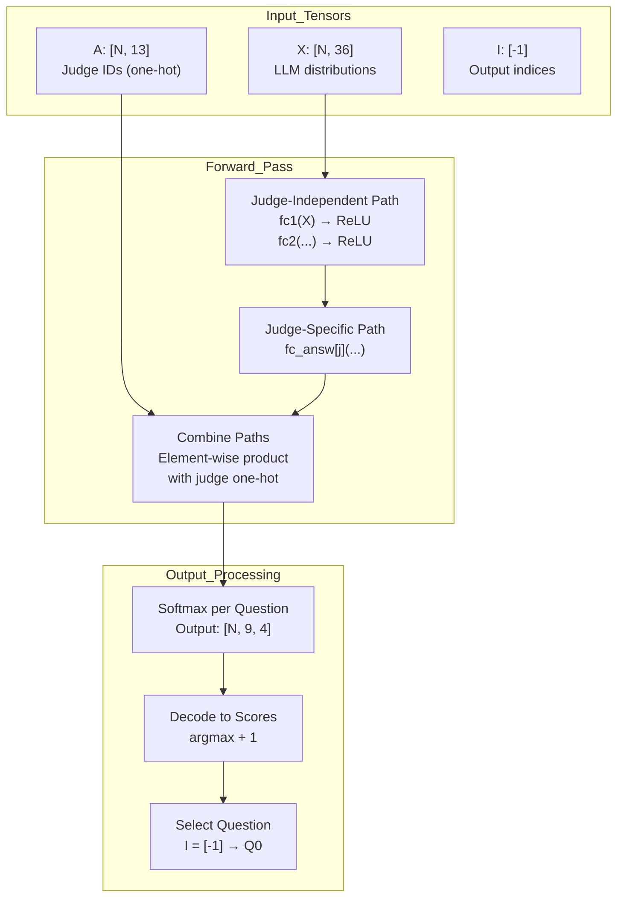
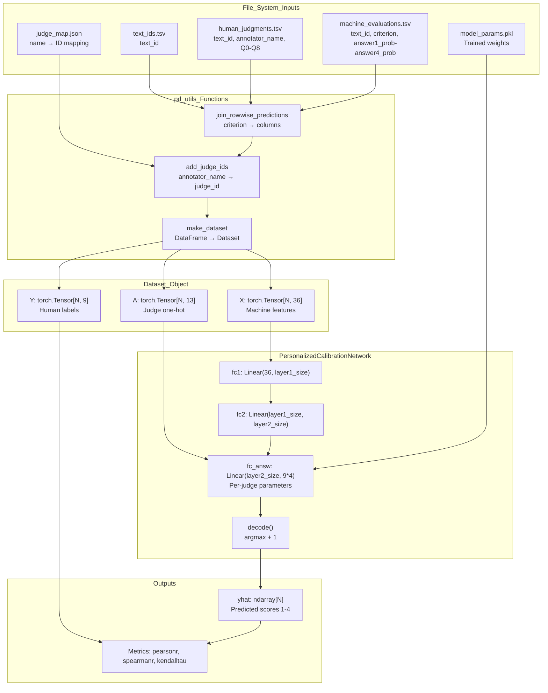

<!-- source: DeepWiki mcp.deepwiki.com · repo microsoft/LLM-Rubric · page 4.3 Making Predictions · fetched 2026-10-26 -->

# Making Predictions

<details>
<summary>Relevant source files</summary>

The following files were used as context for generating this wiki page:

- [README.md](README.md)
- [scripts/llm_rubric_predict.py](scripts/llm_rubric_predict.py)
- [scripts/train_llm_rubric.py](scripts/train_llm_rubric.py)

</details>


## Purpose and Scope

This page explains how to use a trained `PersonalizedCalibrationNetwork` to generate predictions on new data. The prediction process takes a trained model and applies it to a test dataset to produce calibrated scores that match individual human judge preferences. After reading this page, you will understand how to run the prediction script, what inputs are required, and how to interpret the outputs.

For information about training a model, see [Training a Model](#4.2). For information about computing evaluation metrics on predictions, see [Evaluating Results](#4.4).

**Sources:** [README.md:92-103](), [scripts/llm_rubric_predict.py:1-122]()

---

## Prerequisites

Before making predictions, you must have the following artifacts from training:

| Artifact | Description | Typical Location |
|----------|-------------|------------------|
| **Model Parameters** | Trained neural network weights saved via `torch.save()` | `experiments/real_data/model_params.pkl` |
| **Judge Map** | JSON mapping from judge names to integer IDs | `experiments/real_data/judge_map.json` |
| **Test Text IDs** | TSV file specifying which conversations to evaluate | `data/real_conversations/text_ids.tsv` |
| **Human Judgments** | TSV file with human annotations | `data/real_conversations/human_judgments.tsv` |
| **Machine Evaluations** | TSV file with LLM probability distributions | `data/real_conversations/machine_evaluations.tsv` |

The model parameters file contains the trained weights for both judge-independent and judge-specific layers. The judge map ensures that judge IDs used during prediction match those used during training, which is critical for the personalized calibration to work correctly.

**Sources:** [scripts/llm_rubric_predict.py:24-25, 61-64, 102](), [scripts/train_llm_rubric.py:168-172]()

---

## Prediction Workflow Overview



**Workflow Explanation:**

1. **Artifact Loading**: The trained model weights and judge mapping are loaded from disk
2. **Data Preparation**: Machine evaluations are pivoted into feature columns, merged with human judgments, and filtered to the test set
3. **Judge ID Assignment**: Judge names are converted to integer IDs using the saved mapping
4. **Dataset Creation**: Input features (X), judge IDs (A), and ground truth labels (Y) are assembled into tensors
5. **Model Initialization**: A `PersonalizedCalibrationNetwork` instance is created with the same hyperparameters used during training
6. **Weight Loading**: Trained parameters are loaded into the model
7. **Inference**: The model generates predictions in evaluation mode (no gradient computation)
8. **Metric Computation**: Predictions are compared against ground truth using correlation metrics

**Sources:** [scripts/llm_rubric_predict.py:20-118]()

---

## Running the Prediction Script

### Command Structure

The prediction script is located at [scripts/llm_rubric_predict.py]() and is invoked via the shell script:

```bash
bash scripts/predict_llm_rubric_for_real_data_eval.sh
```

This shell script internally calls `llm_rubric_predict.py` with the appropriate parameters.

### Key Parameters

The script accepts the following command-line arguments:

| Parameter | Flag | Description | Example Value |
|-----------|------|-------------|---------------|
| `test_text_ids_path` | `--ids` | Path to TSV file with test conversation IDs | `data/real_conversations/text_ids.tsv` |
| `human_path` | `--human-judgments` | Path to TSV file with human annotations | `data/real_conversations/human_judgments.tsv` |
| `machine_path` | `--machine-evaluations` | Path to TSV file with LLM probability distributions | `data/real_conversations/machine_evaluations.tsv` |
| `model_path` | (positional) | Path to saved model parameters (.pkl file) | `experiments/real_data/model_params.pkl` |
| `judge_map_path` | `--judge-map` | Path to JSON file with judge ID mapping | `experiments/real_data/judge_map.json` |

Additional parameters control the data processing and model configuration:

- `text_id_column`: Column name for conversation IDs (default: `"text_id"`)
- `criterion_column`: Column name for rubric questions (default: `"criterion"`)
- `input_criteria`: List of input questions (default: `["Q1", ..., "Q8", "Q0"]`)
- `output_criteria`: List of output questions to predict (default: `["Q1", ..., "Q8", "Q0"]`)
- `num_answers`: Number of possible answers per question (default: `4`)
- `judge_column`: Column name for judge identifiers (default: `"annotator_name"`)
- `judge_id_column`: Column name for integer judge IDs (default: `"judge_id"`)

### Hyperparameter Override Options

The script accepts optional hyperparameter overrides that must match the training configuration:

- `layer1_size`: Size of first hidden layer
- `layer2_size`: Size of second hidden layer
- `batch_size`: Batch size for data loading
- `learning_rate`: Learning rate (not used during prediction, but part of `Hyperparameters` object)
- `pretraining_epochs`: Number of pretraining epochs (metadata only)
- `finetuning_epochs`: Number of finetuning epochs (metadata only)

**Sources:** [scripts/llm_rubric_predict.py:20-41, 78-100]()

---

## Internal Prediction Process

### Data Loading and Preparation



The data preparation follows these steps, implemented in [scripts/llm_rubric_predict.py:42-105]():

1. **Load Text IDs**: Read the test set conversation IDs from TSV
2. **Load Human Judgments**: Read annotations and filter out invalid entries where `Q0 == 0`
3. **Load Machine Evaluations**: Read LLM probability distributions in row-wise format
4. **Pivot Machine Data**: Use `pd_utils.join_rowwise_predictions()` to convert row-wise data (one row per criterion) into column-wise features (e.g., `Q1_answer1_prob`, `Q1_answer2_prob`, etc.)
5. **Merge Datasets**: Join human judgments with machine evaluations on `text_id`
6. **Load Judge Mapping**: Read the judge ID mapping from JSON
7. **Assign Judge IDs**: Use `pd_utils.add_judge_ids()` with the pre-existing mapping to ensure consistency with training
8. **Filter to Test Set**: Keep only rows where `text_id` is in the test set
9. **Create Dataset**: Use `pd_utils.make_dataset()` to construct a `Dataset` object with tensors `X` (features), `A` (judge IDs), and `Y` (labels)

**Sources:** [scripts/llm_rubric_predict.py:42-105](), [llm_rubric/pd_utils.py]()

---

### Model Initialization and Loading



The model initialization process in [scripts/llm_rubric_predict.py:73-103]() consists of:

1. **Dimension Calculation**: 
   - `input_size = len(input_criteria) × num_answers = 9 × 4 = 36`
   - `output_size = len(output_criteria) = 9`
   - `num_judges = len(judge_id_map)` (from loaded judge map)

2. **Hyperparameter Object Creation**: A `Hyperparameters` object is instantiated with the same configuration used during training. This includes layer sizes, batch size, learning rate, and epoch counts.

3. **Model Instantiation**: `PersonalizedCalibrationNetwork(hp)` creates a new model with randomly initialized weights.

4. **Weight Loading**: `model.load_state_dict(torch.load(model_path))` loads the trained parameters from disk, overwriting the random initialization.

5. **Evaluation Mode**: `model.eval()` switches the model to evaluation mode, which:
   - Disables dropout (if present)
   - Disables batch normalization updates
   - Signals that gradients should not be computed

**Sources:** [scripts/llm_rubric_predict.py:73-103](), [llm_rubric/model/torch_impl.py]()

---

### Generating Predictions

The prediction generation occurs in [scripts/llm_rubric_predict.py:108-117]():

```python
yhat = model.decode(ds_test.X, ds_test.A, I=[-1])[:, 0].detach().numpy()
y = ds_test.Y[:,-1].detach().numpy()
```

**Key Method: `model.decode()`**

The `decode()` method performs the following operations:



**Decoding Process:**

1. **Forward Pass**: The model computes probability distributions over answer choices (1-4) for each question (Q1-Q8, Q0)

2. **Answer Selection**: The `decode()` method converts probability distributions to discrete predictions by taking `argmax(prob) + 1`, mapping 0-indexed probabilities to 1-4 scores

3. **Question Selection**: The parameter `I=[-1]` specifies to return predictions for the last question (Q0, the overall satisfaction question)

4. **Detaching and Conversion**: `.detach().numpy()` converts the PyTorch tensor to a NumPy array, detaching it from the computation graph since gradients are not needed

The output `yhat` is a 1D NumPy array of shape `[N]` containing predicted scores (1-4) for each test sample on question Q0.

**Sources:** [scripts/llm_rubric_predict.py:108-109](), [llm_rubric/model/torch_impl.py]()

---

## Understanding Prediction Outputs

### Computed Metrics

The prediction script automatically computes three correlation metrics and prints them to console:

```python
p_corr, _ = stats.pearsonr(y, yhat)
s_corr, _ = stats.spearmanr(y, yhat)
t_corr, _ = stats.kendalltau(y, yhat)
print("test pearsonr", p_corr) 
print("test spearmanr", s_corr) 
print("test kendallt", t_corr)
```

Example output from [README.md:93-102]():

```
Number of judges
24
Total rows: 223
9 4
test pearsonr 0.31304019363805424
test spearmanr 0.367664375396213
test kendallt 0.29084198763627717
```

### Metric Interpretations

| Metric | Range | Interpretation | Use Case |
|--------|-------|----------------|----------|
| **Pearson Correlation** | -1 to +1 | Measures linear relationship between predictions and ground truth | Best for assessing if predictions are proportionally correct |
| **Spearman Correlation** | -1 to +1 | Measures monotonic relationship (rank-based) | Better for ordinal data like 1-4 scales; robust to outliers |
| **Kendall's Tau** | -1 to +1 | Measures ordinal association (concordant vs discordant pairs) | More conservative; less sensitive to ties |

**Values above 0.3** indicate moderate positive correlation, suggesting the model's predictions align reasonably well with human judgments. The Spearman correlation is typically highest for this task since it captures rank ordering, which is most relevant for ordinal ratings.

**Note on RMSE**: The script includes commented-out code for computing Root Mean Squared Error (RMSE). To use RMSE, the model must be trained with an RMSE loss function rather than the default log-loss. See [scripts/llm_rubric_predict.py:110, 114]().

**Sources:** [scripts/llm_rubric_predict.py:108-117](), [README.md:93-102]()

---

## Prediction Data Flow



**Key Data Transformations:**

1. **TSV → DataFrame**: Raw data files are read using `pd.read_csv(sep="\t")`
2. **Row-wise → Column-wise**: Machine evaluations pivot from one row per criterion to multiple columns per text_id
3. **Names → IDs**: Judge names are mapped to integer IDs for efficient neural network processing
4. **DataFrame → Tensors**: The `make_dataset()` function converts pandas DataFrames to PyTorch tensors
5. **Tensors → Predictions**: The model's forward pass processes tensors through neural network layers
6. **Probabilities → Scores**: The `decode()` method converts probability distributions to discrete 1-4 scores
7. **Scores → Metrics**: NumPy arrays are passed to scipy.stats functions for correlation computation

**Sources:** [scripts/llm_rubric_predict.py:1-122](), [llm_rubric/pd_utils.py](), [llm_rubric/model/torch_impl.py]()

---

## Common Issues and Solutions

### Judge ID Mismatch

**Problem**: Predictions fail or produce incorrect results due to judge ID inconsistency between training and prediction.

**Solution**: Always use the same `judge_map.json` file that was saved during training. The `add_judge_ids()` function in prediction mode accepts a `judge_id_map` parameter to ensure consistency [scripts/llm_rubric_predict.py:61-64]().

### Missing Test Text IDs

**Problem**: Some text IDs in the test set don't appear in the human judgments or machine evaluations.

**Solution**: The script automatically drops rows with missing values using `df.dropna()` [scripts/llm_rubric_predict.py:58](). Ensure all test text IDs have corresponding annotations and evaluations.

### Hyperparameter Mismatch

**Problem**: Model architecture doesn't match the saved weights if hyperparameters differ from training.

**Solution**: Either load hyperparameters from the training configuration or pass them explicitly when running the prediction script. The `Hyperparameters` object must match the training configuration for weight loading to succeed.

### Model Not in Evaluation Mode

**Problem**: Forgetting to call `model.eval()` can cause unexpected behavior with dropout or batch normalization layers.

**Solution**: The script automatically sets evaluation mode at [scripts/llm_rubric_predict.py:103](). When using the model programmatically, always call `model.eval()` before inference.

**Sources:** [scripts/llm_rubric_predict.py:58, 61-64, 94-103]()

---

