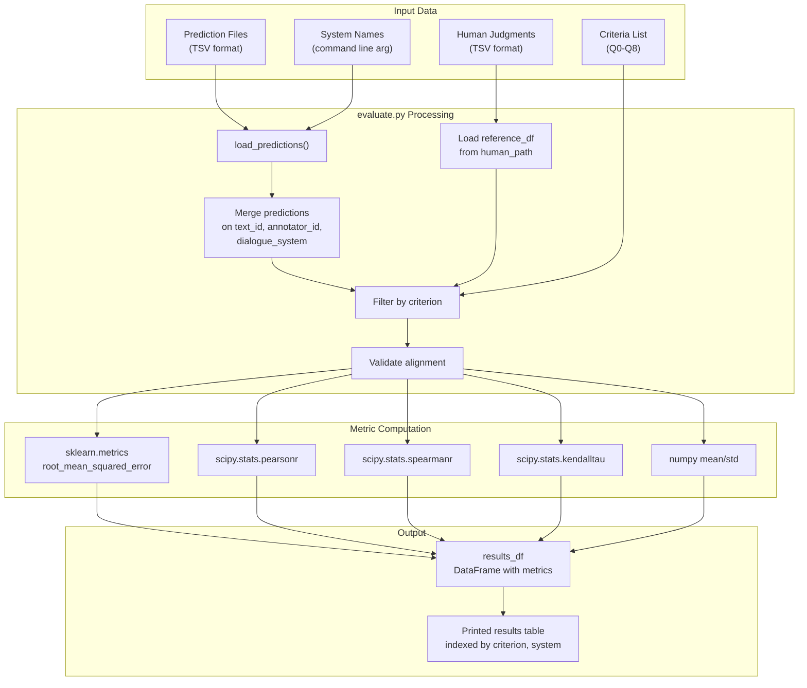
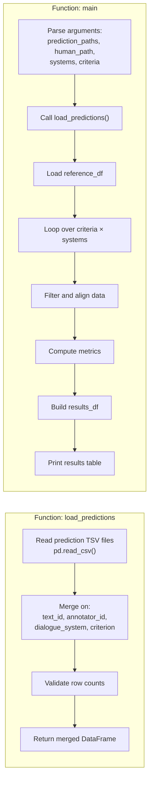
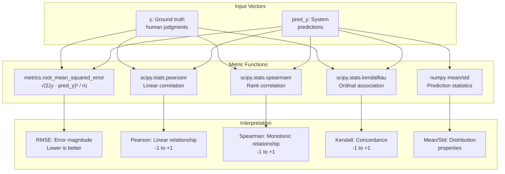
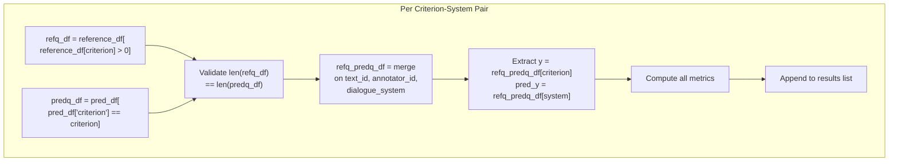
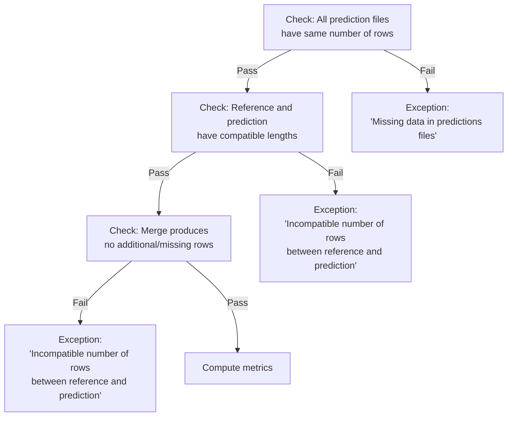
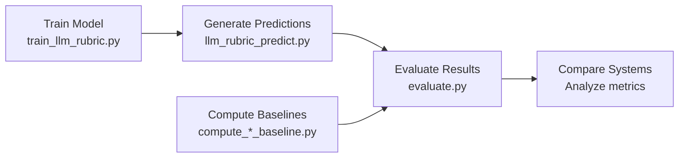

<!-- source: DeepWiki mcp.deepwiki.com · repo microsoft/LLM-Rubric · page 4.4 Evaluating Results · fetched 2026-10-26 -->

# Evaluating Results

<details>
<summary>Relevant source files</summary>

The following files were used as context for generating this wiki page:

- [README.md](README.md)
- [scripts/evaluate.py](scripts/evaluate.py)

</details>


## Purpose and Scope

This page describes how to evaluate predictions from the LLM-Rubric model and baseline systems against human judgments. The evaluation process computes multiple correlation metrics (Pearson, Spearman, Kendall's tau) and RMSE to measure agreement between predicted and actual human annotations. This enables systematic comparison of different approaches to assess which produces predictions that best align with human judgment patterns.

For information about generating predictions from a trained model, see [Making Predictions](#4.3). For computing baseline predictions, see [Computing Baselines](#4.1). For understanding the metrics in the context of hyperparameter optimization, see [Hyperparameter Tuning](#4.5).

## Evaluation Overview

The LLM-Rubric system evaluates predictions by comparing them against ground-truth human judgments across multiple criteria (Q0-Q8). The evaluation framework supports comparing multiple systems simultaneously, enabling direct performance comparisons between the LLM-Rubric model and various baseline approaches.

### Evaluation Workflow



**Sources:** [scripts/evaluate.py:1-69]()

## The evaluate.py Script

The evaluation script [scripts/evaluate.py:1-69]() provides a unified interface for computing metrics across different prediction systems. It implements data loading, alignment validation, and metric computation in a single workflow.

### Core Functions

| Function | Purpose | Lines |
|----------|---------|-------|
| `load_predictions()` | Load and merge multiple prediction files | [scripts/evaluate.py:12-21]() |
| `main()` | Primary evaluation workflow | [scripts/evaluate.py:23-68]() |

### Script Architecture



**Sources:** [scripts/evaluate.py:12-68]()

## Input Requirements

The evaluation script requires specific input formats to ensure proper data alignment and metric computation.

### Required Arguments

| Argument | Type | Description | Example |
|----------|------|-------------|---------|
| `prediction_paths` | List[Path] | Paths to prediction TSV files | Multiple files, one per system |
| `--human-judgments` | Path | Path to human judgment TSV file | `data/real/human_judgments.tsv` |
| `--systems` | str | Comma-separated system names | `"random,expected_llm,llm_rubric"` |
| `--criteria` | str | Comma-separated criteria (default: all) | `"Q1,Q2,Q3,Q4,Q5,Q6,Q7,Q8,Q0"` |

### Prediction File Format

Prediction files must be TSV format with the following columns:

| Column | Type | Description |
|--------|------|-------------|
| `text_id` | string | Unique conversation identifier |
| `annotator_id` | string | Human judge identifier |
| `dialogue_system` | string | System being evaluated (e.g., "azure", "bing") |
| `criterion` | string | Rubric criterion (Q0-Q8) |
| `[system_name]` | float | Predicted score (1-4 scale) |

All prediction files must contain identical sets of `(text_id, annotator_id, dialogue_system, criterion)` tuples for proper alignment.

**Sources:** [scripts/evaluate.py:12-21](), [scripts/evaluate.py:33-48]()

## Metrics Computed

The evaluation script computes five key metrics for each criterion-system combination:

### Metric Definitions



**Sources:** [scripts/evaluate.py:53-59]()

### Metric Details

| Metric | Implementation | Range | Interpretation |
|--------|---------------|-------|----------------|
| **RMSE** | `sklearn.metrics.root_mean_squared_error()` | [0, ∞) | Root mean squared error; measures absolute prediction error magnitude. Lower values indicate better agreement. |
| **Pearson** | `scipy.stats.pearsonr().statistic` | [-1, 1] | Linear correlation coefficient; measures linear relationship strength. Values near 1 indicate strong positive correlation. |
| **Spearman** | `scipy.stats.spearmanr().statistic` | [-1, 1] | Rank correlation coefficient; measures monotonic relationship. More robust to outliers than Pearson. |
| **Kendall** | `scipy.stats.kendalltau().statistic` | [-1, 1] | Kendall's tau; measures ordinal association. Interprets concordance between ranking pairs. |
| **Mean** | `numpy.mean()` | [1, 4] | Average predicted score; indicates central tendency of predictions. |
| **Std** | `numpy.std()` | [0, ∞) | Standard deviation; indicates prediction variance. |

**Sources:** [scripts/evaluate.py:53-59]()

## Running Evaluations

### Basic Usage

To evaluate a single system:

```bash
python scripts/evaluate.py \
    path/to/predictions.tsv \
    --human-judgments data/real/human_judgments.tsv \
    --systems system_name \
    --criteria Q0,Q1,Q2,Q3,Q4,Q5,Q6,Q7,Q8
```

### Comparing Multiple Systems

To compare multiple systems (e.g., baselines and LLM-Rubric):

```bash
python scripts/evaluate.py \
    experiments/real_data/predictions_random.tsv \
    experiments/real_data/predictions_sample_llm.tsv \
    experiments/real_data/predictions_argmax_llm.tsv \
    experiments/real_data/predictions_expected_llm.tsv \
    experiments/real_data/predictions_llm_rubric.tsv \
    --human-judgments data/real/human_judgments.tsv \
    --systems random,sample_llm,argmax_llm,expected_llm,llm_rubric
```

The order of prediction files must match the order of system names in the `--systems` argument.

**Sources:** [README.md:64-75]()

### Evaluation Data Flow



**Sources:** [scripts/evaluate.py:39-60]()

## Output Format

The evaluation script produces a pandas DataFrame indexed by `(criterion, system)` with the following columns:

### Example Output

```
                            rmse   pearson  spearman   kendall    N      mean       std
criterion system
Q0        random        1.453309 -0.054438 -0.043663 -0.036858  223  2.587444  1.152196
          sample_llm    1.207228  0.039810  0.045245  0.040967  223  3.322870  0.794469
          argmax_llm    1.201643  0.140091  0.086990  0.081134  223  3.614350  0.563597
          expected_llm  0.918676  0.177301  0.086675  0.065928  223  3.282864  0.300516
          llm_rubric    0.832458  0.313040  0.367664  0.290842  223  3.156000  0.425123
```

### Column Descriptions

| Column | Description |
|--------|-------------|
| `criterion` | Rubric question (Q0-Q8) |
| `system` | Prediction system name |
| `rmse` | Root mean squared error |
| `pearson` | Pearson correlation coefficient |
| `spearman` | Spearman rank correlation |
| `kendall` | Kendall's tau coefficient |
| `N` | Number of examples evaluated |
| `mean` | Average predicted score |
| `std` | Standard deviation of predictions |

**Sources:** [scripts/evaluate.py:62-64](), [README.md:69-75]()

## Interpreting Results

### Comparative Analysis

The multi-indexed output enables easy comparison:

1. **Within a criterion**: Compare different systems' performance on the same question
2. **Within a system**: Examine how one system performs across different criteria
3. **Overall performance**: Q0 (overall satisfaction) is typically the primary metric of interest

### Performance Indicators

| Observation | Interpretation |
|-------------|----------------|
| High Pearson, high Spearman | Strong linear and monotonic agreement with human judges |
| Low RMSE | Predictions are close to actual human scores in absolute terms |
| High std with low correlation | System produces varied predictions but they don't align with human patterns |
| Mean ≈ human mean | System captures the central tendency correctly |
| Negative correlations | System predictions are inversely related to human judgments (poor calibration) |

### Typical Patterns

From the example outputs in [README.md:69-102]():

- **Random baseline**: Near-zero correlations, high RMSE (establishes lower bound)
- **Machine baselines** (sample/argmax/expected): Low positive correlations (0.04-0.18)
- **LLM-Rubric**: Stronger correlations (0.31 Pearson, 0.37 Spearman for Q0)

The LLM-Rubric model typically achieves 2-3x higher correlation coefficients compared to simple machine baselines by learning judge-specific calibration patterns.

**Sources:** [README.md:69-102]()

## Validation and Error Handling

The evaluation script implements multiple validation checks to ensure data integrity:

### Data Validation Flow



**Sources:** [scripts/evaluate.py:18-19](), [scripts/evaluate.py:44-50]()

### Validation Checks

| Check Location | Validation | Error Message |
|----------------|------------|---------------|
| [scripts/evaluate.py:18-19]() | All prediction files have identical row counts after merge | "Missing data in predictions files." |
| [scripts/evaluate.py:44-45]() | Reference and prediction DataFrames have same length for each criterion | "Incompatible number of rows between reference and prediction." |
| [scripts/evaluate.py:49-50]() | Merge operation preserves all rows without duplication | "Incompatible number of rows between reference and prediction." |

### Common Issues

| Issue | Cause | Solution |
|-------|-------|----------|
| Missing data exception | Prediction files contain different sets of examples | Ensure all systems predict on identical input sets |
| Incompatible rows | Mismatch between human judgments and predictions | Verify text_id, annotator_id, and dialogue_system alignment |
| Empty criterion results | Human judgments contain Q[X] = 0 (invalid/skipped) | Filter is working correctly; these are excluded from evaluation |

**Sources:** [scripts/evaluate.py:18-50]()

## Integration with Workflow

### Position in Pipeline

The evaluation step occurs after prediction generation:



### Script Integration Example

From [README.md:92-102](), the typical workflow combines prediction and evaluation:

```bash
# Step 1: Generate predictions
bash scripts/predict_llm_rubric_for_real_data_eval.sh

# Step 2: Evaluate (embedded in prediction script output)
# Produces:
# test pearsonr 0.31304019363805424
# test spearmanr 0.367664375396213
# test kendallt 0.29084198763627717
```

The evaluation metrics provide feedback for:
- Model selection during hyperparameter tuning (see [Hyperparameter Tuning](#4.5))
- Performance comparison between different approaches
- Validation of model improvements
- Publication and reporting of results

**Sources:** [README.md:79-102]()

---

