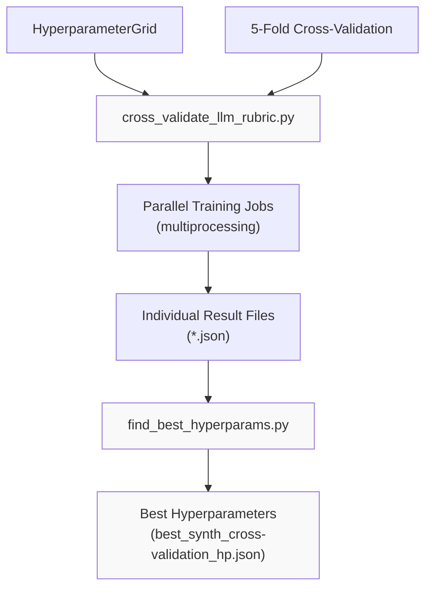
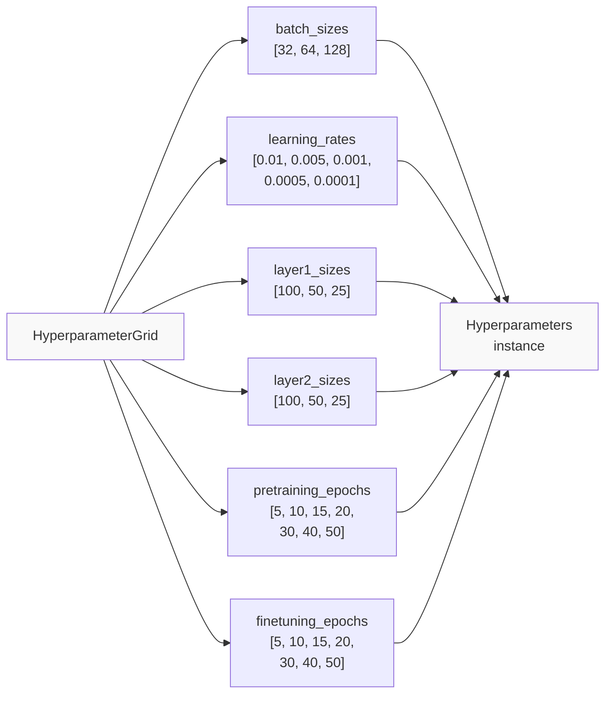
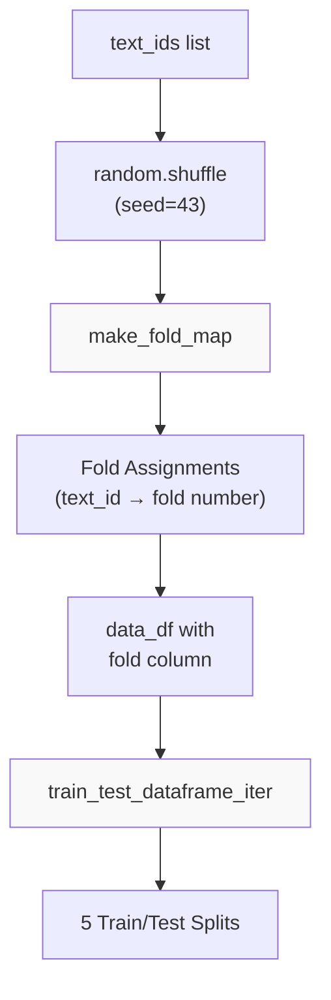
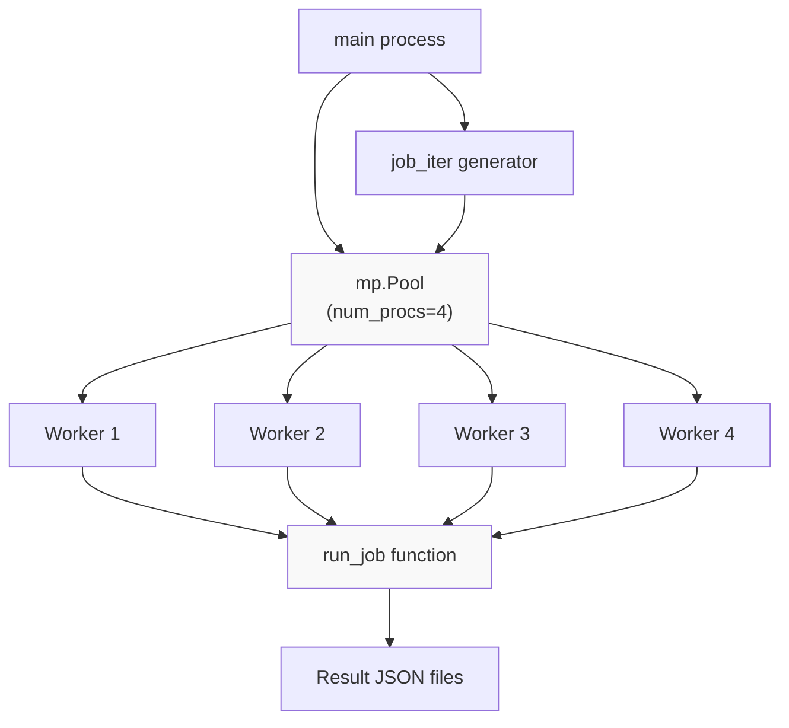
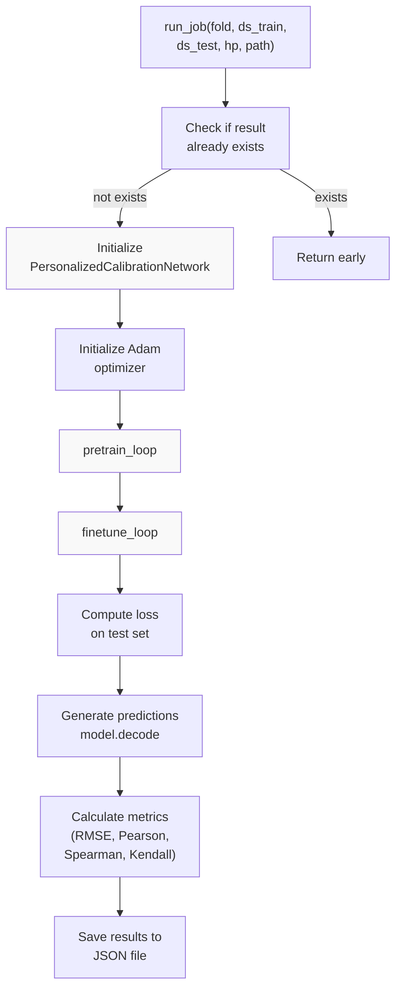
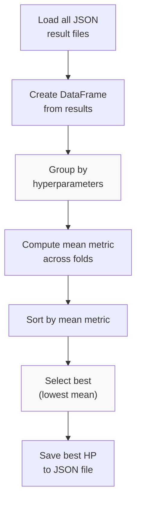

<!-- source: DeepWiki mcp.deepwiki.com · repo microsoft/LLM-Rubric · page 4.5 Hyperparameter Tuning · fetched 2026-10-26 -->

# Hyperparameter Tuning

<details>
<summary>Relevant source files</summary>

The following files were used as context for generating this wiki page:

- [README.md](README.md)
- [scripts/cross_validate_llm_rubric.py](scripts/cross_validate_llm_rubric.py)
- [scripts/find_best_hyperparams.py](scripts/find_best_hyperparams.py)
- [scripts/find_hyperparams_for_real_data_eval.sh](scripts/find_hyperparams_for_real_data_eval.sh)

</details>


## Purpose and Scope

This page describes the hyperparameter optimization process for the `PersonalizedCalibrationNetwork`. Hyperparameter tuning uses k-fold cross-validation on synthetic data to identify the optimal model configuration before training on real conversation data. The process explores combinations of network architecture parameters (layer sizes), training parameters (learning rate, batch size), and training duration (epoch counts) to maximize prediction quality.

For details on the model architecture and training process, see [Network Architecture](#6.1) and [Training Process](#6.2). For a complete reference of all hyperparameters, see [Hyperparameters Configuration](#6.3).

---

## Overview of the Hyperparameter Tuning Process

The hyperparameter optimization workflow consists of three main stages:

1. **Grid Search with Cross-Validation**: Train models with all hyperparameter combinations across multiple data folds
2. **Result Aggregation**: Collect and organize evaluation metrics from all training jobs
3. **Best Configuration Selection**: Identify the hyperparameter set with optimal average performance



**Workflow: Complete Hyperparameter Tuning Pipeline**

The system trains multiple model configurations in parallel, evaluates each on held-out test folds, and selects the configuration with the best average metric across folds.

Sources: [scripts/cross_validate_llm_rubric.py](), [scripts/find_best_hyperparams.py](), [scripts/find_hyperparams_for_real_data_eval.sh](), Diagram 4 from architecture overview

---

## Hyperparameter Search Space

The `HyperparameterGrid` class defines the search space as a Cartesian product of all hyperparameter values. Each combination generates a `Hyperparameters` instance for model training.

### Grid Configuration



**Diagram: HyperparameterGrid Structure and Output**

### Search Space Parameters

| Parameter | Values | Description |
|-----------|--------|-------------|
| `batch_size` | [32, 64, 128] | Number of samples per training batch |
| `learning_rate` | [0.01, 0.005, 0.001, 0.0005, 0.0001] | Adam optimizer learning rate |
| `layer1_size` | [100, 50, 25] | Hidden units in first layer |
| `layer2_size` | [100, 50, 25] | Hidden units in second layer |
| `pretraining_epochs` | [5, 10, 15, 20, 30, 40, 50] | Training iterations for pretraining phase |
| `finetuning_epochs` | [5, 10, 15, 20, 30, 40, 50] | Training iterations for finetuning phase |

The total number of hyperparameter combinations is computed as:
```
3 × 5 × 3 × 3 × 7 × 7 = 6,615 configurations
```

Each configuration is tested across 5 folds, resulting in 33,075 total training jobs.

### Fixed Parameters

The following parameters are determined by the dataset and do not vary during hyperparameter search:

| Parameter | Source | Description |
|-----------|--------|-------------|
| `input_size` | `len(input_criteria) × num_answers` | Typically 36 (9 criteria × 4 answers) |
| `output_size` | `len(output_criteria)` | Typically 9 (Q1-Q8, Q0) |
| `num_judges` | Derived from data | Number of unique human judges |
| `all_data_size` | Dataset size | Total number of training examples |

Sources: [scripts/cross_validate_llm_rubric.py:26-81](), [scripts/cross_validate_llm_rubric.py:170-177]()

---

## Cross-Validation Strategy

The system uses k-fold cross-validation to evaluate hyperparameter configurations on synthetic conversation data. This provides robust performance estimates by testing each configuration on multiple train-test splits.

### Fold Assignment Process



**Diagram: K-Fold Cross-Validation Setup**

### Implementation Details

The cross-validation process is implemented through the following steps:

1. **Data Loading**: Load synthetic conversation data with human judgments and machine evaluations
   - Text IDs: [scripts/cross_validate_llm_rubric.py:140]()
   - Human judgments: [scripts/cross_validate_llm_rubric.py:141-142]()
   - Machine evaluations: [scripts/cross_validate_llm_rubric.py:143-150]()

2. **Data Merging**: Combine human and machine data on `text_id` [scripts/cross_validate_llm_rubric.py:160]()

3. **Fold Assignment**: Randomly assign text IDs to folds using `make_fold_map` [scripts/cross_validate_llm_rubric.py:158]()

4. **Judge ID Mapping**: Convert judge names to integer IDs with `add_judge_ids` [scripts/cross_validate_llm_rubric.py:165]()

5. **Split Generation**: Create train/test dataframes for each fold with `train_test_dataframe_iter` [scripts/cross_validate_llm_rubric.py:168]()

6. **Dataset Creation**: Convert dataframes to model-ready tensors using `make_dataset` [scripts/cross_validate_llm_rubric.py:182-183]()

### Default Configuration

| Parameter | Value | Description |
|-----------|-------|-------------|
| `num_folds` | 5 | Number of cross-validation folds |
| `random_seed` | 43 | Random seed for reproducibility |

Sources: [scripts/cross_validate_llm_rubric.py:122-168](), [llm_rubric/kfold_utils.py]()

---

## Parallel Execution

To accelerate the hyperparameter search, the system executes training jobs in parallel using Python's `multiprocessing` module. Each worker process trains and evaluates a single model configuration on a single fold.

### Job Distribution Architecture



**Diagram: Parallel Training with Multiprocessing Pool**

### Job Execution Function

The `run_job` function [scripts/cross_validate_llm_rubric.py:85-119]() executes a single training job:



**Diagram: Single Job Execution Flow**

### Job Parameters

Each job is defined by a tuple containing:

| Component | Type | Description |
|-----------|------|-------------|
| `fold` | `int` | Fold number (0-4) |
| `ds_train` | `Dataset` | Training dataset for this fold |
| `ds_test` | `Dataset` | Test dataset for this fold |
| `hp` | `Hyperparameters` | Configuration to evaluate |
| `path` | `Path` | Output file path for results |

### Result File Naming

Result files are named using MD5 hashes of the fold and hyperparameter configuration to ensure uniqueness and idempotency:

```python
data_md5 = hashlib.md5(
    json.dumps((fold, dataclasses.asdict(hp)), sort_keys=True).encode("utf-8")
).hexdigest()
path = output_path / f"{data_md5}.json"
```

This allows interrupted runs to resume without recomputing completed jobs [scripts/cross_validate_llm_rubric.py:86-89]().

### Performance Considerations

- Default worker count: 4 processes [scripts/find_hyperparams_for_real_data_eval.sh:10]()
- Environment variable `OMP_NUM_THREADS=2` limits OpenMP threads per worker [scripts/find_hyperparams_for_real_data_eval.sh:2]()
- Total runtime depends on: number of configurations × training time per configuration / number of workers

Sources: [scripts/cross_validate_llm_rubric.py:85-199](), [scripts/find_hyperparams_for_real_data_eval.sh:1-2]()

---

## Evaluation Metrics and Selection

Each training job evaluates the model on the held-out test fold and records multiple metrics. The best hyperparameter configuration is selected based on the average performance across all folds.

### Recorded Metrics

The `run_job` function computes the following metrics for each configuration [scripts/cross_validate_llm_rubric.py:96-116]():

| Metric | Variable | Description |
|--------|----------|-------------|
| Log Loss | `log_loss_finetune` | Cross-entropy loss on test fold after finetuning |
| RMSE | `rmse` | Root mean squared error between predictions and ground truth |
| Pearson Correlation | `pearson` | Linear correlation coefficient |
| Spearman Correlation | `spearman` | Rank correlation coefficient |
| Kendall's Tau | `kendall` | Ordinal association measure |

### Result File Format

Each job produces a JSON file with the following structure:

```json
{
  "fold": 0,
  "hyperparameters": "{\"input_size\": 36, \"output_size\": 9, ...}",
  "pearson": 0.31304,
  "spearman": 0.36766,
  "kendall": 0.29084,
  "rmse": 0.91867,
  "log_loss_finetune": 1.23456,
  "finetune_target": "Q0"
}
```

### Best Hyperparameter Selection

The `find_best_hyperparams.py` script aggregates results and selects the optimal configuration:



**Diagram: Best Hyperparameter Selection Process**

### Selection Algorithm

1. **Load Results**: Read all JSON files from the hyperparameter directory [scripts/find_best_hyperparams.py:16-21]()

2. **Group by Configuration**: Group results by the `hyperparameters` field [scripts/find_best_hyperparams.py:23-28]()

3. **Calculate Means**: Compute mean metric value across all folds for each configuration [scripts/find_best_hyperparams.py:31]()

4. **Sort and Select**: Sort by mean metric (default: `log_loss_finetune`) and select the best [scripts/find_best_hyperparams.py:32-33]()

5. **Save Best**: Write the best hyperparameter configuration to output file [scripts/find_best_hyperparams.py:38-39]()

### Configurable Selection Metric

The selection metric can be customized via the `--metric` option:

```bash
python scripts/find_best_hyperparams.py \
  --hps experiments/real_data/synth_cross-validation_hps/ \
  --output experiments/real_data/best_synth_cross-validation_hp.json \
  --metric log_loss_finetune
```

Default metric: `log_loss_finetune` (lower is better)

Sources: [scripts/find_best_hyperparams.py](), [scripts/cross_validate_llm_rubric.py:96-116]()

---

## Running Hyperparameter Tuning

### Complete Workflow Script

The `find_hyperparams_for_real_data_eval.sh` script executes the full hyperparameter tuning pipeline:

```bash
# Step 1: Run cross-validation with grid search
python scripts/cross_validate_llm_rubric.py \
    --ids data/synth_data/synth_dialogue_ids.tsv \
    --human-judgments data/synth_data/human_judges_synth_all_FIXED_ANON.tsv \
    --machine-evaluations data/synth_data/gpt-3.5-turbo-16k_synth_evaluations_FIXED.tsv \
    --output-path experiments/real_data/synth_cross-validation_hps/ \
    --judge-column annotator_id \
    --num-procs 4

# Step 2: Find best hyperparameters from results
python scripts/find_best_hyperparams.py \
  --hps experiments/real_data/synth_cross-validation_hps/ \
  --output experiments/real_data/best_synth_cross-validation_hp.json
```

### Input Files

| Argument | File | Description |
|----------|------|-------------|
| `--ids` | `synth_dialogue_ids.tsv` | List of text IDs for cross-validation |
| `--human-judgments` | `human_judges_synth_all_FIXED_ANON.tsv` | Human annotations on synthetic data |
| `--machine-evaluations` | `gpt-3.5-turbo-16k_synth_evaluations_FIXED.tsv` | LLM probability distributions |

### Output Files

| File | Description |
|------|-------------|
| `synth_cross-validation_hps/*.json` | Individual results for each fold × hyperparameter combination |
| `best_synth_cross-validation_hp.json` | Best hyperparameter configuration (single JSON object) |

### Command-Line Options

The `cross_validate_llm_rubric.py` script accepts the following key options:

| Option | Default | Description |
|--------|---------|-------------|
| `--ids` | Required | Path to text ID file |
| `--human-judgments` | Required | Path to human judgment file |
| `--machine-evaluations` | Required | Path to machine evaluation file |
| `--output-path` | Required | Directory for result files |
| `--num-folds` | 5 | Number of cross-validation folds |
| `--judge-column` | `annotator_name` | Column name for judge identifiers |
| `--random-seed` | 43 | Random seed for reproducibility |
| `--num-procs` | 4 | Number of parallel worker processes |
| `--input-criteria` | `[Q1...Q8, Q0]` | Criteria to use as model inputs |
| `--output-criteria` | `[Q1...Q8, Q0]` | Criteria to predict as outputs |

Sources: [scripts/find_hyperparams_for_real_data_eval.sh](), [scripts/cross_validate_llm_rubric.py:122-138]()

---

## Understanding Results

### Console Output

During execution, the scripts provide progress information:

```
Loaded 2899 human judgments from data/synth_data/human_judges_synth_all_FIXED_ANON.tsv
Loaded 2007 machine evaluations from data/synth_data/gpt-3.5-turbo-16k_synth_evaluations_FIXED.tsv
Running 5-fold cross validation on the following ids: syn_1, syn_2, ...
Total rows: 223
```

Upon completion, `find_best_hyperparams.py` displays:

```
Best hyperparameters:
{
  "input_size": 36,
  "output_size": 9,
  "num_judges": 13,
  "batch_size": 64,
  "learning_rate": 0.001,
  "layer1_size": 25,
  "layer2_size": 25,
  "pretraining_epochs": 20,
  "finetuning_epochs": 30,
  ...
}
Metric mean log_loss_finetune: 1.23456
```

### Best Hyperparameters File

The output file `best_synth_cross-validation_hp.json` contains a single JSON object:

```json
{
  "input_size": 36,
  "output_size": 9,
  "num_judges": 13,
  "all_data_size": 223,
  "finetune_output": -1,
  "num_answers": 4,
  "batch_size": 64,
  "learning_rate": 0.001,
  "layer1_size": 25,
  "layer2_size": 25,
  "pretraining_epochs": 20,
  "finetuning_epochs": 30,
  "random_seed": 43
}
```

This file is used by `train_llm_rubric.py` for final model training on real conversation data [README.md:82-86]().

### Interpreting Results

The best hyperparameters typically exhibit the following characteristics:

- **Learning Rate**: Lower values (0.001 or 0.0005) often perform better, indicating the need for careful optimization
- **Layer Sizes**: Moderate sizes (25-50 units) balance expressiveness and overfitting risk
- **Training Duration**: More epochs generally improve performance until convergence
- **Batch Size**: Larger batches (64-128) provide more stable gradient estimates

The selected configuration represents the best trade-off between training time and prediction quality on synthetic data, which generalizes to real conversation evaluation.

Sources: [README.md:79-92](), [scripts/find_best_hyperparams.py:33-37]()

---

## Resuming Interrupted Runs

The hyperparameter tuning process is designed to be resumable. If the cross-validation job is interrupted:

1. Already completed result files remain in the output directory
2. The `run_job` function checks if a result file exists before training [scripts/cross_validate_llm_rubric.py:86-89]()
3. Re-running the script will skip completed jobs and only execute remaining configurations
4. Progress bar updates to show completed jobs

This idempotent design enables long-running hyperparameter searches to be executed across multiple sessions without wasting computation.

Sources: [scripts/cross_validate_llm_rubric.py:85-119]()

---

## Customizing the Search Space

To explore different hyperparameter ranges, modify the `HyperparameterGrid` initialization in `cross_validate_llm_rubric.py`:

```python
hp_grid = HyperparameterGrid(
    input_size=input_size,
    output_size=output_size,
    num_judges=num_judges,
    all_data_size=len(data_df),
    batch_sizes=[32, 64, 128],           # Customize these lists
    learning_rates=[0.01, 0.001],        # to modify search space
    layer1_sizes=[50, 25],
    layer2_sizes=[50, 25],
    pretraining_epochs=[10, 20, 30],
    finetuning_epochs=[20, 30, 40],
)
```

Reducing the number of values per hyperparameter significantly decreases the total number of configurations and runtime. For example, testing 2 values per parameter instead of 5-7 reduces the search space from 6,615 to 64 configurations.

Sources: [scripts/cross_validate_llm_rubric.py:172-177](), [scripts/cross_validate_llm_rubric.py:26-81]()

---

